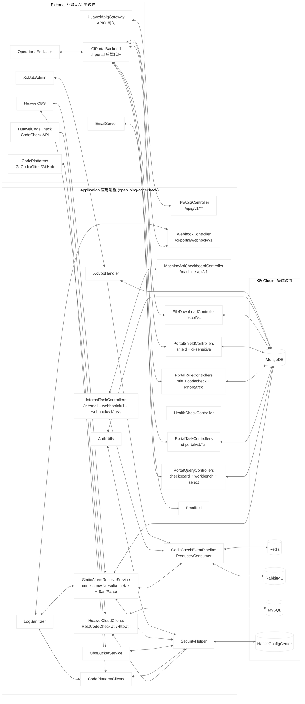

# openlibing-codecheck 安全威胁模型分析报告

> **分析对象**：`openlibing-codecheck`（openLiBing 平台代码检查服务）
> **分析方法**：STRIDE-A（STRIDE + Abuse）威胁建模，融合零信任与纵深防御视角
> **分析时间**：2026-10-10

## 0. 报告元数据

| 字段       | 值                                                          |
| ---------- | ----------------------------------------------------------- |
| Git 仓库   | `https://gitcode.com/openlibing/openlibing-codecheck.git`   |
| Git 分支   | `master`                                                    |
| Git Commit | `b107ad01`（提交时间 `2026-10-09 16:39:31 +0800`）          |
| 分析模型   | `DeepSeek-V4-Flash 正式版`                                  |
| 分析开始   | `2026-10-10 10:04 (+08:00)`                                 |
| 分析完成   | `2026-10-10 10:35 (+08:00)`                                 |
| 输出位置   | `openlibing-docs/architecture_desgin/openlibing-codecheck/` |

---

## 1. 执行摘要

openlibing-codecheck 是 openLiBing 研发工作流平台中的**代码检查微服务**。它编排华为云 CodeCheck 静态扫描（每日全量扫描 + PR 增量门禁检查）、接收 CICD 服务推送的静态告警 SARIF 结果并解析入库、管理规则集与问题屏蔽、向 CI 门户提供看板/汇总查询与 Excel 导出。服务为 Spring Boot 3.4.4（Java 21）单 K8s 工作负载（端口 8091，非 root 容器 + RASP agent），存在三类信任面：**集群内服务间端点**（`/internal/**`、`/ci-portal/webhook/**`、`/machine-api/**`）、**经 ci-portal 后端代理的门户端点**（`/ci-portal/**`）、**经华为云 APIG 网关转发的机机端点**（`/apig/v1/**`）。

本次分析识别 **20 个分析单元 / 25 个模型元素**，枚举 **58 条 STRIDE-A 威胁记录**，整合为 **19 个安全发现**。系统**无 Tier 1（无前置条件直接可利用）发现**：所有外部可达面均被上游边界（APIG 网关、ci-portal 后端代理、集群网络）拦挡。但风险**高度集中在鉴权与授权层**——应用几乎无代码内统一鉴权，且多处授权决策消费客户端下发的身份信息（`userId`），一旦集群内任一 Pod 被攻破或网关策略配置不当，即可实现身份冒充、越权触发扫描任务、SSRF、数据越权读取等。

**已核实的正向安全控制**：webhook 查询入口有字段/集合白名单（`WebhookInputValidator`）、多个门户写端点调用 `AuthUtils.checkPermission`、生产环境 Redis/RabbitMQ/MongoDB 使用 TLS、容器非 root 运行并带 RASP agent、启动参数含 `-Dfastjson.parser.safeMode=true`、`CommandArgSanitizer` 白名单覆盖命令执行面、Redisson 锁与 XXL-Job 白名单就位、`LogSanitizer` 与 log4j2 配置防 CRLF 注入。

> **威胁计数说明**：本分析枚举 58 条威胁记录（56 条具体威胁 + 2 条 N/A），其中 0 个可直接利用、53 个条件性风险、3 个纵深防御项。该数字反映 STRIDE-A 的全面覆盖，不代表系统整体不安全。

### 1.1 风险评级：**Elevated（偏高）**

风险定为"偏高"而非"严重"的原因：无 Tier 1 直接可利用发现，所有利用路径至少需要一个前置条件（集群内网络访问 T2 / 前置失陷或管理访问 T3）。但存在 1 个 Critical 与 10 个 Important 发现，一旦可达（如被攻破的兄弟 Pod、集群内恶意 actor、或 APIG 网关策略失配），可对扫描结果、缺陷数据、任务工作流形成完整读写能力——包括通过客户端下发的 `userId` 冒充任意平台用户（FIND-04）、触发任意扫描与解析（FIND-02/FIND-13）、服务端拉取任意 URL（FIND-05）。整体安全水位取决于**本仓库之外的边界控制**（网关鉴权、网络分段、Nacos ACL），无法仅从源码验证。

### 1.2 按 Tier 分布

| Tier     | 说明                                | 威胁数 | 发现数 | 优先级   |
| -------- | ----------------------------------- | ------ | ------ | -------- |
| Tier 1   | 直接可利用（无前置条件）            | 0      | 0      | 严重风险 |
| Tier 2   | 条件性风险（单一前置条件）          | 53     | 15     | 偏高风险 |
| Tier 3   | 纵深防御（多前置条件/基础设施访问） | 3      | 4      | 中等风险 |
| **合计** |                                     | **56** | **19** |          |

---

## 2. 架构概览

### 2.1 系统定位

openlibing-codecheck 承担代码质量检查业务：

- **任务编排**：接收门户/网关/内部触发，创建全量（daily）与增量（PR 门禁）扫描任务，经 XXL-Job 定时扫描 + RabbitMQ 事件队列异步执行，调用华为云 CodeCheck SDK 与 GitCode/Gitee/GitHub 平台 API。
- **结果接收与解析**：CICD 服务将扫描 SARIF 文件上传 OBS 后回调 `/codescan/v1/result/receive`，服务端下载解析（`StandardSarifParser` + 工具路由工厂）并写入 MongoDB 静态告警集合。
- **业务管理**：规则集管理、问题屏蔽（shield）、敏感词管理、忽略树、看板/工作台查询、Excel 导出。
- **权限体系**：门户端点写操作在 delegate 层调用 `AuthUtils.checkPermission`（菜单-角色-项目匹配）；机机端点依赖 APIG 网关与服务间信任。

### 2.2 部署分类

**部署分类：`K8S_SERVICE`（混合暴露）**

| 信任面         | 端点前缀                                                                   | 外部可达性            | 上游边界                      |
| -------------- | -------------------------------------------------------------------------- | --------------------- | ----------------------------- |
| 机机（M2M）    | `/apig/v1/**`                                                              | 经华为 APIG 网关对外  | APIG 网关（平台边界）         |
| 门户（Portal） | `/ci-portal/**`                                                            | 经 ci-portal 后端代理 | ci-portal 后端（代理+登录态） |
| 集群内         | `/internal/**`、`/machine-api/**`、`/ci-portal/webhook/**`、`/codescan/**` | 集群网络内            | 服务间信任（无代码鉴权）      |
| 健康检查       | `/health-check`                                                            | 集群内                | 无                            |

该分类决定了**前置条件下限**：任何威胁的前置条件不得低于所属组件的暴露底线（见 2.5 组件暴露表）。若后续移除网络分段（如端点暴露到更广网络），多个 Tier 2 发现将升级为 Tier 1。

### 2.3 技术栈

| 类别     | 技术                                                                                                |
| -------- | --------------------------------------------------------------------------------------------------- |
| 运行时   | Java 21 + Spring Boot 3.4.4（Web MVC）                                                              |
| 存储     | MongoDB（Spring Data MongoTemplate）、MySQL（MyBatis-Plus 配置中心数据源）、Redis（Redisson/Jedis） |
| 消息     | RabbitMQ（死信队列 + TTL 延迟机制）                                                                 |
| 调度     | XXL-Job（分布式任务调度）                                                                           |
| 配置中心 | 华为云 CSE Nacos（prod/beta/gama）、Apollo（icsl 遗留）                                             |
| 外部集成 | 华为云 CodeCheck SDK、华为云 OBS SDK、GitCode/Gitee/GitHub 平台 API、SMTP 邮件                      |
| 安全     | RASP agent（start.sh）、`-Dfastjson.parser.safeMode=true`、Log4j2 CRLF 转义、非 root 容器           |
| 质量门禁 | spotbugs-include.xml、pmd-rules.xml、checkstyle、pre-commit（gitleaks + detect-private-key）        |

### 2.4 信任边界

| 边界 ID       | 类型              | 说明                   | 包含元素                                                                                                                  |
| ------------- | ----------------- | ---------------------- | ------------------------------------------------------------------------------------------------------------------------- |
| `External`    | Internet/网关边界 | 互联网侧外部实体       | CiPortalBackend、HuaweiApigGateway、CodePlatforms、HuaweiCodeCheck、HuaweiOBS、XxlJobAdmin、EmailServer、Operator/EndUser |
| `K8sCluster`  | 集群边界          | 集群内中间件           | MongoDB、Redis、RabbitMQ、MySQL、NacosConfigCenter                                                                        |
| `Application` | 进程边界          | 应用进程（单 K8s Pod） | 全部 20 个分析单元（进程）                                                                                                |

---

## 3. 威胁模型 DFD

### 3.1 系统级 DFD

> 图例：`[...]` 进程 / `[(...)]` 数据存储 / `{...}` 边界。图中省略同一 Pod 内 localhost 隐式流与跨切面日志流细节（`LogSanitizer` 实际为全局 AOP 关注点）。

### 3.2 元素清单（25 个模型元素）

#### 进程（20 个分析单元，锚定真实类）

| ID                        | 类型 | 锚点类/文件                                                                                                                      | 职责                                                                                                                                    | 边界        |
| ------------------------- | ---- | -------------------------------------------------------------------------------------------------------------------------------- | --------------------------------------------------------------------------------------------------------------------------------------- | ----------- |
| ApiGatewayEntry           | 进程 | `business/controller/HwApigController.java`                                                                                      | `/apig/v1/**` 机机入口（4 端点），转发全量/增量任务触发与状态回传                                                                       | Application |
| WebhookController         | 进程 | `business/controller/WebhookController.java` + `WebhookDelegateImpl` + `WebhookInputValidator`                                   | `/ci-portal/webhook/codecheck/v1/find/by/mongoDB` 通用查询                                                                              | Application |
| InternalTaskControllers   | 进程 | `InternalController.java`、`InternalCodeFullController.java`、`InternalCodeIncController.java`、`SuppressionScanController.java` | `/internal/**`、`/ci-portal/webhook/codecheck/full/task`、`/ci-portal/webhook/codecheck/v1/task(+status)`、`/internal/suppression/scan` | Application |
| MachineApiControllers     | 进程 | `MachineApiCheckboardController.java`                                                                                            | `/machine-api/v1/**` 机机查询                                                                                                           | Application |
| PortalTaskControllers     | 进程 | `FulltaskController.java` + `FulltaskDelegateImpl`                                                                               | `/ci-portal/v1/full/**` 全量任务管理                                                                                                    | Application |
| PortalRuleControllers     | 进程 | `RuleController.java`、`RuleSetListController.java`、`IgnoretreeController.java`                                                 | 规则/规则集/忽略树管理                                                                                                                  | Application |
| PortalShieldControllers   | 进程 | `ProblemshieldController.java`、`SensitiveController.java`                                                                       | 问题屏蔽/审核、敏感词管理                                                                                                               | Application |
| PortalQueryControllers    | 进程 | `CheckboardController.java`、`WorkbenchController.java`、`SelectionController.java`                                              | 看板/工作台/下拉查询，含 `getTaskFileContents` 拉取代码平台文件                                                                         | Application |
| FileDownLoadController    | 进程 | `FileDownLoadController.java` + `FileDownloadDelegateImpl`                                                                       | `/ci-portal/excel/v1/**` Excel 导出与下载                                                                                               | Application |
| HealthCheckController     | 进程 | `HealthCheckController.java`                                                                                                     | `GET /health-check`                                                                                                                     | Application |
| StaticAlarmReceiveService | 进程 | `StaticAlarmReceiveController.java`、`SarifParseServiceImpl.java`、`StandardSarifParser.java`、`SarifParserFactory.java`         | `/codescan/v1/result/receive` 接收扫描结果，下载 OBS SARIF 并解析入库                                                                   | Application |
| AuthUtils                 | 进程 | `common/utils/codecheck/AuthUtils.java`                                                                                          | 门户端点菜单-角色-项目鉴权                                                                                                              | Application |
| SecurityHelper            | 进程 | `common/utils/security/SecurityHelper.java`、`FragmentCryptoUtil.java`、`TokenUtil.java`                                         | 凭据加解密、片段编码、门禁 token 生成                                                                                                   | Application |
| CodeCheckEventPipeline    | 进程 | `CodeCheckEventProducer.java`、`CodeCheckEventConsumer.java`、`CodeCheckEventRabbitConfig.java`                                  | 扫描事件入队/消费、死信与 TTL 处理                                                                                                      | Application |
| XxlJobHandler             | 进程 | `common/job/XxlJobHandler.java`                                                                                                  | 定时扫描 processing 任务并入队                                                                                                          | Application |
| CodePlatformClients       | 进程 | `common/codeplate/GitCodeHelper.java`、`GiteeHelper.java`、`GithubPlate.java`、`CodePlateHelper.java`                            | 代码平台 API 交互（PR 校验、文件读取、token 使用）                                                                                      | Application |
| HuaweiCloudClients        | 进程 | `RestCodeCheckUtil.java`、`HttpUtil.java`、`CompileCodeCheckUtil.java`、`HttpRequestUtil.java`                                   | 华为云 CodeCheck/编译检查 HTTP 客户端                                                                                                   | Application |
| ObsBucketService          | 进程 | `ObsBucketServiceImpl.java`                                                                                                      | OBS 对象上传/下载（含凭据解密）                                                                                                         | Application |
| EmailUtil                 | 进程 | `common/utils/email/EmailUtil.java`                                                                                              | 邮件通知（SMTP）                                                                                                                        | Application |
| LogSanitizer              | 进程 | `common/util/LogSanitizer.java` + log4j2 配置                                                                                    | 日志 CRLF 注入防护（跨切面）                                                                                                            | Application |

#### 数据存储（5）

| ID                | 类型              | 锚点                                                                    | 说明                                   | 边界       |
| ----------------- | ----------------- | ----------------------------------------------------------------------- | -------------------------------------- | ---------- |
| MongoDB           | NoSQL 数据存储    | `MongoConfig.java`                                                      | 主业务库（任务/结果/告警/屏蔽/敏感词） | K8sCluster |
| Redis             | 缓存/队列数据存储 | `RedisConfig.java`                                                      | 分布式锁、任务队列、限流计数           | K8sCluster |
| RabbitMQ          | 消息队列          | `RabbitConnectionFactoryConfig.java`、`CodeCheckEventRabbitConfig.java` | 扫描事件队列（TTL 24h + 死信）         | K8sCluster |
| MySQL             | SQL 数据存储      | `DataSourceConfig.java`                                                 | 配置中心业务库（菜单/角色/权限等）     | K8sCluster |
| NacosConfigCenter | 配置中心          | `application-prod.yaml` 等                                              | 全部敏感配置与 `security.part1` 密钥   | K8sCluster |

#### 外部实体（7 个外部服务 + 1 个外部角色）

| ID                | 类型     | 锚点（集成点）                              | 说明                                            |
| ----------------- | -------- | ------------------------------------------- | ----------------------------------------------- |
| HuaweiApigGateway | 外部服务 | `HwApigController` 类注释                   | APIG 网关，`/apig/v1/**` 唯一鉴权屏障           |
| CiPortalBackend   | 外部服务 | 门户端点调用方                              | ci-portal 后端代理，携带用户登录态转发 `userId` |
| CodePlatforms     | 外部服务 | `GitCodeHelper/GiteeHelper/GithubPlate`     | GitCode/Gitee/GitHub 平台 API                   |
| HuaweiCodeCheck   | 外部服务 | `RestCodeCheckUtil`                         | 华为云 CodeCheck 扫描 API                       |
| HuaweiOBS         | 外部服务 | `ObsBucketService`、`SarifParseServiceImpl` | 对象存储（SARIF 结果）                          |
| XxlJobAdmin       | 外部服务 | `XxlJobConfig`                              | XXL-Job 调度中心                                |
| EmailServer       | 外部服务 | `EmailUtil`                                 | SMTP 邮件服务器                                 |
| Operator/EndUser  | 外部角色 | 各门户端点                                  | 平台用户（威胁来源，不参与 STRIDE 目标分析）    |

### 3.3 数据流清单

| ID   | 流向                                                | 协议                    | 说明                                         |
| ---- | --------------------------------------------------- | ----------------------- | -------------------------------------------- |
| DF01 | HuaweiApigGateway <--> ApiGatewayEntry              | HTTPS                   | 机机任务触发/状态回传                        |
| DF02 | CiPortalBackend <--> Portal*Controllers             | HTTPS                   | 门户请求（含客户端 userId）                  |
| DF03 | CiPortalBackend <--> WebhookController              | HTTPS                   | 通用 Mongo 查询                              |
| DF04 | InternalTaskControllers <--> CodeCheckEventPipeline | 进程内/HTTP             | 任务事件入队                                 |
| DF05 | StaticAlarmReceiveService <--> HuaweiOBS            | HTTPS(无白名单)         | 服务端下载 SARIF（SSRF 面）                  |
| DF06 | StaticAlarmReceiveService <--> MongoDB              | TLS(主机名不校验)       | 告警结果入库                                 |
| DF07 | CodePlatformClients <--> CodePlatforms              | HTTPS                   | PR 校验、文件读取（token 入 URL）            |
| DF08 | HuaweiCloudClients <--> HuaweiCodeCheck             | HTTPS                   | 扫描任务创建/轮询                            |
| DF09 | XxlJobHandler <--> XxlJobAdmin                      | HTTP(S)                 | 执行器注册/调度                              |
| DF10 | CodeCheckEventPipeline <--> RabbitMQ                | TLS(仅 prod)/明文(其余) | 事件消息（无签名）                           |
| DF11 | CodeCheckEventPipeline <--> Redis                   | TLS                     | 锁与队列                                     |
| DF12 | 各进程 <--> MongoDB                                 | TLS(主机名不校验)       | 业务读写                                     |
| DF13 | AuthUtils <--> MongoDB/MySQL                        | TLS                     | 权限元数据查询                               |
| DF14 | SecurityHelper <--> NacosConfigCenter               | HTTP(S)                 | 密钥与密文配置拉取                           |
| DF15 | EmailUtil <--> EmailServer                          | SMTP(无强制 STARTTLS)   | 邮件通知                                     |
| DF16 | PortalQueryControllers <--> CodePlatforms           | HTTPS                   | `getTaskFileContents` 按 repoUrl+path 拉文件 |

### 3.4 组件暴露表（前置条件下限，单一事实源）

| 组件                                                                                        | 监听地址    | 鉴权屏障                    | 外部可达           | 最小前置条件                     | 派生 Tier |
| ------------------------------------------------------------------------------------------- | ----------- | --------------------------- | ------------------ | -------------------------------- | --------- |
| ApiGatewayEntry                                                                             | 集群内 8091 | APIG 网关                   | 是（经网关）       | `Authenticated User`（网关）     | T2        |
| WebhookController                                                                           | 集群内 8091 | 无（依赖网关）              | 是（经 ci-portal） | `Internal Network`               | T2        |
| InternalTaskControllers                                                                     | 集群内 8091 | 无                          | 否                 | `Internal Network`               | T2        |
| MachineApiControllers                                                                       | 集群内 8091 | 无                          | 否                 | `Internal Network`               | T2        |
| PortalTaskControllers                                                                       | 集群内 8091 | delegate 层 checkPermission | 是（经 ci-portal） | `Authenticated User`             | T2        |
| PortalRuleControllers                                                                       | 集群内 8091 | delegate 层 checkPermission | 是（经 ci-portal） | `Authenticated User`             | T2        |
| PortalShieldControllers                                                                     | 集群内 8091 | 无（部分业务过滤）          | 是（经 ci-portal） | `Authenticated User`             | T2        |
| PortalQueryControllers                                                                      | 集群内 8091 | 无                          | 是（经 ci-portal） | `Authenticated User`             | T2        |
| FileDownLoadController                                                                      | 集群内 8091 | 部分 checkPermission        | 是（经 ci-portal） | `Authenticated User`             | T2        |
| HealthCheckController                                                                       | 集群内 8091 | 无                          | 否                 | `Internal Network`               | T2        |
| StaticAlarmReceiveService                                                                   | 集群内 8091 | 无                          | 否（CICD 调用）    | `Internal Network`               | T2        |
| SecurityHelper/CodePlatformClients/HuaweiCloudClients/ObSBucketService/EmailUtil 等内部组件 | 无监听      | —                           | 否                 | `Host/OS Access` / `{组件} 失陷` | T3        |

---

## 4. STRIDE-A 分析

### 4.1 STRIDE-A 汇总表

**威胁总览：58 条记录（56 条具体威胁 + 2 条 N/A），按 Tier 分布 T1=0 / T2=53 / T3=3**

| 分析单元                  | S     | T      | R     | I      | D     | E      | A     | 小计   | T1    | T2     | T3    |
| ------------------------- | ----- | ------ | ----- | ------ | ----- | ------ | ----- | ------ | ----- | ------ | ----- |
| ApiGatewayEntry           | 1     | 0      | 0     | 1      | 1     | 0      | 1     | 4      | 0     | 4      | 0     |
| WebhookController         | 0     | 0      | 0     | 1      | 0     | 1      | 1     | 3      | 0     | 3      | 0     |
| InternalTaskControllers   | 0     | 0      | 0     | 2      | 1     | 1      | 1     | 5      | 0     | 5      | 0     |
| MachineApiControllers     | 0     | 0      | 0     | 0      | 0     | 1      | 0     | 1      | 0     | 1      | 0     |
| PortalTaskControllers     | 0     | 0      | 0     | 0      | 0     | 1      | 1     | 2      | 0     | 2      | 0     |
| PortalRuleControllers     | 0     | 0      | 0     | 1      | 0     | 1      | 0     | 2      | 0     | 2      | 0     |
| PortalShieldControllers   | 0     | 0      | 0     | 0      | 0     | 1      | 1     | 2      | 0     | 2      | 0     |
| PortalQueryControllers    | 0     | 0      | 0     | 1      | 0     | 0      | 1     | 2      | 0     | 2      | 0     |
| FileDownLoadController    | 0     | 1      | 0     | 0      | 0     | 1      | 0     | 2      | 0     | 2      | 0     |
| HealthCheckController     | 0     | 0      | 0     | 0      | 1     | 0      | 0     | 1      | 0     | 1      | 0     |
| StaticAlarmReceiveService | 1     | 1      | 0     | 1      | 1     | 0      | 0     | 4      | 0     | 4      | 0     |
| AuthUtils                 | 0     | 0      | 0     | 0      | 0     | 2      | 0     | 2      | 0     | 2      | 0     |
| SecurityHelper            | 0     | 2      | 0     | 1      | 0     | 0      | 0     | 3      | 0     | 2      | 1     |
| CodeCheckEventPipeline    | 1     | 1      | 0     | 0      | 1     | 0      | 0     | 3      | 0     | 3      | 0     |
| XxlJobHandler             | 1     | 1      | 0     | 0      | 0     | 0      | 0     | 2      | 0     | 2      | 0     |
| CodePlatformClients       | 0     | 0      | 0     | 2      | 0     | 0      | 0     | 2      | 0     | 2      | 0     |
| HuaweiCloudClients        | 0     | 2      | 0     | 1      | 0     | 0      | 0     | 3      | 0     | 3      | 0     |
| ObsBucketService          | 0     | 1      | 0     | 0      | 0     | 0      | 0     | 1      | 0     | 1      | 0     |
| EmailUtil                 | 0     | 1      | 0     | 0      | 0     | 0      | 0     | 1      | 0     | 1      | 0     |
| LogSanitizer              | 0     | 1      | 0     | 1      | 0     | 0      | 0     | 2      | 0     | 2      | 0     |
| MongoDB                   | 0     | 1      | 0     | 1      | 0     | 0      | 0     | 2      | 0     | 2      | 0     |
| Redis                     | 0     | 0      | 0     | 1      | 0     | 0      | 0     | 1      | 0     | 1      | 0     |
| RabbitMQ                  | 0     | 0      | 0     | 1      | 0     | 0      | 0     | 1      | 0     | 1      | 0     |
| NacosConfigCenter         | 0     | 1      | 0     | 1      | 0     | 0      | 0     | 2      | 0     | 1      | 1     |
| MySQL                     | 0     | 0      | 0     | 1      | 0     | 0      | 0     | 1      | 0     | 1      | 0     |
| CiPortalBackend           | 0     | 0      | 0     | 0      | 0     | 1      | 0     | 1      | 0     | 1      | 0     |
| HuaweiApigGateway         | 1     | 0      | 0     | 0      | 0     | 0      | 0     | 1      | 0     | 0      | 1     |
| **合计**                  | **5** | **13** | **0** | **17** | **5** | **10** | **6** | **56** | **0** | **53** | **3** |

> 计数口径：仅统计具体威胁行（N/A 行不计入）。S=欺骗、T=篡改、R=抵赖、I=信息泄露、D=拒绝服务、E=提权、A=滥用（业务逻辑滥用）。

### 4.2 各分析单元 STRIDE-A 明细

#### 4.2.1 ApiGatewayEntry（锚点：`HwApigController.java`）

| ID  | 类别 | 威胁                                                                                                                                                                                                                                  | 前置条件             | Tier | 状态 |
| --- | ---- | ------------------------------------------------------------------------------------------------------------------------------------------------------------------------------------------------------------------------------------- | -------------------- | ---- | ---- |
| T01 | S    | APIG 网关 AppCode/凭据泄露或被旁路后可冒用机机调用方身份触发任务                                                                                                                                                                      | `Authenticated User` | T2   | Open |
| T02 | I    | 4 个 APIG 端点 `logger.info("...params={}", params)` 全量打印请求体（[HwApigController.java:72/94/113/135](src/main/java/com/openlibing/codecheck/business/controller/HwApigController.java)），上游若在 params 中携带 token 即入日志 | `Internal Network`   | T2   | Open |
| T03 | A    | 客户端可控 `prUrl/repoUrl` 仅非空校验（[HwApigController.java:96/137](src/main/java/com/openlibing/codecheck/business/controller/HwApigController.java)），可触发任意仓库扫描，消耗 CodeCheck 配额                                    | `Authenticated User` | T2   | Open |
| T04 | D    | 网关后无代码级速率限制，机机端点可被高频调用消耗计算资源                                                                                                                                                                              | `Authenticated User` | T2   | Open |

#### 4.2.2 WebhookController（锚点：`WebhookController.java` + `WebhookInputValidator.java`）

| ID  | 类别 | 威胁                                                                                                                                                                                                                             | 前置条件           | Tier | 状态                        |
| --- | ---- | -------------------------------------------------------------------------------------------------------------------------------------------------------------------------------------------------------------------------------- | ------------------ | ---- | --------------------------- |
| T05 | I    | `/ci-portal/webhook/codecheck/v1/find/by/mongoDB` 暴露白名单内 17 个集合的任意查询读取（任务、结果、屏蔽、告警等），无身份校验                                                                                                   | `Internal Network` | T2   | Open                        |
| T06 | E    | NoSQL 注入/跨集合访问（$ne/$regex/$where 等）已由 `WebhookInputValidator` 表名/字段名/值类型白名单缓解（[WebhookInputValidator.java:37-141](src/main/java/com/openlibing/codecheck/common/security/WebhookInputValidator.java)） | `Internal Network` | T2   | ✅ 已缓解（代码内既有控制） |
| T07 | A    | 无身份校验的查询滥用（批量枚举、数据爬取、撞库查询）                                                                                                                                                                             | `Internal Network` | T2   | Open                        |

#### 4.2.3 InternalTaskControllers（锚点：`InternalController.java` / `InternalCodeFullController.java` / `InternalCodeIncController.java` / `SuppressionScanController.java`）

| ID  | 类别 | 威胁                                                                                                                                                                                                                                                                                                                                        | 前置条件           | Tier | 状态 |
| --- | ---- | ------------------------------------------------------------------------------------------------------------------------------------------------------------------------------------------------------------------------------------------------------------------------------------------------------------------------------------------- | ------------------ | ---- | ---- |
| T08 | E    | 集群内任意 Pod 可无鉴权触发任务：`GET /internal/full/invoke/task`（[InternalController.java:84](src/main/java/com/openlibing/codecheck/business/controller/InternalController.java)）、`POST /ci-portal/webhook/codecheck/full/task`、`POST /ci-portal/webhook/codecheck/v1/task`，全部无代码内鉴权（服务间信任）                           | `Internal Network` | T2   | Open |
| T09 | A    | 伪造 `prUrl/repoUrl` 触发任意仓库扫描（配额消耗、数据污染），仅非空校验（[InternalCodeFullController.java:51](src/main/java/com/openlibing/codecheck/business/controller/InternalCodeFullController.java)、[InternalCodeIncController.java:65](src/main/java/com/openlibing/codecheck/business/controller/InternalCodeIncController.java)） | `Internal Network` | T2   | Open |
| T10 | I    | 内部任务控制器整包入参打日志（[InternalCodeFullController.java:49](src/main/java/com/openlibing/codecheck/business/controller/InternalCodeFullController.java)、[InternalCodeIncController.java:63](src/main/java/com/openlibing/codecheck/business/controller/InternalCodeIncController.java)）                                            | `Internal Network` | T2   | Open |
| T11 | D    | 高频触发任务（无速率限制）导致 MQ/MongoDB/CodeCheck 资源耗尽                                                                                                                                                                                                                                                                                | `Internal Network` | T2   | Open |
| T12 | I    | `SuppressionScanController` 异常信息回显给调用方（[SuppressionScanController.java:43](src/main/java/com/openlibing/codecheck/business/controller/SuppressionScanController.java)）                                                                                                                                                          | `Internal Network` | T2   | Open |

#### 4.2.4 MachineApiControllers（锚点：`MachineApiCheckboardController.java`）

| ID  | 类别 | 威胁                                                                                                                                                                                                      | 前置条件           | Tier | 状态 |
| --- | ---- | --------------------------------------------------------------------------------------------------------------------------------------------------------------------------------------------------------- | ------------------ | ---- | ---- |
| T13 | E    | `/machine-api/v1/**` 无鉴权机机端点可查询全量扫描结果/记录（[MachineApiCheckboardController.java:49/69](src/main/java/com/openlibing/codecheck/business/controller/MachineApiCheckboardController.java)） | `Internal Network` | T2   | Open |

#### 4.2.5 PortalTaskControllers（锚点：`FulltaskController.java`）

| ID  | 类别 | 威胁                                                                                                                                                                                                                              | 前置条件             | Tier | 状态 |
| --- | ---- | --------------------------------------------------------------------------------------------------------------------------------------------------------------------------------------------------------------------------------- | -------------------- | ---- | ---- |
| T14 | E    | `userId` 来自客户端 `@RequestParam`（[FulltaskController.java:38/70/84](src/main/java/com/openlibing/codecheck/business/controller/FulltaskController.java)），`checkPermission` 以该 userId 校验 → 伪造他人身份越权执行/删除任务 | `Authenticated User` | T2   | Open |
| T15 | A    | `perform/task` 与 `termination/task` 权限校验完全依赖客户端 userId，可冒用管理员操作                                                                                                                                              | `Authenticated User` | T2   | Open |

#### 4.2.6 PortalRuleControllers（锚点：`RuleController.java` / `RuleSetListController.java` / `IgnoretreeController.java`）

| ID  | 类别 | 威胁                                                                                                                                                                                                            | 前置条件             | Tier | 状态 |
| --- | ---- | --------------------------------------------------------------------------------------------------------------------------------------------------------------------------------------------------------------- | -------------------- | ---- | ---- |
| T16 | E    | 规则/规则集/忽略树写操作 `checkPermission` 均基于客户端 userId（[RuleController.java:45](src/main/java/com/openlibing/codecheck/business/controller/RuleController.java) 等），userId 可伪造 → 规则集越权增删改 | `Authenticated User` | T2   | Open |
| T17 | I    | `IgnoretreeController` `currentPath` 客户端可控（[IgnoretreeController.java:39](src/main/java/com/openlibing/codecheck/business/controller/IgnoretreeController.java)），可探测路径/目录结构信息                | `Authenticated User` | T2   | Open |

#### 4.2.7 PortalShieldControllers（锚点：`ProblemshieldController.java` / `SensitiveController.java`）

| ID  | 类别 | 威胁                                                                                                                                                                                                                                                                                                                                                                                         | 前置条件             | Tier | 状态 |
| --- | ---- | -------------------------------------------------------------------------------------------------------------------------------------------------------------------------------------------------------------------------------------------------------------------------------------------------------------------------------------------------------------------------------------------- | -------------------- | ---- | ---- |
| T18 | E    | 问题屏蔽/敏感词全部操作（增删改查/审核/转审/撤销）的 `userId/userName` 均来自客户端（[ProblemshieldController.java:43-178](src/main/java/com/openlibing/codecheck/business/controller/ProblemshieldController.java)、[SensitiveController.java:43-218](src/main/java/com/openlibing/codecheck/business/controller/SensitiveController.java)），无服务端身份注入 → 越权审核/撤销/篡改屏蔽记录 | `Authenticated User` | T2   | Open |
| T19 | A    | `AuthUtils.authByShieldFoss` 审核人判定基于客户端 `userId/userType`（[AuthUtils.java:242-295](src/main/java/com/openlibing/codecheck/common/utils/codecheck/AuthUtils.java)），可伪造审核人身份                                                                                                                                                                                              | `Authenticated User` | T2   | Open |

#### 4.2.8 PortalQueryControllers（锚点：`CheckboardController.java` / `WorkbenchController.java` / `SelectionController.java`）

| ID  | 类别 | 威胁                                                                                                                                                                                                                              | 前置条件             | Tier | 状态 |
| --- | ---- | --------------------------------------------------------------------------------------------------------------------------------------------------------------------------------------------------------------------------------- | -------------------- | ---- | ---- |
| T20 | I    | 看板/工作台/下拉查询端点无代码内鉴权（[CheckboardController.java:46-251](src/main/java/com/openlibing/codecheck/business/controller/CheckboardController.java)），经 ci-portal 可达即可越权读取跨项目数据                         | `Authenticated User` | T2   | Open |
| T21 | A    | `getTaskFileContents` 按客户端 `repoUrl+path` 拉取代码平台文件（[CheckboardDelegateImpl.java:706-732](src/main/java/com/openlibing/codecheck/business/impl/CheckboardDelegateImpl.java)）→ 服务端请求伪造（SSRF 面）/任意文件读取 | `Authenticated User` | T2   | Open |

#### 4.2.9 FileDownLoadController（锚点：`FileDownLoadController.java`）

| ID  | 类别 | 威胁                                                                                                                                                                                                 | 前置条件             | Tier | 状态 |
| --- | ---- | ---------------------------------------------------------------------------------------------------------------------------------------------------------------------------------------------------- | -------------------- | ---- | ---- |
| T22 | E    | `download/log` 与多数导出端点无 `checkPermission`（[FileDownLoadController.java:184-193](src/main/java/com/openlibing/codecheck/business/controller/FileDownLoadController.java)）→ 越权导出敏感数据 | `Authenticated User` | T2   | Open |
| T23 | T    | `tableName` 直接拼接导出文件名（[FileDownLoadController.java:109](src/main/java/com/openlibing/codecheck/business/controller/FileDownLoadController.java)）→ 文件名注入/路径遍历                     | `Authenticated User` | T2   | Open |

#### 4.2.10 HealthCheckController（锚点：`HealthCheckController.java`）

| ID  | 类别 | 威胁                                                                                                    | 前置条件           | Tier | 状态 |
| --- | ---- | ------------------------------------------------------------------------------------------------------- | ------------------ | ---- | ---- |
| T24 | —    | 健康检查仅返回 "ok"，无敏感信息泄露（N/A）                                                              | —                  | —    | N/A  |
| T25 | D    | 容器无 `HEALTHCHECK` 指令（Dockerfile 未定义），依赖外部轮询与 monitor.sh（5 分钟窗口）→ 异常态检测滞后 | `Internal Network` | T2   | Open |

#### 4.2.11 StaticAlarmReceiveService（锚点：`StaticAlarmReceiveController.java` / `SarifParseServiceImpl.java`）

| ID  | 类别 | 威胁                                                                                                                                                                                                                                                                   | 前置条件           | Tier | 状态 |
| --- | ---- | ---------------------------------------------------------------------------------------------------------------------------------------------------------------------------------------------------------------------------------------------------------------------- | ------------------ | ---- | ---- |
| T26 | I    | **SSRF**：`URI.create(obsUrl).toURL().openStream()` 服务端直接拉取客户端/上游提供的 URL（[SarifParseServiceImpl.java:159-161](src/main/java/com/openlibing/codecheck/business/service/impl/alarm/SarifParseServiceImpl.java)），无协议/域名白名单 → 可拉取任意内网地址 | `Internal Network` | T2   | Open |
| T27 | D    | 无界下载/解析：`obsUrls` 数量、单文件大小、SARIF runs/results 深度均无上限（[SarifParseServiceImpl.java:100-123](src/main/java/com/openlibing/codecheck/business/service/impl/alarm/SarifParseServiceImpl.java)）→ 内存/带宽耗尽                                       | `Internal Network` | T2   | Open |
| T28 | T    | SARIF 无签名/HMAC 完整性校验 → 篡改结果注入伪造告警（[SarifParseServiceImpl.java:159](src/main/java/com/openlibing/codecheck/business/service/impl/alarm/SarifParseServiceImpl.java)）                                                                                 | `Internal Network` | T2   | Open |
| T29 | S    | `/codescan/v1/result/receive` 无鉴权（[StaticAlarmReceiveController.java:37-40](src/main/java/com/openlibing/codecheck/business/controller/alarm/StaticAlarmReceiveController.java)）→ 集群内可伪造扫描结果提交                                                        | `Internal Network` | T2   | Open |

#### 4.2.12 AuthUtils（锚点：`AuthUtils.java`）

| ID  | 类别 | 威胁                                                                                                                                                                                                                                             | 前置条件             | Tier | 状态 |
| --- | ---- | ------------------------------------------------------------------------------------------------------------------------------------------------------------------------------------------------------------------------------------------------ | -------------------- | ---- | ---- |
| T30 | E    | **核心授权缺陷**：`checkPermission(url, projectId, userId)` 决策消费客户端传入的 `userId`（[AuthUtils.java:349-389](src/main/java/com/openlibing/codecheck/common/utils/codecheck/AuthUtils.java)），无服务端会话/令牌绑定 → 任意身份冒充        | `Authenticated User` | T2   | Open |
| T31 | E    | `checkPermission` 依赖 url→菜单映射；未配置菜单的 URL 直接跳过循环返回 false（[AuthUtils.java:351-355](src/main/java/com/openlibing/codecheck/common/utils/codecheck/AuthUtils.java)），且 `general_config` 菜单直接放行——菜单配置缺漏时校验失效 | `Authenticated User` | T2   | Open |

#### 4.2.13 SecurityHelper（锚点：`SecurityHelper.java` / `FragmentCryptoUtil.java` / `TokenUtil.java`）

| ID  | 类别 | 威胁                                                                                                                                                                                                                           | 前置条件               | Tier | 状态 |
| --- | ---- | ------------------------------------------------------------------------------------------------------------------------------------------------------------------------------------------------------------------------------ | ---------------------- | ---- | ---- |
| T32 | I    | 单一静态密钥 `security.part1` 集中存储于配置中心（[SecurityHelper.java:25](src/main/java/com/openlibing/codecheck/common/utils/security/SecurityHelper.java)），41 处解密调用点共用 → 配置中心被攻破即全部凭据失效，轮换需重启 | `Host/OS Access`       | T3   | Open |
| T33 | T    | `FragmentCryptoUtil` 对含密钥代码片段仅 **Base64 编码**（可逆伪加密，[FragmentCryptoUtil.java:115](src/main/java/com/openlibing/codecheck/common/utils/security/FragmentCryptoUtil.java)）                                     | `Local Process Access` | T2   | Open |
| T34 | T    | `TokenUtil` 以 **MD5(uuid+number)** 生成门禁 token（[TokenUtil.java:50-53](src/main/java/com/openlibing/codecheck/common/utils/common/TokenUtil.java)）→ 弱哈希/可预测                                                         | `Local Process Access` | T2   | Open |

#### 4.2.14 CodeCheckEventPipeline（锚点：`CodeCheckEventProducer.java` / `CodeCheckEventConsumer.java` / `CodeCheckEventRabbitConfig.java`）

| ID  | 类别 | 威胁                                                                                | 前置条件           | Tier | 状态 |
| --- | ---- | ----------------------------------------------------------------------------------- | ------------------ | ---- | ---- |
| T35 | T    | MQ 消息无签名/无加密（仅传 taskId，但可被篡改指向任意任务）→ 集群内篡改伪造扫描事件 | `Internal Network` | T2   | Open |
| T36 | S    | RabbitMQ 凭据以密文入厂但 broker 内明文，集群内具备 MQ 访问权限者可窃取/冒用        | `Internal Network` | T2   | Open |
| T37 | D    | 消费者并发 5 无任务级资源上限（仅 `PROJECT_LIMIT_*` 限流兜底）→ 大量任务挤压资源    | `Internal Network` | T2   | Open |

#### 4.2.15 XxlJobHandler（锚点：`XxlJobHandler.java` / `XxlJobConfig.java`）

| ID  | 类别 | 威胁                                                                                                                                                                                         | 前置条件           | Tier | 状态                        |
| --- | ---- | -------------------------------------------------------------------------------------------------------------------------------------------------------------------------------------------- | ------------------ | ---- | --------------------------- |
| T38 | S    | XXL-Job `accessToken` 未解密直接使用（[XxlJobConfig.java:27-28](src/main/java/com/openlibing/codecheck/common/config/XxlJobConfig.java)），强度/轮换不可从源码验证                           | `Internal Network` | T2   | Open                        |
| T39 | T    | `jobParam` 白名单（`CommandArgSanitizer`）已覆盖（[XxlJobHandler.java:97-103](src/main/java/com/openlibing/codecheck/common/job/XxlJobHandler.java)），超时值限幅 231-232 → 命令注入面已缓解 | `Internal Network` | T2   | ✅ 已缓解（代码内既有控制） |

#### 4.2.16 CodePlatformClients（锚点：`GitCodeHelper.java` / `GiteeHelper.java` / `GithubPlate.java`）

| ID  | 类别 | 威胁                                                                                                                                                                                                     | 前置条件               | Tier | 状态 |
| --- | ---- | -------------------------------------------------------------------------------------------------------------------------------------------------------------------------------------------------------- | ---------------------- | ---- | ---- |
| T40 | I    | Gitee 将明文 `access_token` 拼入 URL 查询串（`?access_token=`，[GiteeHelper.java:71/147](src/main/java/com/openlibing/codecheck/common/codeplate/GiteeHelper.java)）→ 被代理/访问日志/浏览器历史记录收集 | `Local Process Access` | T2   | Open |
| T41 | I    | 平台 token 解密后明文放入请求体（[ExternalcheckDelegateImpl.java:145-147](src/main/java/com/openlibing/codecheck/business/impl/ExternalcheckDelegateImpl.java)），错误路径存在进日志风险                 | `Local Process Access` | T2   | Open |

#### 4.2.17 HuaweiCloudClients（锚点：`RestCodeCheckUtil.java` / `HttpUtil.java` / `HttpRequestUtil.java`）

| ID  | 类别 | 威胁                                                                                                                                                                                                                                                                                      | 前置条件               | Tier | 状态 |
| --- | ---- | ----------------------------------------------------------------------------------------------------------------------------------------------------------------------------------------------------------------------------------------------------------------------------------------- | ---------------------- | ---- | ---- |
| T42 | I    | 错误日志打印整个 `Request` 对象（含解密后 AK/SK/accessToken，[RestCodeCheckUtil.java:168/210/844](src/main/java/com/openlibing/codecheck/common/utils/codecheck/RestCodeCheckUtil.java)）→ 凭据泄露                                                                                       | `Local Process Access` | T2   | Open |
| T43 | T    | Feign 客户端 name 含 https 前缀（[OpenlibingFrameworkClient.java:24](src/main/java/com/openlibing/codecheck/business/operation/common/OpenlibingFrameworkClient.java)），无 mTLS，依赖服务端 TLS 配置                                                                                     | `Internal Network`     | T2   | Open |
| T44 | T    | RestTemplate（[RestTemplateConfig.java:28](src/main/java/com/openlibing/codecheck/common/config/RestTemplateConfig.java)）与 OkHttp（[HttpRequestUtil.java:45-50](src/main/java/com/openlibing/codecheck/common/utils/http/HttpRequestUtil.java)）使用默认 TrustManager，未自定义证书校验 | `Internal Network`     | T2   | Open |

#### 4.2.18 ObsBucketService（锚点：`ObsBucketServiceImpl.java`）

| ID  | 类别 | 威胁                                                                                                                                                                                 | 前置条件               | Tier | 状态 |
| --- | ---- | ------------------------------------------------------------------------------------------------------------------------------------------------------------------------------------ | ---------------------- | ---- | ---- |
| T45 | T    | OBS 上传对象 key 无白名单/路径约束（[ObsBucketServiceImpl.java:164-165](src/main/java/com/openlibing/codecheck/business/service/impl/ObsBucketServiceImpl.java)）→ 越权覆盖/越界对象 | `Local Process Access` | T2   | Open |

#### 4.2.19 EmailUtil（锚点：`EmailUtil.java`）

| ID  | 类别 | 威胁                                                                                                                                                              | 前置条件           | Tier | 状态 |
| --- | ---- | ----------------------------------------------------------------------------------------------------------------------------------------------------------------- | ------------------ | ---- | ---- |
| T46 | T    | SMTP 未强制 STARTTLS（[EmailUtil.java:84](src/main/java/com/openlibing/codecheck/common/utils/email/EmailUtil.java)），依赖邮件服务器策略 → 明文凭据/内容传输风险 | `Internal Network` | T2   | Open |
| T47 | —    | SMTP 密码不打日志，存储来源为 DB/配置（N/A，已核实）                                                                                                              | —                  | —    | N/A  |

#### 4.2.20 LogSanitizer（锚点：`LogSanitizer.java` + log4j2 配置）

| ID  | 类别 | 威胁                                                                                                                                                                          | 前置条件               | Tier | 状态                        |
| --- | ---- | ----------------------------------------------------------------------------------------------------------------------------------------------------------------------------- | ---------------------- | ---- | --------------------------- |
| T48 | T    | 日志 CRLF 注入已由 `LogSanitizer`（[LogSanitizer.java:18-22](src/main/java/com/openlibing/codecheck/common/util/LogSanitizer.java)）+ log4j2 `%msg` 转义缓解                  | `Local Process Access` | T2   | ✅ 已缓解（代码内既有控制） |
| T49 | I    | 脱敏覆盖不全：部分 logger 直打业务对象/`jobParam`（[XxlJobHandler.java:128/215](src/main/java/com/openlibing/codecheck/common/job/XxlJobHandler.java)），异常消息可能含连接串 | `Local Process Access` | T2   | Open                        |

#### 4.2.21 数据存储

**MongoDB（锚点：`MongoConfig.java`）**

| ID  | 类别 | 威胁                                                                                                                                                                           | 前置条件           | Tier | 状态                        |
| --- | ---- | ------------------------------------------------------------------------------------------------------------------------------------------------------------------------------ | ------------------ | ---- | --------------------------- |
| T50 | I    | TLS 已启用但 `invalidHostNameAllowed(true)` 关闭主机名校验（[MongoConfig.java:69](src/main/java/com/openlibing/codecheck/common/config/mongo/MongoConfig.java)）→ 中间人攻击面 | `Internal Network` | T2   | Open                        |
| T51 | T    | MongoDB 传输 TLS 已启用（核实为控制而非缺陷）                                                                                                                                  | `Internal Network` | T2   | ✅ 已缓解（代码内既有控制） |

**Redis（锚点：`RedisConfig.java`）**

| ID  | 类别 | 威胁                                                                                                                                                       | 前置条件           | Tier | 状态                        |
| --- | ---- | ---------------------------------------------------------------------------------------------------------------------------------------------------------- | ------------------ | ---- | --------------------------- |
| T52 | I    | Redis 强制 TLS（`useSsl()` + `rediss://`，[RedisConfig.java:69/102](src/main/java/com/openlibing/codecheck/common/config/redis/RedisConfig.java)）→ 已缓解 | `Internal Network` | T2   | ✅ 已缓解（代码内既有控制） |

**RabbitMQ（锚点：`RabbitConnectionFactoryConfig.java`）**

| ID  | 类别 | 威胁                                                                                                                                                                                                          | 前置条件           | Tier | 状态 |
| --- | ---- | ------------------------------------------------------------------------------------------------------------------------------------------------------------------------------------------------------------- | ------------------ | ---- | ---- |
| T53 | I    | TLS 仅 `prod` profile 启用（[RabbitConnectionFactoryConfig.java:58-60](src/main/java/com/openlibing/codecheck/common/config/rabbitmq/RabbitConnectionFactoryConfig.java)），beta/gama/icsl 明文传输凭据与消息 | `Internal Network` | T2   | Open |

**NacosConfigCenter（锚点：`application-prod.yaml`）**

| ID  | 类别 | 威胁                                                                                                                 | 前置条件           | Tier | 状态 |
| --- | ---- | -------------------------------------------------------------------------------------------------------------------- | ------------------ | ---- | ---- |
| T54 | I    | 加密密钥 `security.part1` 与全部密文配置同组存储于配置中心 → 配置中心单点失效                                        | `Host/OS Access`   | T3   | Open |
| T55 | T    | icsl profile 走明文 HTTP Apollo（[application-icsl.yaml:2](src/main/resources/application-icsl.yaml)），凭据明文传输 | `Internal Network` | T2   | Open |

**MySQL（锚点：`DataSourceConfig.java`）**

| ID  | 类别 | 威胁                                                                                                                                                                        | 前置条件           | Tier | 状态 |
| --- | ---- | --------------------------------------------------------------------------------------------------------------------------------------------------------------------------- | ------------------ | ---- | ---- |
| T56 | I    | JDBC URL 的 TLS 完全依赖配置项（`useSSL/requireSSL`），代码未强制（[DataSourceConfig.java:73](src/main/java/com/openlibing/codecheck/common/config/DataSourceConfig.java)） | `Internal Network` | T2   | Open |

#### 4.2.22 外部实体

**CiPortalBackend**

| ID  | 类别 | 威胁                                                                                                       | 前置条件             | Tier | 状态            |
| --- | ---- | ---------------------------------------------------------------------------------------------------------- | -------------------- | ---- | --------------- |
| T57 | E    | 代理是否校验/覆盖客户端下发的 `userId` 未知：若透传，则门户端点授权缺陷（FIND-04）被直接放大为任意用户冒充 | `Authenticated User` | T2   | ⚠️ Needs Review |

**HuaweiApigGateway**

| ID  | 类别 | 威胁                                                                                | 前置条件           | Tier | 状态            |
| --- | ---- | ----------------------------------------------------------------------------------- | ------------------ | ---- | --------------- |
| T58 | S    | APIG 网关鉴权策略（AppCode 签发、调用方审计、限流）不可从本仓源码验证，属平台侧依赖 | `Internal Network` | T3   | ⚠️ Needs Review |

---

## 5. 安全发现

> 发现按 **利用层级（Tier）** 组织，Tier 内按 CVSS 得分降序。每个发现含 SDL 严重度、CVSS 4.0、CWE、OWASP、前置条件、修复工作量等必填属性。

### 5.1 Tier 2 — 条件性风险（单一前置条件）

#### FIND-01：机机/APIG 端点缺少代码内鉴权，安全依赖上游网关与服务间信任

| 属性         | 值                                                                                                       |
| ------------ | -------------------------------------------------------------------------------------------------------- |
| 严重度 (SDL) | Important                                                                                                |
| CVSS 4.0     | `CVSS:4.0/AV:N/AC:L/AT:N/PR:L/UI:N/VC:H/VI:H/VA:N/SC:N/SI:N/SA:N`（Score: 7.8）                          |
| CWE          | [CWE-306](https://cwe.mitre.org/data/definitions/306.html)：Missing Authentication for Critical Function |
| OWASP        | A07:2025 – Identification and Authentication Failures                                                    |
| 利用层级     | Tier 2 — 条件性风险                                                                                      |
| 前置条件     | `Authenticated User`（仅需经网关认证的调用方）                                                           |
| 修复工作量   | Medium                                                                                                   |
| 相关威胁     | [T01](#421-apigatewayentry)、[T04](#421-apigatewayentry)、[T58](#4222-外部实体)                          |

**描述**：`HwApigController` 的 4 个 `/apig/v1/**` 端点（[HwApigController.java:69-140](src/main/java/com/openlibing/codecheck/business/controller/HwApigController.java)）在代码内**不执行任何身份校验**，类注释明确"由 APIG 网关鉴权"。若网关策略配置不当、AppCode 泄露、或网关被旁路（如集群内直连），任何调用方即可触发全量/增量扫描任务。所有 `/apig/v1/**` 端点的安全完全系于网关这一单一外部屏障。

**证据**：`HwApigController` 类注释（:26-31）声明网关鉴权；4 个端点方法体无 `checkPermission`/token 校验调用；入参仅 `@NotBlank` 类非空校验（:96/137）。

**修复**：在代码层增加网关签名/调用方凭证二次校验（如 AppCode 映射、HMAC 头校验），并与网关策略形成双因子；对任务触发类端点增加调用方白名单与审计日志。

**验证**：构造不带网关签名的直连请求应被拒绝；核对网关侧调用审计与代码层校验日志。

#### FIND-02：内部/机机端点无鉴权，集群内任意 Pod 可触发任意扫描任务

| 属性         | 值                                                                                                                                                                                                                                                                                                                                                                                                |
| ------------ | ------------------------------------------------------------------------------------------------------------------------------------------------------------------------------------------------------------------------------------------------------------------------------------------------------------------------------------------------------------------------------------------------- |
| 严重度 (SDL) | Important                                                                                                                                                                                                                                                                                                                                                                                         |
| CVSS 4.0     | `CVSS:4.0/AV:N/AC:L/AT:P/PR:N/UI:N/VC:H/VI:H/VA:H/SC:N/SI:N/SA:N`（Score: 8.0）                                                                                                                                                                                                                                                                                                                   |
| CWE          | [CWE-306](https://cwe.mitre.org/data/definitions/306.html)：Missing Authentication for Critical Function                                                                                                                                                                                                                                                                                          |
| OWASP        | A01:2025 – Broken Access Control                                                                                                                                                                                                                                                                                                                                                                  |
| 利用层级     | Tier 2 — 条件性风险                                                                                                                                                                                                                                                                                                                                                                               |
| 前置条件     | `Internal Network`（集群网络访问）                                                                                                                                                                                                                                                                                                                                                                |
| 修复工作量   | Medium                                                                                                                                                                                                                                                                                                                                                                                            |
| 相关威胁     | [T08](#423-internaltaskcontrollers锚点internalcontrollerjava--internalcodefullcontrollerjava--internalcodeinccontrollerjava--suppressionscancontrollerjava)、[T11](#423-internaltaskcontrollers锚点internalcontrollerjava--internalcodefullcontrollerjava--internalcodeinccontrollerjava--suppressionscancontrollerjava)、[T13](#424-machineapicontrollers锚点machineapicheckboardcontrollerjava) |

**描述**：`/internal/**`、`/ci-portal/webhook/codecheck/full/**`、`/ci-portal/webhook/codecheck/v1/task`、`/machine-api/v1/**` 全部依赖"服务间信任"，无任何代码内鉴权。集群内任一被攻破 Pod 或恶意工作负载可直接触发全量/增量扫描（如 `GET /internal/full/invoke/task`，[InternalController.java:84](src/main/java/com/openlibing/codecheck/business/controller/InternalController.java)），并高频调用造成资源耗尽。

**证据**：上述控制器方法无鉴权调用；`MachineApiCheckboardController` 无 `@Valid` 且方法体无权限校验（:49/69）；服务间信任仅靠"注释约定"。

**修复**：为机机端点引入服务身份认证（mTLS / service account token / 共享密钥 + 签名头）；对任务触发端点实施调用方白名单、速率限制与配额校验。

**验证**：从集群内未授权 Pod 调用应被拒绝；核对端点审计日志含调用方身份。

#### FIND-03：门户查询/导出端点缺失鉴权，可越权读取跨项目数据

| 属性         | 值                                                                                                                                                                                                                                                                                                                                                       |
| ------------ | -------------------------------------------------------------------------------------------------------------------------------------------------------------------------------------------------------------------------------------------------------------------------------------------------------------------------------------------------------- |
| 严重度 (SDL) | Important                                                                                                                                                                                                                                                                                                                                                |
| CVSS 4.0     | `CVSS:4.0/AV:N/AC:L/AT:N/PR:L/UI:N/VC:H/VI:N/VA:N/SC:H/SI:N/SA:N`（Score: 7.2）                                                                                                                                                                                                                                                                          |
| CWE          | [CWE-284](https://cwe.mitre.org/data/definitions/284.html)：Improper Access Control                                                                                                                                                                                                                                                                      |
| OWASP        | A01:2025 – Broken Access Control                                                                                                                                                                                                                                                                                                                         |
| 利用层级     | Tier 2 — 条件性风险                                                                                                                                                                                                                                                                                                                                      |
| 前置条件     | `Authenticated User`（经 ci-portal 的任意登录用户）                                                                                                                                                                                                                                                                                                      |
| 修复工作量   | Medium                                                                                                                                                                                                                                                                                                                                                   |
| 相关威胁     | [T05](#422-webhookcontroller锚点webhookcontrollerjava--webhookinputvalidatorjava)、[T07](#422-webhookcontroller锚点webhookcontrollerjava--webhookinputvalidatorjava)、[T20](#428-portalquerycontrollers锚点checkboardcontrollerjava--workbenchcontrollerjava--selectioncontrollerjava)、[T22](#429-filedownloadcontroller锚点filedownloadcontrollerjava) |

**描述**：`CheckboardController`（看板）、`WorkbenchController`（工作台）、`SelectionController`（下拉）、`WebhookController`（find/by/mongoDB）、`FileDownLoadController` 多数导出端点均无代码内鉴权。经 ci-portal 代理登录后，任意用户可查询跨项目看板/汇总数据、枚举白名单集合内 17 个 MongoDB 集合（任务/结果/屏蔽/告警）、导出下载日志。

**证据**：`CheckboardController` 15 个端点仅 3 个带 `@Valid`，无 `checkPermission`；`WebhookDelegateImpl` 白名单仅限制表/字段，不限制查询者身份（[WebhookInputValidator.java:37-141](src/main/java/com/openlibing/codecheck/common/security/WebhookInputValidator.java)）；`FileDownLoadController.download/log` 无鉴权（:184-193）。

**修复**：为查询/导出端点统一接入 `AuthUtils.checkPermission`（以服务端会话身份而非客户端 userId）；webhook 通用查询收敛为最小权限接口或迁移到服务端专用查询。

**验证**：以低权限用户调用看板/导出接口应返回 403；核对 webhook 查询只能访问本人项目数据。

#### FIND-04：客户端可控 userId 导致授权决策被冒充（核心授权缺陷）

| 属性         | 值                                                                                                                                                                                                                                                                                                                                                                                                                                                                                                                                        |
| ------------ | ----------------------------------------------------------------------------------------------------------------------------------------------------------------------------------------------------------------------------------------------------------------------------------------------------------------------------------------------------------------------------------------------------------------------------------------------------------------------------------------------------------------------------------------- |
| 严重度 (SDL) | Critical                                                                                                                                                                                                                                                                                                                                                                                                                                                                                                                                  |
| CVSS 4.0     | `CVSS:4.0/AV:N/AC:L/AT:N/PR:L/UI:N/VC:H/VI:H/VA:H/SC:H/SI:H/SA:N`（Score: 8.7）                                                                                                                                                                                                                                                                                                                                                                                                                                                           |
| CWE          | [CWE-287](https://cwe.mitre.org/data/definitions/287.html)：Improper Authentication                                                                                                                                                                                                                                                                                                                                                                                                                                                       |
| OWASP        | A01:2025 – Broken Access Control                                                                                                                                                                                                                                                                                                                                                                                                                                                                                                          |
| 利用层级     | Tier 2 — 条件性风险                                                                                                                                                                                                                                                                                                                                                                                                                                                                                                                       |
| 前置条件     | `Authenticated User`（任意登录用户）                                                                                                                                                                                                                                                                                                                                                                                                                                                                                                      |
| 修复工作量   | High                                                                                                                                                                                                                                                                                                                                                                                                                                                                                                                                      |
| 相关威胁     | [T14](#425-portaltaskcontrollers锚点fulltaskcontrollerjava)、[T15](#425-portaltaskcontrollers锚点fulltaskcontrollerjava)、[T16](#426-portalrulecontrollers锚点rulecontrollerjava--rulesetlistcontrollerjava--ignoretreecontrollerjava)、[T18](#427-portalshieldcontrollers锚点problemshieldcontrollerjava--sensitivecontrollerjava)、[T19](#427-portalshieldcontrollers锚点problemshieldcontrollerjava--sensitivecontrollerjava)、[T30](#4212-authutils锚点authutilsjava)、[T31](#4212-authutils锚点authutilsjava)、[T57](#4222-外部实体) |

**描述**：全站授权决策基于客户端经 `@RequestParam` 下发的 `userId`（[AuthUtils.java:349-389](src/main/java/com/openlibing/codecheck/common/utils/codecheck/AuthUtils.java)），服务端无会话/令牌绑定。攻击者可提交他人 `userId` 使 `checkPermission`/`authByShieldFoss`/`judgeRepoPermission` 按目标身份判定，实现越权执行/删除任务、增删改规则集、审核/撤销屏蔽记录、冒充审核人。问题屏蔽（`ProblemshieldController`）甚至完全不调用 `checkPermission`。

**证据**：`FulltaskController` userId 来自客户端（:38/70/84）；`RuleController` 全部写操作 userId 来自 `@RequestParam`；`SensitiveController` userId/userName 均客户端可控（:43-218）；`ProblemshieldController` delegate 无 `checkPermission` 调用；`authByShieldFoss` 以客户端 userId/userType 判定审核人（[AuthUtils.java:242-295](src/main/java/com/openlibing/codecheck/common/utils/codecheck/AuthUtils.java)）。

**修复**：引入服务端会话/令牌（JWT/Session）作为唯一身份源，禁止信任客户端 `userId`；在网关或统一过滤器注入服务端身份，全站授权改读该身份；`ProblemshieldController` 补齐 `checkPermission`。

**验证**：修改请求中的 userId 为他人 ID 后，授权判定应仍返回当前登录用户权限；越权操作应被拒绝。

#### FIND-05：SARIF obsUrl 服务端拉取存在 SSRF

| 属性         | 值                                                                                                                                                                                                                  |
| ------------ | ------------------------------------------------------------------------------------------------------------------------------------------------------------------------------------------------------------------- |
| 严重度 (SDL) | Important                                                                                                                                                                                                           |
| CVSS 4.0     | `CVSS:4.0/AV:N/AC:L/AT:P/PR:L/UI:N/VC:H/VI:N/VA:N/SC:H/SI:N/SA:N`（Score: 7.5）                                                                                                                                     |
| CWE          | [CWE-918](https://cwe.mitre.org/data/definitions/918.html)：Server-Side Request Forgery                                                                                                                             |
| OWASP        | A05:2025 – Injection                                                                                                                                                                                                |
| 利用层级     | Tier 2 — 条件性风险                                                                                                                                                                                                 |
| 前置条件     | `Internal Network`（可调用 `/codescan/v1/result/receive` 的上游/集群内 actor）                                                                                                                                      |
| 修复工作量   | Medium                                                                                                                                                                                                              |
| 相关威胁     | [T26](#4211-statalarmreceiveservice锚点statalarmreceivecontrollerjava--sarifparseserviceimpljava)、[T21](#428-portalquerycontrollers锚点checkboardcontrollerjava--workbenchcontrollerjava--selectioncontrollerjava) |

**描述**：`SarifParseServiceImpl.downloadAndParse` 对上游/调用方提供的 `obsUrl` 直接 `URI.create(obsUrl).toURL().openStream()`（[SarifParseServiceImpl.java:159-161](src/main/java/com/openlibing/codecheck/business/service/impl/alarm/SarifParseServiceImpl.java)），无协议/域名/IP 白名单。攻击者可提交 `http://169.254.169.254/...`、集群内服务地址或任意内网 URL，使服务端代为拉取，造成内网探测、元数据窃取、集群内服务攻击。`CheckboardController.getTaskFileContents` 按客户端 `repoUrl+path` 拉取代码平台文件（[CheckboardDelegateImpl.java:706-732](src/main/java/com/openlibing/codecheck/business/impl/CheckboardDelegateImpl.java)）构成同类 SSRF 面。

**证据**：`downloadAndParse` 无任何 URL 校验；`obsUrls` 来自 `StaticAlarmReceiveDTO` 客户端入参；`getTaskFileContents` 的 repoUrl/path 直接拼接为平台 API 请求。

**修复**：对 obsUrl 实施协议（仅 https）、域名（仅 OBS 域名白名单）、IP（拒绝私网/链路本地/元数据地址）三重校验；改用 `ObsBucketService.downloadFileContent()` 走签名访问而非匿名 openStream；`getTaskFileContents` 的 repoUrl 收敛为仓库白名单 + 路径规范化。

**验证**：提交 `http://169.254.169.254` 类 URL 应被拒绝；核对日志无内网地址拉取记录。

#### FIND-06：扫描结果无完整性校验，可伪造注入告警

| 属性         | 值                                                                                                                                                                                                   |
| ------------ | ---------------------------------------------------------------------------------------------------------------------------------------------------------------------------------------------------- |
| 严重度 (SDL) | Important                                                                                                                                                                                            |
| CVSS 4.0     | `CVSS:4.0/AV:N/AC:L/AT:P/PR:N/UI:N/VC:N/VI:H/VA:N/SC:N/SI:N/SA:N`（Score: 7.0）                                                                                                                      |
| CWE          | [CWE-345](https://cwe.mitre.org/data/definitions/345.html)：Insufficient Verification of Data Authenticity                                                                                           |
| OWASP        | A08:2025 – Software and Data Integrity Failures                                                                                                                                                      |
| 利用层级     | Tier 2 — 条件性风险                                                                                                                                                                                  |
| 前置条件     | `Internal Network`                                                                                                                                                                                   |
| 修复工作量   | Medium                                                                                                                                                                                               |
| 相关威胁     | [T28](#4211-statalarmreceiveservice锚点statalarmreceivecontrollerjava--sarifparseserviceimpljava)、[T29](#4211-statalarmreceiveservice锚点statalarmreceivecontrollerjava--sarifparseserviceimpljava) |

**描述**：`/codescan/v1/result/receive`（[StaticAlarmReceiveController.java:37-40](src/main/java/com/openlibing/codecheck/business/controller/alarm/StaticAlarmReceiveController.java)）无鉴权，且 SARIF 文件无签名/HMAC 完整性校验。集群内任何调用方可伪造扫描结果提交，或篡改 OBS 上 SARIF 内容（对象 key 无防护），注入虚假/恶意告警污染门禁判定与缺陷数据，影响发布决策。

**证据**：`receive` 方法仅 `@Valid` 结构校验；`SarifParseServiceImpl` 下载后直接解析入库，无来源签名验证；`StaticAlarmReceiveDTO` 含客户端可控 obsUrl。

**修复**：为扫描结果接收引入来源认证（CICD 服务共享密钥/HMAC 头）；对 SARIF 内容做签名/HMAC 校验；OBS 对象使用私有读 + 签名下载。

**验证**：无有效签名的提交应被拒绝；篡改后的 SARIF 应无法入库。

#### FIND-07：敏感数据多路径日志泄露（AK/SK、token、请求体）

| 属性         | 值                                                                                                                                                                                                                                                                                                                                                                                                                                                                                                                                  |
| ------------ | ----------------------------------------------------------------------------------------------------------------------------------------------------------------------------------------------------------------------------------------------------------------------------------------------------------------------------------------------------------------------------------------------------------------------------------------------------------------------------------------------------------------------------------- |
| 严重度 (SDL) | Important                                                                                                                                                                                                                                                                                                                                                                                                                                                                                                                           |
| CVSS 4.0     | `CVSS:4.0/AV:N/AC:L/AT:N/PR:L/UI:N/VC:H/VI:N/VA:N/SC:N/SI:N/SA:N`（Score: 7.0）                                                                                                                                                                                                                                                                                                                                                                                                                                                     |
| CWE          | [CWE-532](https://cwe.mitre.org/data/definitions/532.html)：Insertion of Sensitive Information into Log File                                                                                                                                                                                                                                                                                                                                                                                                                        |
| OWASP        | A09:2025 – Security Logging and Monitoring Failures                                                                                                                                                                                                                                                                                                                                                                                                                                                                                 |
| 利用层级     | Tier 2 — 条件性风险                                                                                                                                                                                                                                                                                                                                                                                                                                                                                                                 |
| 前置条件     | `Local Process Access`（日志读取）                                                                                                                                                                                                                                                                                                                                                                                                                                                                                                  |
| 修复工作量   | Low                                                                                                                                                                                                                                                                                                                                                                                                                                                                                                                                 |
| 相关威胁     | [T02](#421-apigatewayentry)、[T10](#423-internaltaskcontrollers锚点internalcontrollerjava--internalcodefullcontrollerjava--internalcodeinccontrollerjava--suppressionscancontrollerjava)、[T40](#4216-codeplatformclients锚点gitcodehelperjava--giteehelperjava--githubplatejava)、[T41](#4216-codeplatformclients锚点gitcodehelperjava--giteehelperjava--githubplatejava)、[T42](#4217-huaweicloudclients锚点restcodecheckutiljava--httputiljava--httprequestutiljava)、[T49](#4220-logsanitizer锚点logsanitizerjava--log4j2-配置) |

**描述**：多处日志路径输出敏感信息：① 机机/APIG 控制器整包打印请求 `params={}`（[HwApigController.java:72/94/113/135](src/main/java/com/openlibing/codecheck/business/controller/HwApigController.java) 等）；② `RestCodeCheckUtil` 错误日志打印整个 `Request` 对象（含解密后 AK/SK/accessToken，:168/210/844）；③ Gitee 将明文 `access_token` 拼入 URL（[GiteeHelper.java:71/147](src/main/java/com/openlibing/codecheck/common/codeplate/GiteeHelper.java)）可能进入代理/访问日志；④ 部分 logger 直打业务对象与 `jobParam`。

**证据**：见各锚点行号；`LogSanitizer` 仅覆盖 CRLF 注入，不做凭据脱敏；仓库无统一 `MessageMaskUtils` 类。

**修复**：为日志引入统一脱敏工具（accessToken/token/password/secret/privateKey/AK/SK 字段掩码）；控制器入参改为打印脱敏摘要而非整包；`Request` 对象错误日志改为脱敏字段；token 改走 Header（`Authorization: token xxx`）而非 URL 查询串。

**验证**：触发一次含 AK/SK 的失败请求，核对日志无明文凭据；grep 日志确认无 `access_token=` 明文。

#### FIND-08：MongoDB TLS 主机名校验关闭

| 属性         | 值                                                                                          |
| ------------ | ------------------------------------------------------------------------------------------- |
| 严重度 (SDL) | Important                                                                                   |
| CVSS 4.0     | `CVSS:4.0/AV:N/AC:L/AT:P/PR:N/UI:N/VC:H/VI:H/VA:N/SC:H/SI:H/SA:N`（Score: 7.4）             |
| CWE          | [CWE-295](https://cwe.mitre.org/data/definitions/295.html)：Improper Certificate Validation |
| OWASP        | A02:2025 – Security Misconfiguration                                                        |
| 利用层级     | Tier 2 — 条件性风险                                                                         |
| 前置条件     | `Internal Network`                                                                          |
| 修复工作量   | Low                                                                                         |
| 相关威胁     | [T50](#4221-数据存储)                                                                       |

**描述**：`MongoConfig` 在启用 TLS 的同时设置 `invalidHostNameAllowed(true)`（[MongoConfig.java:69](src/main/java/com/openlibing/codecheck/common/config/mongo/MongoConfig.java)），代码注释自认"不推荐用于生产环境"。攻击者若能在集群内实施中间人（DNS 欺骗/ARP/恶意代理），可截获并篡改业务库全部数据。

**证据**：`builder.invalidHostNameAllowed(true)` 显式关闭主机名与证书 CN/SAN 校验。

**修复**：配置正确 CA 链后将 `invalidHostNameAllowed` 置为 `false`；确认 MongoDB 证书 CN/SAN 与连接主机名一致。

**验证**：以错误主机名连接应失败；核对 prod 配置已关闭该选项。

#### FIND-09：SARIF 下载/解析无界，资源可被耗尽

| 属性         | 值                                                                                                                                                                                                                               |
| ------------ | -------------------------------------------------------------------------------------------------------------------------------------------------------------------------------------------------------------------------------- |
| 严重度 (SDL) | Important                                                                                                                                                                                                                        |
| CVSS 4.0     | `CVSS:4.0/AV:N/AC:L/AT:P/PR:N/UI:N/VC:N/VI:N/VA:H/SC:N/SI:N/SA:N`（Score: 7.5）                                                                                                                                                  |
| CWE          | [CWE-770](https://cwe.mitre.org/data/definitions/770.html)：Allocation of Resources Without Limits                                                                                                                               |
| OWASP        | A06:2025 – Insecure Design                                                                                                                                                                                                       |
| 利用层级     | Tier 2 — 条件性风险                                                                                                                                                                                                              |
| 前置条件     | `Internal Network`                                                                                                                                                                                                               |
| 修复工作量   | Medium                                                                                                                                                                                                                           |
| 相关威胁     | [T27](#4211-statalarmreceiveservice锚点statalarmreceivecontrollerjava--sarifparseserviceimpljava)、[T37](#4214-codecheckeventpipeline锚点codecheckeventproducerjava--codecheckeventconsumerjava--codecheckeventrabbitconfigjava) |

**描述**：`parseAllUrls` 对 `obsUrls` 列表全量循环下载解析（[SarifParseServiceImpl.java:100-123](src/main/java/com/openlibing/codecheck/business/service/impl/alarm/SarifParseServiceImpl.java)），URL 数量、单文件大小、SARIF runs/results 深度均无上限。提交超大文件或大量 URL 可耗尽内存/带宽/CPU；MQ 消费者并发 5 无任务级资源上限放大该风险。

**证据**：`obsUrls` 无数量限制；`openStream()` 全量读入 `ObjectMapper`；无 zip 炸弹/解压防护。

**修复**：限制 obsUrls 数量与单文件大小（如 50MB）、设置连接/读取超时、限制 runs/results 深度与 issue 总数；消费者侧按任务配额限流。

**验证**：提交超大/超量 URL 应被拒绝或流式截断；监控内存与带宽峰值。

#### FIND-10：RabbitMQ 消息无签名/加密，集群内可篡改伪造扫描事件

| 属性         | 值                                                                                                                                                                                                                                                           |
| ------------ | ------------------------------------------------------------------------------------------------------------------------------------------------------------------------------------------------------------------------------------------------------------ |
| 严重度 (SDL) | Important                                                                                                                                                                                                                                                    |
| CVSS 4.0     | `CVSS:4.0/AV:N/AC:L/AT:P/PR:N/UI:N/VC:H/VI:H/VA:N/SC:N/SI:N/SA:N`（Score: 7.0）                                                                                                                                                                              |
| CWE          | [CWE-345](https://cwe.mitre.org/data/definitions/345.html)：Insufficient Verification of Data Authenticity                                                                                                                                                   |
| OWASP        | A08:2025 – Software and Data Integrity Failures                                                                                                                                                                                                              |
| 利用层级     | Tier 2 — 条件性风险                                                                                                                                                                                                                                          |
| 前置条件     | `Internal Network`                                                                                                                                                                                                                                           |
| 修复工作量   | Medium                                                                                                                                                                                                                                                       |
| 相关威胁     | [T35](#4214-codecheckeventpipeline锚点codecheckeventproducerjava--codecheckeventconsumerjava--codecheckeventrabbitconfigjava)、[T36](#4214-codecheckeventpipeline锚点codecheckeventproducerjava--codecheckeventconsumerjava--codecheckeventrabbitconfigjava) |

**描述**：扫描事件消息（`CodeCheckEventProducer` 仅传 taskId，[CodeCheckEventProducer.java:47-74](src/main/java/com/openlibing/codecheck/business/impl/CodeCheckEventProducer.java)）无签名、无加密、无消息认证。集群内具备 RabbitMQ 访问权限（或凭据泄露）者可注入/篡改/重放事件，伪造扫描执行或干扰门禁。

**证据**：消息体为明文 JSON；队列配置仅 durable+TTL+死信，无消息级完整性机制（[CodeCheckEventRabbitConfig.java:76-127](src/main/java/com/openlibing/codecheck/common/config/rabbitmq/CodeCheckEventRabbitConfig.java)）。

**修复**：消息体附加生产者 HMAC/签名；消费端校验消息来源与 taskId 归属；RabbitMQ 启用 VHost 隔离 + 独立凭据 + 网络 ACL。

**验证**：篡改消息体后消费端应拒绝；核对无来源消息的消费日志。

#### FIND-11：非生产环境传输明文（RabbitMQ/MySQL/icsl Nacos/SMTP）

| 属性         | 值                                                                                                           |
| ------------ | ------------------------------------------------------------------------------------------------------------ |
| 严重度 (SDL) | Moderate                                                                                                     |
| CVSS 4.0     | `CVSS:4.0/AV:N/AC:L/AT:P/PR:N/UI:N/VC:H/VI:N/VA:N/SC:N/SI:N/SA:N`（Score: 6.5）                              |
| CWE          | [CWE-319](https://cwe.mitre.org/data/definitions/319.html)：Cleartext Transmission of Sensitive Information  |
| OWASP        | A04:2025 – Cryptographic Failures                                                                            |
| 利用层级     | Tier 2 — 条件性风险                                                                                          |
| 前置条件     | `Internal Network`                                                                                           |
| 修复工作量   | Medium                                                                                                       |
| 相关威胁     | [T46](#4219-emailutil锚点emailutiljava)、[T53](#4221-数据存储)、[T55](#4221-数据存储)、[T56](#4221-数据存储) |

**描述**：RabbitMQ TLS 仅 `prod` profile 启用（[RabbitConnectionFactoryConfig.java:58-60](src/main/java/com/openlibing/codecheck/common/config/rabbitmq/RabbitConnectionFactoryConfig.java)），beta/gama/icsl 明文传输凭据与消息；MySQL JDBC URL TLS 依赖配置项；icsl profile 走明文 HTTP Apollo（[application-icsl.yaml:2](src/main/resources/application-icsl.yaml)）；SMTP 未强制 STARTTLS。

**证据**：`if ("prod".equals(env))` 条件启用 SSL；`DataSourceConfig` 无 TLS 代码强制；`EmailUtil` 未设置 TLS 属性。

**修复**：全环境统一启用 TLS（含证书校验）；非 prod 环境对齐 prod 安全基线；SMTP 强制 STARTTLS 并拒绝明文。

**验证**：核对各环境配置 TLS 已启用；用 tcpdump/代理验证无明文凭据。

#### FIND-12：弱加密实现（Base64 伪加密 + MD5 门禁 token）

| 属性         | 值                                                                                                                                                                                 |
| ------------ | ---------------------------------------------------------------------------------------------------------------------------------------------------------------------------------- |
| 严重度 (SDL) | Moderate                                                                                                                                                                           |
| CVSS 4.0     | `CVSS:4.0/AV:L/AC:L/AT:N/PR:L/UI:N/VC:H/VI:N/VA:N/SC:N/SI:N/SA:N`（Score: 6.5）                                                                                                    |
| CWE          | [CWE-311](https://cwe.mitre.org/data/definitions/311.html)：Missing Encryption of Sensitive Data                                                                                   |
| OWASP        | A04:2025 – Cryptographic Failures                                                                                                                                                  |
| 利用层级     | Tier 2 — 条件性风险                                                                                                                                                                |
| 前置条件     | `Local Process Access`（进程内数据访问）                                                                                                                                           |
| 修复工作量   | Medium                                                                                                                                                                             |
| 相关威胁     | [T33](#4213-securityhelper锚点securityhelperjava--fragmentcryptoutiljava--tokenutiljava)、[T34](#4213-securityhelper锚点securityhelperjava--fragmentcryptoutiljava--tokenutiljava) |

**描述**：`FragmentCryptoUtil` 对含密钥/敏感代码片段仅做 **Base64 编码**（[FragmentCryptoUtil.java:115](src/main/java/com/openlibing/codecheck/common/utils/security/FragmentCryptoUtil.java)），可逆无保密性；`TokenUtil` 以 **MD5(uuid+number)** 生成门禁 token（[TokenUtil.java:50-53](src/main/java/com/openlibing/codecheck/common/utils/common/TokenUtil.java)），弱哈希且输入部分可预测，存在门禁 token 预测/碰撞风险。

**证据**：`Base64.getEncoder().encodeToString` 调用；`MessageDigest.getInstance("MD5")` 调用。

**修复**：片段数据改用 AES-GCM 加密；门禁 token 改用 CSPRNG 生成随机数 + HMAC-SHA256 签名并设置过期时间。

**验证**：核对 Base64 存储值已被真实密文替代；token 值不可由 uuid+number 复现。

#### FIND-13：恶意 prUrl/repoUrl 触发任意仓库扫描，消耗配额

| 属性         | 值                                                                                                                                                                                       |
| ------------ | ---------------------------------------------------------------------------------------------------------------------------------------------------------------------------------------- |
| 严重度 (SDL) | Moderate                                                                                                                                                                                 |
| CVSS 4.0     | `CVSS:4.0/AV:N/AC:L/AT:N/PR:L/UI:N/VC:N/VI:N/VA:H/SC:N/SI:N/SA:N`（Score: 6.5）                                                                                                          |
| CWE          | [CWE-770](https://cwe.mitre.org/data/definitions/770.html)：Allocation of Resources Without Limits                                                                                       |
| OWASP        | A06:2025 – Insecure Design                                                                                                                                                               |
| 利用层级     | Tier 2 — 条件性风险                                                                                                                                                                      |
| 前置条件     | `Authenticated User`（经网关）                                                                                                                                                           |
| 修复工作量   | Medium                                                                                                                                                                                   |
| 相关威胁     | [T03](#421-apigatewayentry)、[T09](#423-internaltaskcontrollers锚点internalcontrollerjava--internalcodefullcontrollerjava--internalcodeinccontrollerjava--suppressionscancontrollerjava) |

**描述**：APIG 与内部任务入口对 `prUrl/repoUrl` 仅做非空校验（[HwApigController.java:96/137](src/main/java/com/openlibing/codecheck/business/controller/HwApigController.java)），解析出仓库名/PR 号后直接调代码平台 API 并同步调华为云 CodeCheck（[ExternalcheckDelegateImpl.java:139-155](src/main/java/com/openlibing/codecheck/business/impl/ExternalcheckDelegateImpl.java)）。攻击者可提交任意仓库 URL 触发扫描，消耗华为云配额并造成扫描资源滥用。

**证据**：`InternalCodeIncDelegateImpl` 对 prUrl 解析后无仓库属主/归属校验；仅 Redis `PROJECT_LIMIT_*` 计数限流兜底。

**修复**：校验仓库属主/调用方是否有该仓库权限（复用 `AuthUtils.judgeRepoPermission`）；对任务触发实施配额与速率双重限制；对 PR URL 域名单与格式强校验。

**验证**：以无权用户提交他人仓库 URL 应被拒绝；核对配额超限后任务被拒绝。

#### FIND-14：XXL-Job accessToken 明文使用，强度不可验证

| 属性         | 值                                                                                  |
| ------------ | ----------------------------------------------------------------------------------- |
| 严重度 (SDL) | Moderate                                                                            |
| CVSS 4.0     | `CVSS:4.0/AV:N/AC:L/AT:P/PR:N/UI:N/VC:N/VI:H/VA:N/SC:N/SI:N/SA:N`（Score: 6.5）     |
| CWE          | [CWE-287](https://cwe.mitre.org/data/definitions/287.html)：Improper Authentication |
| OWASP        | A07:2025 – Identification and Authentication Failures                               |
| 利用层级     | Tier 2 — 条件性风险                                                                 |
| 前置条件     | `Internal Network`                                                                  |
| 修复工作量   | Low                                                                                 |
| 相关威胁     | [T38](#4215-xxljobhandler锚点xxljobhandlerjava--xxljobconfigjava)                   |

**描述**：`XxlJobConfig` 将 `xxl.job.admin.accessToken` 直接以明文读取使用（[XxlJobConfig.java:27-28](src/main/java/com/openlibing/codecheck/common/config/XxlJobConfig.java)），强度/是否为空/轮换策略均不可从源码验证。若 token 弱或为空，攻击者可向 XXL-Job Admin 冒充执行器或向执行器下发恶意任务。

**证据**：`@Value("${xxl.job.admin.accessToken}")` 明文注入，未走 `SecurityHelper.decrypt`。

**修复**：token 走配置中心密文 + 解密使用；强制强随机值并定期轮换；执行器端启用注册鉴权与 IP 白名单。

**验证**：核对配置中心 token 为密文且为强随机值；弱 token 配置应被拒绝启动。

#### FIND-15：异常信息回显与路径遍历（SuppressionScan/文件名拼接）

| 属性         | 值                                                                                                                                                                                                                                                                                                                                          |
| ------------ | ------------------------------------------------------------------------------------------------------------------------------------------------------------------------------------------------------------------------------------------------------------------------------------------------------------------------------------------- |
| 严重度 (SDL) | Moderate                                                                                                                                                                                                                                                                                                                                    |
| CVSS 4.0     | `CVSS:4.0/AV:N/AC:L/AT:N/PR:L/UI:N/VC:L/VI:L/VA:N/SC:N/SI:N/SA:N`（Score: 6.0）                                                                                                                                                                                                                                                             |
| CWE          | [CWE-209](https://cwe.mitre.org/data/definitions/209.html)：Generation of Error Message Containing Sensitive Information                                                                                                                                                                                                                    |
| OWASP        | A02:2025 – Security Misconfiguration                                                                                                                                                                                                                                                                                                        |
| 利用层级     | Tier 2 — 条件性风险                                                                                                                                                                                                                                                                                                                         |
| 前置条件     | `Authenticated User` / `Internal Network`                                                                                                                                                                                                                                                                                                   |
| 修复工作量   | Low                                                                                                                                                                                                                                                                                                                                         |
| 相关威胁     | [T12](#423-internaltaskcontrollers锚点internalcontrollerjava--internalcodefullcontrollerjava--internalcodeinccontrollerjava--suppressionscancontrollerjava)、[T17](#426-portalrulecontrollers锚点rulecontrollerjava--rulesetlistcontrollerjava--ignoretreecontrollerjava)、[T23](#429-filedownloadcontroller锚点filedownloadcontrollerjava) |

**描述**：`SuppressionScanController` 将异常消息直接回显给调用方（[SuppressionScanController.java:43](src/main/java/com/openlibing/codecheck/business/controller/SuppressionScanController.java)）；`FileDownLoadController` 以 `tableName` 直接拼接导出文件名（[FileDownLoadController.java:109](src/main/java/com/openlibing/codecheck/business/controller/FileDownLoadController.java)），存在文件名注入/路径遍历；`IgnoretreeController` `currentPath` 客户端可控（:39）。

**证据**：异常处理 `e.getMessage()` 拼入响应体；文件名拼接未过滤 `../`、路径分隔符等。

**修复**：异常统一经 `GlobalExceptionHandler` 返回通用错误码，内部细节仅记日志；文件名/路径参数做白名单 + 规范化 + 黑名单字符过滤。

**验证**：触发异常观察响应不含内部细节；提交含 `../` 的 tableName 应被拒绝。

### 5.2 Tier 3 — 纵深防御（多前置条件/基础设施访问）

#### FIND-16：单一静态密钥 + 配置中心单点失效

| 属性         | 值                                                                                                              |
| ------------ | --------------------------------------------------------------------------------------------------------------- |
| 严重度 (SDL) | Important                                                                                                       |
| CVSS 4.0     | `CVSS:4.0/AV:N/AC:L/AT:P/PR:H/UI:N/VC:H/VI:H/VA:N/SC:H/SI:N/SA:N`（Score: 7.0）                                 |
| CWE          | [CWE-522](https://cwe.mitre.org/data/definitions/522.html)：Insufficiently Protected Credentials                |
| OWASP        | A04:2025 – Cryptographic Failures                                                                               |
| 利用层级     | Tier 3 — 纵深防御                                                                                               |
| 前置条件     | `Host/OS Access`（配置中心访问）                                                                                |
| 修复工作量   | High                                                                                                            |
| 相关威胁     | [T32](#4213-securityhelper锚点securityhelperjava--fragmentcryptoutiljava--tokenutiljava)、[T54](#4221-数据存储) |

**描述**：全部凭据（Mongo/MySQL/Redis/RabbitMQ/AK-SK/平台 token/邮箱密码）使用单一静态密钥 `security.part1` 加密（[SecurityHelper.java:25](src/main/java/com/openlibing/codecheck/common/utils/security/SecurityHelper.java)，41 处解密调用点），且密钥与密文同组存储于配置中心（Nacos）。配置中心被攻破即全部凭据失效；密钥轮换需全量重新加密并重启。

**证据**：`SecurityHelper.decrypt` 41 处调用点共用同一 key；`security.part1` 与业务密文同 namespace。

**修复**：引入 KMS（云 KMS/HSM）管理主密钥，应用侧使用 KMS 信封加密；密钥与密文分仓隔离并开启 Nacos ACL/审计；建立密钥轮换机制。

**验证**：模拟配置中心泄露场景，确认凭据无法被非 KMS 权限解密；核对 ACL 已生效。

#### FIND-17：HTTP 客户端证书校验缺失 / 无 mTLS

| 属性         | 值                                                                                                                                                                                       |
| ------------ | ---------------------------------------------------------------------------------------------------------------------------------------------------------------------------------------- |
| 严重度 (SDL) | Moderate                                                                                                                                                                                 |
| CVSS 4.0     | `CVSS:4.0/AV:N/AC:L/AT:P/PR:N/UI:N/VC:H/VI:H/VA:N/SC:N/SI:N/SA:N`（Score: 6.5）                                                                                                          |
| CWE          | [CWE-295](https://cwe.mitre.org/data/definitions/295.html)：Improper Certificate Validation                                                                                              |
| OWASP        | A02:2025 – Security Misconfiguration                                                                                                                                                     |
| 利用层级     | Tier 3 — 纵深防御                                                                                                                                                                        |
| 前置条件     | `Internal Network`（中间人位置）                                                                                                                                                         |
| 修复工作量   | Medium                                                                                                                                                                                   |
| 相关威胁     | [T43](#4217-huaweicloudclients锚点restcodecheckutiljava--httputiljava--httprequestutiljava)、[T44](#4217-huaweicloudclients锚点restcodecheckutiljava--httputiljava--httprequestutiljava) |

**描述**：`RestTemplateConfig` 使用默认 TrustManager（[RestTemplateConfig.java:28](src/main/java/com/openlibing/codecheck/common/config/RestTemplateConfig.java)）、OkHttp（[HttpRequestUtil.java:45-50](src/main/java/com/openlibing/codecheck/common/utils/http/HttpRequestUtil.java)）未自定义证书校验、Feign 服务间调用无 mTLS——依赖系统默认 CA 与服务端 TLS 配置，无法防范集群内中间人。

**证据**：无自定义 TrustManager/HostnameVerifier 代码；Feign name 含 https 前缀但无证书双向校验配置。

**修复**：为所有出站客户端配置固定 CA 信任库与主机名校验；服务间调用启用 mTLS（服务网格或证书注入）。

**验证**：以自签证书/错误主机名调用外部服务应失败。

#### FIND-18：OBS 对象 key 无白名单，可越权覆盖对象

| 属性         | 值                                                                                          |
| ------------ | ------------------------------------------------------------------------------------------- |
| 严重度 (SDL) | Moderate                                                                                    |
| CVSS 4.0     | `CVSS:4.0/AV:L/AC:L/AT:N/PR:L/UI:N/VC:L/VI:H/VA:N/SC:N/SI:N/SA:N`（Score: 6.0）             |
| CWE          | [CWE-22](https://cwe.mitre.org/data/definitions/22.html)：Improper Limitation of a Pathname |
| OWASP        | A01:2025 – Broken Access Control                                                            |
| 利用层级     | Tier 3 — 纵深防御                                                                           |
| 前置条件     | `Local Process Access`（调用 OBS 上传的逻辑）                                               |
| 修复工作量   | Low                                                                                         |
| 相关威胁     | [T45](#4218-obsbucketservice锚点obsbucketserviceimpljava)                                   |

**描述**：`ObsBucketServiceImpl` 上传对象 key 无白名单/路径约束（[ObsBucketServiceImpl.java:164-165](src/main/java/com/openlibing/codecheck/business/service/impl/ObsBucketServiceImpl.java)），调用方可控 key 时可越权覆盖其他任务/仓库的扫描结果对象（纵深防御项，需先失陷某内部组件）。

**证据**：上传路径由参数拼接，无 bucket 内前缀/对象名校验。

**修复**：对象 key 采用固定前缀 + 规范化校验（仅允许 `{repoName}/{yyyyMMdd.HH}/{runId}/...` 模式）；OBS 桶开启版本控制与访问日志。

**验证**：构造越界 key 上传应被拒绝；核对桶内对象路径符合约定。

#### FIND-19：容器凭据入镜像与健康检查/资源限制缺失

| 属性         | 值                                                                                               |
| ------------ | ------------------------------------------------------------------------------------------------ |
| 严重度 (SDL) | Moderate                                                                                         |
| CVSS 4.0     | `CVSS:4.0/AV:L/AC:L/AT:P/PR:H/UI:N/VC:H/VI:N/VA:L/SC:N/SI:N/SA:N`（Score: 5.5）                  |
| CWE          | [CWE-522](https://cwe.mitre.org/data/definitions/522.html)：Insufficiently Protected Credentials |
| OWASP        | A06:2025 – Insecure Design                                                                       |
| 利用层级     | Tier 3 — 纵深防御                                                                                |
| 前置条件     | `Host/OS Access`（镜像/容器访问）                                                                |
| 修复工作量   | Medium                                                                                           |
| 相关威胁     | [T25](#4210-healthcheckcontroller锚点healthcheckcontrollerjava)                                  |

**描述**：Dockerfile 将多个 keystore/pfx 凭据文件打入镜像（[Dockerfile:38-46](Dockerfile)），镜像被拉取/泄露即凭据泄露；容器无 `HEALTHCHECK` 指令（仅暴露 `/health-check` 端点，依赖外部轮询），且无显式内存/CPU 限制（仅 JVM MaxRAMPercentage 75%）。

**证据**：Dockerfile COPY 凭据文件；无 HEALTHCHECK 指令；无 cgroup limits 声明。

**修复**：凭据文件改由启动时注入（Secret/挂载），镜像内不落盘；补充 `HEALTHCHECK` 指向 `/health-check`；设置容器资源 limits/requests。

**验证**：检查镜像层无凭据文件；`docker inspect` 显示 HEALTHCHECK 与资源限制已配置。

---

## 6. 行动摘要（Action Summary）

| Tier                                                 | 说明                    | 威胁   | 发现   | 优先级      |
| ---------------------------------------------------- | ----------------------- | ------ | ------ | ----------- |
| [Tier 1](#51-tier-2--条件性风险单一前置条件)（无）   | 直接可利用              | 0      | 0      | 🔴 严重风险 |
| [Tier 2](#51-tier-2--条件性风险单一前置条件)         | 单一前置条件            | 53     | 15     | 🟠 偏高风险 |
| [Tier 3](#52-tier-3--纵深防御多前置条件基础设施访问) | 多前置条件/基础设施访问 | 3      | 4      | 🟡 中等风险 |
| **合计**                                             |                         | **56** | **19** |             |

### 6.1 按 CVSS 排序的 Top 发现

| 发现                                                                       | Tier | CVSS | SDL 严重度 | 标题                                    |
| -------------------------------------------------------------------------- | ---- | ---- | ---------- | --------------------------------------- |
| [FIND-04](#find-04客户端可控-userid-导致授权决策被冒充核心授权缺陷)        | T2   | 8.7  | Critical   | 客户端可控 userId 导致授权决策被冒充    |
| [FIND-02](#find-02内部机机端点无鉴权集群内任意-pod-可触发任意扫描任务)     | T2   | 8.0  | Important  | 内部/机机端点无鉴权，可任意触发扫描任务 |
| [FIND-01](#find-01机机apig-端点缺少代码内鉴权安全依赖上游网关与服务间信任) | T2   | 7.8  | Important  | 机机/APIG 端点缺少代码内鉴权            |
| [FIND-05](#find-05sarif-obsurl-服务端拉取存在-ssrf)                        | T2   | 7.5  | Important  | SARIF obsUrl 服务端拉取 SSRF            |
| [FIND-09](#find-09sarif-下载解析无界资源可被耗尽)                          | T2   | 7.5  | Important  | SARIF 下载/解析无界资源耗尽             |
| [FIND-08](#find-08mongodb-tls-主机名校验关闭)                              | T2   | 7.4  | Important  | MongoDB TLS 主机名校验关闭              |
| [FIND-03](#find-03门户查询导出端点缺失鉴权可越权读取跨项目数据)            | T2   | 7.2  | Important  | 门户查询/导出端点缺失鉴权               |
| [FIND-06](#find-06扫描结果无完整性校验可伪造注入告警)                      | T2   | 7.0  | Important  | 扫描结果无完整性校验                    |
| [FIND-07](#find-07敏感数据多路径日志泄露aksktoken请求体)                   | T2   | 7.0  | Important  | 敏感数据多路径日志泄露                  |
| [FIND-10](#find-10rabbitmq-消息无签名加密集群内可篡改伪造扫描事件)         | T2   | 7.0  | Important  | RabbitMQ 消息无签名/加密                |

### 6.2 Quick Wins（低成本高收益）

无 Tier 1 零前置条件发现，因此无"零前置条件快速修复项"。以下为 **Low 修复工作量** 的 Tier 2/3 快速修复建议：

| 发现                                                               | 修复工作量 | 行动                                                              |
| ------------------------------------------------------------------ | ---------- | ----------------------------------------------------------------- |
| [FIND-07](#find-07敏感数据多路径日志泄露aksktoken请求体)           | Low        | 引入统一日志脱敏（token/AK/SK/password 掩码），控制器改打脱敏摘要 |
| [FIND-08](#find-08mongodb-tls-主机名校验关闭)                      | Low        | 配置 CA 链后关闭 `invalidHostNameAllowed`                         |
| [FIND-14](#find-14xxl-job-accesstoken-明文使用强度不可验证)        | Low        | XXL-Job token 走配置中心密文 + 强随机值                           |
| [FIND-15](#find-15异常信息回显与路径遍历suppressionscan文件名拼接) | Low        | 异常统一经 GlobalExceptionHandler，文件名/路径参数白名单化        |
| [FIND-18](#find-18obs-对象-key-无白名单可越权覆盖对象)             | Low        | OBS 对象 key 固定前缀 + 规范化校验                                |

---

## 7. 威胁覆盖核对表

> 每个威胁必须映射到发现（✅ Covered）或既有代码内控制（✅ 已缓解）。本表不含"接受风险"项——是否接受由工程团队决策。

| 威胁                                          | 状态       | 对应发现/控制                                         |
| --------------------------------------------- | ---------- | ----------------------------------------------------- |
| T01 / T04 / T58                               | ✅ Covered | FIND-01                                               |
| T08 / T11 / T13                               | ✅ Covered | FIND-02                                               |
| T05 / T07 / T20 / T22                         | ✅ Covered | FIND-03                                               |
| T14 / T15 / T16 / T18 / T19 / T30 / T31 / T57 | ✅ Covered | FIND-04                                               |
| T21 / T26                                     | ✅ Covered | FIND-05                                               |
| T28 / T29                                     | ✅ Covered | FIND-06                                               |
| T02 / T10 / T40 / T41 / T42 / T49             | ✅ Covered | FIND-07                                               |
| T50                                           | ✅ Covered | FIND-08                                               |
| T27 / T37                                     | ✅ Covered | FIND-09                                               |
| T35 / T36                                     | ✅ Covered | FIND-10                                               |
| T46 / T53 / T55 / T56                         | ✅ Covered | FIND-11                                               |
| T33 / T34                                     | ✅ Covered | FIND-12                                               |
| T03 / T09                                     | ✅ Covered | FIND-13                                               |
| T38                                           | ✅ Covered | FIND-14                                               |
| T12 / T17 / T23                               | ✅ Covered | FIND-15                                               |
| T32 / T54                                     | ✅ Covered | FIND-16                                               |
| T43 / T44                                     | ✅ Covered | FIND-17                                               |
| T45                                           | ✅ Covered | FIND-18                                               |
| T25                                           | ✅ Covered | FIND-19                                               |
| T06                                           | ✅ 已缓解  | WebhookInputValidator 白名单（代码内既有控制）        |
| T39                                           | ✅ 已缓解  | CommandArgSanitizer jobParam 白名单（代码内既有控制） |
| T48                                           | ✅ 已缓解  | LogSanitizer + log4j2 CRLF 转义（代码内既有控制）     |
| T51                                           | ✅ 已缓解  | MongoDB TLS 已启用（代码内既有控制）                  |
| T52                                           | ✅ 已缓解  | Redis TLS 已启用（代码内既有控制）                    |
| T24 / T47                                     | —          | N/A（已核实无风险面）                                 |

> **覆盖核对结论**：56 条具体威胁全部被 19 个发现或 5 个既有代码内控制覆盖，无遗漏的 Open 威胁；无"接受风险"项；平台依赖项（T57/T58）标记为 Needs Review 并在第 8 节列出验证项。

---

## 8. 技术专项安全核查（Technology-Specific Checklist）

依据 `analysis-principles.md` 技术清单，对本仓涉及的每类技术核对（未单独成发现的在此明确缓解或标注）：

| 技术                 | 检查项                                        | 结论                                                                         | 状态                      |
| -------------------- | --------------------------------------------- | ---------------------------------------------------------------------------- | ------------------------- |
| MongoDB              | 鉴权/TLS/主机名校验                           | TLS 已启用，但 `invalidHostNameAllowed(true)`                                | FIND-08                   |
| Redis                | TLS/ACL                                       | `useSsl()` + `rediss://` 强制 TLS                                            | ✅ 已缓解（T52）          |
| RabbitMQ             | TLS/消息完整性                                | 仅 prod TLS；消息无签名                                                      | FIND-10 / FIND-11         |
| MySQL                | TLS 强制                                      | 依赖 JDBC URL 配置，代码未强制                                               | FIND-11                   |
| 消息队列             | 篡改/伪造                                     | 无消息签名                                                                   | FIND-10                   |
| 容器/Docker          | 非 root / 凭据入镜像 / HEALTHCHECK / 资源限制 | 非 root + RASP + safeMode 已实现；凭据入镜像、无 HEALTHCHECK、无显式资源限制 | FIND-19                   |
| 密钥管理             | 单点/弱算法                                   | 单一静态密钥 + Base64 伪加密 + MD5 token                                     | FIND-12 / FIND-16         |
| REST API             | 鉴权/限流/错误回显                            | 门户部分有 checkPermission；机机无；异常回显局部存在                         | FIND-01/02/03/15          |
| 外部代码平台 API     | token 处理                                    | token 拼 URL 查询串、明文入请求体                                            | FIND-07                   |
| 华为云 CodeCheck/OBS | 凭据处理/对象 key                             | AK/SK 解密使用、错误日志泄露；对象 key 无白名单                              | FIND-07 / FIND-18         |
| 日志/审计            | CRLF 注入/脱敏                                | CRLF 已缓解；凭据脱敏缺失                                                    | T48 缓解 / FIND-07        |
| 配置中心             | 密钥隔离/传输                                 | 密钥与密文同组；icsl 明文 HTTP                                               | FIND-16 / FIND-11         |
| CI/CD 与门禁         | pre-commit/gitleaks/spotbugs                  | gitleaks、detect-private-key、spotbugs CRLF/XXE/SQL 规则已配置               | ✅ 已缓解（既有工程控制） |
| XXL-Job              | accessToken                                   | 明文、强度不可验证                                                           | FIND-14                   |
| SMTP 邮件            | STARTTLS                                      | 未强制                                                                       | FIND-11                   |

---

## 9. 分析上下文与假设

### 9.1 分析范围

| 约束 | 说明                                                                                                                                                                                 |
| ---- | ------------------------------------------------------------------------------------------------------------------------------------------------------------------------------------ |
| 范围 | `openlibing-codecheck` 仓库全源码分析（Spring Boot 微服务，单 K8s 工作负载）                                                                                                         |
| 排除 | 外部服务内部实现（Nacos、华为 OBS/APIG/CodeCheck、GitCode/Gitee/GitHub、SMTP）；兄弟服务内部代码（openlibing-cicd、openlibing-framework、openlibing-coderepo）；ci-portal 前后端实现 |
| 重点 | 鉴权与授权（AuthUtils/APIG 依赖）、注入（NoSQL/命令/文件名）、SSRF、凭据与加密处理、日志泄露、消息队列安全、传输安全（TLS）、资源消耗、业务逻辑滥用                                  |

### 9.2 基础设施上下文

| 类别       | 从代码发现                                                                                                  | 相关发现         |
| ---------- | ----------------------------------------------------------------------------------------------------------- | ---------------- |
| 部署       | 单 K8s 工作负载、非 root、RASP agent、端口 8091、三个信任面（Pod/集群/外部）                                | FIND-01/02/19    |
| 鉴权       | 无统一代码内鉴权层；机机端点依赖服务间信任；门户部分端点 `AuthUtils.checkPermission`（消费客户端 userId）   | FIND-01/02/03/04 |
| 凭据与配置 | `security.part1` AES 密钥与全部密文同组存于配置中心；XXL token 明文                                         | FIND-14/16       |
| 传输       | MongoDB TLS + `invalidHostNameAllowed(true)`；RabbitMQ TLS 仅 prod；MySQL TLS 依赖配置；Feign HTTPS 无 mTLS | FIND-08/11/17    |
| 消息与队列 | RabbitMQ 消费者并发 5、Redisson 锁、消息仅传 taskId 无签名                                                  | FIND-09/10       |
| 日志       | INFO 级整包请求日志；`Request` 对象错误日志；CRLF 已缓解                                                    | FIND-07/15       |

### 9.3 Needs Verification（需人工验证项）

| 项目                  | 问题                                                      | 检查点                          | 不确定性原因                                           |
| --------------------- | --------------------------------------------------------- | ------------------------------- | ------------------------------------------------------ |
| APIG 网关策略         | `/apig/v1/**` 的鉴权、限流、调用方审计是否真实生效？      | 网关配置/策略、AppCode 签发记录 | 网关行为在本仓外；FIND-01/13 假设网关是唯一屏障        |
| ci-portal userId 代理 | ci-portal 后端是否校验/覆盖客户端下发的 `userId`？        | ci-portal 源码、网关过滤器配置  | 若后端服务端注入身份，FIND-04 前置条件将升高           |
| MySQL TLS             | 配置中心 JDBC URL 是否强制 `useSSL/requireSSL`？          | Nacos 数据源配置                | `DataSourceConfig` 代码未强制 TLS（FIND-11）           |
| XXL-Job accessToken   | `xxl.job.admin.accessToken` 是否强随机且轮换？            | Nacos 配置值                    | 源码无法验证强度（FIND-14）                            |
| SMTP STARTTLS         | 邮件服务器是否强制 STARTTLS 并拒绝明文？                  | SMTP 服务器策略                 | `EmailUtil` 未设置 TLS 属性（FIND-11）                 |
| Nacos ACL             | Nacos ACL 是否启用？`security.part1` 是否与业务配置隔离？ | Nacos 认证/配置组策略           | 密钥与密文同组，隔离依赖部署（FIND-16）                |
| 网络分段              | 集群 NetworkPolicy/mTLS 是否在 Pod 间与中间件间生效？     | K8s NetworkPolicy、服务网格     | 内部端点假设服务间信任；分段可抬高 FIND-02/03 前置条件 |
| MongoDB 证书          | `invalidHostNameAllowed(false)` 能否安全开启？            | MongoDB 服务端证书/CA 链        | 当前设置为刻意 workaround（FIND-08）                   |

### 9.4 Finding Overrides

| 发现 ID | 原严重度 | 覆盖值 | 理由                                     | 新状态 |
| ------- | -------- | ------ | ---------------------------------------- | ------ |
| —       | —        | —      | 本次未应用覆盖。评审后如有调整在此更新。 | —      |

### 9.5 附加说明

部署分类为 **K8s 集群服务（混合暴露）**：`/apig/v1/**` 仅经华为 APIG 网关外部可达（视为平台信任边界）、门户端点仅经 ci-portal 后端代理可达、`/internal/**`/`/machine-api/**`/webhook/`/codescan/**` 为集群内部。该分类得出 **0 个 Tier 1 发现**（每个监听器至少有一道上游屏障），并为全篇 STRIDE-A 与发现设定了前置条件下限（`Internal Network` 或 `Authenticated User`）。若后续移除网络分段（如端点暴露至更广网络），多个 Tier 2 发现将升级为 Tier 1。本次分析相对 2026-09-02 基线（commit d7c7af22）确认：SARIF 解析重构（`StandardSarifParser` + 工具路由）、`LogSanitizer` CRLF 增强、依赖升级（amqp-client/jackson/log4j/jsoup 的 SCA 漏洞）等已修复；而鉴权模型、SSRF、凭据管理等核心问题仍存在。

---

## 10. 参考与分类说明

### 10.1 安全标准参考

| 标准                  | URL                                                                                   | 用途       |
| --------------------- | ------------------------------------------------------------------------------------- | ---------- |
| Microsoft SDL Bug Bar | https://www.microsoft.com/en-us/msrc/sdlbugbar                                        | 严重度分级 |
| OWASP Top 10:2025     | https://owasp.org/Top10/2025/                                                         | 威胁归类   |
| CVSS 4.0              | https://www.first.org/cvss/v4.0/specification-document                                | 风险评分   |
| CWE                   | https://cwe.mitre.org/                                                                | 弱点分类   |
| STRIDE                | https://learn.microsoft.com/en-us/azure/security/develop/threat-modeling-tool-threats | 威胁枚举   |

### 10.2 组件文档参考

| 组件                 | 文档 URL                                                                | 相关章节               |
| -------------------- | ----------------------------------------------------------------------- | ---------------------- |
| Spring Boot          | https://spring.io/projects/spring-boot                                  | MVC 控制器、配置       |
| Spring Data MongoDB  | https://docs.spring.io/spring-data/mongodb/docs/current/reference/html/ | MongoTemplate 查询构造 |
| Redisson             | https://redisson.org/                                                   | 分布式锁、Redis 队列   |
| RabbitMQ Java Client | https://www.rabbitmq.com/clients/java-api-client                        | 消息消费者、死信处理   |
| 华为云 OBS SDK       | https://support.huaweicloud.com/sdk-java-devg-obs/                      | 对象存储操作           |
| 华为云 CodeCheck API | https://support.huaweicloud.com/api-codecheck/                          | 扫描任务创建与轮询     |
| XXL-Job              | https://github.com/xuxueli/xxl-job                                      | 执行器注册、定时任务   |

### 10.3 分类参考

| 分类               | 取值                                                                                              |
| ------------------ | ------------------------------------------------------------------------------------------------- |
| **利用层级**       | T1 直接暴露（无前置条件）· T2 条件性风险（单一前置条件）· T3 纵深防御（多前置条件或基础设施访问） |
| **STRIDE + Abuse** | S 欺骗 · T 篡改 · R 抵赖 · I 信息泄露 · D 拒绝服务 · E 提权 · A 滥用（业务逻辑滥用）              |
| **SDL 严重度**     | Critical · Important · Moderate · Low                                                             |
| **修复工作量**     | Low · Medium · High                                                                               |
| **威胁状态**       | Open · Mitigated（代码内既有控制）· Platform（平台侧，需验证）· N/A                               |
| **CVSS**           | CVSS 4.0 向量（`CVSS:4.0/` 前缀）                                                                 |
| **CWE**            | 超链接 CWE ID（如 [CWE-306](https://cwe.mitre.org/data/definitions/306.html)）                    |
| **OWASP**          | OWASP Top 10:2025 映射（如 A01:2025 – Broken Access Control）                                     |

---

_本报告由 threat-model-analyst skill 生成的整合版威胁模型（STRIDE-A），单一文档结构，供安全评审与整改跟踪使用。_
