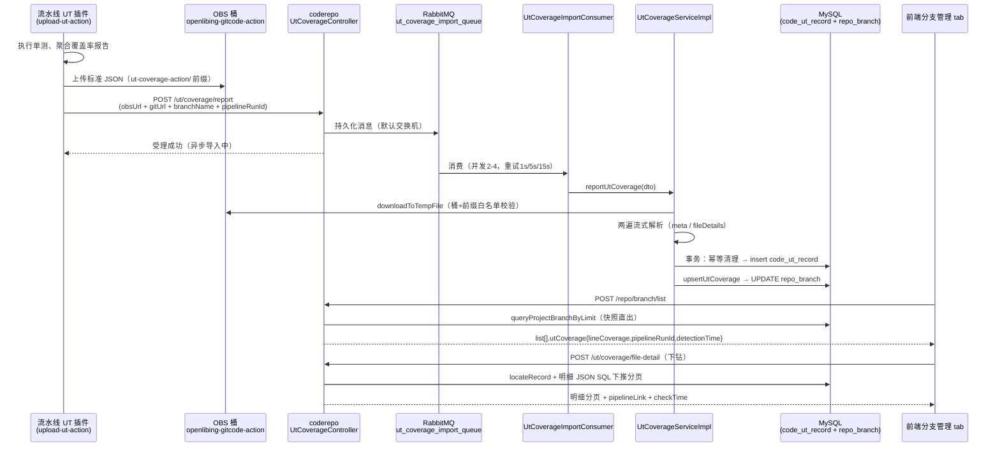

# UT 覆盖率指标数据链路（分支管理 tab）

> 梳理范围：代码仓管理页面「分支管理」tab 中的 **UT 覆盖率** 指标——数据从哪里来、怎么保存、页面怎么查询与下钻。
> 所在接口：`POST https://www.openlibing.com/gateway/openlibing-coderepo/repo/branch/list`（服务内路径 `/repo/branch/list`）。
> 梳理日期：2026-11-02，基于 openlibing-coderepo 当前主干代码。

---

## 1. 指标是什么

| 项 | 说明 |
| --- | --- |
| 指标名 | UT 覆盖率（行覆盖率，%） |
| 页面位置 | 代码仓管理 → 分支管理 tab（项目维度跨仓分支列表） |
| 查询接口 | `POST /gateway/openlibing-coderepo/repo/branch/list` → `BranchController#queryProjectBranch` |
| 返回字段 | `data.list[].utCoverage = { lineCoverage, pipelineRunId, detectionTime }` |
| 空值语义 | 三个底层字段全为 NULL 时 `utCoverage = null`（该分支从未收到成功上报，前端展示 `--`） |
| 口径 | **最近一次成功上报**的行覆盖率快照（非平均值、非累计） |

`BranchUtCoverageVO`（`business/vo/BranchUtCoverageVO.java`）：

| 字段 | 类型 | 含义 |
| --- | --- | --- |
| `lineCoverage` | BigDecimal | 行覆盖率（%），DECIMAL(5,2) |
| `pipelineRunId` | String | 最近一次上报的流水线执行 ID（下钻定位用） |
| `detectionTime` | Date | 最近一次 UT 检测完成时间（来自上报文件的 `detectionCompletedAt`，非服务器落库时间） |

---

## 2. 全链路总览

```
┌─────────────────────── 写入链路（异步） ───────────────────────┐
│                                                              │
│  CI 流水线 UT 覆盖率收集插件（upload-ut-action / ut-coverage-action）  │
│   1. 执行单测、解析覆盖率报告 → 生成标准 JSON（lineCoverage 必填        │
│      + fileDetails 文件明细 + 归属元数据）                        │
│   2. JSON 上传统一 OBS 桶：openlibing-gitcode-action             │
│      对象前缀：ut-coverage-action/                              │
│   3. POST /openlibing-coderepo/ut/coverage/report               │
│      （apig 机机接口，body 只带 obsUrl + gitUrl + branchName       │
│        + pipelineRunId，数据唯一来源是 OBS 文件）                  │
│                │                                                │
│                ▼                                                │
│  UtCoverageController#reportUtCoverage（coderepo）               │
│   仅校验 + 投递 RabbitMQ 持久化消息（默认交换机，                    │
│   routing key = 队列名 ut_coverage_import_queue），                │
│   同步返回「上报已受理，正在异步导入」——成功 ≠ 已入库               │
│                │                                                │
│                ▼                                                │
│  UtCoverageImportConsumer（并发 2-4，prefetch=1）                │
│   重试 3 次（1s/5s/15s 退避），超限记 error 日志后 ACK 丢弃          │
│                │                                                │
│                ▼                                                │
│  UtCoverageServiceImpl#reportUtCoverage → persistUtCoverage      │
│   a. OBS 下载临时文件（桶 + 对象前缀白名单校验）                     │
│   b. 两遍 Jackson 流式解析（防大文件 OOM）                         │
│   c. 事务内：幂等清理 → 双写（历史表 + 分支表快照）                  │
│                │                          │                     │
│                ▼                          ▼                     │
│      code_ut_record（历史全量）      repo_branch（每分支最新快照）  │
└──────────────────────────────────────────────────────────────┘

┌─────────────────────── 查询链路（同步） ───────────────────────┐
│  前端分支管理 tab                                             │
│   POST /repo/branch/list                                    │
│     └─ repo_branch 快照直出 → VO.utCoverage                  │
│   POST /ut/coverage/file-detail（点击指标下钻）                 │
│     └─ code_ut_record 历史记录 + 明细 JSON SQL 下推分页          │
└──────────────────────────────────────────────────────────────┘
```

时序视角：



---

## 3. 写入链路详细设计

### 3.1 上报入口：`POST /ut/coverage/report`

- Controller：`business/controller/UtCoverageController.java`（`@RequestMapping("/ut/coverage")`），注释标明为 **apig 机机接口**。
- 入参 `UtCoverageReportDTO`（`business/dto/ut/UtCoverageReportDTO.java`）：

| 字段 | 必填 | 说明 |
| --- | --- | --- |
| `gitUrl` | 是 | 仓库 URL，归属唯一标识 |
| `branchName` | 是 | 分支名称 |
| `pipelineRunId` | 否 | 流水线执行 ID（幂等去重 + 下钻定位） |
| `obsUrl` | 是 | OBS 标准 JSON 下载链接（唯一数据来源） |

- **异步受理模式**：Controller 只做参数校验，把请求序列化为持久化消息投递到 `ut_coverage_import_queue`（默认交换机，routing key = 队列名），立即返回「上报已受理，正在异步导入」。OBS 下载与解析重活从 HTTP 线程池解耦，返回成功**仅代表受理，不代表入库完成**——页面数据可见性存在秒级延迟。

### 3.2 异步消费：`UtCoverageImportConsumer`

- `@RabbitListener(queues = "${spring.rabbitmq.coderepo.ut_coverage_import_queue}", containerFactory = "codeMetricsListenerContainerFactory", concurrency = "2-4")`，prefetch=1 有界并发。
- 失败重试：单条消息内 1s / 5s / 15s 退避共 3 次，全部失败记 error 日志后 **ACK 丢弃**（不无限重投，避免毒消息阻塞队列；与 `CodeMetricsImportConsumer` 策略一致）。

### 3.3 核心入库：`UtCoverageServiceImpl#persistUtCoverage`

**Step 1 OBS 下载与安全校验**（`ObsBucketServiceImpl#downloadToTempFile`）

- 从 `obsUrl` 虚拟主机域名解析桶名（`{bucket}.obs.{region}.myhuaweicloud.com`），URL 路径解析 objectKey。
- **白名单硬校验**：桶必须为 `openlibing-gitcode-action`，objectKey 前缀必须为 `ut-coverage-action/` 或 `code-metrics-action/`——防止越权读取任意 OBS 对象。
- 流式下载到本地临时文件，用完即删（finally 兜底）。

**Step 2 两遍 Jackson 流式解析**（大文件防 OOM）

- 第一遍 `readUtMeta`：读取归属元数据与小体积指标；请求体缺失的 `gitUrl / branchName / pipelineRunId` 从文件内回填（请求体优先，避免双源冲突）；`fileDetails` 数组整体跳过。
  - 指标字段：`lineCoverage`（必填，兼容数字/字符串，BigDecimal 保精度）、`runNumber`、`commitId`、`detectionCompletedAt`（ISO 时间）。
  - 未知字段跳过，保证插件端向后兼容。
- 第二遍 `streamFileDetailsJson`：逐条读取 `fileDetails` 数组元素序列化为入库 JSON；累计 UTF-8 字节数超上限（`DB_TEXT_PAYLOAD_MAX_BYTES`）立即拒绝，防超长文本入库。
- 归属校验（gitUrl/branchName 必填）与 lineCoverage 必填校验在此之后执行。

**Step 3 归一化**

- `normalizeGitUrl`：去掉结尾 `.git`。原因：`repo_info.repo_url` 强制以 `.git` 结尾，而插件上报 URL 通常不带，不归一会导致精确匹配失败、分支表不更新。
- 历史表 `code_ut_record.git_url` 统一按不带 `.git` 的形态存储。

**Step 4 事务内三步双写**（`TransactionTemplate`，仅 DB 操作包事务，OBS 下载/解析留在事务外避免长占连接）

1. **幂等清理** `deleteExistingRecord`：
   - 有 `pipelineRunId`：按 gitUrl + branchName + runId 精确查旧记录并删除（重复上报不产生脏数据）。
   - 无 `pipelineRunId`：清理该仓该分支的历史**失败**记录（精确匹配 NULL 永不命中，防重试堆积失败数据）。
2. **写历史表** `saveUtRecord`：insert `code_ut_record`（雪花 ID 由 HOSTNAME/IP 派生 workerId 避免多实例冲突；`status=0` 成功；`coverage_file_detail_json` 为 LONGTEXT 明细数组）。
3. **更新分支快照** `upsertBranchLatest`：
   - `repoCoordinateResolver.resolveByCoordinate(gitUrl)` 反查命中的**全部** `repo_info` 行——同一仓库可能被多个项目以不同域名（gitcode.com / atomgit.com）录入，逐个 repoId upsert，避免只刷新其中一个项目。
   - `RepoBranchInfoMapper.upsertUtCoverage`（UPDATE 语句，走 `uk_repo_branch_repo_id_name` 唯一索引定位单行）：

   ```sql
   UPDATE repo_branch
   SET ut_line_coverage = #{utLineCoverage},
       ut_pipeline_run_id = #{utPipelineRunId},
       ut_detection_time = #{utDetectionTime},
       update_at = #{updateAt}          -- JVM 侧写入，避免 MySQL 会话时区偏移
   WHERE repo_id = #{repoId}
     AND branch_name = #{branchName}
     AND is_deleted = 0
   ```

   - 分支不存在（影响 0 行）仅告警不失败——分支行存在性由上游分支同步保证。

**失败路径**：OBS 下载/解析失败时 `saveFailureRecord` 落一条 `status=1` + `error_message`（按 TEXT 容量截断）的历史记录，失败有迹可查；接口同步返回明确业务失败。

---

## 4. 存储设计（双写模型）

| 表 | 角色 | 关键列 | 建表/加列位置 |
| --- | --- | --- | --- |
| `repo_branch` | **最新快照**（页面查询源，每分支一行） | `ut_line_coverage DECIMAL(5,2)`、`ut_pipeline_run_id VARCHAR(512)`、`ut_detection_time DATETIME`（均可空） | `db/changelog/db.changelog.xml` changeSet `20260917_add_ut_coverage_to_repo_branch` |
| `code_ut_record` | **历史全量**（含失败记录，下钻数据源） | `id`（雪花）、`git_url`、`branch_name`、`pipeline_run_id`、`run_number`、`commit_id`、`line_coverage`、`coverage_file_detail_json LONGTEXT`、`detection_completed_at`、`status`（0 成功 / 1 失败）、`error_message`、`create_time`；索引 `idx_git_branch(git_url(255), branch_name, detection_completed_at)` | 同文件 changeSet `20260917_create_table_code_ut_record` |

设计动机与分支表其它指标（`code_scale` 等度量快照、`static_alert_count`）一致：**指标直落分支表，列表查询零拼接、排序下推 SQL**；历史与文件明细因体积大走独立表，仅下钻时访问。

---

## 5. 查询链路详细设计

### 5.1 列表查询（分支管理 tab）

1. 前端 `POST /gateway/openlibing-coderepo/repo/branch/list`（`userId` 由网关注入）。
2. `BranchController#queryProjectBranch` → `RepoServiceImpl#queryProjectBranch`：
   - 横向越权校验：`commonService.resolveAccessibleRepoScope(userId, null, projectId, PROJECT_BRANCH_LIST)` 收敛可访问仓库范围。
   - 排序字段白名单映射（`PROJECT_BRANCH_SORT_FIELD_MAP`，前端 camelCase → DB 列名），默认按 `update_at desc`，并列由 `branch_id desc` 兜底。
3. `RepoBranchInfoMapper.queryProjectBranchByLimit`：SELECT 直取 `b.ut_line_coverage / b.ut_pipeline_run_id / b.ut_detection_time`（连同其余指标列），JOIN `repo_info` 取项目归属，WHERE + ORDER BY + LIMIT 全部下推 SQL。
4. `buildProjectBranchInfoList` → 每行 `buildBranchUtCoverage(row)`：三个 ut 字段**全空返回 null**（前端不展示），否则组装 `BranchUtCoverageVO{lineCoverage, pipelineRunId, detectionTime}` 挂到 `ProjectBranchInfoVO.utCoverage`。
5. 查询链路**零 Feign、零跨服务调用**——数据全部来自本服务 MySQL 分支表快照。

### 5.2 下钻查询（文件级明细）

点击列表 UT 覆盖率指标 → `POST /ut/coverage/file-detail`（`UtCoverageController#getFileDetail`，`UrlConstant.UT_COVERAGE_FILE_DETAIL`）：

1. 入参 `UtCoverageFileDetailQueryDTO`：`repoId` + `branchName` + `pipelineRunId`（列表 VO 透出，用于定位历史记录）+ `fileName` 过滤 + 排序字段/方向 + 分页。
2. 横向越权校验后按 `repoId` 反查 `repo_info.repo_url` → `normalizeGitUrl`。
3. `resolveEquivalentGitUrls`：按坐标补齐 gitcode.com / atomgit.com 双域名等价 URL 形态 + 跨项目录入形态，保证跨域名录入场景下历史记录仍能命中。
4. `locateRecord`：
   - 带 `pipelineRunId`：`selectByPipelineRunId(gitUrls, branchName, runId)` 精确定位（定位失败兜底最新成功记录）。
   - 不带：`selectLatestByGitAndBranch(gitUrls, branchName)` 取 `detection_completed_at` 最新一条成功记录。
5. 明细展开**全部下推 SQL**（`countFileDetails` / `selectFileDetailPage`）：对 LONGTEXT `coverage_file_detail_json` 用 MySQL JSON 函数完成过滤（fileName）、排序（filePath/lineCoverage/lineCovered/lineTotal 白名单）与分页，避免整段 LONGTEXT 载入内存。
6. 返回 `UtCoverageFileDetailVO`：分页明细（filePath/lineCoverage/lineCovered/lineTotal）+ `pipelineLink`（`{repoUrl去.git}/actions/runs/{pipelineRunId}`，跳转流水线）+ `checkTime`（检测完成时间格式化展示）。

---

## 6. 关键设计要点与注意事项

1. **异步受理 ≠ 已入库**：上报接口同步返回只代表消息进 MQ；页面可见性延迟 = MQ 消费排队 + OBS 下载解析耗时（正常秒级）。排查「页面上报了但没刷出来」时先查 `ut_coverage_import_queue` 积压与消费者日志。
2. **数据唯一来源是 OBS 文件**：接口 body 里的 gitUrl/branchName/pipelineRunId 仅是归属提示，缺失时从文件回填；两者冲突以请求体优先。
3. **幂等语义**：同 `gitUrl + branchName + pipelineRunId` 重复上报会先删旧历史记录再插入；无 runId 的上报只清理历史失败记录后追加。
4. **多项目/多域名归属**：同仓被多项目录入（或 gitcode/atomgit 双域名形态）时，一次上报会刷新**所有**命中 `repo_info` 对应项目的分支行，保证各项目页面口径一致。
5. **失败可追溯**：解析/下载失败会落 `status=1` 的 `code_ut_record` 记录（含截断后的失败原因），但不影响 `repo_branch` 快照——页面继续展示上一次成功值。
6. **快照覆盖语义**：分支表保存的是「最近一次成功上报」，不做新旧比较（后到者胜）。若流水线并发跑同一分支，页面展示值取决于入库先后而非流水线先后，属已知取舍。
7. **安全约束**：OBS 下载强制桶名 + 对象前缀白名单；`getFileDetail` 走网关注入 userId 做横向越权校验；`/report` 为机机接口（apig），无 userId。

---

## 7. 参考代码索引

| 环节 | 位置（openlibing-coderepo） |
| --- | --- |
| 列表接口 | `business/controller/BranchController.java`（`/repo/branch/list`） |
| 列表实现 | `business/service/impl/RepoServiceImpl.java`：`queryProjectBranch` / `buildProjectBranchInfoList` / `buildBranchUtCoverage` |
| 列表 SQL | `resources/mapper/RepoBranchInfoMapper.xml`：`queryProjectBranchByLimit`（select 含 3 个 ut 列） |
| 上报接口 | `business/controller/UtCoverageController.java`（`/ut/coverage/report`、`/ut/coverage/file-detail`） |
| MQ 消费者 | `business/service/UtCoverageImportConsumer.java` |
| 入库服务 | `business/service/impl/UtCoverageServiceImpl.java`：`reportUtCoverage` / `persistUtCoverage` / `upsertBranchLatest` / `saveFailureRecord` / `getFileDetail` / `locateRecord` |
| OBS 下载与白名单 | `business/service/impl/ObsBucketServiceImpl.java`（`downloadToTempFile`、`UT_COVERAGE_OBS_OBJECT_PREFIX`） |
| 坐标反查 | `business/service/impl/RepoCoordinateResolverImpl.java`：`resolveByCoordinate` / `resolveEquivalentGitUrls` |
| 快照 upsert SQL | `resources/mapper/RepoBranchInfoMapper.xml`：`upsertUtCoverage` |
| 建表/加列 | `resources/db/changelog/db.changelog.xml`：changeSet `20260917_add_ut_coverage_to_repo_branch`、`20260917_create_table_code_ut_record` |
| 上报生产端 | CI 流水线 UT 覆盖率收集插件（upload-ut-action / ut-coverage-action，独立插件仓，OBS 桶 `openlibing-gitcode-action`、前缀 `ut-coverage-action/`） |
