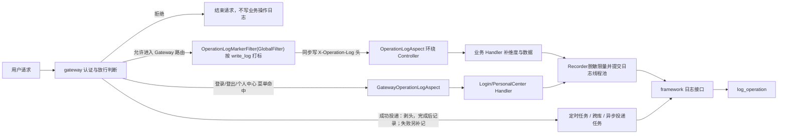
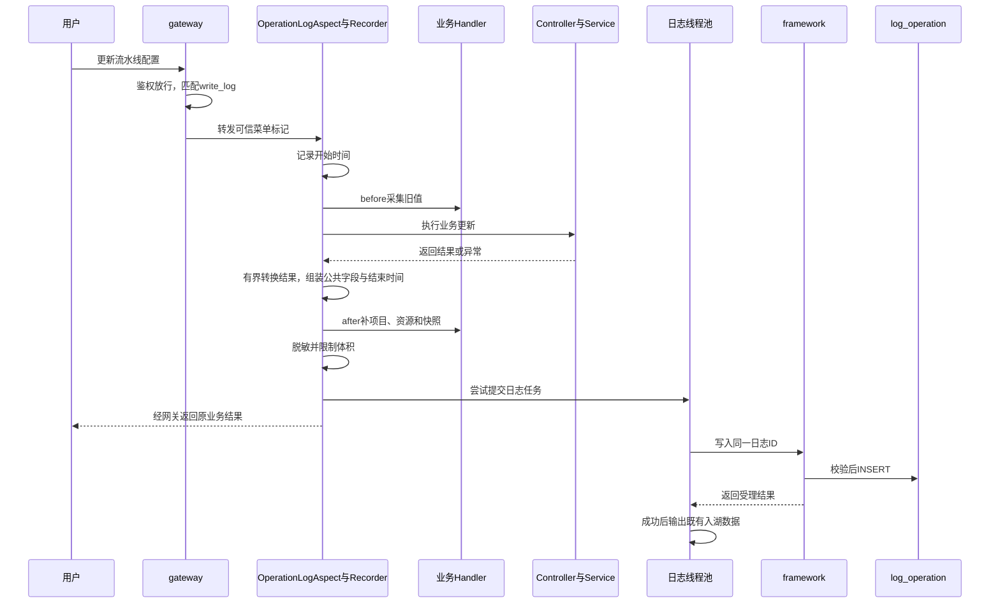
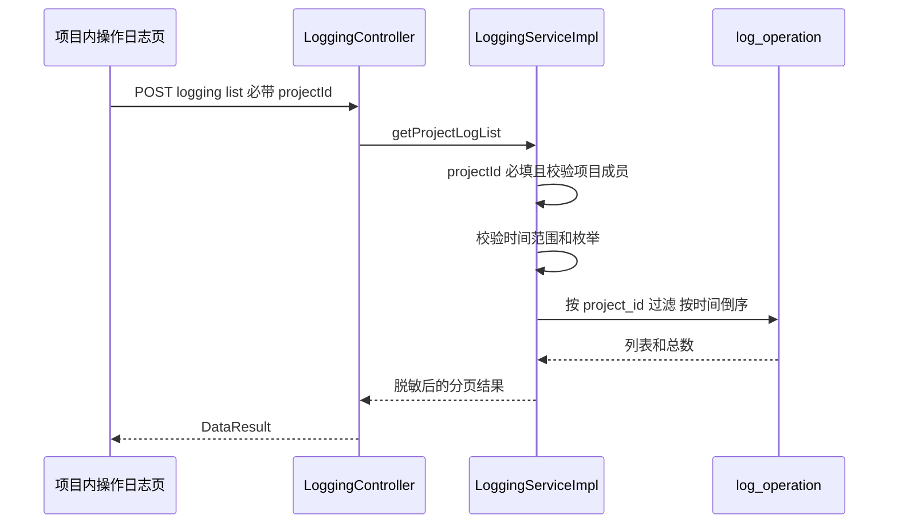

# 统一操作日志技术设计方案

# 1.方案设计

## 1.1 业务场景

平台管理员需要从统一入口查询操作日志，并逐步缩小范围：

1. 先选择功能模块，例如“流水线操作”；
2. 再选择项目；
3. 再选择具体流水线；
4. 最后查看对该流水线执行了什么操作。

现网把模块边界同时表达在两个位置：

- `MANAGEMENT_LOG` 的中文目录，例如“流水线操作”；
- 日志表的 `operation_module`，例如“流水线配置”。

这两个字段本质上都回答“日志属于哪个功能模块”，只是一个表示上级，一个表示下级。与此同时，
目录还被绑定到物理表名，导致新增模块需要新增表、动态表白名单、查询分支和清理逻辑。

本次改造统一模块表达，并将关系库操作日志收敛到 `log_operation`。

## 1.2 方案目标

本次改造统一“如何采集、写到哪里、如何查询”，让使用方按下面四层定位操作记录：

```text
模块 → 项目 → 资源 → 操作
```

**存储与查询**

- 新日志统一写入 `log_operation`，新增模块不再新增日志表。
- 模块直接复用菜单 `identification`，不另建日志模块路径；项目与资源的空值规则见 §4.6。
- 平台旧查询继续查旧表，另增统一表查询；CICD 和 coderepo 项目页只查新表。
- 历史数据不迁移，新表从零积累；本期保留旧表及旧查询，稳定后再单独下线。

**采集与写入**

- gateway 放行业务后，按菜单 URL 的 `write_log` 决定是否打标。认证方式不改变该规则；拒绝请求不记业务操作日志。
- common 切面读取标记，Handler 只实现 `matches/before/after`，补项目、资源及新旧数据；Controller 不新增日志注解。
- framework 是关系库唯一写入服务。Controller、Service、Job 和业务 Mapper 不直接写日志表；系统任务及跨库服务通过内部接口写入。
- 原 `@LogApi` 和旧 insert 保留调用兼容，但不再产生日志。原已挂菜单的日志接口按初始化清单开启开关，新挂 URL 默认关闭。

**时间与性能**

- 同步 HTTP 在业务结束后记录；repo/cicd 页面投递的异步同步与已接入的定时任务统一为开工插入“进行中”、结束更新同一条记录。具体时序，见 §2.2.5、§2.2.6。
- 记录开始、结束两列，不另存耗时。
- 控制同步快照、返回体转换、排队体积、后台并发及清理规模。异步保存不代表采集零开销，具体保护与待验证边界见第 5 章。

## 1.3 为什么使用菜单标识

日志的模块归属不再自建中文路径，直接复用菜单管理已有的 `identification` 字段（`/openlibing-framework/manage/menu/query-menu` 接口返回的标识）：

```text
repo_manage:add      同步仓库信息
repo_manage:update   编辑代码仓
repo_branch_manage:sync  同步分支信息
project_manage:add   新建项目
update-pipeline-config  更新流水线配置
pipeline_info_sync   同步流水线信息
```

使用菜单标识的收益：

| 现网问题                                         | 使用菜单标识后的处理                                                     |
| ------------------------------------------------ | ------------------------------------------------------------------------ |
| 目录和 operation_module 都叫“模块”，开发者难区分 | 只存一个 `module_id`，值即菜单标识                                       |
| 日志域自建路径集合需要单独维护                   | 菜单管理已有目录树和唯一性校验（`checkIdentification`），日志域零维护    |
| gateway 无法知道接口属于哪个模块                 | 独立打标过滤器按「请求 URL → `menu_url_info`」匹配，补一次 join 即得标识 |
| 新增模块需要在日志域登记路径                     | 新增菜单即新增可记日志的模块，不改日志代码                               |
| 英文码值无法直接看出归属                         | 菜单树接口按 `parentId` 组装目录，前端展示走菜单管理数据                 |
| 历史路径需要迁移映射                             | 历史数据不迁移，新表从零积累，无映射负担                                 |

`identification` 唯一标识菜单操作，名称取对应的 `menu_info.menu_name`，因此原 `operation` 字段不再单独保留。标识存在历史命名，不能解析后缀猜测含义：例如 `repo_manage:add` 当前对应“同步仓库信息”，`pipeline_info_sync` 不含冒号。

## 1.4 模块标识规则

### 1.4.1 存储规则

- `module_id` 存储菜单表 `menu_info.identification` 的原值，列类型 `VARCHAR(255)`；
- 唯一性由菜单管理保证：非通用菜单全局唯一；
- 日志域不新增校验或副本集合，写入时以菜单表为准；
- **通用菜单**指 `identification = general_config` 整棵子树（现网根节点「通用菜单」，子节点全部共用这一个标识，约 132 条菜单、226 条 URL）。它的作用是登录后人人可调、鉴权免角色，不是一个业务模块。整树不打标、不记拦截器日志。原因：`module_id` 无法区分这些接口；其中绝大多数是查询、下拉、PV。不要和业务菜单上的 `menu_level=menu_general`（权限级别）混淆。

### 1.4.2 查询规则

精确查询某个叶子模块（对应一条菜单的接口）：

```sql
WHERE module_id = 'update-pipeline-config'
```

查询一级模块及其全部下级：先经菜单接口取该菜单子树的全部 `identification`，再等值匹配：

```sql
WHERE module_id IN (
  'update-pipeline-config', 'pipeline_info_sync', 'pipeline_whitelist:update'
)
```

不再使用 `LIKE` 前缀匹配，模块查询使用等值条件，与模块索引对应；实际访问方式仍需通过 EXPLAIN 验证。
菜单子树集合由服务端从菜单表实时查询生成，不接受前端提交任意 `module_id` 列表之外的非法定制。

### 1.4.3 页面展示规则

模块下拉分两个页面场景，契约各自固定，均不再依赖日志域的 `MANAGEMENT_LOG` 路径集合。

**场景一：平台日志页（管理中心，不带 projectId）**

**数据来源**：新增统一表模块接口 `GET /manage/operation-logs/modules`，后端查询`menu_info` 并复用菜单管理同款 `TreeUtil.listToTree` 组树。现有
`GET /manage/logging/get/log/operationModule/{flag}` 仍为旧页面查询旧表服务，不修改。

**返回值**：精简菜单树，只保留开启写日志的菜单及父级；每节点固定五个字段，通用菜单 `general_config` 子树整树排除：

```json
[
  {
    "id": 12,
    "parentId": 0,
    "menuName": "流水线操作",
    "identification": "pipeline_manage",
    "children": [
      {
        "id": 15,
        "parentId": 12,
        "menuName": "流水线配置",
        "identification": "pipeline_config",
        "children": [
          {
            "id": 16,
            "parentId": 15,
            "menuName": "更新流水线配置",
            "identification": "update-pipeline-config",
            "children": []
          }
        ]
      }
    ]
  }
]
```

**前端渲染**：组件为树形下拉（TreeSelect），树数据即上述返回值；节点显示`menuName`，目录可展开也可整枝选中，叶子直接选中。交互示意（浏览器直接打开）：`docs/plans/2026-09-11-operation-log-module-treeselect.html`。生产实现用现网已有的 Element Plus `el-tree-select`，`check-strictly`，`value=identification`，`label=menuName`。

**选中行为**：用户选中任意节点后，前端把该节点的 `identification` 作为`moduleId` 提交查询，清空下拉则不过滤模块；新 `OperationLogServiceImpl` 按`moduleId` 反查菜单表定位节点，展开其子树全部 `identification`，执行`module_id IN (...)` 等值查询。选中“流水线操作”目录即查其全部子菜单标识，
选中叶子 `update-pipeline-config` 即精确等值查询。

**拼接职责**：树由后端组好一次性返回，前端不做子树展开和标识收集；子树展开只发生在后端查询时。

**场景二：业务模块页（项目内，必带 projectId，CICD 与代码仓同一契约）**

列表与列头筛选都查统一表 `log_operation`，不调平台模块树，也不再按列各调一个 DISTINCT 接口。菜单名称按 `module_id = menu_info.identification` 补齐，仅作展示，不参与日志计数。

**列表筛选** `POST .../list`：必带 `projectId`。过滤字段用统一表列名，集合语义（空或 null 不过滤）：

```text
moduleId / logResult / userName / resourceName / ip
```

时间窗比较 `operation_end_time`。CICD 现网 URL `POST /logging/pipelineLog/list` 保留，请求体在旧标量字段之外增加上述集合；旧 `operationModule/operation/operationTargetName/userName/logResult` 仍可作为**入参**提交，由 Service 转成 `module_id/resource_name` 过滤。**出参**与代码仓相同，使用 `LogProjectVO`（统一表 18 列 + `menuName`），不再返回 `operationTargetName` / `operationTargetJson` / `operationModule` / `operation` / `operationDate`。代码仓用 `POST /logging/list`。

**列头筛选** 对齐代码仓 `/project-repo/query-repo-filter-meta`：一次 POST 返回所点名列的候选项和预览计数，不再按列各查一个 DISTINCT 接口。

```text
POST /logging/filter-meta
```

入参与列表相同的过滤条件，另加 `filterMetaDimensions`（白名单：`moduleId` / `userName` / `resourceName` / `ip` / `logResult`）。未传或空数组返回 `filterMeta: {}` 且不查库。非法维度丢弃。计算某一维时不把该维已选值放进 WHERE，以便交叉筛选。repo/cicd 的 `logResult` 固定并集「成功」「失败」「进行中」，无数据时 count=0。单维最多 1000 条。SQL 聚合后优先保留已选值及其真实计数，无匹配的已选值补 0；单维已选值本身超过 1000 时返回参数错误。同一次请求只读取一次本仓可写模块集合。 `moduleId` 候选项返回 `{value, count, menuName}`，其中 `value` 仍为菜单标识，`menuName` 为 `menu_info.menu_name`，JSON 字段名与列表一致。候选集排序及截取完成后一次批量补查名称（最多 1000 个标识），包含补 0 的已选项；菜单不存在时名称为 null，不丢候选、不合并同名菜单。其它维度仍为 `{value, count}`，不查询菜单名称。

```json
{
  "filterMeta": {
    "moduleId": [
      {
        "value": "update-pipeline-config",
        "count": 12,
        "menuName": "更新流水线"
      }
    ],
    "userName": [{ "value": "zhangsan", "count": 8 }],
    "resourceName": [{ "value": "编译流水线", "count": 5 }],
    "ip": [{ "value": "10.0.0.1", "count": 3 }],
    "logResult": [
      { "value": "成功", "count": 20 },
      { "value": "失败", "count": 2 },
      { "value": "进行中", "count": 0 }
    ]
  }
}
```

CICD 现网 `GET /logging/users`、`GET /logging/targetNames` 只给未切页面的兼容，新页面只调 `filter-meta`。代码仓列头只提供 `filter-meta`，不另保留 DISTINCT 接口。不新增树接口。

## 1.5 涉及模块

| 仓/组件                         | 主要改造                                                                                                                                                                                                                 |
| ------------------------------- | ------------------------------------------------------------------------------------------------------------------------------------------------------------------------------------------------------------------------ |
| openlibing-common               | `@LogApi`/`LoggerAspect`/旧 insert 留空转；新增请求头驱动的 `OperationLogAspect`；Recorder 填写起止时间；保留 Handler                                                                                                    |
| openlibing-framework            | 建表；新增统一表查询；保留旧表查询；微服务写入、清理任务、菜单是否写入列                                                                                                                                                 |
| gateway                         | 请求放行后独立按 `write_log` 打标；自有登录/登出等接口按同一菜单规则，经 Recorder 调 framework                                                                                                                           |
| 管理中心前端                    | 原日志页和 `{flag}` 接口保留；新增统一日志页，使用 `/manage/operation-logs/*`                                                                                                                                            |
| 各 Handler 仓                   | Handler 实现 `matches/before/after`，按 Controller 与参数匹配；moduleId 来自请求标记，不在启动时扫描绑定；删除本地日志写入 Mapper                                                                                        |
| cicd                            | 四个流水线 Handler（不含同步）；同步流水线按 §2.2.6 任务直写；模块页查询、定时任务走 framework；页面同步任务与定时任务均开工插入进行中、结束更新同一条记录；列表补 `resourceName/ip`；列头改 `POST /logging/filter-meta` |
| openlibing-coderepo             | Handler 补项目/资源；`/sync-repo`、`/sync-repo-branch` 按 §2.2.6 不走 Handler、任务直写并剥头；项目维查询 `/logging/list` 补 `resourceName/ip`；列头改 `POST /logging/filter-meta`                                       |
| workspace/metric/ops/design-api | Handler 改 `matches/before/after`，走 common Recorder；现网 Feign/RestTemplate 直写只因无本地日志表/拷贝了旧切面，不是定时任务或跨库入口                                                                                 |
| CICD / coderepo 项目查询        | 只查统一表和本仓菜单标识，不合并旧数据；时间窗走结束时间；列表筛 `moduleId/logResult/userName/resourceName/ip`；列头统一 `filter-meta`                                                                                   |

逐仓完整名单、建议开发顺序和本期不改清单见**附录 C**。

本期关系库范围是：30 张现网目录注册表、游离的 `log_anti_poison` 和
`log_parameter_exception`，以及 SBOM 净新增统一表写入。旧
`log_parameter_exception` 的历史归属不再限制新链路：所有已接入统一操作日志的服务，
只要请求命中 `write_log=1` 菜单，参数绑定或校验失败也写入 `log_operation`。
完整表级处置见附录 B。

## 1.6 非目标

- 不合并字段模型不同的机机调用审计、simulation 和 argus 独立审计；
- 不合并数据湖表；
- 不在本期 DROP 旧表；
- 不新增 MQ 或扩展 JSON 列；gateway 可复用现有 Redis 菜单内容的本机匹配索引，不另建菜单事实来源；
- 不承诺进程崩溃场景下绝对零丢失；
- 不为耗时单独加列。HTTP Handler 仍结束后一次写入；repo/cicd 异步同步与已接入的定时任务开工先 INSERT 进行中和开始时间，结束再按同一 ID UPDATE 结果和结束时间。

本期包含标准 18 列结构的 `log_machine_interface`，不包含字段模型不同的其他机机调用审计表。

# 2.实现逻辑设计

## 2.1 实现总览



一次用户请求里，四类角色各做一件事：

| 角色                  | 做什么                                                                                                                                                                                                                                                         | 不做什么                                                            |
| --------------------- | -------------------------------------------------------------------------------------------------------------------------------------------------------------------------------------------------------------------------------------------------------------- | ------------------------------------------------------------------- |
| gateway               | `AuthFilter` 等 WebFilter 只决定拒绝或进入路由；独立 `OperationLogMarkerFilter`（GlobalFilter）对所有进入 Gateway 路由的请求读取 `write_log`，值为 1 则带上 `X-Operation-Log: {identification}`。登录/登出/个人中心由本仓专用切面按同一套菜单匹配写入，见 §3.3 | 打标路径不组装日志、不写库、不调 Handler；不经 `OperationLogAspect` |
| 业务仓环绕拦截器      | 读取标记头，围绕 Controller 前后调用对应 Handler                                                                                                                                                                                                               | 不缓存 HTTP 报文、不写库                                            |
| Handler               | 现网那些类：只实现 matches/before/after                                                                                                                                                                                                                        | 不手写 identification、不注册、不写库                               |
| `@LogApi` / 旧 insert | 代码保留，调用不报错                                                                                                                                                                                                                                           | 不写 `log_operation`，也不再写旧日志表                              |

定时任务、跨库服务没有 gateway 请求，直接调 framework 写入。立刻返回「请稍后」的 HTTP 投递接口同样按定时任务写（见 §2.2.6），不要再让切面写一条起止时间相同的行。上述入口最终都经 framework 写同一张 18 列表。业务 Service、Controller、Job 不直接写表；业务仓可保留只读查询 Mapper。同步 HTTP 完成后写一条；repo/cicd 页面异步同步与已接入生命周期的定时任务开工 INSERT、结束 UPDATE 同一条（见 §2.2.5）。一般跨库直写由调用方提供完整记录，不自动获得 begin/finish。

## 2.2 公共能力改造

公共层一次改造，所有模块复用：

| 公共组件                      | 职责                  | 本次改造                                                            |
| ----------------------------- | --------------------- | ------------------------------------------------------------------- |
| `LogApi`                      | 原注解                | 加 `@Deprecated`；注解还在，切面空转，不产生日志                    |
| `LoggerAspect`                | 原切面                | 保留类和注册方法，`doBefore`/`doAfter` 直接 return                  |
| 各仓旧 `insert`/`saveLogs`    | 原直写                | 方法签名保留，方法体改为 return，不写任何表                         |
| `OperationLogAspect`（新增）  | Controller 环绕拦截器 | 仅 Servlet；无头直接执行；有头时组 Context，按 `matches` 选 Handler |
| `AbstractLogHandler`          | 业务补数约定          | 子类只实现 matches/before/after，公共保存由 Recorder 负责           |
| `OperationLogContext`（新增） | 请求上下文            | 一次请求共用：moduleId、入参、旧数据、返回值和待写入记录            |
| `OperationLogRecord`（新增）  | 新写入模型            | 只包含统一表 18 个字段；不改旧查询 `LogsDetailVO`                   |

一句话：gateway 决定记不记并带上模块标识；切面用本次入参选 Handler；Handler 只通过上下文补业务数据；公共模板统一保存。

### 2.2.1 gateway：请求放行后独立打标

认证回答“请求能否执行”，日志策略回答“已允许执行的操作是否记录”。`AuthFilter / WebhookAuthFilter` 保持原认证语义，新增的 `OperationLogMarkerFilter` 使用 Gateway `GlobalFilter`，覆盖所有成功进入路由的路径，包括 Webhook 验签后的 Handler 直达路径。

不能将 Marker 放成认证后的普通 WebFilter，否则可能被直接进入路由的认证分支绕过。

```text
认证/鉴权拒绝 → 结束请求，不记统一业务操作日志
认证/鉴权放行 → 进入 Gateway 路由
  → 删除外部传入的 X-Operation-Log
  → 按 URL、请求方法和动态段约束匹配菜单
  → 非通用菜单且 write_log=1：设置可信标记，继续转发
  → 其它情况：不带日志标记，继续转发
```

`OperationLogHeaderRelayFilter` 在路由前根据可信 exchange 属性重写出站头，不信任客户端同名头。打标故障只影响本次日志采集，不改变原业务响应，也不能吞掉下游业务异常。

**菜单从哪里来**

使用 `AuthMapper#queryAllMenuUrlForOperationLog` 查询全量菜单 URL，并缓存到 Redis `operationLogMenus`：

```sql
SELECT mui.menu_url, mui.request_method,
       mui.available_value, mui.unavailable_value, mui.write_log,
       mi.identification
FROM menu_url_info mui
JOIN menu_info mi ON mi.id = mui.menu_id
```

现有 `queryMenuUrl / menuUrls` 只服务动态段校验，不能复用为打标菜单，否则普通 URL 会漏记。动态段约束仍沿用原匹配规则。

framework 保存菜单后，在事务提交回调中直接删除 `operationLogMenus`，同时失效权限缓存；回滚不执行失效，删除缓存失败不把已提交的业务伪装成失败。不能依赖后续普通鉴权请求间接刷新日志菜单。

**匹配开销如何控制**

稳定请求只 GET 一次 Redis；内容未变时复用同实例解析结果和匹配索引，变化时重建。缓存缺失合并同实例回源，空结果也写入 `[]`；Redis 故障不额外放大为数据库查询。

路由打标的 Redis/JDBC 阻塞操作移到专用 boundedElastic 调度器，最多 4 个线程、每线程 128 个排队任务。拒绝时清除不可信标记并保留原业务放行结果；正常打标只输出 DEBUG。

这是复用现有 Redis 内容的本机索引，不增加菜单事实来源或独立 TTL。每次 GET 的流量、调度等待及 gateway 自有接口同步匹配成本仍需实测。

**哪些请求记录**

- 普通登录、免登录、公开、转发白名单、机机签名和 Webhook 请求：放行后按相同菜单规则判断，认证方式本身不跳过日志。
- 匿名写操作：开启开关也记录，无法取得用户/三方身份时允许为空。
- `general_config` 通用菜单子树：不记录统一业务日志。这些节点共用标识，不能区分业务归属；不要与权限级别 `menu_general` 混淆。
- 登录、登出、个人中心等 gateway 自有接口：由 `GatewayOperationLogAspect` 使用同一菜单匹配规则；仍挂通用树时不写，拆出独立标识并开启开关后生效。超时退出没有 HTTP 菜单路径，本期不由该切面记录。
- 机机访问审计保留原规则；对应业务 URL 开启 write_log 时，还可记录业务操作日志，两者语义不同。
- 页面异步投递接口由业务仓剥头，成功投递不记 HTTP 完成行，实际任务与投递失败规则见 §2.2.6。

**是否写入字段**

开关位于 `menu_url_info.write_log`，gateway 只读，由 framework 菜单管理保存：

| 情况                                    | 初值与维护规则                                 |
| --------------------------------------- | ---------------------------------------------- |
| 原有 `@LogApi` 且完整路径已挂业务菜单   | 由独立数据 changeSet 初始化为 1，排除通用菜单  |
| 已挂菜单但原来没有日志、新挂 URL        | 默认 0，需要记录时在菜单管理开启               |
| 未挂菜单、未匹配或仍属 `general_config` | 不打标，不能视为已覆盖                         |
| 无 HTTP 的任务、跨库直写                | 显式传已存在的 moduleId，不按 URL 开关决定写入 |

`MenuUrlInfoDTO/Entity/VO` 及 gateway 同名实体增加 `writeLog`。framework 的 `add-menu/update-menu/query-menu` 接收、保存和返回 `urls[].writeLog`；只允许 0/1，未传按 0，非法值拒绝。修改 URL 仍是先删后增，编辑页必须带回该字段，避免丢失原值。

```json
{
  "identification": "update-pipeline-config",
  "urls": [
    {
      "menuUrl": "/openlibing-cicd/pipeline/config/update",
      "requestMethod": "POST",
      "writeLog": 1
    }
  ]
}
```

菜单维护接口是 framework 的 `POST /manage/menu/add-menu`、`POST /manage/menu/update-menu`，gateway 不另建开关写入接口。初始化清单和 Liquibase 规则见 §4.1.3、§2.8。

#### 日志客户端 IP 透传（2026-10-15 补充）

Gateway 当前依赖解析为 Spring Cloud Gateway 5.0.3。该版本会在可信代理条件不成立时删除出站 `X-Forwarded-*`，因此下游不能只依靠这些头恢复客户端 IP。本次只调整操作日志链路，不恢复业务转发头，不修改全局代理信任配置、鉴权、限流和黑白名单取 IP 方法。

1. `OperationLogMarkerFilter` 首先清除外部传入的 `X-Operation-Client-IP` 和旧 exchange 属性。命中可写菜单时，在 Gateway 转发头过滤之前按 `X-Forwarded-For` 首项 → `X-Real-IP` 首项 → 当前连接地址采集 IP，保存到 exchange 属性。
2. `OperationLogHeaderRelayFilter` 只对有网关菜单标记的请求，将采集值写入 `X-Operation-Client-IP`；在 `HttpHeadersFilter` 出站阶段再次覆盖，确保经过 Gateway 5.0.3 的删除过滤器仍可传递。无标记时移除该头，不向响应添加它。
3. common 的 `OperationLogClientIp` 统一解析单个 IPv4/IPv6 字面量，不做 DNS 查询、不跳过私网地址猜测公网 IP。下游日志优先读取有效的专用头；缺失或非法时按原头及连接地址回退，兼容旧网关。地址全部不可用时留空。
4. `OperationLogRecorder` 普通日志及参数校验失败日志、repo/cicd 的 `AsyncOperationLogIdentity` 共用该方法。异步接口剥掉菜单标记后仍保留 IP 专用头，投递前复制 IP，任务结束不重新读取请求。无 HTTP 来源的系统任务继续不填 IP。
5. Gateway 登录、登出、个人中心的专用日志切面在入站请求上使用相同的原始头解析顺序，忽略外部日志专用头；不再复用取 XFF 末项的业务工具方法。

**信任边界**：专用头只证明其值由网关按既有日志规则采集，并不把任意转发头变成可信身份。沿用原有部署前提：外部流量必须经过负责覆盖/清洗转发头的入口代理，下游业务端口不得直接对公网开放。仅校验 IP 字面量不能防止伪造 XFF；本次不扩大业务对转发头的信任范围，日志 IP 也不得用于授权、限流或黑白名单。若入口已经丢失客户端 IP，本方案不会凭空恢复，连接地址回退仍可能是内网地址。

**发布与验证**：先把 common 的变更合入当前 SDK 发布分支并发布配套制品，再让 Gateway、framework 和需要生效的业务服务引用该制品重新构建；repo/cicd 还须包含异步身份采集改动。仅发布 Gateway 无法让旧 common 读取新头。无需 SQL、表结构或前端改动，不回填历史 IP。两侧任一先升级仍可按旧方式回退，全部升级后生效。验证应覆盖同一用户两次操作、原生 Gateway 5.0.3 删除过滤器、伪造专用头清除、IPv6、旧网关回退及任务跨线程身份保留。

**本地验证**：按最新 develop 的 common 依赖配置（Boot 4.1.1 / Spring 7.0.9）构建测试 SDK，Gateway 实际使用 5.0.3；没有修改各仓正式 SDK 版本号。common 日志回归 93 项、Gateway 日志与登录回归 92 项、framework 日志回归 35 项、repo 异步相关回归 30 项、cicd 异步相关回归 25 项，共 275 项通过；common/Gateway Checkstyle 均无违规。Maven 测试使用已缓存的 Surefire 3.5.5，绕过本机 3.5.4 插件缺失问题；格式化使用已缓存的 Google Java Format 1.28.0。上述为本地代码验证，beta 发布后的真实 IP 来源仍须验收，不把本地模拟输入当作线上抓包证据。

### 2.2.2 OperationLogAspect（新增）

拦截发生在业务仓 Controller 方法外层，采用 Spring AOP `@Around`，仅在 Servlet MVC 仓加载。Spring 已把请求解析成 DTO，切面直接读取方法参数和返回对象，不复制 HTTP 报文、不新建 ThreadLocal。

#### 实际拦截位置与触发条件

```text
OperationLogAspect 读取 X-Operation-Log
  → 无标记：直接执行业务
  → 有标记：创建 OperationLogContext
      → 按 Controller、DTO/参数选择唯一 Handler
      → before 查询旧值
      → proceed() 执行原 Controller
      → 取得返回对象或异常
      → Recorder 组装、补数、脱敏并尝试异步保存
      → 原样返回业务结果或继续抛出原异常
```

标记值用于填写 `module_id`，不用于注册或寻找 Handler。Spring 注入本仓 `List<AbstractLogHandler>`，切面调用各自 `matches(context)`：

| 匹配结果          | 记录行为                                        |
| ----------------- | ----------------------------------------------- |
| 无标记            | 不创建上下文、不查询快照，直接放行业务          |
| 唯一 Handler 命中 | 执行 before/after，补业务字段                   |
| 无 Handler 命中   | 仍记公共字段，项目/资源可能为空，并留下排查信息 |
| 多个 Handler 命中 | 不猜选、不重复补数，只记公共字段并告警          |

`matches` 先限定 Controller，再判断自己的 DTO 或参数组合。仅凭“有 id/ids”容易跨业务同时命中；framework 已补 Controller 作用域，共用 Controller 的机器接口/账号删除再按 MVC 方法区分。

原业务返回对象不会被改写。`OperationLogResultSnapshot` 先生成有界日志副本，再转成 Handler 使用的结构，避免先完整转换大对象再截断。成功判断字段优先保留，标量返回沿用原成功/HTTP 状态兜底；预算见 §5.3。

before/after 或保存异常不得覆盖原业务结果。旧值查询仍在业务执行前进行，不能为了“异步”推迟到修改之后；日志入队也不等于已经落库。

**参数异常发生在 Controller 之前时**

common 的 `OperationLogValidationExceptionResolver` 观察标准绑定/校验失败，经 `Recorder.writeDirect` 投递同一有界线程池，再返回 `null`，由原异常处理器继续生成响应。覆盖 Bean Validation、方法参数校验、BindException、缺参数/请求头、类型不匹配和不可读请求体；不把任意 `IllegalArgumentException` 都归为绑定失败。

`OperationLogValidationWebMvcConfig` 在构造参数上使用 `@Lazy` 注入 Recorder，注册观察器时只传递延迟代理。若在 MVC 配置构造时立即创建 Recorder，会经日志 Feign 子容器的刷新事件反向触发 MVC 配置装配，形成循环依赖并阻断启动。这是公共启动问题，修复位于 common；不通过关闭参数异常日志或开启全局循环依赖容忍绕过。新增真实 MVC 与 Feign 启动回归，验证禁止循环依赖时可启动、观察器仍处于解析链首位，缺少必填参数仍返回 400。

进一步检查发现，仅延迟上述 MVC 配置仍不充分：CICD、coderepo 的 `AsyncOperationLogFailureRecorder` 也是 MVC 配置，会直接依赖 Recorder。因此 Recorder 构造时也通过 `@Lazy` 只持有 `OperationLogWriteClient` 代理，避免任何调用方在创建 Recorder 时提前创建 Feign 子容器。普通单例装配完成后，由 `SmartInitializingSingleton` 回调解析并校验客户端；漏扫客户端或多个实现没有唯一候选时仍在启动阶段失败，不将配置错误推迟到第一条日志。

本轮新增 14 项启动回归：5 种初始化入口分别搭配有／无指标注册表，另覆盖客户端缺失、实现冲突、本地客户端首次写入及响应式环境不加载 Servlet 组件。操作日志相关共 82 项测试与静态检查通过；CICD、coderepo 实际观察器源码的独立 MVC 启动验证也通过。切面、线程池、指标、公共 Feign 配置及其余 common 组件未发现需要新增修复的同类依赖环；这些结果不代替各服务连接配置中心和数据库后的完整启动冒烟。

**合入分支的测试兼容性**：common 日志开发分支使用 Spring Boot 3.5.14，而 `develop_202610_iter1` 使用 4.1.1。为避免 Boot 自动配置拆包造成测试编译失败，启动测试采用标准 `@EnableWebMvc`、`@EnableAspectJAutoProxy` 和真实 Feign 自动配置；指标场景通过明确的 `@Bean` 创建 `SimpleMeterRegistry`。不再增加按版本动态加载类名的辅助类。测试验证真实 MVC/Feign 初始化链和公共指标接入，不覆盖 Boot 全套指标自动配置。本次使用两条分支各自原有的依赖配置，各通过 82 项日志测试；Boot 3 静态检查和 Boot 4 Maven 打包通过。测试适配不调整业务依赖版本，也不表示其它服务已完成 Boot 4 全量迁移验证。

仅可信菜单标记请求可记录，通用菜单和 internal-server 请求不写。`OperationLogWriteGuard` 使用 request attribute，让切面和异常观察器只提交一次失败日志。

**与其它组件的边界**

- `write-modules` 只给 CICD/coderepo 查询白名单使用，Handler 不在启动时调用它或建立菜单映射。
- gateway 是 WebFlux，不加载该 Servlet 切面；自有 Login/User Controller 由 `GatewayOperationLogAspect` 和参数异常适配器处理。
- 原 `@LogApi` 标在 Service 的场景，要核对对应 Controller 能否取得资源定位参数；无 HTTP 定位条件的操作使用 §2.5 直写入口。

### 2.2.3 AbstractLogHandler 与上下文

一次请求共用 `OperationLogContext`，保存 moduleId、Controller 类型、参数 Map、原实参 args、开始时间、旧快照、结果 Map 和公共记录。before/after 读取同一上下文，不再额外注册或保存日志。

三个方法各做一件事：

```text
matches(context)       判断是否属于自己的 Controller 和参数类型
before(context)        在业务执行前返回旧值快照
after(context, biz)    根据结果补项目、资源、新旧数据
```

模块来自请求标记；Handler 不手写 identification、不按 URL 注册、不实现 init/saveLog，也不注入日志 Mapper 或写入客户端。多个 Handler 同时命中时的降级规则见 §2.2.2。

#### 18 列谁填：公共模板 vs 业务补数

| 字段                                                       | 填写方                           | 规则                                              |
| ---------------------------------------------------------- | -------------------------------- | ------------------------------------------------- |
| id、module_id                                              | Recorder                         | 生成 ID，复制可信菜单标识                         |
| 起止时间、结果、user__、account__、ip、params、ex_message  | Recorder                         | 从上下文、认证身份及返回结果取得，见 §2.2.5、§4.2 |
| project_id、resource_id、resource_name、old_data、new_data | Handler 的 OperationLogBizFields | 只补业务维度，平台/项目/批量语义见 §4.6           |

按类型使用 `OperationLogParams.firstDto`，按方法参数名使用 `OperationLogParams.string`。paramsMap 不把 DTO 拆平；参数名不可用时，相关 Handler 可从 args 回退读取同类型 DTO。

#### CICD 对照（现网取数方式必须分开 Handler）

| Handler                     | 典型参数                                                             | 业务字段     |
| --------------------------- | -------------------------------------------------------------------- | ------------ |
| PipelineConfigLogHandler    | UpdatePipelineDetailDTO、PipelineRelationDTO 或 projectId+pipelineId | 项目、流水线 |
| PipelineWhiteListLogHandler | UpdateWhiteStatusDTO                                                 | 项目、流水线 |
| ImageLogHandler             | CreateImageDto、UpdateImageDto、DeleteImageDto                       | 镜像资源     |
| ShortcutLogHandler          | ShortcutRequestDTO                                                   | 评论指令     |

上述参数仍需结合 Controller 作用域判断，不能只凭通用 id。`SyncPipelineInfoDTO` 不匹配这些 Handler，按 §2.2.6 记录实际任务。

公共保存流程固定为：组装公共字段 → Handler 补业务字段 → 脱敏/体积限制 → 提交日志线程池 → framework 写表 → 调用方入湖。无需在每个 Handler 复制该流程。

`OperationLogLakeObjectRegistry` 按 identification 模块前缀解析原 Object_id，最长前缀优先。流水线配置、白名单、同步仍进入 `log_pipeline`，镜像和评论指令分别使用原 `log_image`、`log_shortcut`；不能把整个 CICD 服务一律映射成流水线。完整对照见附录 B。

framework 本仓通过 `FrameworkOperationLogWriteClient` 调本地 InternalServer；其它仓通过 common `OperationLogWriteFeignClient`。CICD/coderepo/vulnerability 保留的本仓 `FrameworkLogClient` 声明 `primary=false`，并绑定 `OperationLogFeignConfig`，避免多个 primary 注入冲突，也让任务直调受到同一超时约束。

### 2.2.4 开发者新增接口时做什么

1. **先判定是不是异步投递。** HTTP 立刻返回「请稍后」、真正工作在线程池或 XXL 的，**禁止**按下面 2–5 去加 Handler、禁止让切面在 HTTP 返回时写库，一律走 §2.2.6。
2. 同步写完才返回的接口：菜单挂 URL，并把 `write_log` 设为 1。
3. 入参 DTO 已被某个 Handler 的 `matches` 覆盖：不用改代码。
4. 新 DTO：只改对应 Handler 的 `matches/before/after`。
5. 不要在 Controller 上加注解，不要手写 identification，不要实现 `init/saveLog`。

params 及新旧快照由 Recorder 在入队前统一脱敏和限量，见 §5.3。每个 `write_log=1` 的 Controller 方法至少补成功/失败各一条测试，断言业务字段按该接口契约有值或明确允许为空。gateway 另做认证模式矩阵测试：普通登录、免登录、公开接口匿名/带 token、转发白名单、无用户信息、机机签名、Webhook 只要成功进入 Gateway 路由都执行 Marker GlobalFilter；认证失败不进入路由；两类请求都不得透传客户端伪造头。

### 2.2.5 操作开始时间与结束时间

现网只有一个 `operation_date`，表达「这条日志何时产生」。定时任务（尤其同步仓库、巡检关闭过期触发器）可能跑数分钟到数小时：只记一个时间既看不出何时开工，也看不出实际耗时。HTTP 接口耗时通常很短，但同一张表、同一套写入契约，**接口日志同样记开始和结束**，不另开字段策略。

| 列                     | 含义         | 谁填                                                                                                                                                                                                                                       |
| ---------------------- | ------------ | ------------------------------------------------------------------------------------------------------------------------------------------------------------------------------------------------------------------------------------------ |
| `operation_start_time` | 本次操作开始 | **同步写完的 HTTP**：切面创建 `OperationLogContext` 时的 `startTime`（`proceed()` 之前，含 `before` 快照，误差毫秒级）。**异步投递 / 定时任务 / 跨库**：调用方在任务入口自己记下的时间（§2.2.6），禁止用 HTTP 返回「请稍后」的时刻冒充结束 |
| `operation_end_time`   | 本次操作结束 | **同步写完的 HTTP**：业务 `proceed()` 返回或抛异常之后、Recorder 组装日志时的当前时间。**异步投递 / 定时任务 / 跨库**：调用方在任务结束后、调 framework **之前** 填写                                                                      |

约束：

1. **同步 HTTP Handler 在结束后插入一次；repo/cicd 页面异步同步和已接入的定时任务统一为先插后改。** 开工 INSERT，`log_result=进行中`，`operation_end_time` 暂等于开始时间；结束后只 UPDATE `log_result`、`operation_end_time`、`ex_message`，不改开始时间。进程在结束前崩溃则留下进行中行。入湖只在结束回写成功之后做一次。
2. 两列均为 `DATETIME NOT NULL`，且 `operation_end_time >= operation_start_time`。不单独存耗时，终态行可用结束减开始；进行中行的结束时间只是占位，不能显示为已完成耗时。
3. HTTP / gateway 切面由 `OperationLogRecorder` 填这两列，Handler 的 `after` 碰不到。Handler 与一般跨库直写调用 `POST /internal-server/add/microservices/log`，必须由调用方带齐起止时间和结果；缺任一列、或结束早于开始，framework 拒绝受理（4xx），不落库。repo/cicd 异步同步与定时任务开工也走该插入接口，但 `logResult` 为「进行中」、结束时间暂等于开始时间；结束后改调新增接口 `POST /internal-server/finish/microservices/log` 回写结果和结束时间（契约见 §6.2）。Recorder 同 JVM 内若出现结束早于开始（不应发生），把结束时间抬到开始时间再写。
4. **查询时间窗绑定结束时间。** 请求里的 `startTime` / `endTime` 仍是筛选区间，SQL 比较的是 `operation_end_time`。同步 HTTP 的行在完成后出现；repo/cicd 异步同步与定时任务的进行中行暂以开始时间作为结束时间占位，页面不能据此认定任务已完成。本期不按开始时间过滤，也不做时间窗与 `[start,end]` 区间重叠查询。
5. 入湖不扩字段：`operation_time` = 开始时间，`log_print_time` = 结束时间。

定时任务写法（同步仓库、巡检等同理：执行前插入，执行后回写。Handler 不要套这段）：

```java
Date startedAt = new Date();
OperationLogRecord running = beginJobLog(startedAt);
try {
  syncRepos();
  finishJobLog(running, OperationLogConstant.RESULT_SUCCESS, null);
} catch (RuntimeException exception) {
  finishJobLog(running, OperationLogConstant.RESULT_FAIL, exception.getMessage());
  throw exception;
}
```

`beginJobLog` 插入 `operationStartTime`，结果为进行中。`finishJobLog` 只回写结果和 `operationEndTime`，受理后再本地入湖。

### 2.2.6 异步投递接口：不走 Handler，走任务直写

判定：HTTP **立刻**返回「开始同步，请稍后」之类提示，真正工作在线程池或 XXL Job 里。这是统一禁令，不只针对同步流水线：凡投递后立刻返回的写接口，都不走 Handler、都按任务直写。对照现网：CICD `/project/pipeline/syncPipelineInfo`、`/syncAllPipelineInfos`；代码仓 `/project-repo/sync-repo`、`/sync-repo-branch`。

这类请求**不是** §2.3 的同步写操作。若仍走 `OperationLogAspect` + Handler，切面会在 `proceed()` 返回的那一瞬间写库，`operation_start_time` 与 `operation_end_time` 几乎相同——这是错误写入，不代表任务跑完。用户看到「能写入成功但开始时间和结束时间一样」，就是踩了这条。

统一规则：

1. **Handler 不得 `matches` 该 DTO。** 例如不要再为 `SyncPipelineInfoDTO` / `SyncRepoInfoDTO` / `SyncRepoBranchInfoDTO` 做补数。
2. **成功投递时，这次 HTTP 不得额外写成功完成行。** 这些 URL 保持 `write_log=1`，由 gateway 打可信标记，再由业务仓 `AsyncOperationLogSkipFilter` 保存原请求并剥掉 `X-Operation-Log`。不能用 `write_log=0` 代替剥头：它会使仅绑定此 URL 的标识退出 `write-modules` 查询白名单，也会丢失投递失败日志的可信操作标识。
3. **日志由任务写。** 任务线程开始执行时记下 `startedAt`，立即调用 framework 插入 `log_result=进行中`（结束时间暂等于开始时间），结束后按同一 ID 调用 finish 更新结果、结束时间及失败原因，带菜单 `moduleId`（须存在于 `menu_info`）、项目内业务的 `project_id`；整项目/多资源批量 `resource_*` 留空。单仓同步分支可以填该仓 `resource_*`，禁止把「同步流水线信息」「同步仓库信息」写成 `resource_name`。
4. 页面按钮触发的线程池任务与 XXL 定时任务走同一套直写。用户点「同步」看到的那一行，起止时间必须覆盖真正干活的区间。

| 接口                                                          | 仓       | HTTP                                             | 谁写日志                                                                         |
| ------------------------------------------------------------- | -------- | ------------------------------------------------ | -------------------------------------------------------------------------------- |
| `/project/pipeline/syncPipelineInfo`、`/syncAllPipelineInfos` | cicd     | `AsyncOperationLogSkipFilter` 剥头，不写         | `PipelineServiceImpl.runRemotePipelineSync`；XXL `syncPipelineConfigInfoHandler` |
| `/project-repo/sync-repo`                                     | coderepo | 不走 Handler；`AsyncOperationLogSkipFilter` 剥头 | `submitProjectSyncTask`；XXL `syncRepoInfoHandler`                               |
| `/project-repo/sync-repo-branch`                              | coderepo | 不走 Handler；同上剥头                           | `asyncSyncRepoBranch`（单仓 `resource_*` 填仓库）                                |

**投递失败补记**：CICD/coderepo 的剥头过滤器以 request attribute 保存可信原请求。Controller 返回失败或抛出投递异常时，失败观察器经 Recorder 补一条失败 HTTP 日志；绑定/校验失败交给参数异常观察器。原响应或异常不变，请求级 WriteGuard 防重。成功投递仍只由实际任务记录。

新接口若也是「投递后立刻返回」，套本条，不要按 §2.2.4 去加 Handler。

#### 人工异步任务：请求信息随任务保存，执行结果在结束时确定

人工点击同步仍是用户操作，不能因为在线程池执行就按无请求的系统任务处理。coderepo 的 `/sync-repo`、`/sync-repo-branch` 和 CICD 的 `/syncPipelineInfo`、`/syncAllPipelineInfos` 按以下顺序处理：

1. **投递前采集身份。** 在请求线程提取用户、账号、客户端 IP 和入湖 host，保存为不可变的小对象。任务只携带这些值，不保留 `HttpServletRequest`、Cookie、Token 或完整请求体。人工操作缺字段时保留真实缺失，不冒充 `system`；只有明确的系统任务使用系统身份。
2. **受理与完成分开。** 投递失败沿用 HTTP 失败补记；成功投递后由任务开工插入进行中、结束更新同一条记录。请求结束、线程复用都不能改变该任务的操作人。已受理任务遇到锁竞争、中断或被更新任务替代，也尝试记录失败及明确原因，不静默消失。
3. **结果来自实际执行。** 同步允许单项失败后继续，但必须将失败汇总到任务结果；不能把“异常已捕获”当作成功。汇总只保留计数及简短原因，不收集整批实体或无界异常列表。无令牌、平台调用失败等导致同步未完成时也不能记成功。
4. **开工先插入，收尾后更新。** worker 开始执行后、业务步骤执行前调用 begin；实际步骤结束时固定结束时间，随后完成进度收尾和锁释放，最后调用 finish。开工日志异常不阻止业务，结束日志异常不影响锁释放。finish 和入湖等待不计入结束时间，也不延长业务持锁时间；begin 是任务线程的同步调用，其耗时处于任务起止区间内。

任务排队期间尚未进入 worker 时不插入进行中；以 worker 实际开始执行为开工时刻，不以点击或 HTTP 返回为准。开工后因锁失效、代次替换、中断或业务失败退出，也更新同一 ID 为失败。进行中行的结束时间只是非空字段占位，不能当成已经完成；repo/cicd 列表与列头候选都接受“进行中”。

begin 只写统一表、不入湖；finish 被 framework 成功受理后才按投递前采集的 host 等上下文入湖一次。任务不再通过 `write` 追加终态行。进程崩溃或 finish 失败仍可能留下进行中行；begin 失败也可能导致无记录，当前继续沿用尽力写入，不新增持久化补偿或自动超时判定。

普通仓库编辑继续使用 Handler 采集必要的新旧值；整项目同步不为填满日志而额外查询全量快照，`resource_*` 留空，单仓分支同步填写仓库 ID 和名称。成功记录不额外保存请求参数；失败说明不得包含凭据。

CICD 人工同步不再把 `userId` 当作用户名：请求线程从已认证身份采集真实用户名、账号、IP 和 host；仅选中一条流水线时记录本地流水线 ID 与名称，多条或整项目同步不猜填单个资源。远端查询失败、配置保护中止、更新影响行数为零及保存异常都必须向上反馈，不因内部捕获异常而记成功。失败汇总只保留数量及首个固定原因，第三方响应、异常堆栈和令牌不进入操作日志。

CICD 的项目同步 Redis 锁使用每次任务独有的值，释放时通过原子比较后删除，防止旧任务删除租约到期后新任务取得的锁；排队后若已失去锁，不再开始同步，记录未执行原因。开工 begin 在任务开始执行时调用，结束 finish 放在锁释放尝试之后。原有 300 秒租约仍保留，本次不增加自动续租，不能据此承诺超过租约的任务仍然互斥。

CICD 定时同步保持 `system` 身份和 begin/finish 同一条记录；逐条汇总远端及保存结果，非数据库运行时异常和严重错误也必须先标记失败，再执行 finish，不能在异常退出时回写成功。严重错误继续向上抛出；人工异步同步也使用 begin/finish 更新同一条记录，不新增“已投递成功”完成行。

**任务直写的菜单契约（2026-10-15 BETA 核对）**：`module_id` 必须与实际业务操作对应的 `menu_info.identification` 完全一致。不能为了沿用旧映射，把同步归入修改，也不能自行拼出菜单表不存在的标识。HTTP 失败补记与任务完成直写必须使用同一操作的标识；同一业务的人工任务与定时任务保持一致。

- 仓库同步 `/project-repo/sync-repo`（人工与 XXL）：`repo_manage:add`，菜单名“同步仓库信息”；后缀 `add` 是既有标识，不代表此处执行新增。原来的 `repo_manage:update` 实际是“修改仓库信息”，属于错记。
- 分支同步 `/project-repo/sync-repo-branch`：`repo_branch_manage:sync`，菜单名“同步分支信息”；原 `repo_manage:update_branch` 在核对环境没有菜单，不可继续使用。
- CICD `/project/pipeline/syncPipelineInfo`、`/syncAllPipelineInfos` 及 XXL 同步：`pipeline_info_sync`，菜单名“同步流水线信息”；原 `pipeline_sync:update` 在核对环境没有菜单。
- CICD 过期触发器巡检及其实际配置变更：`update-pipeline-config`，复用真实“流水线配置更新”菜单，与 `/project/pipeline/updatePipelineConfig` 对齐；原 `pipeline_config:update` 在核对环境没有菜单。此处记录的业务确实是配置更新，不归为同步。

**查询与入湖同步校正**：BETA 的 `/sync-repo` 当前 `write_log=0`，且 `repo_manage:add` 下没有其它 `write_log=1` 的 URL；framework 发布时由 Liquibase 增量 `20261015_fix_coderepo_sync_repo_write_log`（`db/changelog/v1.0.1/fix_coderepo_sync_repo_write_log.xml`）精确置 1，不再手工执行配置 UPDATE；菜单绑定缺失或多义时 HALT，修复配置后重试。`operation-log-write-log-update.sql` 第 5 段仅用于发布前后只读核对。迁移完成后仍需通过网关既有机制刷新 `operationLogMenus` Redis 缓存；Liquibase 不操作 Redis。分支同步、CICD 两个同步入口和配置更新入口已为 1，仍须逐环境核对。应用只使用已存在的菜单，不创建虚构菜单、不把历史错误标识塞入查询白名单。业务仓通过 `OperationLogMenuConfig` 注册公共 Registry 扩展：`repo_branch_manage` → `log_project`，`pipeline_info_sync` / `update-pipeline-config` → `log_pipeline`；`repo_manage` 沿用公共映射。common 版本与写入契约不变。无冒号标识的入湖 `operation_type` 沿用 Adapter 契约，保留完整标识，不擅自翻译为 `sync`/`update`。

**验收与历史边界**：测试直接断言上述真实字符串，不能只比较写入类自身常量；覆盖人工成功/失败、定时 begin/finish、分支同步资源和真实 Registry 的入湖路由。部署验收同时检查菜单存在、URL 唯一绑定、查询白名单、最终名称及投递失败/任务完成不重记。历史 `repo_manage:update` 同时可能包含真实编辑与错记同步，禁止批量全部改成同步；只有具备独立任务关联证据的记录才可另行修复。本轮代码和配置脚本不更新 `log_operation`，不补造缺失日志或 IP。

**CICD 日志页查询范围（已确认）**：`/image/v1/update` 绑定的 `mirror_detail`（“构建任务详情，配置详情”）不在 CICD 操作日志查询页展示。`OperationLogWriteModules` 从 framework 返回的可写菜单集合中精确排除此标识，列表 `/logging/pipelineLog/list`、`filter-meta` 以及兼容的 `users` / `targetNames` 共用过滤后的集合，确保列表、计数和候选一致；显式请求被排除的 `moduleId` 返回参数错误，`filter-meta` 也不得把它作为已选项补回。此规则只控制 CICD 查询范围，不关闭日志写入，不改权限菜单绑定，不影响平台统一日志查询。

黑白名单操作必须可查询：`pipeline_whitelist` 和 `pipeline_whitelist:update` 只要在 framework 返回的本仓可写菜单集合中，都保留并参与列表与筛选查询，不能因同一 URL 存在两条绑定而将其排除。现有 `write_log` 和绑定保持不变，不在 Handler 中覆盖操作标识；其它镜像操作不因 `mirror_detail` 的排除而被整体过滤。

## 2.3 接口日志执行链

本图只适用于同步写完才返回的接口；页面异步投递与定时任务分别见 §2.2.6、§2.2.5。



业务返回与后台保存可以并发，图示不保证二者完成先后。**请求线程仍承担 before/after 和转换开销，只是不等待 framework 保存完成。** 同步 HTTP 一次操作只新增一行，不套定时任务的先插后改。

## 2.4 补数示例：PipelineConfigLogHandler

流水线配置的 `old_data`、`new_data` 必须采用同一实体结构和脱敏规则，直接序列化实体副本；不能只给旧值增加 `{id, pipelineId, oldData}` 包装，也不能把内部快照二次编码为 JSON 字符串。旧实现的单条更新和批量绑定均存在这一不对称包装，已统一调用 `PipelineOperationLogSnapshot.serialize`。资源标识保留在实体自身字段中。

快照工具复制实体，再独立解析/复制配置，清除 `sourceJson`、配置中的 `sources` / `variables`，统一将配置放在 `configJsonObj`；不修改业务实体。单条请求在 before 采集，批量绑定从更新前的实体集合生成 `formattedOldData`，after 使用相同工具生成新快照。修复只影响之后写入的日志；已落库的历史包装数据不自动改写，若需修复需单独处理。

```java
@Component
public class PipelineConfigLogHandler extends AbstractLogHandler {
  @Resource private PipelineInfoMapper pipelineInfoMapper;

  /**
   * 本次入参是否由本 Handler 补数。
   *
   * @param context 请求上下文
   * @return 命中则 true
   */
  @Override
  public boolean matches(OperationLogContext context) {
    return context != null && readIds(context) != null;
  }

  /**
   * 业务执行前快照，只允许按主键回查当前资源。
   *
   * @param context 请求上下文
   * @return 旧数据 JSON，没有则空串
   */
  @Override
  public String before(OperationLogContext context) {
    if (context == null || context.getParamsMap() == null) {
      return "";
    }
    try {
      Map<String, Object> params = context.getParamsMap();
      Object formattedOldData = params.get("formattedOldData");
      if (formattedOldData != null && StringUtils.isNotBlank(String.valueOf(formattedOldData))) {
        return String.valueOf(formattedOldData);
      }
      PipelineIds ids = readIds(context);
      if (ids == null) {
        return "";
      }
      return queryAndBuildOldData(ids.projectId(), ids.pipelineId());
    } catch (RuntimeException exception) {
      log.warn("Failed to snapshot pipeline config old data", exception);
      return "";
    }
  }

  /**
   * 业务执行后补项目、资源和新旧数据。只能改 {@link OperationLogBizFields}，不能改公共字段。
   *
   * @param context 请求上下文
   * @param biz 只能填写的业务字段
   */
  @Override
  public void after(OperationLogContext context, OperationLogBizFields biz) {
    if (context == null || biz == null) {
      return;
    }
    try {
      PipelineIds ids = readIds(context);
      if (ids == null) {
        return;
      }
      PipelineInfoEntity pipeline =
          pipelineInfoMapper.selectByProjectAndPipelineId(ids.projectId(), ids.pipelineId());
      biz.setProjectId(ids.projectId());
      biz.setResourceId(ids.pipelineId());
      biz.setResourceName(pipeline == null ? null : "流水线" + pipeline.getName());
      if (!OperationLogHandlerSupport.isSuccess(context)) {
        return;
      }
      biz.setOldData(context.getBeforeData());
      biz.setNewData(queryAndBuildNewData(pipeline));
    } catch (RuntimeException exception) {
      log.warn("Failed to fill pipeline config log fields", exception);
    }
  }

  /**
   * 从入参解析项目 ID 和流水线 ID：优先识别更新流水线、关系绑定、批量绑定三类 DTO，兜底读散参。
   *
   * @param context 请求上下文
   * @return 双键齐全则返回，否则 null
   */
  private PipelineIds readIds(OperationLogContext context) {
    if (context == null) {
      return null;
    }
    UpdatePipelineDetailDTO detail =
        OperationLogHandlerSupport.firstDto(context, UpdatePipelineDetailDTO.class);
    if (detail != null) {
      return ofIds(detail.getProjectId(), detail.getId());
    }
    PipelineRelationDTO relation =
        OperationLogHandlerSupport.firstDto(context, PipelineRelationDTO.class);
    if (relation != null) {
      return ofIds(relation.getProjectId(), relation.getPipelineId());
    }
    BatchPipelineRelationDTO batch =
        OperationLogHandlerSupport.firstDto(context, BatchPipelineRelationDTO.class);
    Map<String, Object> params = context.getParamsMap();
    if (batch != null) {
      return ofIds(batch.getProjectId(), OperationLogParams.string(params, "pipelineId"));
    }
    return ofIds(
        OperationLogParams.string(params, "projectId"),
        OperationLogParams.string(params, "pipelineId"));
  }

  /**
   * 组装双键，任一为空白视为无效返回 null。
   *
   * @param projectId 项目 ID
   * @param pipelineId 流水线 ID
   * @return 双键记录，无效则 null
   */
  private PipelineIds ofIds(String projectId, String pipelineId) {
    if (StringUtils.isBlank(projectId) || StringUtils.isBlank(pipelineId)) {
      return null;
    }
    return new PipelineIds(projectId, pipelineId);
  }

  /**
   * 回查流水线旧数据，使用与新数据相同的实体快照结构。
   *
   * @param projectId 项目 ID
   * @param pipelineId 流水线 ID
   * @return 旧数据 JSON，不存在则空串
   */
  private String queryAndBuildOldData(String projectId, String pipelineId) {
    PipelineInfoEntity oldEntity =
        pipelineInfoMapper.selectByProjectAndPipelineId(projectId, pipelineId);
    return PipelineOperationLogSnapshot.serialize(oldEntity);
  }

  /**
   * 将执行后的流水线实体脱敏后序列化为新数据。
   *
   * @param pipeline 执行后的流水线实体
   * @return 新数据 JSON，实体为 null 则空串
   */
  private String queryAndBuildNewData(PipelineInfoEntity pipeline) {
    return PipelineOperationLogSnapshot.serialize(pipeline);
  }

  /** 流水线定位双键：项目 ID + 流水线 ID。 */
  private record PipelineIds(String projectId, String pipelineId) {}
}
```

新旧数据查询需遵守 §5.3 的预算。

镜像继续用 `ImageLogHandler.matches` 认 `CreateImageDto` 等类型，不要并进流水线 Handler。对不上任何 Handler 时只写公共字段。

流水线三个旧表口径的 lake Object_id 仍解析为 `log_pipeline`；评论指令、镜像走各自 Object_id，见 §2.2.3 注册表。这与补数类怎么拆无关。

### 2.4.1 新旧快照可比性约束（2026-10-15 补充）

`old_data` 与 `new_data` 表示**同一资源范围、同一投影下的执行前后状态**。两边可用时，根类型、包装层级、字段名、字段类型、脱敏和省略规则必须一致。不可一边保存数据库实体、另一边保存请求 DTO、展示 VO、增删 ID 差量或执行统计；接口响应只能用于定位新资源 ID，或在已证明与前置快照完全同构时作为状态来源。前后均应通过同一快照方法生成。

- 内部 `before` 可以携带项目、资源和查询范围等上下文；`after` 必须解包后再写日志，不能让 `oldData`、`newData` 或 `_scanScope` 这样的内部包装成为仅一侧存在的业务数据。
- 集合没有业务顺序时按稳定标识排序。对象与数组不能混用；单条与多条共用的扫描路径操作统一使用实体数组。新增无旧资源、删除无新资源属于正常状态变化；批量部分删除的新快照为仍存在的记录数组，全部删除为 `[]`。
- 不把下载描述、成功/失败数量当作资源状态。下载的描述放 `resource_name`，前后快照均为空；批量删除统计保留原业务响应，不改变业务处理和返回格式。
- 脱敏操作不得修改业务实体。公共账号只保留登录名和配置状态，不记录令牌值；个人中心投影移除邮箱和令牌，账号绑定查询仅选择安全字段。日志公共层继续执行统一脱敏和字节预算。
- 快照读取失败只降级日志，不影响业务结果；不拿请求参数或响应包装伪造“成功落库”的状态。查不到新建规则集的真实 ID 或实体时不填造新快照。`_omitted` 是不完整数据标记，前端不得将其与完整实体做全量差异判断。

本次已落地范围：

1. **CICD 流水线**：单条更新与批量绑定统一使用 `PipelineOperationLogSnapshot.serialize`，保持本节示例的实体结构；移除旧值专有的包装和二次 JSON 编码。
2. **repo 全局配置**：前后均读取 `project_repo_global_config.config_json`，并增加同构的公共账号安全投影 `commonAccounts`；不再把存储 JSON 与 `GlobalConfigVO` 对比。每个平台记录 `accountName`、`configured`（是否配置令牌），不对比令牌内容。
3. **CICD PR 准入标签**：前后按同一项目、平台、owner/repo 查询 `PrLabelInfoDTO`，按标签 ID 排序；不再使用请求中的 `LabelResponseDTO`。日志专用查询最多 101 行，超过 100 条整批省略，不限制业务标签操作数量。
4. **framework 菜单**：新增、修改共用 `snapshotMenu`，前后字段统一为 `menuInfo`、`menuUrls`，URL 列表按 ID 排序；删除场景继续保留原有关联权限快照。
5. **framework 机机账号权限**：先按账号主键找到业务 `accountId`，再有界查询实际权限；前后均为 `{interfaceIds:[...]}`，去重、排序。旧值不再读取请求中的目标权限，新值不再记录 `deleteIds/insertIds` 差量。
6. **codecheck 规则集**：修改前后均按 `templateId` 查询 `CodeCheckProjectRuleSetVo`；新增从成功响应取得真实模板 ID 再查询。检测中心切换规则集前后均使用对应仓库的 `SigRuleSet`，不再将 `UpdateRuleModel` 当作新状态。
7. **gateway 个人中心**：前后均查询同一种实体并使用同一安全投影，移除 `newData` 包装。普通个人资料包含用户绑定列表（固定平台联合查询，最多 101 行）；解绑按同一账号和平台查询，邮箱解绑走平台用户投影；不使用登录/绑定接口响应替代持久化状态。
8. **design-api 扫描路径**：`before` 固定本次受影响的配置主键与目标自然键（内部项目 ID、pattern、type），执行前后查询同一范围，按 ID 排序并统一输出 `ScanPathConfigDo` 数组。覆盖“新增时命中已有记录”“正则拆分后旧 ID 删除、新增多条”“批量保存只返回第一条”的情况；不记录展示字段 `gitUrl`，也不为日志扫描整个项目。批量输入和定位键各最多 100 项，读取最多 101 条探测超限；原 ID 和拆分后的目标自然键均计入定位键预算。
9. **repo 批量删除、framework 工具下载**：按前述状态语义处理，避免资源数组与执行统计、描述文本与参数对象的伪差异。

**影响与验证边界**：本次修改日志 Handler、日志专用查询及测试依赖，不调整业务 Service 的保存逻辑、接口响应、认证鉴权、网关 IP 取值或数据库表结构。framework/gateway 补充 `test` scope 的测试依赖，不进入运行时依赖。部分成功操作新增结束后读取：全局配置为配置及公共账号各一次，PR 标签一次，账号权限为账号和权限各一次，规则集一次，检测中心复用任务到仓库的查询链，个人中心为用户及绑定快照查询，批量仓库一次。扫描路径前置主键/项目定位后执行一次有界范围查询，结束再读一次相同范围；JPA 分页在满页时可能附带计数查询。它们仍在日志采集阶段同步执行，有条数限制但不是耗时保证，需要 beta 观察查询延迟，不能声称零开销。

回归至少覆盖：未变化内容前后一致、只改一个字段不出现整体替换、请求/响应包含其他结构时不混入快照、批量部分删除、正则拆分多条、权限主键与业务账号 ID 不同、空结果、超限省略、失败不补成功快照，以及脱敏不修改源实体。修复只影响之后写入的记录；已落库的错误结构不自动改写，也不根据新结构推断并覆盖历史真实值。

**本次本地验证（operation_log_architecture_v2）**：repo 40 项、CICD 50 项、framework 21 项、codecheck 23 项、gateway 9 项定向回归通过；API 管理仓完整 `mvn verify` 通过，319 项测试通过，当前 JaCoCo 行覆盖率报告为 35.84%（高于仓库 20% 要求）。合计 462 项测试，无失败或跳过；Java 格式化、修改文件 `git diff --check` 和 Mapper XML 解析检查通过。gateway 本地默认 Surefire 3.5.4 缓存不完整，验证使用 `test-compile org.apache.maven.plugins:maven-surefire-plugin:3.5.5:test`，没有修改项目插件版本。测试未连接 beta 数据库；SQL 的真实执行耗时及部署后的日志展示仍需环境验收。此次不自动提交、推送、合并，也不修补历史日志。

## 2.5 Framework 写入流程

framework 是 `log_operation` 的唯一关系库写入服务。同步 HTTP 经 Recorder 调用它；没有 gateway 请求的系统任务和跨库操作由调用方显式组装记录后调用。

```text
POST /internal-server/add/microservices/log
POST /internal-server/finish/microservices/log
GET  /internal-server/operation-log/write-modules?urlPrefix=/openlibing-cicd
```

第一条复用既有插入 URL，第二条是定时任务结束回写，第三条只服务查询白名单，不参与 Handler 注入。详细请求契约见 §6.2。

**新增记录**

1. 调用方生成 ID，填写 moduleId、起止时间、结果及允许为空的业务/身份字段。
2. framework 基本参数校验后，在任何菜单或日志 SQL 之前取得并发许可；满额返回业务拒绝。
3. 按 identification 精确查菜单，固定 INSERT 统一表；重复主键按幂等处理，不重新生成 ID。
4. 返回调用方 ID；调用方在成功受理后输出入湖数据。framework 本身不重复入湖。

`MicroservicesLogDTO` 与新 18 列模型对齐，不再包含 tableFlag/tableDescription/operationModule 等旧路由字段；保留平台用户与三方账号两组身份，不要求系统任务伪造浏览器或账号信息。

**任务写入**

repo/cicd 页面异步同步与已接入生命周期的定时任务统一在任务入口保存开始时间并 INSERT“进行中”，结束用同一 ID 调 finish，仅回写结果、结束时间和失败信息。任务直写是任务线程中的同步调用，受 Feign 超时和 framework 并发预算约束，不使用 HTTP Recorder 队列。

任务修改可变配置时应先复制旧值，避免 oldData/newData 指向同一对象。直接任务写入器没有自动经过 Recorder 包内脱敏工具，调用方必须控制字段、脱敏和体积。begin/finish 失败可能没有记录或留下进行中，当前没有持久化补偿。

**客户端与入湖**

framework 自身通过本地适配器调用 InternalServer，其它仓由 common 公共 Feign 写入；仅有任务/查询需求的仓保留本仓 FrameworkLogClient。公共写入接口保持唯一 primary，本仓客户端关闭 primary 并绑定专用超时配置。

Recorder 或任务调用方按原 Object_id 输出一次 `MANAGE_LOG`，数据湖不合表。数据库受理和入湖不在同一事务中，前者成功不能当作后者持久化确认。映射见 §2.2.3、§4.1.3。

业务仓删除日志写入 Mapper，但 CICD/coderepo 的只读日志查询 Mapper 保留。旧 GetLogsMapper 继续只读旧表。

## 2.6 查询流程

### 平台查询：旧表与统一表并行

本期**不改现有 `/manage/logging/*` 接口及其实现**。原`ManageController → LoggingServiceImpl → GetLogsMapper` 继续按 `MANAGEMENT_LOG`选旧表、执行原 `UNION ALL`，用于查询切换前的历史数据；现有请求 DTO、返回 VO 和管理中心旧页面都保持不变。

统一表另建一套接口和类，禁止在旧接口内判断“查旧表还是新表”：

```text
POST /manage/operation-logs/list
GET  /manage/operation-logs/modules
GET  /manage/operation-logs/{id}
```

```text
新页面在模块下拉（TreeSelect）选中某节点
  → 提交该节点的 identification 作为 moduleId
  → OperationLogServiceImpl 查菜单表并展开子树 identification
  → OperationLogMapper 按 module_id IN 查询 log_operation
  → 返回日志
```

查询某节点时统一使用：

```sql
AND module_id IN (#{moduleIds})
```

`module_id` 集合由服务端从菜单表实时展开，前端只能提交菜单树中存在的节点；等值条件与 `idx_module_time` 索引对应，实际访问方式待 EXPLAIN 验证，不再有 LIKE 前缀拼接与通配符转义问题。

当前实现由 Mapper 查询完整记录，再转换为不向页面返回 oldData/newData/params 的列表 VO。下面为期望的列表投影形状；SQL 大字段裁剪尚未落地，不能把 VO 裁剪当作数据库读取成本已经降低：

```sql
SELECT id, module_id, project_id, resource_id, resource_name,
       operation_start_time, operation_end_time, log_result, user_id, user_name,
       account_id, account_platform, account_name, ip, ex_message,
       (old_data IS NOT NULL OR new_data IS NOT NULL OR ex_message IS NOT NULL
        OR params IS NOT NULL) AS has_detail
FROM log_operation
WHERE operation_end_time BETWEEN #{startDate} AND #{endDate}
ORDER BY operation_end_time DESC, id DESC
LIMIT #{start}, #{pageSize};
```

两套查询完全隔离：

| 查询入口                        | 数据源          | 本期处置                                  |
| ------------------------------- | --------------- | ----------------------------------------- |
| 现有 `/manage/logging/*`        | 旧 `log_xxx` 表 | 原样保留；不改 URL、DTO、VO、Mapper       |
| 新增 `/manage/operation-logs/*` | `log_operation` | 新建 Controller、Service、Mapper、DTO、VO |

不做旧表与新表 `UNION`，也不按时间自动切库。这样旧接口不会因统一表字段减少而破坏兼容，新接口也不会背负动态表名和旧字段。

### CICD 项目维查询

CICD 项目页只查本期之后的新日志，底层固定 `log_operation`。列表 URL 保留；列头改为与代码仓仓库列表相同的一次拉取：

```text
POST /logging/pipelineLog/list
POST /logging/filter-meta
GET  /logging/users            （兼容旧页，新页不用）
GET  /logging/targetNames      （兼容旧页，新页不用）
```

`LogPipelineMapper` 按 `project_id` 和 CICD 允许的 `module_id` 集合查询统一表。
该集合来自framework `write-modules` 返回的可写模块集合，禁止再用 `LogOperationAndModule` 硬编码对照。
空模块条件时 `IN` 该集合；请求里的 `moduleId` 必须是该集合的子集，否则整批拒绝。

列表筛选使用统一表列：`moduleId` / `logResult` / `userName` / `resourceName` / `ip`（均为集合）。旧标量 `operationModule`、`operation`、`operationTargetName`、`userName`、`logResult` 仍可作为**入参**提交，Service 只做过滤转换，**不写回出参**：

```text
旧 operationModule/operation 查询值 → 本仓允许的 module_id 集合
旧 operationTargetName 查询值       → resource_name 过滤
```

出参对齐代码仓 `LogProjectVO`：`moduleId` / `menuName` / `resourceId` / `resourceName` / `operationStartTime` / `operationEndTime` / `ip` 等统一表列；返回前掩码 `old_data` / `new_data`。不再把 `resource_name` 别名成 `operationTargetName`，也不再把 `module_id` 拆成 `operationModule` + `operation`。

`filter-meta` 的请求体与列表相同的过滤条件，加 `filterMetaDimensions`；出参 `data.filterMeta`，`moduleId` 项为 `{value, count, menuName}`，其它维度项为 `{value, count}`。CICD 不再从 `log_pipeline` 读取历史；如需回看旧流水线日志，使用平台旧查询入口。

### 代码仓项目维查询（新增）

代码仓 Handler 已经写日志，但本仓没有查询 API，项目内无法回看。在 `openlibing-coderepo`新增查询，不改平台接口。查统一表 `log_operation`，**必传 `projectId`**，只返回该项目下已写入`project_id` 的行。`project_id` 为 NULL 的历史行默认查不到，**不做回填**，也不用`old_data` / `new_data` 做 `JSON_EXTRACT` 猜项目。



未传或非法 `projectId` 直接返回参数不合法，不查库。

**分页查询** `POST /logging/list`：在该项目下按模块、结果、操作人、资源名、IP、时间过滤。

**列头筛选** `POST /logging/filter-meta`：与列表同一套过滤条件，一次返回所点名列的候选项和计数；`moduleId` 为 `{value, count, menuName}`，其它维度为 `{value, count}`（契约见 1.4.3 场景二）。

过滤字段 `moduleId` / `logResult` / `userName` / `resourceName` / `ip` 均为集合；空或 null 表示该维度不过滤。集合内每个 `moduleId` 必须命中framework `write-modules` 返回的本仓可写菜单标识，并满足业务仓查询范围（CICD 排除 `mirror_detail`、保留黑白名单），存在非法值则整批拒绝。禁止用 `LogOperationAndModule` 做白名单。

空模块时只查本仓会写入的菜单标识集合：

```sql
WHERE project_id = #{projectId}
  AND module_id IN (#{allowedModuleIds})
  AND operation_end_time >= #{startTime}
  AND operation_end_time <= #{endTime}
ORDER BY operation_end_time DESC, id DESC
```

未传时间范围时后端兜底近 30 天。CICD 列表与 filter-meta 同样使用近 30 天兜底。`pageSize` 上限 100。

当前用户必须是该 `projectId` 的项目成员，对齐 cicd `isProjectMember`。非成员无权限。返回前对 `old_data` / `new_data` 掩码。查询服务不打印日志明细。

## 2.7 历史数据处理

历史数据**完全不迁移**：旧 `log_xxx` 表只读保留，统一表 `log_operation` 从零开始积累。

不迁移的原因：

- 旧表的模块归属是 `operation_module` 中文串，与新表 `module_id`（菜单标识）之间没有可靠映射，逐条翻译必然产生错归类；
- 历史数据的主要消费场景是「出问题时回看」，旧表只读保留即可满足；
- 免去 30+ 张表的迁移脚本、对账和发布窗口，实施风险大幅降低。

本期旧查询入口继续对外提供，用于查看切换前数据；新查询入口只看`log_operation`。两边不合并结果，页面明确标注“历史日志”和“统一日志”。
稳定运行并完成使用方确认后，再单独立项下线旧接口和旧页面；本期不 DROP 旧表。

## 2.8 上线顺序

**common 启动修复的交付前置条件**：在 common 的 `operation_log_architecture` 分支修复 `OperationLogValidationWebMvcConfig` 与 `OperationLogRecorder` 的提前实例化问题，两项修复一起合入 common 的制品发布分支并发布配套 JAR。metric 的 `develop_new` 已扫描公共组件和日志 Feign 客户端，本问题无需修改 metric 的业务代码；必须重新解析包含修复的 common 依赖、构建并部署。若沿用同一 SNAPSHOT 坐标，构建时需强制更新快照，确认最终应用包中的 JAR 确实含有修复。CICD、coderepo 及采用同一公共日志客户端的其它服务也应获取该修复，各服务仍需完成实际启动冒烟。beta 验证后按既定流程发布正式版本。

不做双写或历史迁移。各仓按同一发布批次上线：

1. 先发 framework：Liquibase 建 `log_operation`、给 `menu_url_info` 加 `write_log`（**整列默认 0**），并跑 `20260920_menu_url_info_init_write_log` 把已挂菜单的 `@LogApi` URL 置 `1`（排除 `general_config`）。加列那条 changeSet 仍然不写 URL 白名单。
2. 对照 `operation-log-write-log-mapping.xlsx`：framework 启动后抽查 `write_log=1` 的行数；库里路径和清单对不上的保持 0，用菜单保存补，或改走 §2.5。gateway 不写这列。gateway 登录/登出/发送邮箱现挂通用树，JOIN 排除后仍是 0，拆出独立 identification 后再置 1；
3. 后端各仓和管理中心新增统一日志查询，原平台查询代码和页面不改；
4. 统一发布最终版本：gateway 独立 Marker Filter 对所有已放行且 `write_log=1` 的 URL 透传标记头；业务仓切面按请求头写入、按 `matches` 补数。写入不依赖 `write-modules`；该接口只给查询白名单用；
5. 触发原 `@LogApi` 接口和 framework 系统任务冒烟，确认新表有数据、旧表计数不再增长；网关必须分别覆盖普通登录、免登录、公开接口（匿名及带 token）、转发白名单、无用户信息、机机签名、Webhook 七类成功进入路由的路径，并验证同一路径 `write_log=1` 有头、`0` 无头、伪造头被删除、拒绝请求不写业务操作日志；长任务（同步仓库、同步分支、选中/全量同步流水线等）核对执行期间已有进行中行，完成后相同 ID 更新为成功或失败且无额外完成行，开始时间不变、起止时间覆盖实际执行区间；
6. 分别验证平台旧查询仍能读旧表、平台新查询及 CICD/coderepo 查询只读统一表。

表和列都由 Liquibase 新增。服务回退**不执行** `liquibase rollback`，不 DROP 表或列。
若统一写入冒烟失败，gateway、业务仓和 framework 按发布批次整体回退到上一版本，旧版本恢复向旧表写入；回退前已写入 `log_operation` 的数据保留；回退期间是否可由页面查看，取决于新查询服务是否仍可用，不承诺整体回退后新接口仍存在。禁止只回退其中一个服务后长期运行，避免出现“gateway 已打头但业务仓不处理”或“新调用方发送新 DTO、旧 framework 不识别”。

## 2.9 风险与对策

**本次已处理的代码风险**

- 入口漏记或伪造：独立 Marker GlobalFilter 覆盖放行路径，路由前清除外部标记；参数异常和投递失败补记，使用请求级防重。
- Handler 错配：按 Controller/方法及参数收窄，多个命中时不猜选；机器账号按账号 ID 查询，多架构评审使用独立集合。
- 写入客户端冲突：公共 Feign 唯一 primary，本仓任务客户端关闭 primary 并使用专用超时。
- 敏感信息和大载荷：Recorder 入队前统一脱敏、限量，业务快照批量查询与关联查询有界；具体预算见 §5.3。
- 网关与缓存开销：单次 GET、复用匹配索引、合并回源，路由阻塞查询移出事件线程；菜单事务提交后直接失效。
- 并发洪峰和大清理：调用端有界队列、framework 非阻塞写入预算、500 条独立事务清理，见第 5 章。
- 查询筛选错误：项目权限和模块白名单、默认时间窗、已选候选值优先及真实计数；不与旧表混查。

**仍需验证的性能边界**

同步 Handler 查询和序列化并未消失。部分完整实体的大字段、单条慢 SQL、锁等待、自定义 getter 仍可能增加请求耗时；行数限制不是 CPU/内存硬上限。平台列表当前仍加载完整记录后转换 VO，大字段 SQL 投影尚未落地。

线程池吞吐、队列可见延迟、真实执行计划、跨实例缓存故障恢复和清理积压消化，必须通过 beta 验证。已修复具体缺陷不等于整体性能验收关闭。

**当前可靠性与范围限制**

- 有界队列不是持久化队列，拒绝、退出或重试耗尽可能丢日志；finish 失败可能留下进行中记录。
- 数据库与入湖不是原子写入，现有成功计数不代表端到端入湖确认；本期不引入 MQ/outbox。
- 通用菜单不拆出独立标识就不记录；无法唯一匹配 Handler 时仅有公共字段。
- HTTP 日志从请求采集 IP；人工异步任务必须在投递前采集，不能在后台线程重新取请求。没有 HTTP 来源的系统任务允许为空；原 Service 注解场景仍须核对 Controller 定位条件。
- beta 配套版本由仓库负责人发布；验证后使用正式版，不将过渡版本号固定在方案中。

# 3.类设计

## 3.1 openlibing-common

| 类                                                | 修改内容                                                                                                                |
| ------------------------------------------------- | ----------------------------------------------------------------------------------------------------------------------- |
| `LogApi`                                          | 加 `@Deprecated`，注解保留；切面不产生日志                                                                              |
| `LoggerAspect`                                    | 保留可调用；`doBefore`/`doAfter` 空转                                                                                   |
| 各仓旧 insert / saveLogs                          | 签名保留，方法体 return                                                                                                 |
| `OperationLogAspect`（新增）                      | 仅 Servlet；读请求头；按 `matches` 从 `List<AbstractLogHandler>` 选一个                                                 |
| `OperationLogRecorder`（新增）                    | 填公共字段、脱敏限量、异步保存和入湖；提供参数异常 writeDirect；业务 Handler 不写库                                     |
| `OperationLogRecorder` 启动依赖                   | 构造时延迟注入写入客户端，普通单例装配完成后解析校验；防止 MVC/Feign 循环依赖，同时保留客户端漏配、冲突时的启动失败行为 |
| `OperationLogPayloadSanitizer`                    | 入队前递归脱敏、限制参数/快照/异常字段体积，数据库请求和入湖复用同一结果                                                |
| `OperationLogResultSnapshot`                      | 先生成有界返回体副本再转换；检测循环和超限，不修改原业务响应                                                            |
| `OperationLogFeignConfig`                         | 专用连接/读取超时，底层不重试；公共及保留的本仓任务客户端复用                                                           |
| `OperationLogValidationExceptionResolver`（新增） | 仅 Servlet；在 MVC 异常解析链最前面观察标准参数绑定/校验异常，调用 Recorder 后返回 `null`，不消费异常、不改变响应       |
| `OperationLogValidationWebMvcConfig`（新增）      | 注册参数异常观察器；通过构造参数 `@Lazy` 注入 Recorder，避免 MVC → Recorder → Feign 子容器 → MVC 的启动循环依赖         |
| `OperationLogWriteGuard`（新增）                  | 以 request attribute 保证同一请求只提交一条操作日志，供 Controller Aspect 与参数异常解析器共用                          |
| `AbstractLogHandler`                              | 子类只实现 `matches/before/after`                                                                                       |
| `OperationLogBizFields`（新增）                   | after 只能填这 5 个业务字段                                                                                             |
| `OperationLogParams`（新增）                      | `string(key)` 取 Param，`firstDto(Class)` 取 DTO                                                                        |
| `OperationLogContext`（新增）                     | moduleId、入参、旧数据、返回值、待写入记录                                                                              |
| `OperationLogModuleClient`（新增）                | 仅查询白名单用 `write-modules`，写入链路不用                                                                            |
| `OperationLogLakeObjectRegistry`（新增）          | 按 identification 模块段维护原 Object_id；CICD 不得整服务映射到 `log_pipeline`                                          |
| `OperationLogRecord`（新增）                      | 新写入模型，只包含统一表 18 字段                                                                                        |
| `LogsBasicVO` / `LogsDetailVO`                    | 保持不变，只供平台旧查询使用                                                                                            |
| `OperationLogExecutorConfig`                      | 提供有界日志线程池及失败指标；容量从配置读取                                                                            |
| `OperationLogMetrics`                             | Micrometer 写入量、成功、拒绝、失败、耗时、队列深度和活跃线程指标                                                       |

全仓未发现 `@LogApi(isSendAlarm = true)` 的生产用法，因此 `LoggerAspect` 空转不会取消现网
告警；以后如需接口异常告警，使用独立告警组件，不再复用日志注解。

## 3.2 openlibing-framework

| 类                                                         | 修改内容                                                                                                                                                                                                       |
| ---------------------------------------------------------- | -------------------------------------------------------------------------------------------------------------------------------------------------------------------------------------------------------------- |
| 旧 `LoggingServiceImpl` / `GetLogsMapper`                  | 保持不变，继续为 `/manage/logging/*` 查询旧表                                                                                                                                                                  |
| `OperationLogController`（新增）                           | 提供 `/manage/operation-logs/*`，只查询统一表                                                                                                                                                                  |
| `OperationLogServiceImpl`（新增）                          | 展开菜单子树并校验统一表查询条件                                                                                                                                                                               |
| `db/changelog/v1.0.1/log_operation.xml`（新增）            | Liquibase 建 `log_operation` 及 6 个索引；`db.changelog.xml` include                                                                                                                                           |
| `db/changelog/v1.0.1/menu_url_info.xml`                    | 追加 `write_log` 列 changeSet                                                                                                                                                                                  |
| `OperationLogMapper`（新增）                               | `log_operation` 的唯一 MySQL 写入者，同时服务统一表查询                                                                                                                                                        |
| `InternalServerImpl`                                       | 接收四层字段写表；按 identification 精确校验菜单存在，不全量扫描菜单；校验 `operationStartTime`/`operationEndTime` 必填且结束不早于开始；新增 `listWriteLogModules`，供查询白名单按服务前缀返回 identification |
| `MicroservicesLogDTO`                                      | 使用 id、菜单标识、项目、资源、ip 和起止时间；删除 `operationDate` 及旧路由字段                                                                                                                                |
| `MenuUrlInfoDTO/Entity/VO`、`MenuEntity` / `menu_url_info` | 新增 `write_log`（1-写入 0-不写入），默认 0                                                                                                                                                                    |
| `MenuController` / `MenuServiceImpl` / `MenuUrlInfoMapper` | `add-menu/update-menu/query-menu` 接收、保存并返回每条 URL 的 `writeLog`，校验只允许 0/1；事务提交后直接失效 operationLogMenus 及权限缓存                                                                      |
| `BatchPersonalDataJob`                                     | 原旧表清理保留；统一表一年保留期、独立每15分钟调度，每轮最多100批                                                                                                                                              |
| `OperationLogCleanupBatch`                                 | 独立 Bean 的 REQUIRES_NEW，每批最多500个过期ID，删除数量异常则回滚                                                                                                                                             |
| `OperationLogHandlerScope`                                 | 按 Controller/MVC方法收窄通用参数 Handler，避免多命中                                                                                                                                                          |
| `OperationLogSnapshotPolicy` 及日志专用 Mapper             | 批量100项、关联101行探测；Wiki正文4096字节；机器账号按account_id回查                                                                                                                                           |

## 3.3 gateway

| 类                                                  | 修改内容                                                                                                                                                                                                                                                                                                                                                   |
| --------------------------------------------------- | ---------------------------------------------------------------------------------------------------------------------------------------------------------------------------------------------------------------------------------------------------------------------------------------------------------------------------------------------------------- |
| `AuthFilter`                                        | 只负责现有认证、鉴权和放行，不再承担操作日志打标                                                                                                                                                                                                                                                                                                           |
| `OperationLogMarkerFilter`（新增）                  | Gateway `GlobalFilter`，`HIGHEST_PRECEDENCE`；对所有进入路由的请求清除伪造头并按菜单 `write_log` 设置可信 exchange 属性和 `X-Operation-Log`，覆盖 Webhook Handler 直达路径；阻塞菜单查询移到专用调度器                                                                                                                                                     |
| `OperationLogHeaderRelayFilter`                     | 路由前按可信 exchange 属性重写出站头；无属性时删除同名头，打标成功仅 DEBUG                                                                                                                                                                                                                                                                                 |
| `UserAuthHelper`                                    | 全量菜单匹配；一次Redis GET，复用解析索引、合并同实例回源、空结果缓存；保留原鉴权语义                                                                                                                                                                                                                                                                      |
| `MenuUrlInfoEntity`                                 | 新增 `identification`、`writeLog`，与 `operationLogMenus` 缓存字段对齐                                                                                                                                                                                                                                                                                     |
| `AuthMapper#queryMenuUrl`                           | **不改**。继续只查动态段 URL，服务现网路径变量校验                                                                                                                                                                                                                                                                                                         |
| `AuthMapper#queryAllMenuUrlForOperationLog`（新增） | 全量 `menu_url_info JOIN menu_info`，带 `identification、write_log`                                                                                                                                                                                                                                                                                        |
| `GatewayOperationLogAspect`（新增）                 | WebFlux 专用切面。切入 `LoginController` / `UserController`，不读 `@LogApi`、不读 `X-Operation-Log`；`moduleId` 来自 `UserAuthHelper.matchOperationLogMenu`（与 Marker Filter 同一套：通用菜单或 `write_log≠1` 不写）。请求 cookie 无 token 时再看响应 cookie（登录）。经 Recorder 写 framework。超时退出无 HTTP 路径，不写。原 `remark` 中的 IP 改写 `ip` |
| `GatewayOperationLogValidationRecorder`（新增）     | 仅处理 gateway 自有 Login/User Controller 的 WebFlux 参数校验失败；按 `UserAuthHelper` 菜单匹配后经 Recorder 写一条失败日志，不记录下游业务参数异常的第二份日志                                                                                                                                                                                            |
| 写入客户端                                          | 删除本仓 OkHttp `FrameworkLogClient`。Recorder 注入 common `OperationLogWriteFeignClient`；`GatewayApplication` `@EnableFeignClients(clients = OperationLogWriteFeignClient.class)`。Nacos `discovery.secure=true`，Feign `name` 为 `https://openlibing-framework`                                                                                         |
| `LogsServiceImpl`                                   | 删除 `saveLogs` / 直调 framework；入湖与超时退出监听保留                                                                                                                                                                                                                                                                                                   |
| `LoginLogHandler` / `PersonalCenterHandler`         | 只实现 `matches/before/after`；分别匹配菜单 identification 的 `login:`/`logout:`、`personal_center:` 前缀（拆出独立菜单后的 enrichment，不是写入来源）                                                                                                                                                                                                     |
| 登录/登出/个人中心                                  | 不走 `OperationLogAspect`。identification 以菜单表为准，禁止在 `LogOperationAndModule` 手写。现挂 `general_config` 时不写；拆出独立 identification 并打开 `write_log` 后无需改切面。方法上残留的 `@LogApi` 空跑                                                                                                                                            |

## 3.4 各业务仓

| 类别                                                                                                    | 修改内容                                                                                                                                                                                 |
| ------------------------------------------------------------------------------------------------------- | ---------------------------------------------------------------------------------------------------------------------------------------------------------------------------------------- |
| `PipelineConfig/WhiteList/Shortcut/ImageLogHandler`                                                     | 删除 `registerLogHandler` 和 `recordLogs` 重写；改为 `matches/before/after`。**删除 `PipelineSyncLogHandler`**：同步流水线按 §2.2.6 任务直写                                             |
| Controller                                                                                              | **不加**日志注解                                                                                                                                                                         |
| CICD 异步投递剥头                                                                                       | `AsyncOperationLogSkipFilter` 对 `/syncPipelineInfo`、`/syncAllPipelineInfos` 去掉 `X-Operation-Log`                                                                                     |
| CICD `AsyncOperationLogIdentity` / `SyncTaskResult`                                                     | 请求线程采集不可变身份；有界汇总任务失败，与 coderepo 同口径，不要求 common 升级                                                                                                         |
| CICD `PipelineServiceImpl` / `XxlJobHandler`                                                            | 人工同步传递身份、单条资源及实际结果；独有锁值配合原子释放，释放后写日志；定时同步按实际结果更新同一条日志                                                                               |
| CICD `OperationLogDirectWriter`                                                                         | 人工任务透传入湖 host；系统任务保留原调用方式及 begin/finish 生命周期                                                                                                                    |
| coderepo 异步投递剥头                                                                                   | 同名 Filter 对 `/sync-repo`、`/sync-repo-branch` 去掉 `X-Operation-Log`；`RepoLogHandler` / `RepoBranchLogHandler` 不得 `matches` 对应 DTO                                               |
| coderepo `AsyncOperationLogIdentity`                                                                    | 在投递线程采集不可变的用户、账号、IP 和 host；后台不读取请求，不保留认证凭据；显式区分人工与系统任务                                                                                     |
| coderepo `SyncTaskResult`                                                                               | 汇总同步失败项数量与首个固定原因，防止内部捕获异常后外层误报成功；不保存无界异常列表                                                                                                     |
| coderepo `RepoServiceImpl` / `SyncUserServiceImpl`                                                      | 页面任务的部分失败、锁竞争和被替代进入最终结果；成员子任务失败向上返回，已启动子任务收尾后才返回；释放业务锁后写日志                                                                     |
| coderepo `SyncRepoOperationLogWriter` / `SyncRepoBranchOperationLogWriter` / `OperationLogDirectWriter` | 接收已固定的身份及起止时间，人工任务同时向关系库与入湖传递来源；保留原有系统任务调用兼容                                                                                                 |
| `PipelineLogHandler`                                                                                    | 删除重复的公共组装和异步保存方法                                                                                                                                                         |
| `PipelineEventTriggerServiceImpl`                                                                       | 删除直写 Mapper；任务入口记下开始时间，结束后调 framework 并在本地入湖                                                                                                                   |
| CICD/coderepo/vulnerability `FrameworkLogClient`                                                        | 保留任务/查询能力，primary=false；绑定专用超时，公共写入接口唯一注入                                                                                                                     |
| CICD/coderepo 投递失败观察器                                                                            | 基于剥头前可信请求补记失败；成功投递不额外记HTTP行，使用请求级防重                                                                                                                       |
| Workspace `WorkspaceProjectLogHandler`                                                                  | 改为 `matches/before/after`；删除本仓 `MicroservicesLogDTO` 和 `FrameworkClient#addMicroservicesLog`；走 common Recorder；`@LogApi` 仍打在 Service 上但空转，切面拦 Controller           |
| metric `DashboardCommonLogHandler`                                                                      | 改为 `matches/before/after`；删除本仓 `MicroservicesLogReq`、`FrameworkFeignClient#addLog` 和 `DashboardLoggerAspect` 写入路径；走 common Recorder；`@LogApi` 仍打在 Controller 上但空转 |
| ops `DashboardCommonLogHandler`                                                                         | 改为 `matches/before/after`；删除本仓 `MicroservicesLogReq`、`FrameworkFeignClient#addLog` 和 `DashboardLoggerAspect` 写入路径；走 common Recorder；`@LogApi` 仍打在 Controller 上但空转 |
| design-api 三个 Handler                                                                                 | 改为 `matches/before/after`；删除本仓 `MicroservicesLogReq` 和 `saveLog` Feign 直写；走 common Recorder；`@LogApi` 仍打在 Service 上但空转，切面拦 Controller                            |
| CICD `LoggingServiceImpl` / `LogPipelineMapper`                                                         | 固定查统一表；列表出参 `LogProjectVO`；筛 `resourceName/ip`；新增 `POST /logging/filter-meta`                                                                                            |
| coderepo `LoggingController`                                                                            | `POST /logging/list`、`POST /logging/filter-meta`                                                                                                                                        |
| CICD / coderepo `LoggingServiceImpl`                                                                    | `projectId` 必填、项目成员校验、枚举校验、分页和 filter-meta                                                                                                                             |
| `LogListQueryDTO` / `LogFilterMetaQueryDTO`                                                             | 均含必填 `projectId`；列表与 filter-meta 共用过滤字段                                                                                                                                    |
| `LogProjectVO`                                                                                          | CICD 与代码仓项目维列表共用出参形状，含 `operationStartTime` / `operationEndTime` / `resourceName` / `ip`；返回前掩码 `old_data` / `new_data`；不含 `operationTargetName`                |
| coderepo `OperationLogMapper`                                                                           | `selectProjectLogsPage`、`selectFilterMetaGroupBy`，均带 `project_id =`                                                                                                                  |
| 四个 `*LogHandler`                                                                                      | 成功和失败均写入 `projectId`                                                                                                                                                             |

各仓切换时：

- `@LogApi` 和旧 insert 保留，不再作为写入入口；
- Handler 不再注入 Aspect，也不再手写 identification / URL 前缀；
- 写入不调 `write-modules`；查询白名单才用；
- `before` / `after` 只使用 `OperationLogContext`，不解析原始 HTTP JSON；
- 原 `operation` 语义由菜单标识 `模块:动作` 承担。

**本次补充的业务快照优化**

以下改动只影响日志采集，不缩减业务实际操作范围。集合超限用 `_omitted` 标记，页面不能当作空数据或完整快照。

- AI：分发记录 before/after 各一次批量主键查询，最多 100 项，批量资源不拼接单资源 ID。
- SCA：屏蔽规则和评审快照改为批量 SQL，前后均检查 100 项上限，空/超限不查询；批量资源不再拼接单资源 ID。
- platform-release：LTS 基础配置、责任人、多架构评审、发布配置等改为批量回查。评审主记录、领域项、评论固定 3 次查询；版本、里程碑固定 2 次。关联最多取 101 条探测超限。普通与多架构评审读取各自集合，共用字段模板仍读公共集合。
- platform-release：模板 after 去掉重复主记录查询，模板和轮次关联限量；分组树复制前检查根集合，最多 100 节点迭代并检测循环。批量资源不填逗号拼接 ID。快照采用主记录加关联集合结构，业务响应不变。
- design-api：扫描路径批量主键一次 `findAllById` 定位，前后按固定主键及目标自然键做有界范围查询，覆盖正则拆分和去重更新；统一为实体数组，详见 §2.4.1。
- CICD、coderepo、workspace：镜像批量删除、仓库批量快照和成员回查补充 100 项采集上限。
- ops：最新备注在数据库侧 `limit 1`，不加载全部历史后取第一条。

续查共覆盖 16 仓、63 个 Handler，补充修改 9 仓；未发现需改动的实现保留，不以改动仓数替代检查范围。common 与 framework 的保护分别见 §3.1、§3.2，验证边界见 §2.8。

## 3.5 管理中心前端

以下为配套页面要求，本轮后端整改测试不代表前端已部署或验收。菜单编辑页需往返保留每条 URL 的 writeLog；日志详情需展示 _omitted 原因，不将省略理解为操作失败。

| 改造点         | 最终行为                                                                                        |
| -------------- | ----------------------------------------------------------------------------------------------- |
| 旧页面         | URL、`{flag}`、请求字段和返回展示全部保持不变，继续查旧表                                       |
| 新页面         | 调 `/manage/operation-logs/*`，只展示切换后统一表数据；列表和详情展示操作开始时间、操作结束时间 |
| 新页面模块选择 | 调 `/manage/operation-logs/modules` 取精简菜单树，提交 `moduleId`                               |
| 页面区分       | 明确标注“历史日志（旧表）”和“统一日志（新表）”，禁止静默混合                                    |

## 3.6 代码仓前端

项目页查询不改管理中心：

| 页面                  | 最终行为                                                                                                                                                                                                                                       |
| --------------------- | ---------------------------------------------------------------------------------------------------------------------------------------------------------------------------------------------------------------------------------------------- |
| CICD 现有流水线日志页 | 列表仍走 `POST /logging/pipelineLog/list`，出参 `LogProjectVO`（`resourceName`，不再用 `operationTargetName`）；请求可带旧标量或新集合（含 `resourceName/ip`）；列头改 `POST /logging/filter-meta`；旧 `GET /users`、`GET /targetNames` 仅兼容 |
| coderepo 新页面列表   | `POST /logging/list`，必带当前 `projectId`；筛 `moduleId/logResult/userName/resourceName/ip`；展示操作开始时间、操作结束时间                                                                                                                   |
| CICD / 代码仓列头     | `POST /logging/filter-meta`，对齐 `/project-repo/query-repo-filter-meta`；`filterMetaDimensions` 点名列，`moduleId` 返回 `{value, count, menuName}`，其它维度返回 `{value, count}`                                                             |
| 操作结果              | `logResult` 由 filter-meta 返回「成功」「失败」及 count，前端不再写死                                                                                                                                                                          |

## 3.7 新增模块时开发者要做什么

以新增“流水线执行策略更新”接口为例：

1. **先判定是不是异步投递。** 立刻返回「请稍后」的，不要走下面 2–8：Handler 不 `matches` 该 DTO，HTTP 剥头或不打标，任务入口记 `startedAt` 并 begin 插入进行中、结束后按同一 ID finish，见 §2.2.6。
2. 同步写完才返回的接口：在菜单管理新增菜单项，挂载接口 URL，并把 `write_log` 设为 1。
3. 入参已被某个 Handler 的 `matches` 覆盖：不用改代码；
4. 新 DTO：只改对应 Handler 的 `matches/before/after`，Controller 不加注解；
5. 不要手写 identification，不要写 URL 前缀，不要实现 `init/saveLog`；
6. `after` 只填 `OperationLogBizFields`；
7. 保存由 `OperationLogRecorder` 完成（HTTP 的开始/结束时间由 Recorder 填，Handler 不要写）；
8. lake Object_id 按 identification 模块段配置（见 §2.2.3），不得整服务映射；同一旧表不必为每个叶子单独登记；
9. 对该 Controller 方法补成功/失败测试，断言项目和资源字段。异步投递则断言任务开工先插入进行中，完成后仅更新同一 ID、起止时间覆盖干活区间，HTTP 成功返回不额外写完成行。

不需要：

- 再建按模块拆分的 `log_xxx` 表（统一表只建一次，见 §4.1）；
- 修改动态表白名单；
- 新增 UNION 分支；
- 新增清理任务；
- 在日志域登记任何路径。

# 4.数据模型设计

## 4.1 表结构

现网通用日志基线是 18 列；`log_pipeline` 等表另有项目和操作对象扩展列。统一表不是把
所有旧表字段取并集，而是按“模块、项目、资源、操作结果”重新定义，并把单点操作时间拆成起止：

```text
原 18 个标准列
- 5 个旧表达字段
+ 4 个统一维度字段
- 1 个 operation_date
+ 2 个 operation_start_time / operation_end_time
= 18 列
```

拆时间的原因见 §2.2.5：定时任务（同步仓库等）可能很长，接口日志也走同一契约。

保留或语义替换后的 14 个字段是 `id/operation_start_time/operation_end_time/log_result/user_id/user_name/account_id/account_platform/`
`account_name/old_data/new_data/ip/ex_message/params`；新增或替换为`module_id/project_id/resource_id/resource_name`。

下面 SQL 只表达字段契约。真正建表、加列走 framework 现有 Liquibase，启动时由`spring.liquibase.change-log=classpath:db/changelog/db.changelog.xml` 执行。禁止在库上手工跑 DDL，也禁止 CICD、coderepo 等业务仓再写一份同表 changelog。

```sql
CREATE TABLE log_operation (
  id               VARCHAR(255) NOT NULL COMMENT '日志唯一ID',
  module_id        VARCHAR(255) NOT NULL COMMENT '菜单标识',
  project_id       VARCHAR(255) NULL COMMENT '项目ID',
  resource_id      VARCHAR(255) NULL COMMENT '资源ID',
  resource_name    VARCHAR(255) NULL COMMENT '资源名称',
  operation_start_time DATETIME NOT NULL COMMENT '操作开始时间',
  operation_end_time   DATETIME NOT NULL COMMENT '操作结束时间',
  log_result       VARCHAR(20) NOT NULL COMMENT '操作结果：成功、失败或进行中',
  user_id          VARCHAR(255) NULL COMMENT '操作人ID',
  user_name        VARCHAR(255) NULL COMMENT '操作人姓名',
  account_id       VARCHAR(255) NULL COMMENT '三方账号ID',
  account_platform VARCHAR(64) NULL COMMENT '三方账号平台',
  account_name     VARCHAR(255) NULL COMMENT '三方账号名',
  old_data         TEXT NULL COMMENT '操作前数据（JSON）',
  new_data         TEXT NULL COMMENT '操作后数据（JSON）',
  ip               VARCHAR(255) NULL COMMENT '操作客户端IP；无法获取时为空',
  ex_message       TEXT NULL COMMENT '失败原因；业务失败记可展示文案，技术异常记统一提示',
  params           VARCHAR(500) NULL COMMENT '请求参数；操作失败时记录',
  PRIMARY KEY (id),
  KEY idx_operation_time (operation_end_time, id),
  KEY idx_module_time (module_id, operation_end_time, id),
  KEY idx_project_module_time (project_id, module_id, operation_end_time, id),
  KEY idx_project_resource_time (project_id, resource_id, operation_end_time, id),
  KEY idx_user_time (user_id, operation_end_time, id),
  KEY idx_account_time (account_platform, account_id, operation_end_time, id)
) ENGINE=InnoDB
  DEFAULT CHARSET=utf8mb4
  COLLATE=utf8mb4_0900_ai_ci
  COMMENT='统一操作日志表';
```

### 4.1.0 Liquibase 落地

只改 `openlibing-framework`，写法对齐现网 `log_iam_info.xml` / `menu_url_info.xml`：

| 文件                                                               | 内容                                                                                        |
| ------------------------------------------------------------------ | ------------------------------------------------------------------------------------------- |
| `src/main/resources/db/changelog/v1.0.1/log_operation.xml`（新增） | `createTable` 建 `log_operation`；`CONVERT TO utf8mb4_0900_ai_ci`；6 个索引各一个 changeSet |
| `src/main/resources/db/changelog/v1.0.1/menu_url_info.xml`（追加） | 加 `write_log` 列，并为写入校验增加 `menu_info.identification` 索引                         |
| `src/main/resources/db/changelog/db.changelog.xml`                 | `<include file="v1.0.1/log_operation.xml" relativeToChangelogFile="true"/>`                 |

建表 changeSet 骨架（列清单与上面 SQL 一致，此处不重复）：

```xml
<changeSet id="20260916_add_log_operation" author="openlibing">
  <preConditions onFail="MARK_RAN">
    <not>
      <tableExists tableName="log_operation"/>
    </not>
  </preConditions>
  <createTable tableName="log_operation" remarks="统一操作日志表">
    <!-- 按 §4.1 字段契约逐列 create；主键 pk_log_operation -->
  </createTable>
  <sql>
    ALTER TABLE log_operation
      CONVERT TO CHARACTER SET utf8mb4 COLLATE utf8mb4_0900_ai_ci;
  </sql>
  <rollback>
    <dropTable tableName="log_operation" cascadeConstraints="true"/>
  </rollback>
</changeSet>
```

索引单独 changeSet，前置 `indexExists` + `onFail="MARK_RAN"`，与 `menu_url_info` 加索引相同。
changelog 里保留 rollback 标签，只给 `liquibase rollback` 使用；服务版本回退不跑它，表和列保留。

### 4.1.1 删除与替换依据

字段删除只作用于新表和新写入模型。平台旧查询仍使用原 VO 和旧表字段，不随本次删除。

| 旧字段                                     | 新表处置                  | 依据及代码影响                                                                                                                                                                                                                              |
| ------------------------------------------ | ------------------------- | ------------------------------------------------------------------------------------------------------------------------------------------------------------------------------------------------------------------------------------------- |
| `operation_module`                         | 替换为 `module_id`        | 中文模块名不稳定；新值来自菜单 `identification`。旧查询模型保留；入湖 `object_type` 改由 `module_id` 映射                                                                                                                                   |
| `operation`                                | 合并到 `module_id`        | 叶子标识使用菜单真实值；新查询按菜单名展示操作；入湖 `operation_type` 有冒号时取动作段，无冒号时保留完整标识                                                                                                                                |
| `log_code`                                 | 删除                      | 旧管理页展示接口状态码；新查询只消费 `log_result`，失败细节进入 `ex_message`                                                                                                                                                                |
| `log_message`                              | 删除                      | 操作结果消息。成功/失败由 `log_result` 表达，成功不另存 `success` 一类摘要。失败原因并入 `ex_message`：接口返回的失败文案、预期业务异常的业务原因，或未知技术异常的统一提示                                                                 |
| `is_detail`                                | 删除                      | 是否有数据详情；列表用查询计算的 `hasDetail` 判断，依据`old_data/new_data/ex_message` 是否为空；它不是存储列                                                                                                                                |
| `remark`                                   | 替换为 `ip`               | 新表只保留结构化客户端 IP。旧 `remark` 中纯业务描述不迁入新表；只有确实存放 IP 的写入点改写 `ip`                                                                                                                                            |
| `account_id/account_platform/account_name` | 保留                      | 与 `user_id/user_name` 不是重复字段：前者记录本次认证使用的三方身份，后者记录平台用户。JWT 同时携带两组字段，现有查询按 `user_id OR (account_id, account_platform)` 检索，入湖也以 `account_id` 为 `operator`。删除会改变审计主体和湖侧语义 |
| `project_id`                               | 统一保留为字符串          | `log_pipeline` 等局部表已有该字段；项目内业务按入参/实体补齐，平台级不写（见 §4.6）                                                                                                                                                         |
| `operation_target_json/name`               | 替换为 `resource_id/name` | CICD 专用字段改成统一资源语义；有主资源就记录主资源，真正的批量操作资源置空、清单放脱敏后的新旧数据，禁止把 JSON 塞进 `resource_id`                                                                                                         |

三方账号字段的全仓核验结论：

1. `JwtUtils#generateUserJwtToken` 同时写入 `accountId/accountName/accountPlatform` 和`userId/userName`，说明两组身份在认证模型中本来就并存；`account_id != user_id` 是正常情况，不能当作冗余或脏数据。
2. common、gateway、framework 以及各业务仓 Handler 都从 JWT 或直调 DTO 透传 `account_*`；删除会造成新日志失去“用户本次从哪个三方账号登录”的审计证据。
3. framework 旧查询允许只传 `accountPlatform`（用户/`accountLogin` 为空）按平台过滤；同时传 `accountLogin + accountPlatform` 时先解析为 `userId + accountId`，再按 `user_id OR (account_id AND account_platform)` 查询。新查询继续支持同样的可选账号筛选，但只查 `log_operation`。
4. 各仓 `ManageLogHelper` 当前明确映射`operator=account_id`、`account_platform=account_platform`、`user_id=user_id`。若改成 `operator=user_id` 并把平台置空，会直接改变入湖字段含义，不能作为本次表合并的附带改动。
5. 旧通用日志没有独立的 `platform` 或 `account_username` 列；这里所说的平台实际是`account_platform`。页面输入的 `accountLogin` 是查三方用户表的检索条件，日志快照列是`account_name`，三者不要混为一个字段。
6. gateway 的 `LoginLogHandler#extractUserInfo` 和`PersonalCenterHandler#encapsulatingCriticalLogInformation` 现有实现误用
   `FIELD_ACCOUNT_ID/FIELD_ACCOUNT_NAME` 填充 `userId/userName`，因此部分旧记录两组值相等。这是取 claim 的缺陷，不是字段等价；迁移时改为读取 `FIELD_USER_ID/FIELD_USER_NAME`，并增加“两组身份不同”的测试。

因此本期保留 `account_*` 三字段。后续若要删除，必须先完成湖侧契约变更、新旧账号查询替代方案和存量数据验证，不能只依据平台已有 `user_id`。

### 4.1.2 兼容边界

新旧查询共存期间不能直接删除公共旧字段，否则会破坏 `/manage/logging/*`：

- `LogsBasicVO`、`LogsDetailVO`、`QueryLoggingDetailDTO`、`QuerySpecificLoggingDTO`
  和旧 `GetLogsMapper` 保持原样，只服务旧表查询；
- 新增 `OperationLogRecord`、`OperationLogQueryDTO`、`OperationLogListVO`、
  `OperationLogDetailVO` 和 `OperationLogMapper`，只映射上述 18 列；
- 新写入链路使用 `OperationLogRecord`，不再把 `LogsDetailVO` 同时当旧查询 VO 和新写入实体；
- 旧表停止新增数据，但旧接口可以持续读取；稳定后下线旧接口时再删除这些兼容类型。

### 4.1.3 全仓写入影响

扫描结果按写入形态收敛，避免逐文件罗列 setter：

| 代码范围                                                                                                                          | 现状依赖                                                                                                               | 本期改造                                                                                                                                                                                                                |
| --------------------------------------------------------------------------------------------------------------------------------- | ---------------------------------------------------------------------------------------------------------------------- | ----------------------------------------------------------------------------------------------------------------------------------------------------------------------------------------------------------------------- |
| openlibing-common 及使用其 Handler 的 framework、cicd、coderepo、codecheck、anti-poison、AI、SCA、vulnerability、platform-release | `LoggerAspect` 和 Handler 组装 `LogsDetailVO` 的 18 个旧字段                                                           | `LoggerAspect` 空转；Handler 补齐业务字段，公共流程组装 `OperationLogRecord`；模块/动作改为 `moduleId`，项目和资源显式补齐                                                                                              |
| workspace、metric、ops、design-api                                                                                                | 各仓复制 `MicroservicesLogDTO/Req` 并由独立切面/`saveLog` Feign 直写                                                   | Handler 改 `matches/before/after`；删除本仓旧请求对象直写；走 common Recorder 与公共 18 列 `MicroservicesLogDTO`                                                                                                        |
| gateway 登录、登出、个人中心                                                                                                      | WebFlux 不经过业务仓 MVC；登录/个人中心把客户端 IP 写在 `remark`，且现有两个 Handler 误把 account claim 写入 user 字段 | 本仓 `GatewayOperationLogAspect` 按菜单表 identification 写入 + Handler 补数 + Recorder；不读 `@LogApi`；IP 改写 `ip`；user 取 `FIELD_USER_*`、account 取 `FIELD_ACCOUNT_*`。现挂通用菜单则不写。起止时间由 Recorder 填 |
| CICD 定时任务及其他本地 Mapper 写入                                                                                               | 直接 `INSERT log_xxx`，部分带 `operation_target_*`                                                                     | 删除本地写入，改调 framework；页面异步同步与已接入的定时任务均开工插入、结束更新同一条记录；CICD 对象映射到 `resource_*`                                                                                                |
| framework 平台查询                                                                                                                | `GetLogsMapper`、旧 DTO/VO 读取旧字段并支持账号筛选                                                                    | 全部保留，只读旧表；新建 `OperationLogMapper` 查询/写入统一表                                                                                                                                                           |
| 各仓 `ManageLogHelper` 入湖                                                                                                       | 读取 `operationModule/operation/account*/operatorIp/host`                                                              | 不把 18 列实体直接序列化入湖；增加 lake adapter，保留原 Object_id、`operator/account_platform/user_id` 和湖侧字段结构。`operation_time`=开始时间，`log_print_time`=结束时间                                             |

lake adapter 的固定映射为：`object_type=module_id`、`operation_type=module_id` 冒号后的动作段（无冒号时保留完整标识）、`operator=account_id`（没有三方身份的系统任务才回退`user_id`）、`account_platform=account_platform`、`user_id=user_id`、`operator_ip=ip`、`operation_time=operation_start_time`、`log_print_time=operation_end_time`；`host` 仍从当前请求的 lake 上下文取得。该映射保持现有湖侧操作者语义，不把 `account_id` 擅自替换成 `user_id`。湖侧不新增列。

`menu_url_info` 同步加是否写入列，追加到现有 `menu_url_info.xml`，不要新开一份菜单 changelog：

```xml
<changeSet id="20260916_menu_url_info_add_column_write_log" author="openlibing">
  <preConditions onFail="MARK_RAN">
    <tableExists tableName="menu_url_info"/>
    <not>
      <columnExists tableName="menu_url_info" columnName="write_log"/>
    </not>
  </preConditions>
  <sql>
    ALTER TABLE menu_url_info
      ADD COLUMN write_log TINYINT NOT NULL DEFAULT 0
      COMMENT '是否写入操作日志 1-写入 0-不写入'
  </sql>
  <rollback>
    ALTER TABLE menu_url_info DROP COLUMN write_log
  </rollback>
</changeSet>
```

这条 changeSet **只加列**。`DEFAULT 0` 的含义是：现网每一行先全部变成 0，之后新 INSERT 未传也是 0。
它**不能**根据 `@LogApi` 把某几行写成 1。一次性置 1 另开 `20260920_menu_url_info_init_write_log`：精确匹配 `menu_url`，JOIN `menu_info` 排除 `general_config`，库里没有的路径影响 0 行。对照表见 `operation-log-write-log-mapping.xlsx`。

**0 / 1 不在加列 changeSet 里判定。** 初始化由上述 data changeSet 在 framework 发布时执行；漏掉的 URL 用菜单保存补，不要再手跑整份 SQL。

判定只看「现网这条 HTTP 是否已经在记」，标准就是方法上有没有 `@LogApi`（含标在 Service、由 Controller 调进来的）。

| 判定                                                                                                                                               | `write_log` | 说明                                                                                                         |
| -------------------------------------------------------------------------------------------------------------------------------------------------- | ----------- | ------------------------------------------------------------------------------------------------------------ |
| 有 `@LogApi`，且 Controller 完整路径对上 `menu_url_info.menu_url`（含网关前缀，如 `/openlibing-cicd/...`），`identification` 不是 `general_config` | **1**       | 打标链路要记；framework 发布时 `20260920_menu_url_info_init_write_log` 置 1                                  |
| 已挂菜单，但没有任何 `@LogApi` 对上这条 URL                                                                                                        | **0**       | 现网本来不记                                                                                                 |
| 有 `@LogApi`，但对不上任何 `menu_url`                                                                                                              | 保持 **0**  | CSV 里标「对不上」；其它走 §2.5。gateway 登录类接口对得上菜单，不走这一行                                    |
| 对上了，但是 `identification = general_config`                                                                                                     | 保持 **0**  | AuthFilter 与 gateway 专用切面同一套匹配，通用树不加头也不写；拆出独立 identification 后再置 1，切面自动生效 |
| 本 changeSet 之后新挂的 URL                                                                                                                        | 默认 **0**  | 要记只能调 framework `add-menu` / `update-menu` 把 `writeLog` 改成 1                                         |

列默认值只约束「新挂默认不记」。原 `@LogApi` 已挂菜单的 URL 必须靠 framework 这条 data changeSet（或之后菜单保存）改成 1，否则统一发布后这些接口会漏头、新表没数据。

`remark` 从新表删除，替换为 `ip`。规则：现网确实把客户端 IP 写进 `remark` 的入口，改为写 `ip`；
现网 `remark` 是业务描述或其它内容的，不迁入 `ip`，也不再保存那段描述。公共 `AbstractLogHandler`
不给所有接口自动填 IP。

全仓扫描后需要改写 `ip` 的入口：

- gateway `GatewayOperationLogAspect`：公共字段组装时写 `ip`，不再 `setRemark(ip)`；
- coderepo `CommonServiceImpl` 从 Redis 还原登出 IP 后改写 `ip`；
- AI `AiToolManageLogHandler`、`AgentConfigLogHandler` 现有 `remark=ip:accountLogin+操作描述`，
  只提取真实 IP 写入 `ip`，账号和操作描述不再拼入新表。

其余 Handler 的 `remark` 是“新增仓库”“更新配置”等业务描述，`ip` 保持为空。
旧 `LogsDetailVO`、旧表和 `/manage/logging/*` 查询仍保留 `remark`，只删除新
`OperationLogRecord/MicroservicesLogDTO/Mapper` 中的 `remark`。

`project_id` 使用 `VARCHAR(255)`，因为全仓项目 ID 的 Java 类型并不统一，流水线等模块使用`String`；统一表不得按某一张旧表的 INT 类型缩窄。

`project_id` / `resource_id` 为 VARCHAR 列，SQL 绑定值若以 Integer/Long 直接传入会触发列的隐式类型转换、导致索引失效。因此规则是：**业务侧类型不限，进入日志域一律先转字符串再绑定**——环绕拦截器、Handler、framework 写入和所有查询入口在拼装 SQL 参数前执行 `String.valueOf(...)`，
统一表域内不存在数值型 `project_id` / `resource_id` 参数。

索引全局审视结论（6 个）：

| 索引                        | 服务的查询           | 结论                                                          |
| --------------------------- | -------------------- | ------------------------------------------------------------- |
| `idx_operation_time`        | 时间范围全量分页     | 保留，时间列改为 `operation_end_time`                         |
| `idx_module_time`           | 平台模块等值/IN 查询 | 保留，模块查询全部为等值匹配；排序列改为 `operation_end_time` |
| `idx_project_module_time`   | 代码仓项目维查询     | 保留（配合字符串绑定规则）                                    |
| `idx_project_resource_time` | 项目下单资源查询     | 保留；资源属于项目层级，避免假设各仓资源 ID 全局唯一          |
| `idx_user_time`             | 新平台按用户筛选     | 保留                                                          |
| `idx_account_time`          | 按三方平台和账号审计 | 保留；账号 ID 只在平台命名空间内唯一                          |

不能只建 `account_id` 索引：GitCode、Gitee 等平台的账号 ID 命名空间相互独立，查询和索引都必须绑定 `account_platform + account_id`。

## 4.2 字段来源

| 字段                   | Controller 环绕链来源                                                                                                                                      | framework 直调来源                                                |
| ---------------------- | ---------------------------------------------------------------------------------------------------------------------------------------------------------- | ----------------------------------------------------------------- |
| `id`                   | 公共模板生成                                                                                                                                               | 调用端生成                                                        |
| `module_id`            | gateway 标记头（菜单 identification）                                                                                                                      | 请求参数                                                          |
| `project_id`           | 项目内业务从方法入参或业务查询取得；平台级不写，即使入参带了 `projectId`                                                                                   | 仅项目内直调才传                                                  |
| `resource_id`          | Handler 提取被操作资源的稳定 ID                                                                                                                            | 请求参数                                                          |
| `resource_name`        | Handler 查询并固化操作时的资源名称                                                                                                                         | 请求参数                                                          |
| `operation_start_time` | 公共模板抄 `context.startTime`（切面进入有头分支时）                                                                                                       | 请求参数；调用方在任务入口记下，禁止用调用 Feign 的时刻冒充       |
| `operation_end_time`   | 公共模板在业务返回或异常后取当前时间                                                                                                                       | 请求参数；调用方在任务结束后、调 framework 前填写                 |
| `log_result`           | Controller 返回对象或异常归一为成功/失败                                                                                                                   | 请求参数                                                          |
| `user_id`              | gateway 认证后的 `FIELD_USER_ID`                                                                                                                           | 请求参数；登录失败或绑定前为空，系统任务为 `system`               |
| `user_name`            | gateway 认证后的 `FIELD_USER_NAME`                                                                                                                         | 请求参数；登录失败或绑定前为空，系统任务为 `system`               |
| `account_id`           | 已认证 JWT 的 `accountId`                                                                                                                                  | 请求参数；系统任务为空                                            |
| `account_platform`     | 已认证 JWT 的 `accountPlatform`                                                                                                                            | 请求参数；系统任务为空                                            |
| `account_name`         | 已认证 JWT 的 `accountName` 快照                                                                                                                           | 请求参数；系统任务为空                                            |
| `old_data`             | Handler 在 Controller 执行前查询                                                                                                                           | 请求参数                                                          |
| `new_data`             | Handler 在 Controller 成功后按与旧值相同范围、结构查询；仅同构状态结果可复用，禁止直接存请求 DTO 或差量响应（§2.4.1）                                      | 请求参数                                                          |
| `ip`                   | 优先读取 Gateway 覆盖写入的 `X-Operation-Client-IP`；无有效专用值时回退 `X-Forwarded-For` 首项、`X-Real-IP` 首项、远端地址，限 IPv4/IPv6 字面量；见 §2.2.1 | 人工异步任务传入投递前采集的同口径 IP；无 HTTP 来源的系统任务为空 |
| `ex_message`           | 失败时记录，成功为空。正常返回的失败记返回文案；预期业务异常记业务原因；未知技术异常记统一提示。规则见下文                                                 | 请求参数；调用端在失败时传入可展示的失败原因                      |
| `params`               | 方法入参脱敏序列化，受500字符列约束；结构化参数另限500字节                                                                                                 | 调用端脱敏并遵守500字符列约束                                     |

上表中的直调“请求参数”指调用方组装后交给 framework 的日志字段。人工异步任务的 `user_*`、`account_*`、`ip` 来自投递前的身份快照，不是让浏览器自行指定，也不是等任务结束后重新查询用户当前账号。缺失信息不以系统身份或服务端地址猜补，详见 §2.2.6。

一次请求只走下面一条路径，失败都写入 `ex_message`，但操作日志和应用诊断日志必须分层：

1. Controller 正常返回且结果非成功：写入返回体 `msg`，没有 `msg` 时用 `message`，再没有时用 `messageCn`。这是调用方看到的失败原因，例如「该流水线不存在」。成功返回即使带 `msg=success` 也留空。
2. Controller 抛出实现公共 `OperationLogBusinessException` 的预期业务异常：只写该异常里会返回给调用方的业务 message，例如「已有项目管理员，不允许系统管理员进行初始化」。禁止写异常包名、类名和堆栈。各仓哪些异常实现该契约见附录 C.3。没有把 message 返回给调用方的异常不实现契约。
3. Controller 抛出未标记的技术异常：写统一文案「系统异常，请联系管理员」，禁止把 `NullPointerException`、内部类/方法/变量名、第三方响应或堆栈暴露到操作日志。

切面写完失败操作日志后必须把异常原样抛出，不能吞掉。全局异常处理对预期业务异常返回业务 code/message，不打印 ERROR 堆栈；对未知技术异常必须在应用日志打印完整堆栈，k8s 日志按请求时间与操作日志对应。业务代码若在方法内部 catch 后转成失败返回，切面只能记录返回文案；业务代码负责把原始技术异常写入应用日志。

## 4.3 新写入模型

新增 `OperationLogRecord`，与 `log_operation` 一一对应：

```java
private String moduleId;
private String projectId;
private String resourceId;
private String resourceName;
private String ip;
private Date operationStartTime;
private Date operationEndTime;
```

其余字段使用 §4.1 同名驼峰属性。不再包含 `operationDate`。`LogsDetailVO` 不调整，它继续承载平台旧查询结果。
Handler、framework 内部写入和新 Mapper 只使用 `OperationLogRecord`，防止新旧字段混用。起止时间由 Recorder 或直调调用方填写，Handler 不要写。

## 4.4 Request

`MicroservicesLogDTO` 是 framework 直调写入契约，字段与
`OperationLogRecord` 对齐。校验规则：

- 新请求 `id/moduleId/operationStartTime/operationEndTime/logResult` 必填；
- `operationEndTime` 不得早于 `operationStartTime`，否则 framework 拒绝受理；
- 禁止再传 `operationDate`；
- framework 写入的 `moduleId` 必须存在于菜单表，禁止写不存在的标识；
- `projectId/resourceId/resourceName/ip` 按业务语义选填；
- 用户 HTTP 请求从认证后的 JWT 同时传 `accountId/accountPlatform/accountName`；
  `accountId` 与 `accountPlatform` 必须同时有值或同时为空，禁止客户端请求体覆盖；
- 已认证业务操作的 `userId/userName` 必填；登录失败或账号绑定前允许为空，
  禁止用 `accountId/accountName` 冒充；
- 系统操作必须明确 `userId=userName=system`；
- 字符串长度不得超过表结构上限。

现有 `MicroservicesLogDTO` 对 `account_*` 使用全局 `@NotBlank`，改造时删除这三个全局非空校验，
保留长度校验并增加账号 ID/平台成对校验；否则系统任务和登录失败日志无法使用同一写入契约。

## 4.5 Response

新增 `OperationLogListVO` / `OperationLogDetailVO`，旧 `LogsDetailVO` 响应不变：

```json
{
  "moduleId": "update-pipeline-config",
  "projectId": "10001",
  "resourceId": "861740cc31b746daab832578252112e5",
  "resourceName": "流水线openlibing-cicd-test-yzh",
  "operationStartTime": "2026-09-17 10:00:01",
  "operationEndTime": "2026-09-17 10:00:03"
}
```

列表 VO 不返回 `oldData/newData/params` 大字段；当前SQL仍加载完整记录后转VO，读取侧投影待优化。列表返回 `exMessage`（失败原因，列表直接展示）和计算字段 `hasDetail`；
点击详情后通过 `GET /manage/operation-logs/{id}` 查询完整 18 列。`hasDetail` 不是数据库列。
列表和详情都必须返回开始、结束时间，不合并成一个「操作时间」。

## 4.6 空值规则

`after` 只填 `project_id` / `resource_id` / `resource_name` / `old_data` / `new_data`。三个定位字段按下表，**禁止「入参里有 projectId 就写入 project_id」**。

| 字段            | 写入                                                                                                             | 留空                                                                                                                                                                                  |
| --------------- | ---------------------------------------------------------------------------------------------------------------- | ------------------------------------------------------------------------------------------------------------------------------------------------------------------------------------- |
| `project_id`    | 项目内业务：流水线、代码仓、镜像、检查、仓库成员等会出现在场景二项目页的操作。入参或实体已有项目时，成功失败都写 | 管理中心平台模块。`project_manage` / `project_user_manage`、菜单、角色、平台用户、公告、Wiki、登录、权限申请、IAM 等。被治理的项目写到 `resource_*`，不要再抄一份到 `project_id`      |
| `resource_id`   | 本次唯一主资源的稳定 ID：流水线、仓库、镜像、菜单、角色、成员用户、被新建/编辑的项目本身、权限申请单、IAM 账号   | 真正的批量（一次加多名成员、一次同步整个项目成员）；清单放脱敏后的新旧数据。禁止 JSON 塞进本列。禁止把 `project_id` 复制成 `resource_id`（主资源就是项目时除外，如 `project_manage`） |
| `resource_name` | 上述主资源在操作当时的名称。无稳定 ID 时可只填名称                                                               | 与 `resource_id` 同时空。禁止把操作说明（「同步仓库信息」）写成名称                                                                                                                   |

对照例子：

- `update-pipeline-config`：`project_id`=项目，`resource_*`=流水线。
- `repo_manage:add`：整项目仓库同步的 `project_id`=项目，`resource_*` 留空；全量定时同步无单项目时 `project_id` 也留空。`repo_branch_manage:sync`：`project_id`=项目，`resource_*`=被同步的仓库。
- `repo_user_manage:add`：`project_id`=项目，`resource_*`=单名成员。
- `project_manage:add`：`project_id` 空，`resource_*`=该项目。
- `project_user_manage:add`：`project_id` 空；批量加成员则 `resource_*` 也空，名单只进 `new_data`。单人改删：`resource_*`=该成员。

其余空值：

- 普通登录用户同时保留平台用户和本次三方认证身份；系统任务的 `account_*` 为空；
- 代码仓项目页不展示 `project_id` 为空的行。
- `operation_start_time` / `operation_end_time` 不得为空；结束不得早于开始。不存耗时列。

# 5.性能设计

## 5.1 查询性能

主要查询均有对应索引：

| 查询               | 索引                                                     |
| ------------------ | -------------------------------------------------------- |
| 时间范围全量       | `(operation_end_time, id)`                               |
| 模块及子模块       | `(module_id, operation_end_time, id)`                    |
| 项目下某模块       | `(project_id, module_id, operation_end_time, id)`        |
| 项目下单资源       | `(project_id, resource_id, operation_end_time, id)`      |
| 按用户审计         | `(user_id, operation_end_time, id)`                      |
| 按三方平台账号审计 | `(account_platform, account_id, operation_end_time, id)` |

模块查询采用等值/IN 条件，不再拼接 LIKE 前缀。上述索引对应查询维度，实际是否利用索引过滤或排序以 EXPLAIN 为准。查询时间窗比较的是结束时间，见 §2.2.5。不另建开始时间索引。

代码仓与 CICD 项目维查询走 `(project_id, module_id, operation_end_time)`，
未传时间范围兜底近 30 天，`pageSize` 上限 100，`filter-meta` 只在当前项目下对白名单列 `GROUP BY`，单维上限 1000。
所有 `project_id` / `resource_id` 绑定值先转字符串，避免隐式类型转换导致索引失效。
上线前必须对菜单目录、叶子菜单、项目资源组合和全量分页四类
SQL 执行 `EXPLAIN`。若 255 长度字符串导致索引字节或选择性不合理，再依据生产长度分布设置
前缀索引，不能在方案阶段随意截短。

平台列表当前仍读取完整记录后转换列表VO，不能因响应省略大字段就视为SQL读取成本已降低。CICD/coderepo同一次filter-meta只读取一次模块白名单，候选值在SQL聚合后优先保留已选值及其真实计数；无匹配项补0，单维已选值超过1000时拒绝。

## 5.2 分页

新接口按 `operation_end_time DESC, id DESC` 稳定排序。深分页数据量达到慢 SQL 阈值后，
再基于 `(operation_end_time,id)` 改游标分页；当前不预先新增接口。

## 5.3 写入

写入性能分为两个部分：**请求线程负责采集，日志线程负责保存**。前者影响业务响应，后者影响日志可见延迟；不能只因为使用线程池就认为业务没有额外开销。

```text
请求线程：before旧值 → 执行业务 → 有界转换 → after补数 → 脱敏/限量 → 尝试入队
后台线程：调用framework → 写入许可与校验 → INSERT → 成功后输出入湖数据
```

### 5.3.1 同步采集：减少查询与转换成本

无标记请求直接执行业务，不创建上下文或查询快照。有标记请求的 before/after 仍同步执行；before 需要拿到修改前数据，不能推迟到后台。

已整改的批量采集最多 100 项，超过时省略整批快照，空集合不查库。关联集合最多查 101 条，多取一条识别超限后省略整个集合，不把前 100 条伪装为完整数据。逐仓实现见 §3.4，framework 的日志专用 Mapper 见 §3.2。

重点处理包括：Wiki 正文超过 4096 字节不完整读回；发布评审固定 3 次查询、版本固定 2 次；发布树最多 100 节点并检测循环；模板去重查询；ops 最近备注只取一条。原业务查询与实际操作数量不变。

公共返回体先生成有界副本：每层最多 100 项、深度最多 8 层、总节点预算 1000、文本总预算 32K Java 字符。循环或超限内容用 `_omitted` 说明，再转换为 Handler 使用的结构；优先保留结果判断字段，原业务返回对象不变。

这些预算不能限制任意 getter、单条慢 SQL 或已创建业务对象的成本，部分完整实体快照仍需结合实测缩减字段。

### 5.3.2 入队前：统一脱敏和限制体积

`OperationLogPayloadSanitizer` 处理 DTO、Map、集合、数组、JSON 字符串和异常文本中的敏感值。同一份处理结果用于 Recorder 的 framework 请求和入湖输出，不能只在数据库端脱敏。

- `old_data/new_data/ex_message` 各限制 32 KiB UTF-8。
- 失败 params 保留 500 字符列约束，结构化参数另限 500 字节。
- 无法安全转换、损坏 JSON、循环和超限内容使用省略标记，不截成无效 JSON。

32K 字符是返回体转换预算，32 KiB 字节是输出上限，不是同一个阈值。入队限量控制排队与网络/数据库载荷，不是整条请求的内存硬上限。直接任务写入器的字段保护仍由调用方负责。

### 5.3.3 调用端队列：有界，拒绝不回退到请求线程

专用 `OperationLogExecutorConfig` 默认核心 2、最大 8、队列 1000，空闲线程存活 60 秒，关闭等待 10 秒。前四项使用 `operation-log.executor.core-pool-size/max-pool-size/queue-capacity/keep-alive-seconds` 配置；本轮不凭估算调整容量。

队列满时使用 AbortPolicy。Recorder 捕获拒绝，记录日志 ID、模块和指标，不改由请求线程同步补写；后台写入异常同样捕获并计数，不留下无人消费的异步异常。

线程池通常先使用核心线程并排队，队列满后才扩展到最大线程数。因此默认最大 8 不代表平时立即并行写 8 条，队列 1000 也不是吞吐量承诺。容量应按 §5.4 实测确定。

### 5.3.4 framework 与 Feign：限制并发、等待和重试

framework 新增和 finish 共用每实例 `operation-log.ingest.max-concurrent-writes`，默认 8。任何菜单或日志 SQL 前执行非阻塞 tryAcquire；满额立即返回“操作日志写入繁忙，未写入”，不等待许可、不返回假成功。所有路径在 finally 归还许可。

许可应为 framework 核心业务预留数据库连接，按重启生效；N 个副本的预算最多为 N×配置值，不等于全库隔离。菜单校验按 identification 精确查询，不逐条扫描菜单表。

公共和保留的本仓任务 Feign 均使用 `OperationLogFeignConfig`：默认连接 1000 ms、读取 3000 ms，禁止自动跳转，底层 `Retryer.NEVER_RETRY`。超时由 `operation-log.write.connect-timeout-ms/read-timeout-ms` 设置；Feign 客户端属性可能覆盖它，发布时核对最终值。

Recorder 默认最多尝试 2 次、退避 100 ms，配置为 `operation-log.write.max-attempts/retry-backoff-ms`。只有连接类异常或 5xx 等可重试错误重试；4xx、业务拒绝不重试。每次沿用同一 ID，由 framework 主键幂等吸收，不叠加底层重试。

### 5.3.5 参数异常与任务：复用保护，区分执行线程

参数异常经 `Recorder.writeDirect` 进入同一日志队列，不在请求线程调 Feign；观察器返回 null，保留原错误码和响应，并与切面共用请求级防重。

页面异步同步与定时任务 begin/finish 在任务线程同步调用，保证顺序；它们受 Feign 超时和 framework 许可限制，但不受 HTTP Recorder 队列限制，也不自动获得 Recorder 的额外重试。

coderepo 人工异步任务只在投递前复制必要身份字段，不新增数据库补查或整项目快照；失败统计保持有界。任务开始先调用 begin；结束先释放业务锁，再调用 finish 更新日志，不增加第二层无界队列。结束回写或入湖变慢仍会占用当前任务线程，但不再占用项目／仓库同步锁；性能验收需同时观察业务锁占用时间与日志写入耗时，不能将两者混为任务执行耗时。具体执行与空值规则见 §2.2.6。

CICD 采用同样的身份快照和结束后锁外 finish 顺序；CICD 的 Redis 锁与 coderepo 分支同步的本地锁在投递前已取得，begin 的调用耗时计入这些锁的持有时长；单条资源信息复用已经查询的流水线列表，不为日志增加数据库查询。JWT 在采集时只校验一次；失败数量增加不扩大错误摘要体积。任务开始检查锁归属、结束原子释放各使用一次 Redis 操作，不逐条流水线检查或写操作日志。真实吞吐与 Redis/日志服务故障下的耗时仍需 beta 验证。

### 5.3.6 清理：独立调度、小批提交

统一表保留一年，按 operation_end_time 清理。`BatchPersonalDataJob.cleanExpiredOperationLogs` 独立于其它个人数据清理，默认每 15 分钟执行，可用 `operation-log.cleanup.cron` 调整。

每批按 `(operation_end_time,id)` 最多锁定 500 个过期 ID，只删除本批；独立 `OperationLogCleanupBatch` Bean 使用 REQUIRES_NEW，确保每批真实提交。删除数量不一致则回滚，不报告成功。

每轮最多 100 批即 50,000 条，剩余下轮继续；清理记录中的 ID 列表也限量。该限制避免巨型 DELETE，但不保证长期清得完；过期积压、最老过期时间、锁等待和并发写入影响仍须验收。

## 5.4 容量、背压与压测

写入峰值按下面口径估算，不按业务总 QPS 直接配置线程池：

```text
日志写入 QPS = 用户写请求 QPS × write_log=1 比例
             + 参数异常日志 QPS
             + 页面异步同步 begin 请求 QPS + finish 请求 QPS
             + 定时任务 begin 请求 QPS + finish 请求 QPS
```

每个业务实例的异步 Recorder 最多只有 `operation-log.executor.max-pool-size` 个并发写请求；
页面异步同步与定时任务的 begin/finish 不受这个调用端线程池限制，但受 framework 同一个写入预算限制。
调用端队列满后拒绝并记指标，
不把背压传回已经成功的主业务。framework 的 Tomcat 线程、Feign 连接数和 Hikari 连接池按所有实例
最大并发之和压测，但不得简单把数据库连接池扩到该总和；应以数据库可持续 INSERT TPS 为上限反推
业务实例线程数。至少覆盖稳态、5倍突发60秒、慢Redis/缓存失效、framework超载/5xx、数据库连接耗尽、队列满、进程退出和清理并发。分别测量业务P50/P95/P99、Handler查询/转换、GC、排队及落库可见延迟。

当前可靠性是有界内存队列上的尽力写入：队列满、framework 超载、进程退出或重试耗尽均可能丢日志，
异步同步与定时任务的 finish 被拒绝时原记录可能停留在“进行中”。不能承诺零丢失。当前改动通过非阻塞拒绝
保护业务可用性，没有提供持久化补偿。若审计要求零丢失，应另行引入事务 outbox 或持久化消息队列，
并定义重放、幂等、告警与容量策略；单纯扩大线程池不能解决持续超负荷。

并发上限是单实例限制：framework 有 N 个副本时日志 SQL 并发预算最多为 N×配置值；数据库总连接预算
须跨副本核算。该限制不能替代入口请求大小限制、Feign 超时及数据库查询超时，也不能隔离其它业务 SQL。

验收指标：

- 无日志头请求 P99 与关闭日志功能的基线差异只包含一次 header 判断；
- 有日志头请求不等待 framework 返回，Handler 的 `before/after` 查询耗时单独统计；
- framework 单条 `identification` 校验 + INSERT 的 P99 和错误率有监控；
- 压测结束后队列能回落到 0，拒绝数、失败数与缺失日志数可对账；
- 任何重试都使用原 ID，重复写由主键幂等吸收；
- `MANAGE_LOG` 总量按写入日志数线性增长，gateway 不再产生逐请求 INFO 放大。

**已实现指标与口径**

- `operation_log_submitted_total`：尝试提交量，不等于入队成功量。
- `operation_log_write_success_total`：framework 受理成功量，不等于数据湖持久化确认。
- `operation_log_executor_rejected_total`、`operation_log_framework_rejected_total`：区分调用端队列与 framework 拒绝。
- `operation_log_write_failed_total`、`operation_log_write_duration`：后台失败及写入流程耗时。
- `operation_log_executor_queue_depth`、`operation_log_executor_active_threads`：队列深度和活跃线程数。

未配置 MeterRegistry 时指标安全空转，部署需确认采集。队列最老年龄、重试细分、端到端落库/入湖对账尚非全部内建，beta 需补充采集。默认容量不是性能实测结论，验收必须同时说明成功、拒绝、失败、在途和缺失数量。

# 6.API接口设计

## 6.1 平台查询接口

### 旧表查询（原样保留）

```text
POST /manage/logging/find/logging/{flag}
POST /manage/logging/find/all/logging/{flag}
GET  /manage/logging/get/log/operationModule/{flag}
POST /manage/logging/find/moudle/operation/{flag}
```

路径参数、请求字段、响应字段和底层动态表查询全部保持不变，只读取旧 `log_xxx`。
旧页面仍可按 `operationModule/operation/account*` 查询历史，不调用统一表。

### 统一表查询（新增）

```text
POST /manage/operation-logs/list
GET  /manage/operation-logs/modules
GET  /manage/operation-logs/{id}
```

列表请求：

```json
{
  "moduleId": "update-pipeline-config",
  "projectId": "10001",
  "resourceId": "pipeline-26d070",
  "resourceName": "编译流水线",
  "logResult": ["成功"],
  "userId": ["u10001"],
  "accountLogin": "example",
  "accountPlatform": "gitcode",
  "startTime": "2026-09-01 00:00:00",
  "endTime": "2026-09-16 23:59:59",
  "pageNum": 1,
  "pageSize": 20
}
```

| 字段                           | 说明                                                                                                                                                                                                                                                                                                                |
| ------------------------------ | ------------------------------------------------------------------------------------------------------------------------------------------------------------------------------------------------------------------------------------------------------------------------------------------------------------------- |
| `moduleId`                     | 选中菜单节点的 `identification`（目录或叶子均可），后端展开其子树全部标识                                                                                                                                                                                                                                           |
| `projectId`                    | 项目精确筛选                                                                                                                                                                                                                                                                                                        |
| `resourceId`                   | 项目下资源精确筛选；传资源时必须同时传项目                                                                                                                                                                                                                                                                          |
| `resourceName`                 | 无稳定资源 ID 时的名称兜底                                                                                                                                                                                                                                                                                          |
| `logResult/userId`             | 集合筛选；空集合表示不过滤                                                                                                                                                                                                                                                                                          |
| `accountLogin/accountPlatform` | 均可选。只传 `accountPlatform` 时按 `account_platform` 过滤，用户可为空。同时传 `accountLogin + accountPlatform` 时先查三方账号得到 `accountId/userId`，再按 `user_id OR (account_platform, account_id)` 过滤；解析出的 `userId` 为空则只按 `account_id + account_platform`。只传 `accountLogin` 不传平台则参数错误 |
| `startTime/endTime`            | 必须成对出现；默认近 30 天。比较列是 `operation_end_time`（完成时刻），不是开始时间                                                                                                                                                                                                                                 |
| `pageNum/pageSize`             | `pageNum >= 1`，`1 <= pageSize <= 100`                                                                                                                                                                                                                                                                              |

`GET /manage/operation-logs/modules` 查询 `menu_info`，
复用 `TreeUtil.listToTree` 组树，返回精简菜单树
（`id/parentId/menuName/identification/children`，只保留开启写日志的菜单及父级，排除 `general_config` 子树），
数据契约见 §1.4.3。`GET /manage/operation-logs/{id}` 只按主键查统一表，不接受旧表名。

## 6.2 Framework 写入接口

### 本次新增接口

repo/cicd 页面异步同步与定时任务的先插后改复用下面这一条结束接口。同步 HTTP Handler 和未接入生命周期的一般跨库直写不调用它。

| 项         | 内容                                                                                                                                                                                                                             |
| ---------- | -------------------------------------------------------------------------------------------------------------------------------------------------------------------------------------------------------------------------------- |
| 方法 / URL | `POST /internal-server/finish/microservices/log`                                                                                                                                                                                 |
| 所属服务   | `openlibing-framework`，类级路径 `/internal-server`                                                                                                                                                                              |
| 作用       | repo/cicd 页面异步同步与定时任务结束后，按开工时的日志 ID 回写操作结果、结束时间、失败信息。不改 `operation_start_time`，不新插一行                                                                                              |
| 调用方     | `openlibing-cicd` 定时任务 `syncPipelineConfigInfoHandler`、`checkUnusedEventTriggerConfigsHandler`；`openlibing-coderepo` 定时任务 `syncRepoInfoHandler`。均经本仓 `FrameworkLogClient` 调 framework，不经 gateway 用户鉴权打标 |
| 请求体     | `OperationLogFinishDTO`：`id`（必填，开工插入时生成）、`operationEndTime`（必填）、`logResult`（必填，只能是「成功」或「失败」，禁止「进行中」）、`exMessage`（失败原因，成功可空）                                              |
| 校验       | `id`、`operationEndTime`、`logResult` 缺一则 4xx 且不更新。日志 ID 不存在则失败且不更新。`operationEndTime` 早于该行已落库的 `operation_start_time` 则 4xx 且不更新                                                              |
| 落库       | `UPDATE log_operation SET operation_end_time, log_result, ex_message WHERE id = ?`                                                                                                                                               |
| 响应       | `DataResult<String>`，成功时 data 为该日志 ID                                                                                                                                                                                    |
| 入湖       | framework 不入湖。调用方在本接口受理成功后再本地入湖一次                                                                                                                                                                         |

开工插入仍走下面的既有接口，不在本次新增范围内。

### 既有插入接口（复用，非本次新增）

```text
POST /internal-server/add/microservices/log
```

请求新增 `id/moduleId/projectId/resourceId/resourceName`，废弃：

```text
tableFlag
tableDescription
operationModule
```

本次所有调用方同步升级，DTO 和服务实现直接删除这三个字段，不保留新旧分支。
`operation/logCode/logMessage/isDetail/operationDate` 一并从 DTO 删除；
改为必填 `operationStartTime` / `operationEndTime`（见 §2.2.5、§4.4）。
`accountId/accountPlatform/accountName` 保留，避免改变三方身份和入湖操作者语义。

### 现有调用方清点（全仓检索结果）

接口 URL `POST /internal-server/add/microservices/log` 的生产调用方原先共 4 个仓（workspace / metric / ops / design-api），均已改为 Recorder + 公共 18 列 DTO，不再各自维护旧请求对象副本：

| 仓                               | 调用位置                                            | 调用方式                                         | 请求对象                         |
| -------------------------------- | --------------------------------------------------- | ------------------------------------------------ | -------------------------------- |
| computing-resource-workspace     | `OperationLogAspect` + `WorkspaceProjectLogHandler` | common Recorder → `OperationLogWriteFeignClient` | 公共 18 列 `MicroservicesLogDTO` |
| openlibing-metric                | `OperationLogAspect` + `DashboardCommonLogHandler`  | common Recorder → `OperationLogWriteFeignClient` | 公共 18 列 `MicroservicesLogDTO` |
| openlibing-ops                   | `OperationLogAspect` + `DashboardCommonLogHandler`  | common Recorder → `OperationLogWriteFeignClient` | 公共 18 列 `MicroservicesLogDTO` |
| openlibing-design-api-management | `OperationLogAspect` + 三个 Handler                 | common Recorder → `OperationLogWriteFeignClient` | 公共 18 列 `MicroservicesLogDTO` |

本方案新增的调用方：

| 仓                                  | 说明                                                                                                                        |
| ----------------------------------- | --------------------------------------------------------------------------------------------------------------------------- |
| 各业务仓 `OperationLogAspect`       | 读 gateway 标记头后经 Handler 组装，调 framework 写入                                                                       |
| gateway                             | 登录/登出/个人中心由 `GatewayOperationLogAspect` 按菜单表 identification 经 Recorder 调用（现挂 `general_config` 时不调用） |
| SBOM                                | 净新增统一表写入，调用 framework                                                                                            |
| 所有已接入统一操作日志的 Servlet 仓 | common 统一观察参数绑定/校验异常并走 framework 写入；各仓异常处理只负责原响应                                               |

漏改任何一个现有调用方都会导致该模块上线后日志写入静默失败，以上清单是发布检查单的必查项。

成功响应沿用 `DataResult<String>`，data 返回调用端 ID。

## 6.3 模块本地查询接口

### 流水线操作日志

列表 URL 保留；列头改为一次拉取全部点名列：

```text
POST /logging/pipelineLog/list
POST /logging/filter-meta
GET  /logging/users
GET  /logging/targetNames
```

流水线模块页使用framework `write-modules` 返回的本仓可写菜单标识集合，精确排除 `mirror_detail` 后按 `module_id IN` 等值查询；保留 `pipeline_whitelist` 与 `pipeline_whitelist:update`，其它镜像操作沿用现有范围。列表筛 `moduleId` / `logResult` / `userName` / `resourceName` / `ip`（集合）；旧标量字段仅作入参过滤。列表返回 `DataResult<IPage<LogProjectVO>>`，字段与代码仓 `/logging/list` 相同，不再返回 `operationTargetName`。`filter-meta` 对齐 `/project-repo/query-repo-filter-meta`：白名单维度、交叉筛选；`moduleId` 返回 `{value, count, menuName}`，其它维度为 `{value, count}`。旧 `users` / `targetNames` 仅兼容。后端校验标识必须属于该可写模块集合，不能查询其他模块，也不再使用 `LogOperationAndModule`。

### 代码仓项目维查询

不改 §6.1 平台接口。在 `openlibing-coderepo`：

```text
POST /logging/list
POST /logging/filter-meta
```

#### 分页查询

- URL：`POST /logging/list`
- 入参：`LogListQueryDTO`
- 返回：`DataResult<IPage<LogProjectVO>>`

```json
{
  "projectId": 10001,
  "pageNum": 1,
  "pageSize": 10,
  "moduleId": ["repo_manage:update"],
  "logResult": ["成功"],
  "userName": ["zhangsan"],
  "resourceName": ["openlibing-coderepo"],
  "ip": ["10.0.0.1"],
  "startTime": "2026-08-15 00:00:00",
  "endTime": "2026-09-14 23:59:59"
}
```

| 字段                                                          | 规则                                                          |
| ------------------------------------------------------------- | ------------------------------------------------------------- |
| `projectId`                                                   | 必填，Integer，`>= 0`；SQL 绑定前转字符串（见 §4.1 类型规则） |
| `moduleId` / `logResult` / `userName` / `resourceName` / `ip` | `List<String>`，空或 null 不过滤                              |
| `startTime` / `endTime`                                       | 选填；都空则兜底近 30 天。比较列是 `operation_end_time`       |
| `pageNum` / `pageSize`                                        | 分页；`pageSize` 上限 100                                     |

`moduleId` 集合内每个值必须能映射到framework `write-modules` 返回的本仓可写模块集合；有非法值则整批返回参数不合法。`logResult` 只能是「成功」或「失败」。未传 `projectId` 不查库。
`project_id` 为空的行不会出现在结果中。

#### 列头筛选

- URL：`POST /logging/filter-meta`
- 入参：`LogFilterMetaQueryDTO`（与列表相同的过滤字段 + `filterMetaDimensions`）
- 返回：`DataResult<Map<String, Object>>`，`data.filterMeta`；`moduleId` 项含 `{value, count, menuName}`，其它维度项为 `{value, count}`

```json
{
  "projectId": 10001,
  "filterMetaDimensions": [
    "moduleId",
    "userName",
    "resourceName",
    "ip",
    "logResult"
  ],
  "startTime": "2026-08-15 00:00:00",
  "endTime": "2026-09-14 23:59:59"
}
```

维度白名单：`moduleId` / `userName` / `resourceName` / `ip` / `logResult`。未传或空数组返回空 `filterMeta` 且不查库。非法维度丢弃。计算某一维时不把该维已选值放进 WHERE。`logResult` 固定并集「成功」「失败」。缺少 `projectId` 返回参数不合法。

CICD 的 `POST /logging/filter-meta` 与上表同一契约，仅 `projectId` 为字符串、列表 URL 仍是 `/logging/pipelineLog/list`。CICD 列表出参同样是 `LogProjectVO`，与代码仓 `/logging/list` 对齐。

## 6.4 查询 DTO

旧查询 DTO 不修改。新旧类型按数据源隔离：

| DTO                                                 | 用途                                                                                           |
| --------------------------------------------------- | ---------------------------------------------------------------------------------------------- |
| `QueryLoggingDetailDTO` / `QuerySpecificLoggingDTO` | 原样保留，平台旧查询                                                                           |
| `OperationLogQueryDTO`（新增）                      | 平台统一表列表查询                                                                             |
| `LogListQueryDTO`                                   | CICD/coderepo 项目列表；必填 `projectId`；`moduleId/logResult/userName/resourceName/ip` 为集合 |
| `LogFilterMetaQueryDTO`                             | 项目列头筛选；必填 `projectId` + `filterMetaDimensions`；过滤字段与列表相同                    |
| `PipelineLogListDTO`                                | CICD 列表 URL 保留；在旧标量之外增加与 `LogListQueryDTO` 相同的集合字段；旧标量只用于入参过滤  |
| `LogProjectVO`                                      | CICD `/logging/pipelineLog/list` 与代码仓 `/logging/list` 共用出参形状                         |

新 `OperationLogServiceImpl` 接收选中节点的 `moduleId`，展开其子树全部
`identification` 后按 `IN` 等值查询。
选择目录自然查询全部下级，选择叶子菜单自然退化为精确查询，不需要额外 `includeChildren` 字段。
代码仓与 CICD 的列表 `moduleId` 是集合，按本仓可写模块白名单 `IN` 过滤；列头走 `LogFilterMetaQueryDTO`。

# 7.安全设计

## 鉴权

- 平台查询继承现有管理中心鉴权；
- 代码仓 `/logging/list`、`/logging/filter-meta` 与 CICD `/logging/pipelineLog/list`、`/logging/filter-meta` 额外校验当前用户为该 `projectId` 的项目成员，对齐 cicd `isProjectMember`；非成员无权限；
- 项目和资源查询必须叠加调用者可见项目范围；
- framework 内部写入接口继承现有内部服务鉴权；
- 查询 `moduleId` 只允许菜单树中存在的节点；
- 写入 `moduleId` 只允许菜单表已存在的 `identification`；
- 日志采集信任链单一：标记头只能由 gateway 产生，业务侧不得伪造或透传外部传入的同名头；
- `menu_url_info.write_log` 只控制是否写操作日志，与用户鉴权无关，不能拿它做 403。

## 敏感信息

禁止在 `params/old_data/new_data/ex_message` 中保存：

- token、cookie、Authorization；
- password、secret、appSecret；
- API Key、私钥和证书私密内容；
- 数据库连接密码；
- 隐私规范禁止记录的个人信息。

Recorder入队前由OperationLogPayloadSanitizer统一递归脱敏，数据库请求和入湖复用同一结果；预算见§5.3。字段名/文本模式不能识别任意自由文本中的所有敏感内容，任务直写仍需调用方保护。

成功和失败场景都必须测试脱敏，尤其是失败日志会保留请求参数。
代码仓项目维查询返回前对 `old_data` / `new_data` 再做一次掩码；查询服务不打印日志明细。

## 硬编码

- Handler 禁止手写 `update-pipeline-config` 和 URL 前缀；`module_id` 只来自请求头；选哪个 Handler 由 Controller/方法范围与本次入参 `matches` 决定；
- 代码仓 / CICD 查询校验不得再走 `LogOperationAndModule`；
- appkey、token、cookie、secret 和密钥必须走配置；
- SQL 不拼接用户输入的菜单标识，全部使用参数绑定；
- 标识取值由菜单管理统一维护；日志使用实际值，不强制重命名既有无冒号或带连字符的标识。

## 审计日志

- 日志写入失败不改变主业务结果，但必须输出日志 ID、菜单标识和失败原因；
- 调用端 Recorder 仅对连接类异常和 5xx 等可重试错误有限重试，4xx及业务拒绝不重试；framework负责幂等受理；
- 调用端重试必须复用同一 ID；
- MySQL 统一写 `log_operation`；
- 入湖第一参数继续使用该模块切换前的 Object_id，禁止传 `log_operation`；
- 统一表保留一年，清理任务按 `operation_end_time` 分批删除。

# 附录

## A. 模块标识目录

模块目录不再由日志域维护，唯一来源是菜单管理 `menu_info.identification`
（`/openlibing-framework/manage/menu/query-menu` 接口返回的标识字段）。
标识是菜单表中的不透明字符串，不要求 `模块名:动作` 格式，也不能从后缀推断操作含义；以下为已核对的示例：

| 一级模块             | 典型叶子标识                                                                                                       |
| -------------------- | ------------------------------------------------------------------------------------------------------------------ |
| 流水线操作           | `update-pipeline-config`（配置更新）/ `pipeline_info_sync`（同步信息）                                             |
| 项目空间与代码仓管理 | `repo_manage:add`（同步仓库信息）/ `repo_manage:update`（修改仓库信息）/ `repo_branch_manage:sync`（同步分支信息） |
| 项目                 | `project_manage:add`                                                                                               |
| 登录                 | `login:login`                                                                                                      |

完整标识清单以菜单表为准。write-modules仅用于查询白名单；Handler通过Controller/参数作用域及测试验证唯一匹配，不按菜单标识启动绑定。日志域不逐表DISTINCT operation_module冻结映射，HTTP Handler不手写identification或URL前缀。

## B. 全量表级处置

下表是本期完整关系库边界；历史数据不迁移，旧表一律只读保留（见 2.7）。

| 旧表                                       | 一级模块             | lakeObjectId                               | 写入处置                                                                                                              | 历史处置     |
| ------------------------------------------ | -------------------- | ------------------------------------------ | --------------------------------------------------------------------------------------------------------------------- | ------------ |
| `log_login`                                | 登录                 | `log_login`                                | 从通用树拆出独立 identification 并 `write_log=1` 后，gateway 切面经 Recorder 调 framework；本期 `general_config` 不写 | 旧表只读保留 |
| `log_logout`                               | 登出                 | `log_logout`                               | gateway 切面按菜单匹配（现挂 `general_config` 不写）；coderepo 登出仍调 framework                                     | 旧表只读保留 |
| `log_machine_interface`                    | 机机接口             | `log_machine_interface`                    | Handler 补业务数据，公共模板写统一表                                                                                  | 旧表只读保留 |
| `log_permission`                           | 权限管理             | `log_permission`                           | Handler 补业务数据，公共模板写统一表                                                                                  | 旧表只读保留 |
| `log_product`                              | 空间管理             | `log_product`                              | Handler 补业务数据，公共模板写统一表                                                                                  | 旧表只读保留 |
| `log_information_bulletin`                 | 信息公告栏管理       | `log_information_bulletin`                 | Handler 补业务数据，公共模板写统一表                                                                                  | 旧表只读保留 |
| `log_permission_config`                    | 权限配置管理         | `log_permission_config`                    | 三类 Handler 补数据，公共模板写统一表                                                                                 | 旧表只读保留 |
| `log_personal_center`                      | 个人中心             | `log_personal_center`                      | 从通用树拆出独立 identification 并 `write_log=1` 后，gateway 切面经 Recorder 调 framework；本期 `general_config` 不写 | 旧表只读保留 |
| `log_project`                              | 项目空间与代码仓管理 | `log_project`                              | framework/coderepo Handler 补数据，公共模板写统一表                                                                   | 旧表只读保留 |
| `log_platform_release`                     | 平台发布             | `log_platform_release`                     | Handler 补业务数据，公共模板写统一表                                                                                  | 旧表只读保留 |
| `log_platform_release_open_euler`          | openEuler平台发布    | `log_platform_release_open_euler`          | Handler 补业务数据，公共模板写统一表                                                                                  | 旧表只读保留 |
| `log_wiki`                                 | 帮助中心             | `log_wiki`                                 | Handler 补业务数据，公共模板写统一表                                                                                  | 旧表只读保留 |
| `log_feedback`                             | 反馈                 | `log_feedback`                             | Handler 补业务数据，公共模板写统一表                                                                                  | 旧表只读保留 |
| `log_evaluation`                           | 评价                 | `log_evaluation`                           | Handler 补业务数据，公共模板写统一表                                                                                  | 旧表只读保留 |
| `log_pr_manage`                            | PR管理               | `log_pr_manage`                            | Handler 补业务数据，公共模板写统一表                                                                                  | 旧表只读保留 |
| `log_testing_center`                       | 检测中心             | `log_testing_center`                       | Handler 补业务数据，公共模板写统一表                                                                                  | 旧表只读保留 |
| `log_rule_set`                             | 规则集               | `log_rule_set`                             | Handler 补业务数据，公共模板写统一表                                                                                  | 旧表只读保留 |
| `log_sensitive_rule_set`                   | 敏感词               | `log_sensitive_rule_set`                   | Handler 补业务数据，公共模板写统一表                                                                                  | 旧表只读保留 |
| `log_pipeline`                             | 流水线操作           | `log_pipeline`                             | 三个 Handler 补数据，公共模板写统一表；定时任务直调 framework                                                         | 旧表只读保留 |
| `log_shortcut`                             | 评论指令             | `log_shortcut`                             | Handler 补业务数据，公共模板写统一表                                                                                  | 旧表只读保留 |
| `log_digital_dashboard`                    | 数字化运营看板       | `log_digital_dashboard`                    | metric/ops Handler 补业务数据，公共模板写统一表                                                                       | 旧表只读保留 |
| `log_space_permission`                     | 项目与仓库成员管理   | `log_space_permission`                     | framework/coderepo Handler 补数据，公共模板写统一表                                                                   | 旧表只读保留 |
| `log_scan_center`                          | 合法合规             | `log_scan_center`                          | Handler 补业务数据，公共模板写统一表                                                                                  | 旧表只读保留 |
| `log_iam_info`                             | 账号纳管             | `log_iam_info`                             | Handler 补业务数据，公共模板写统一表                                                                                  | 旧表只读保留 |
| `log_ai_tool_manage`                       | AI工具管理           | `log_ai_tool_manage`                       | Handler 补业务数据，公共模板写统一表                                                                                  | 旧表只读保留 |
| `log_cve`                                  | 漏洞管理             | `log_cve`                                  | Handler 补业务数据，公共模板写统一表                                                                                  | 旧表只读保留 |
| `log_tool`                                 | 工具市场与工具管理   | `log_tool`                                 | 六个 Handler 补数据，公共模板写统一表                                                                                 | 旧表只读保留 |
| `log_computing_resource_workspace_project` | 灵枢                 | `log_computing_resource_workspace_project` | Handler 补业务数据，公共模板写统一表                                                                                  | 旧表只读保留 |
| `log_image`                                | 镜像管理             | `log_image`                                | Handler 补业务数据，公共模板写统一表                                                                                  | 旧表只读保留 |
| `log_interface`                            | 接口兼容性管理       | `log_interface`                            | Handler 补业务数据，公共模板写统一表                                                                                  | 旧表只读保留 |
| `log_anti_poison`                          | 防投毒               | `log_anti_poison`                          | Handler 只实现 matches/before/after，公共模板写统一表                                                                 | 旧表只读保留 |
| `log_parameter_exception`                  | 参数异常             | `log_parameter_exception`                  | 历史四仓及其他已接入统一日志的服务都由 common 观察器写统一表；gateway 自有 WebFlux Controller 单独适配                | 旧表只读保留 |
| `NULL`                                     | 软件成分分析         | `SBOM`                                     | SBOM 调用 framework 写统一表，使用对应菜单标识                                                                        | 无历史数据   |

同步处理的查询和旁路：

| 位置                                                                           | 处置                                                                  |
| ------------------------------------------------------------------------------ | --------------------------------------------------------------------- |
| framework 旧 `GetLogsMapper#getCombinedLogs/countCombinedLogs`                 | 原样保留，只查旧表                                                    |
| 新 `OperationLogMapper`                                                        | 为 `/manage/operation-logs/*` 查询统一表，并作为统一表唯一写入 Mapper |
| `LogPipelineMapper#selectPipelineLogsPage`                                     | 查统一表并按流水线菜单标识集合等值过滤                                |
| coderepo 新 `OperationLogMapper#selectProjectLogsPage/selectFilterMetaGroupBy` | 查统一表，必带 `project_id =`；不改平台查询                           |
| `PvUvMapper` 的 `FROM log_login`                                               | 改统一表并按登录菜单标识等值过滤                                      |
| vulnerability CVE 计数/导出                                                    | 改统一表并按漏洞管理菜单标识集合过滤                                  |
| CICD `/logging/*` 与 coderepo 新项目页                                         | 只查统一表；其他旧查询先按使用方逐项确认，不随平台旧查询批量改写      |
| platform-release `LoggingOperation` Mongo 死代码                               | 删除，防止绕过统一表复活                                              |
| 数据湖 `ManageLogHelper.writeLog`                                              | 保留，第一参数继续使用切换前 Object_id                                |

明确排除：

- `log_pipeline_whitelist`；
- `log_*_lake`；
- simulation Filter 日志；
- argus `sys_audit_log`；
- 字段模型不同的机机调用审计表。

## C. 需要改动的代码仓

### C.1 建议开发顺序

| 组                 | 序号 | 仓库名                             | 本期必须改什么                                                                                                                                                                                                                                                                                                                                                                                                                                                                        |
| ------------------ | ---- | ---------------------------------- | ------------------------------------------------------------------------------------------------------------------------------------------------------------------------------------------------------------------------------------------------------------------------------------------------------------------------------------------------------------------------------------------------------------------------------------------------------------------------------------- |
| 公共底座           | 1    | `openlibing-common`                | 空转 `@LogApi`/`LoggerAspect`；新增 `OperationLogAspect`、`OperationLogRecorder`、`OperationLogWriteFeignClient`、Handler 约定 `matches/before/after`、18 列模型（含起止时间）、入湖适配                                                                                                                                                                                                                                                                                              |
| 平台与库表         | 2    | `openlibing-framework`             | Liquibase 建 `log_operation`（18 列，含起止时间）、`menu_url_info.write_log`；唯一 MySQL 写入并校验结束不早于开始；平台新查询 `/manage/operation-logs`（时间窗走结束时间）；菜单保存 `writeLog`；本仓 Handler；`write-modules`；旧查询保留。本次新增备案接口：`POST /internal-server/finish/microservices/log`（异步同步与定时任务结束回写，见 §6.2）                                                                                                                                 |
| 网关打标           | 3    | `openlibing-gateway`               | 独立 Marker GlobalFilter 打 `X-Operation-Log`；读 Redis `operationLogMenus`；`GatewayOperationLogAspect` 按菜单匹配写登录/登出/个人中心；gateway 自有 Controller 参数校验失败走 WebFlux 适配；走 common Feign，不自建写入客户端                                                                                                                                                                                                                                                       |
| Servlet Handler 仓 | 4    | `openlibing-cicd`                  | 四个流水线 Handler（不含同步）改 matches/before/after；同步流水线不走 Handler，任务入口 begin 插入进行中、结束后按同一 ID finish；定时任务 `syncPipelineConfigInfoHandler`、`checkUnusedEventTriggerConfigsHandler` 开工走插入接口、结束走 `POST /internal-server/finish/microservices/log`；剥掉投递接口标记头；`/logging/pipelineLog/list` 出参 `LogProjectVO`（不再返回 `operationTargetName`），筛 `resourceName/ip`；`POST /logging/filter-meta`；Feign 写日志 + `write-modules` |
| Servlet Handler 仓 | 5    | `openlibing-coderepo`              | 四个 Handler 成功失败都补 `projectId`；`/sync-repo`、`/sync-repo-branch` 不走 Handler、任务直写并剥头（§2.2.6）；定时任务 `syncRepoInfoHandler` 开工走插入接口、结束走 `POST /internal-server/finish/microservices/log`；`POST /logging/list` 筛 `resourceName/ip`；`POST /logging/filter-meta`；登出 IP 改写 `ip` 后走 framework                                                                                                                                                     |
| Servlet Handler 仓 | 6    | `openlibing-codecheck`             | Handler 改 matches/before/after；删除本地写库；不复制 `FrameworkLogClient`                                                                                                                                                                                                                                                                                                                                                                                                            |
| Servlet Handler 仓 | 7    | `openlibing-anti-poison`           | Handler 改 matches/before/after；`log_anti_poison` 改走统一表；不复制 `FrameworkLogClient`                                                                                                                                                                                                                                                                                                                                                                                            |
| Servlet Handler 仓 | 8    | `openlibing-ai`                    | Handler 改 matches/before/after；`AiToolManageLogHandler`/`AgentConfigLogHandler` 只把真实 IP 写入 `ip`；不复制 `FrameworkLogClient`                                                                                                                                                                                                                                                                                                                                                  |
| Servlet Handler 仓 | 9    | `openlibing-sca`                   | Handler 改 matches/before/after；删除本地写库；不复制 `FrameworkLogClient`                                                                                                                                                                                                                                                                                                                                                                                                            |
| Servlet Handler 仓 | 10   | `openlibing-vulnerability`         | Handler 改 matches/before/after；CVE 计数/导出改查统一表；本仓 `FrameworkLogClient` 保留 write-modules 与计数接口                                                                                                                                                                                                                                                                                                                                                                     |
| Servlet Handler 仓 | 11   | `openlibing-platform-release`      | Handler 改 matches/before/after；删除 `LoggingOperation` Mongo 死代码；不复制 `FrameworkLogClient`                                                                                                                                                                                                                                                                                                                                                                                    |
| Servlet Handler 仓 | 12   | `openlibing-sbom`                  | 净新增统一表写入；走 common Recorder/`OperationLogWriteFeignClient`；使用对应菜单标识                                                                                                                                                                                                                                                                                                                                                                                                 |
| Servlet Handler 仓 | 13   | `computing-resource-workspace`     | Handler 改 matches/before/after；删除本仓旧 `MicroservicesLogDTO` 直写和复制的 `FrameworkLogClient`；走 common Recorder。现网 Feign 写 framework 只因无本地日志表，不是定时任务/跨库入口                                                                                                                                                                                                                                                                                              |
| Servlet Handler 仓 | 14   | `openlibing-metric`                | Handler 改 matches/before/after；删除本仓旧 `MicroservicesLogReq` 直写、独立 `DashboardLoggerAspect` 和复制的 `FrameworkLogClient`；走 common Recorder；`@LogApi` 空转                                                                                                                                                                                                                                                                                                                |
| Servlet Handler 仓 | 15   | `openlibing-ops`                   | Handler 改 matches/before/after；删除本仓旧 `MicroservicesLogReq` 直写、独立 `DashboardLoggerAspect` 和复制的 `FrameworkLogClient`；走 common Recorder；`@LogApi` 空转                                                                                                                                                                                                                                                                                                                |
| Servlet Handler 仓 | 16   | `openlibing-design-api-management` | Handler 改 matches/before/after；删除本仓旧 `MicroservicesLogReq`、三个 Handler 的 `saveLog` 直写和复制的 `FrameworkLogClient`；走 common Recorder；`@LogApi` 空转                                                                                                                                                                                                                                                                                                                    |

共 **16** 个仓库。1→2→3 必须串行；4～16 依赖 common+framework 已合入，彼此可并行。

### C.3 `ex_message` 契约

common在既有 `OperationLogBusinessException` 契约上增加统一参数异常观察。各仓配套版本由负责人发布，beta验证完成后使用正式版；本次整改未修改依赖版本，方案不固定过渡期SNAPSHOT号。

只有全局异常处理会把业务 message 返回给调用方的异常才实现该契约。切面写 `ex_message` 时用这个 message。未知异常写「系统异常，请联系管理员」，完整堆栈只进应用日志。Controller 正常返回的失败继续取 `msg`、`message`、`messageCn`。

| 仓库                               | 实现契约                                                                                      | 不实现                                                         |
| ---------------------------------- | --------------------------------------------------------------------------------------------- | -------------------------------------------------------------- |
| `openlibing-common`                | 契约、切面、Recorder                                                                          | —                                                              |
| `openlibing-framework`             | `DataResultFailException`                                                                     | 参数校验由 common 统一观察，不实现业务异常契约                 |
| `openlibing-gateway`               | `DataResultFailException`                                                                     | 网关 401/403 未进入业务方法的拒绝                              |
| `openlibing-cicd`                  | `PermissionException`、`EncodingException`                                                    | `MethodArgumentNotValidException` 等入参校验由 common 统一观察 |
| `openlibing-coderepo`              | `DataResultFailException`                                                                     | 参数校验异常由 common 统一观察                                 |
| `openlibing-codecheck`             | `DataResultFailException`、`BusinessException`                                                | 未单独返回 message 的 JDK 异常                                 |
| `openlibing-anti-poison`           | `BusinessException`                                                                           | —                                                              |
| `openlibing-ai`                    | `BusinessException`                                                                           | —                                                              |
| `openlibing-sca`                   | `ScaException`、`PermissionException`                                                         | 默认分支里的未知异常                                           |
| `openlibing-platform-release`      | `BusinessException`                                                                           | —                                                              |
| `computing-resource-workspace`     | `BusinessException`、`MaasAuthException`、`AccessControlException`                            | `AuthException` 当前按成功数据返回                             |
| `openlibing-metric`                | `BizException`，message 取枚举中文                                                            | 参数校验由 common 统一观察                                     |
| `openlibing-ops`                   | `BizException`，message 取枚举中文                                                            | 参数校验由 common 统一观察                                     |
| `openlibing-design-api-management` | `PermissionDeniedException`。三个 Handler 改为 `matches/before/after`，写入走 common Recorder | `IllegalArgumentException` 是 JDK 类型                         |
| `openlibing-vulnerability`         | 无新增异常。依赖按同一发布批次配套，失败文案在 `CommonResult.message`                         | `ServiceException` 没有统一返回给调用方                        |
| `openlibing-sbom`                  | 无新增异常。依赖按同一发布批次配套                                                            | 没有把业务 message 原样返回的自定义异常                        |

### C.2 本期明确不改

这些仓在方案里被点名排除，或没有操作日志写入/查询改造：

| 仓库名                             | 原因                         |
| ---------------------------------- | ---------------------------- |
| `openlibing-simulation`            | Filter 日志不在本期范围      |
| `openlibing-vulnerability-hunting` | argus `sys_audit_log` 不合并 |
| `openlibing-eureka`                | 注册中心，无日志域           |
| `openlibing-sync`                  | 无本期写入/查询改造          |
| `openlibing-ci`                    | 无本期写入/查询改造          |

`log_parameter_exception` 旧表仍只读保留；新链路不再按旧表来源仓划分。所有 C.1 中已接入统一操作日志的 Servlet 仓自动启用 common 参数异常观察器，gateway 只为本仓自有 WebFlux Controller 做适配，不另开仓库。

### C.4 审查整改追溯

本次整改已写入对应设计位置，不要求读者先阅读审查历史：

- R01/R07 客户端装配与超时：§2.2.3、§3.4、§5.3.4。
- R02 脱敏与R05同步采集：§3.1～§3.4、§5.3.1～§5.3.2、§7敏感信息。
- R03 Handler互斥：§2.2.2、§3.2；机器账号/多架构评审查询正确性见§3.2、§3.4。
- R04 网关匹配成本、R09缓存一致性：§2.2.1、§3.3。
- R06 容量、R08清理：§5.3.3、§5.3.6、§5.4。
- R10 投递失败：§2.2.6、§3.4。
- R11/R12查询范围与已选值：§1.4.3、§5.1；平台SQL大字段投影仍待优化。
- R13配套版本：§2.8；R14端到端可靠性：§2.9、§5.4。

证据见[首轮审查记录](../../openlibing-framework/docs/reviews/operation-log-architecture-review-2026-10-12.md)和[两轮整改记录](../../openlibing-framework/docs/reviews/operation-log-architecture-hardening-2026-10-12.md)。首轮发现不表示仍未修复；当前代码完成情况与环境验收分开判断。
