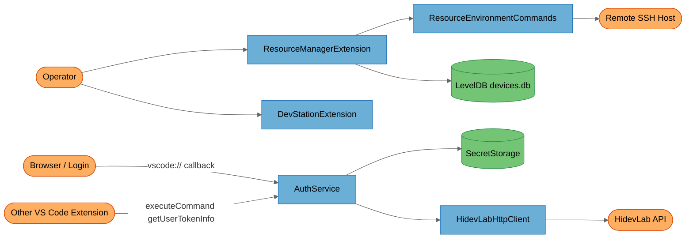

# openlibing-ide-plugin 安全威胁分析报告（master）

| 字段               | 值                                                                                                             |
| ------------------ | -------------------------------------------------------------------------------------------------------------- |
| 报告版本           | 2.0（单文件交付）                                                                                              |
| 分析日期           | 2026-10-10                                                                                                     |
| 仓库               | https://gitcode.com/openlibing/openlibing-ide-plugin.git                                                       |
| 分析分支           | `master`                                                                                                       |
| 分析提交           | `752ddba22532b56f9bf9d1f8efa0aed11bfba540`（2026-10-09，`ci: align job runs-on with unified runner standard`） |
| 上一基线           | `088fb81`（2026-09-03 报告 `threat-model-20260903-093753`）                                                    |
| 部署分类           | **LOCALHOST_DESKTOP**（VS Code / 兼容 IDE 扩展，无产品自有 TCP 监听）                                          |
| 总体风险评级       | **Elevated（升高）**                                                                                           |
| 开放发现           | **11 条**（T1: 0 / T2: 9 / T3: 2；Important: 5 / Moderate: 6）                                                 |
| 已缓解（相对上版） | **1 条**（HidevLab 登录凭证换取失败后的半失效会话）                                                            |

> **威胁数量说明：** 本报告采用 STRIDE-A（含 Abuse）对主要组件做定性枚举；与上版相比，组件逻辑未重构，威胁面以**复核 + CI 增量**为主，开放发现数量略减（1 项已修复），供应链控制增强（新增 SCA / 恶意代码 PR 扫描）。

> **分析范围：** 以 **origin/master 已提交代码** 为准（`752ddba`）。工作区若存在未提交改动，不纳入本报告基线。

---

## 1. 结论摘要

本仓库包含两款 IDE 扩展：**ResourceManager**（`local-build/`）与 **DevStation**（`DevStation/`），用于 HidevLab / OpenLibing 登录、远程环境管理、SSH/rsync 代码同步、YAML 任务编排与远程执行。

**攻击面口径（LOCALHOST_DESKTOP）：**

- 扩展**不对外监听端口**，不存在「无前提互联网直打产品服务」类 **Tier 1** 发现。
- 主要外部触发面包括：`vscode://` **深链登录回调**、HidevLab **HTTPS API**、用户触发的 **SSH/rsync**、以及 **CI `pull_request_target`** 对 fork PR 的检出策略。
- 本地威胁包括：**其他已安装扩展**调用命令、**恶意/被篡改工作区 YAML**、**Webview 渲染不可信后端字段**。

**相对 2026-09-03 基线（`088fb81`）的变化：**

| 类型     | 说明                                                                                                                                                                            |
| -------- | ------------------------------------------------------------------------------------------------------------------------------------------------------------------------------- |
| 已修复   | HidevLab 网页回调换取 `sessionId` 失败时，现通过 `handleHidevLabTokenExpired` 清空会话并引导重登，不再保留无效 `authTicket` 半登录态（`local-build/src/auth/AuthService.ts`）   |
| 新增控制 | `malicious-code-pr-scan.yml`、`sca-pr-scan.yml`、`code-metrics-scan.yml`；pre-commit 工作流与 action 版本对齐                                                                   |
| 持续风险 | TLS 校验关闭、SSH 主机密钥不校验、`openlibing.getUserTokenInfo` 暴露令牌、HidevLab 深链无 state、设备密码 LevelDB 明文、YAML `run` 本地/远程执行、CI `allow-unsafe-pr-checkout` |

**正向控制（已存在）：** OpenLibing 回调校验 `openLibingState`；用户 token 使用 `SecretStorage`；pre-commit 含 gitleaks / detect-secrets；MR 侧增加恶意代码与 SCA 扫描工作流。

### 1.1 总体风险评级

采用四档：**Critical / Elevated / Moderate / Low**。当前无 T1、无 Critical 单条发现，但存在 **5 条 Important**（TLS、SSH MITM、令牌命令暴露、HidevLab 深链 CSRF、YAML/远程命令执行）→ **Elevated**。

---

## 2. 系统架构与信任边界

### 2.1 组件（代码锚点）

| 组件 ID                     | 说明                                  | 主要代码路径                                              |
| --------------------------- | ------------------------------------- | --------------------------------------------------------- |
| ResourceManagerExtension    | ResourceManager 入口、URI 注册        | `local-build/src/extension.ts`                            |
| AuthService                 | 登录、token、HidevLab/OpenLibing 回调 | `local-build/src/auth/`                                   |
| AuthUriHandler              | `vscode://` 深链处理                  | `local-build/src/auth/AuthUriHandler.ts`                  |
| HidevLabHttpClient          | HidevLab API、Cookie sessionId        | `local-build/src/utils/HidevLabHttpClient.ts`             |
| ResourceEnvironmentCommands | SSH/rsync/SFTP、Remote SSH            | `local-build/src/register/ResourceEnvironmentCommands.ts` |
| StorageService              | SecretStorage + LevelDB 设备列表      | `local-build/src/utils/StorageService.ts`                 |
| ResourceEnvironmentView     | 侧栏 Webview UI                       | `local-build/src/webview/ResourceEnvironmentView.ts`      |
| DevStationExtension         | DevStation 入口                       | `DevStation/src/extension.ts`                             |
| TaskExecutor                | YAML 步骤本地 `exec` / 远程容器流程   | `DevStation/src/core/taskExecutor.ts`                     |
| ApiService                  | 远程 `runTask` 等 API                 | `DevStation/src/services/apiService.ts`                   |
| GitCodeCI                   | 构建、pre-commit、SCA、恶意代码扫描   | `.gitcode/workflows/*.yml`                                |

### 2.2 部署与暴露（Component Exposure）

| 组件               | 监听地址    | 认证屏障                 | 外部可达             | 最低利用前提                               |
| ------------------ | ----------- | ------------------------ | -------------------- | ------------------------------------------ |
| 两款扩展主进程     | 无 TCP      | IDE 用户会话             | 否（本地）           | 本地代码执行或用户交互                     |
| HidevLabHttpClient | 出站 HTTPS  | sessionId Cookie         | 是（到 HidevLab）    | 网络位置或恶意 CA/关闭 TLS 校验            |
| SSH/rsync 客户端   | 出站 22 等  | 密钥/密码                | 是（到实验室主机）   | 网络 MITM（配合 StrictHostKeyChecking=no） |
| vscode:// URI      | OS 协议处理 | 部分（OpenLibing state） | 是（需用户点击链接） | **用户点击** 恶意深链                      |
| GitCode CI         | 平台调度    | ROBOT_TOKEN 等           | PR/fork 场景         | 恶意 PR + `pull_request_target` 策略       |

**信任边界：**

1. **Application**：IDE 扩展进程 + Webview（同源 CSP 由 VS Code 约束，但脚本内仍用 `innerHTML`）。
2. **External**：HidevLab/OpenLibing、远程 SSH 主机、GitCode Runner、浏览器登录页。

### 2.3 数据流图（摘要）

---

## 3. STRIDE-A 摘要（按可利用性分层）

| 组件                         | T1  | T2  | T3  | 代表威胁                                                |
| ---------------------------- | --- | --- | --- | ------------------------------------------------------- |
| HidevLabHttpClient           | 0   | 2   | 1   | **I** TLS 关闭校验；**T** 中间人篡改 API                |
| ResourceEnvironmentCommands  | 0   | 3   | 1   | **I** MITM；**E** 远程命令拼接；**A** 误用 ProxyCommand |
| AuthUriHandler / AuthService | 0   | 2   | 1   | **S** HidevLab 无 state；**E** authority 校验过宽       |
| StorageService / LevelDB     | 0   | 1   | 1   | **I** 设备密码明文落盘                                  |
| ResourceEnvironmentView      | 0   | 1   | 0   | **T** Webview `innerHTML` XSS                           |
| AuthCommands                 | 0   | 1   | 0   | **I** 跨扩展令牌读取                                    |
| TaskExecutor / ApiService    | 0   | 2   | 0   | **E/A** YAML `run` 本地 shell / 远程 runTask            |
| GitCodeCI                    | 0   | 1   | 1   | **E/T** fork PR 检出与 `pull_request_target`            |

---

## 4. 安全发现（按可利用性 Tier 排序）

### Tier 2

#### FIND-01 — HidevLab 客户端禁用 TLS 证书校验

| 属性          | 值                                                                                                       |
| ------------- | -------------------------------------------------------------------------------------------------------- |
| 可利用性 Tier | **T2**（需不可信网络或恶意网关；非无交互远程直打扩展）                                                   |
| 修复工作量    | **Medium**                                                                                               |
| 严重度        | **Important**                                                                                            |
| CVSS 4.0      | **8.2** — `CVSS:4.0/AV:N/AC:H/AT:N/PR:N/UI:N/VC:H/VI:H/VA:N/SC:H/SI:H/SA:N`                              |
| CWE           | [CWE-295](https://cwe.mitre.org/data/definitions/295.html): Improper Certificate Validation              |
| OWASP         | **A02:2025 – Security Misconfiguration**                                                                 |
| 证据          | `local-build/src/utils/HidevLabHttpClient.ts` 构造函数：`process.env.NODE_TLS_REJECT_UNAUTHORIZED = "0"` |
| 影响          | 相邻网络或企业 TLS 拦截场景下，可窃听/篡改 sessionId 与 API 数据                                         |
| 建议          | 移除全局关闭校验；按环境使用受信 CA 或证书固定；仅在显式调试开关且非生产路径启用                         |

#### FIND-02 — SSH/rsync 禁用主机密钥校验（MITM）

| 属性          | 值                                                                                                                                              |
| ------------- | ----------------------------------------------------------------------------------------------------------------------------------------------- |
| 可利用性 Tier | **T2**                                                                                                                                          |
| 修复工作量    | **Medium**                                                                                                                                      |
| 严重度        | **Important**                                                                                                                                   |
| CVSS 4.0      | **7.5** — `CVSS:4.0/AV:N/AC:H/AT:N/PR:N/UI:N/VC:H/VI:H/VA:N/SC:N/SI:N/SA:N`                                                                     |
| CWE           | [CWE-322](https://cwe.mitre.org/data/definitions/322.html): Key Exchange without Entity Authentication                                          |
| OWASP         | **A02:2025 – Security Misconfiguration**                                                                                                        |
| 证据          | `StrictHostKeyChecking=no`、`UserKnownHostsFile=/dev/null` 于 `ResourceEnvironmentCommands.ts`、`SSHHelper.ts`、DevStation `rsyncService.ts` 等 |
| 建议          | 首次连接写入 `known_hosts` 或提示指纹确认；跳板机场景对 jump/target 分别校验                                                                    |

#### FIND-03 — 任意扩展可通过命令获取 Access Token

| 属性          | 值                                                                                             |
| ------------- | ---------------------------------------------------------------------------------------------- |
| 可利用性 Tier | **T2**                                                                                         |
| 修复工作量    | **Low**                                                                                        |
| 严重度        | **Important**                                                                                  |
| CVSS 4.0      | **6.8** — `CVSS:4.0/AV:L/AC:L/AT:N/PR:L/UI:N/VC:H/VI:N/VA:N/SC:H/SI:N/SA:N`                    |
| CWE           | [CWE-269](https://cwe.mitre.org/data/definitions/269.html): Improper Privilege Management      |
| OWASP         | **A01:2025 – Broken Access Control**                                                           |
| 证据          | `local-build/src/auth/AuthCommands.ts` 注册 `openlibing.getUserTokenInfo` 并返回 `accessToken` |
| 建议          | 改为仅本扩展 ID 可调用（自定义 RPC / 文档化私有 API + 调用方白名单）；或返回短期 scoped token  |

#### FIND-04 — HidevLab 深链回调缺少 CSRF/state 绑定

| 属性          | 值                                                                                                                                                      |
| ------------- | ------------------------------------------------------------------------------------------------------------------------------------------------------- |
| 可利用性 Tier | **T2**（需**用户点击**恶意 `vscode://` 链接）                                                                                                           |
| 修复工作量    | **Medium**                                                                                                                                              |
| 严重度        | **Important**                                                                                                                                           |
| CVSS 4.0      | **7.1** — `CVSS:4.0/AV:N/AC:L/AT:N/PR:N/UI:A/VC:H/VI:L/VA:N/SC:H/SI:L/SA:N`                                                                             |
| CWE           | [CWE-352](https://cwe.mitre.org/data/definitions/352.html): Cross-Site Request Forgery                                                                  |
| OWASP         | **A01:2025 – Broken Access Control**                                                                                                                    |
| 证据          | `AuthUriHandler.ts` 对 `authType=hidevlab` 仅校验 `authTicket`/`userId`，**无**与登录发起绑定的 state/nonce；OpenLibing 路径则有 `openLibingState` 校验 |
| 建议          | 与 OpenLibing 一致：登录前写入 `globalState`，回调强制校验；拒绝不匹配回调                                                                              |

#### FIND-05 — 任务 YAML `run` 本地 shell 执行（无沙箱）

| 属性          | 值                                                                             |
| ------------- | ------------------------------------------------------------------------------ |
| 可利用性 Tier | **T2**                                                                         |
| 修复工作量    | **High**                                                                       |
| 严重度        | **Important**                                                                  |
| CVSS 4.0      | **7.0** — `CVSS:4.0/AV:L/AC:L/AT:N/PR:N/UI:R/VC:H/VI:H/VA:H/SC:N/SI:N/SA:N`    |
| CWE           | [CWE-78](https://cwe.mitre.org/data/definitions/78.html): OS Command Injection |
| OWASP         | **A05:2025 – Injection**                                                       |
| 证据          | `DevStation/src/core/taskExecutor.ts` `executeStep` → `execAsync(step.run, …)` |
| 建议          | 默认远程执行并禁止本地 `exec`；或显式用户确认 + 命令白名单/解析器              |

#### FIND-06 — 远程 runTask 执行 YAML 中的 `run`

| 属性          | 值                                                                                               |
| ------------- | ------------------------------------------------------------------------------------------------ |
| 可利用性 Tier | **T2**                                                                                           |
| 修复工作量    | **Medium**                                                                                       |
| 严重度        | **Moderate**                                                                                     |
| CVSS 4.0      | **6.5** — `CVSS:4.0/AV:N/AC:L/AT:N/PR:L/UI:R/VC:L/VI:H/VA:L/SC:N/SI:N/SA:N`                      |
| CWE           | [CWE-94](https://cwe.mitre.org/data/definitions/94.html): Improper Control of Generation of Code |
| OWASP         | **A05:2025 – Injection**                                                                         |
| 证据          | `taskExecutor.executeTaskWithContainer` → `apiService.executeTask(..., step.run, ...)`           |
| 建议          | 服务端命令策略 + 客户端提交前校验；限制工作区外 YAML 加载                                        |

#### FIND-07 — Webview 使用 `innerHTML` 渲染设备名/描述

| 属性          | 值                                                                                                                            |
| ------------- | ----------------------------------------------------------------------------------------------------------------------------- |
| 可利用性 Tier | **T2**（需恶意/被篡改 API 字段 + 用户打开侧栏）                                                                               |
| 修复工作量    | **Low**                                                                                                                       |
| 严重度        | **Moderate**                                                                                                                  |
| CVSS 4.0      | **5.8** — `CVSS:4.0/AV:L/AC:L/AT:N/PR:N/UI:R/VC:L/VI:L/VA:N/SC:L/SI:L/SA:N`                                                   |
| CWE           | [CWE-79](https://cwe.mitre.org/data/definitions/79.html): Cross-site Scripting                                                |
| OWASP         | **A05:2025 – Injection**                                                                                                      |
| 证据          | `ResourceEnvironmentView.ts` 中 `deviceList.innerHTML = devices.map(... ${device.name} ... ${device.backendDescription} ...)` |
| 建议          | 使用 `textContent` / DOM API 或严格转义；启用 CSP nonce（若 HTML 外置）                                                       |

#### FIND-08 — 设备 SSH 密码写入 LevelDB 明文

| 属性          | 值                                                                                                     |
| ------------- | ------------------------------------------------------------------------------------------------------ |
| 可利用性 Tier | **T2**                                                                                                 |
| 修复工作量    | **Medium**                                                                                             |
| 严重度        | **Moderate**                                                                                           |
| CVSS 4.0      | **5.5** — `CVSS:4.0/AV:L/AC:L/AT:N/PR:L/UI:N/VC:H/VI:N/VA:N/SC:N/SI:N/SA:N`                            |
| CWE           | [CWE-312](https://cwe.mitre.org/data/definitions/312.html): Cleartext Storage of Sensitive Information |
| OWASP         | **A02:2025 – Security Misconfiguration**                                                               |
| 证据          | `StorageService.saveDevices` → `devicesDB.put("devices", devices)`，设备对象含 `password` 字段         |
| 建议          | 密码仅存 `SecretStorage`（按 deviceId 键）；LevelDB 只存非敏感元数据                                   |

#### FIND-09 — sshpass 将密码置于命令行/进程列表

| 属性          | 值                                                                                                           |
| ------------- | ------------------------------------------------------------------------------------------------------------ |
| 可利用性 Tier | **T2**                                                                                                       |
| 修复工作量    | **Medium**                                                                                                   |
| 严重度        | **Moderate**                                                                                                 |
| CVSS 4.0      | **5.3** — `CVSS:4.0/AV:L/AC:L/AT:N/PR:L/UI:N/VC:H/VI:N/VA:N/SC:N/SI:N/SA:N`                                  |
| CWE           | [CWE-214](https://cwe.mitre.org/data/definitions/214.html): Invocation of Process with Sensitive Information |
| OWASP         | **A02:2025 – Security Misconfiguration**                                                                     |
| 证据          | `ResourceEnvironmentCommands.ts` / `rsyncService.ts` 等：`sshpass -p '${device.password}'`                   |
| 建议          | 优先 SSH 密钥；或使用 SSH_ASKPASS / 环境变量文件权限 0600，避免 argv 暴露                                    |

#### FIND-10 — CI：`pull_request_target` + `allow-unsafe-pr-checkout`

| 属性          | 值                                                                                                                            |
| ------------- | ----------------------------------------------------------------------------------------------------------------------------- |
| 可利用性 Tier | **T2**（针对**仓库/Runner**，非终端用户桌面）                                                                                 |
| 修复工作量    | **Medium**                                                                                                                    |
| 严重度        | **Moderate**                                                                                                                  |
| CVSS 4.0      | **6.0** — `CVSS:4.0/AV:N/AC:H/AT:N/PR:L/UI:N/VC:L/VI:H/VA:L/SC:N/SI:N/SA:N`                                                   |
| CWE           | [CWE-829](https://cwe.mitre.org/data/definitions/829.html): Inclusion of Functionality from Untrusted Control Sphere          |
| OWASP         | **A03:2025 – Software Supply Chain Failures**                                                                                 |
| 证据          | `.gitcode/workflows/build.yml`、`pre-commit.yml` 等：`pull_request_target` + `allow-unsafe-pr-checkout: true` + `ROBOT_TOKEN` |
| 说明          | master 已增加 `malicious-code-pr-scan` / `sca-pr-scan`，**缓解但未消除**恶意 PR 与特权工作流组合风险                          |
| 建议          | fork PR 使用 `pull_request` + 只读权限；敏感 secret 不进入 untrusted 检出 job；或人工批准 gate                                |

### Tier 3

#### FIND-11 — URI authority 校验过宽

| 属性          | 值                                                              |
| ------------- | --------------------------------------------------------------- |
| 可利用性 Tier | **T3**                                                          |
| 修复工作量    | **Low**                                                         |
| 严重度        | **Moderate**                                                    |
| 证据          | `AuthUriHandler.ts`：未知 `uri.authority` 仅 warning 仍继续处理 |
| 建议          | 严格白名单 + 拒绝；记录审计日志                                 |

#### FIND-12 — 自动生成 SSH 密钥空口令（若仍启用）

| 属性          | 值                                                                                           |
| ------------- | -------------------------------------------------------------------------------------------- |
| 可利用性 Tier | **T3**                                                                                       |
| 修复工作量    | **Low**                                                                                      |
| 严重度        | **Moderate**                                                                                 |
| 证据          | `TaskExecutor` / ResourceManager 路径存在 `ssh-keygen ... -N ""` 逻辑（密钥文件权限依赖 OS） |
| 建议          | 引导用户设置 passphrase 或使用 ssh-agent                                                     |

### 已缓解（相对上版基线）

| ID     | 说明                                         | 证据                                                                                                           |
| ------ | -------------------------------------------- | -------------------------------------------------------------------------------------------------------------- |
| MIT-01 | HidevLab 换取 session 失败不再保留半失效会话 | `AuthService.handleHidevLabCallback` catch → `handleHidevLabTokenExpired` + `return false`（master `752ddba`） |

---

## 5. 供应链与 CI（master 增量）

自 `088fb81` 以来，master 新增/强化：

| 工作流                       | 作用                                                       |
| ---------------------------- | ---------------------------------------------------------- |
| `malicious-code-pr-scan.yml` | PR 恶意代码扫描（`openlibing/malicious-code-scan-action`） |
| `sca-pr-scan.yml`            | 依赖/组件 SCA PR 扫描                                      |
| `code-metrics-scan.yml`      | 代码度量                                                   |
| `pre-commit.yml`             | 与统一 runner、pre-commit action 版本对齐                  |

**残留风险：** `build` / `pre-commit` 仍对 PR 使用 `pull_request_target` 与 `allow-unsafe-pr-checkout`（见 FIND-10）。扩展 VSIX **构建产物**本身仍依赖 npm 供应链与自托管 Runner 完整性。

---

## 6. Action Summary（修复优先级）

### Quick Wins（工作量 Low，优先）

| 发现    | 动作                                         |
| ------- | -------------------------------------------- |
| FIND-03 | 限制 `getUserTokenInfo` 调用方或取消对外暴露 |
| FIND-07 | Webview 去掉 `innerHTML` 拼接用户/API 字段   |
| FIND-11 | URI authority 改为 fail-closed               |

### 中期（Medium）

| 发现    | 动作                     |
| ------- | ------------------------ |
| FIND-01 | 恢复 TLS 校验            |
| FIND-02 | SSH 主机密钥信任模型     |
| FIND-04 | HidevLab 登录 state      |
| FIND-08 | 设备密码迁 SecretStorage |
| FIND-09 | 去掉 sshpass 命令行传密  |
| FIND-10 | 收紧 fork PR CI 模型     |

### 结构性（High）

| 发现              | 动作                                 |
| ----------------- | ------------------------------------ |
| FIND-05 / FIND-06 | YAML 执行策略：沙箱、确认、远程-only |

---

## 7. 分析上下文与待核实项

### 7.1 假设

- 分析基于静态代码与工作流 YAML，**未**对 HidevLab 服务端做黑盒渗透。
- 默认用户使用官方 IDE 渠道安装 VSIX，Runner 为组织可信自托管环境。

### 7.2 Needs Verification

| 项                                     | 原因                                                            |
| -------------------------------------- | --------------------------------------------------------------- |
| HidevLab 服务端是否校验 deep link 来源 | 客户端无 state 时，服务端策略可能影响 CSRF 实际可利用性         |
| `malicious-code-pr-scan` 是否阻塞合入  | 工作流仅 `on: pull_request_target`，需确认是否与 build 门禁联动 |
| 生产环境是否强制 SSH 密钥而禁用密码    | 若 UI 禁用密码，FIND-08/09 实际暴露面下降                       |

---

## 8. 报告元数据

| 字段     | 值                                                                         |
| -------- | -------------------------------------------------------------------------- |
| 分析开始 | 2026-10-10 17:19:41（本地）                                                |
| 分析完成 | 2026-10-10 17:35:00（本地，估算）                                          |
| 方法     | STRIDE-A、零信任假设、OWASP Top 10:2025 交叉检查                           |
| 模型     | 静态代码审查 + 工作流审查                                                  |
| 排除目录 | `node_modules/`, `out/`, `dist/`, 历史 `threat-model-*` 报告夹（只读引用） |

---

## 9. 参考

### 安全标准

| 名称                       | 用途         | 链接                                                            |
| -------------------------- | ------------ | --------------------------------------------------------------- |
| OWASP Top 10:2025          | 分类映射     | https://owasp.org/Top10/                                        |
| CWE                        | 弱点类型     | https://cwe.mitre.org/                                          |
| CVSS 4.0                   | 评分         | https://www.first.org/cvss/v4.0/specification-document          |
| VS Code Extension Security | 扩展威胁模型 | https://code.visualstudio.com/api/references/extension-manifest |

### 组件文档

| 组件                       | 说明     | 链接                                                                                                 |
| -------------------------- | -------- | ---------------------------------------------------------------------------------------------------- |
| VS Code UriHandler         | 深链回调 | https://code.visualstudio.com/api/references/vscode-api#UriHandler                                   |
| GitHub pull_request_target | CI 威胁  | https://docs.github.com/en/actions/using-workflows/events-that-trigger-workflows#pull_request_target |

---

**分类说明：** 本仓库为 **LOCALHOST_DESKTOP** 场景，所有发现均 **非 Tier 1**；优先治理 Important 项可将总体评级从 **Elevated** 下调至 **Moderate**。
