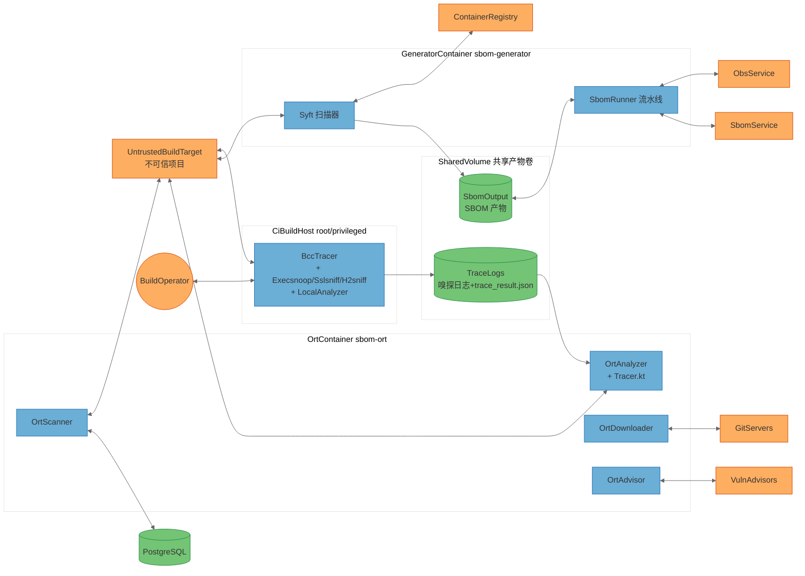
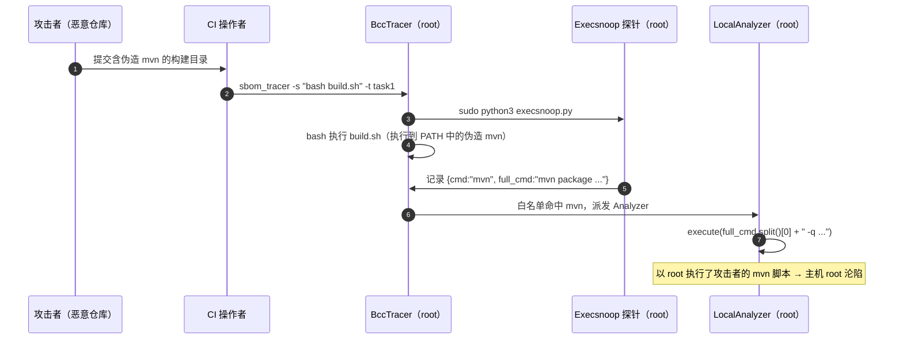
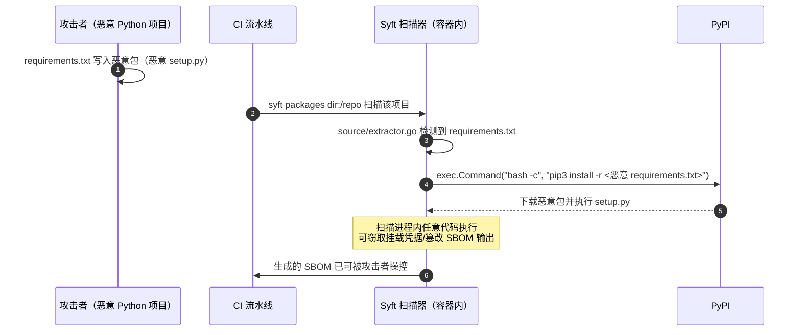
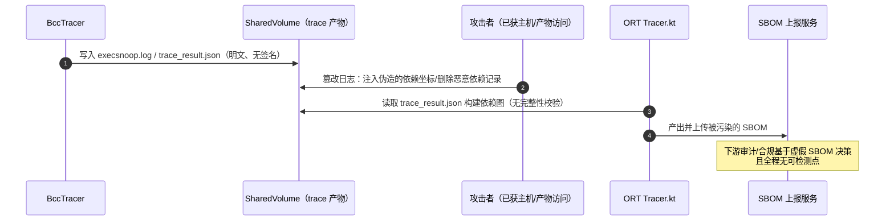

# openlibing-sbom-tools 威胁建模分析报告（STRIDE-A）

> **方法说明**：本报告基于 STRIDE-A（Spoofing / Tampering / Repudiation / Information Disclosure / Denial of Service / Elevation of Privilege / **Abuse**）威胁建模方法，结合 Zero Trust 与纵深防御原则，对仓库 `openlibing-sbom-tools`（commit `2b8fad603`，分支 `main`）进行全量静态分析。所有发现均经过代码证据核实（verify-before-flagging），每条发现附 CVSS 4.0 向量、CWE 与 OWASP Top 10:2025 映射。
>
> **注（威胁计数口径）**：本报告共识别 **21 个被分析元素**（组件/外部服务）、约 **70 条具体威胁**，经去重合并后沉淀为 **17 条安全发现**。威胁条目是分析过程记录，发现（Finding）才是行动项；多条威胁合并到同一发现属于正常整合。

---

## 1. 执行摘要

`openlibing-sbom-tools` 是一套 **SBOM（软件物料清单）工具链**，由三个子模块组成：

| 子模块             | 技术栈                               | 来源             | 职责                                                                                                          |
| ------------------ | ------------------------------------ | ---------------- | ------------------------------------------------------------------------------------------------------------- |
| **sbom-tracer**    | Python + eBPF/BCC                    | 自研             | 构建期依赖追踪：以 root 权限挂载 execsnoop/sslsniff/h2sniff 探针，嗅探构建过程中的 exec 调用与 TLS/HTTP2 流量 |
| **sbom-generator** | Go（Syft v0.51 fork）+ Python 流水线 | Syft fork + 定制 | 扫描目录/镜像生成 SBOM，从 OBS 拉取元数据并上传 SBOM 服务                                                     |
| **sbom-ort**       | Kotlin/Java（ORT ≈19.x，2022 年版）  | ORT fork + 定制  | 依赖分析、源码下载、漏洞咨询、扫描（含自定义 `Tracer` 包管理器，读取 sbom-tracer 产出）                       |

**总体评价**：三个子模块均为 **CLI/CI 构建工具，无任何网络监听端口**，因此不存在"未认证远程攻击者直接利用"的 Tier 1 暴露面。但该工具链的**核心工作模式是"以特权身份处理不可信输入"**——以 root 嗅探/追踪任意构建过程、以扫描器身份解析任意仓库内容——这使它天然处于供应链攻击的火线上。本次分析识别出 3 类主要风险簇：

1. **特权执行链被不可信构建内容劫持（最高风险）**
   - sbom-tracer 以 root/sudo 运行，且其 analyzer 会**再次执行被追踪进程的 argv[0]**（如 `mvn`、`git`）——构建目录中的伪造 `mvn` 二进制将以 root 执行（[mvn_analyzer.py](file:///d:/CODE/JAVACODE/openlibing-sbom-tools/sbom-tracer/sbom_tracer/local_analyzer/mvn_analyzer.py)）。
   - sbom-generator 在扫描期对被扫描项目执行 `pip3 install -r requirements.txt`（[extractor.go](file:///d:/CODE/JAVACODE/openlibing-sbom-tools/sbom-generator/syft/source/extractor.go#L371-L386)），恶意 requirements.txt 即可在扫描期安装并执行任意代码。

2. **高价值凭据的多路明文暴露**
   - 探针捕获的 TLS 明文载荷（含 Authorization/token）与完整 argv 未做任何脱敏即落盘并打包进产物；
   - OBS AK/SK、SBOM_SECRET_KEY 以**命令行参数**传递（`ps` 可见）；
   - SSH 私钥被 `COPY` 进镜像层且 `StrictHostKeyChecking=no`（[Dockerfile_local](file:///d:/CODE/JAVACODE/openlibing-sbom-tools/sbom-generator/sbom_runner/build/Dockerfile_local#L3-L5)）。

3. **SBOM 全链路完整性缺失（工具链的产出即信任锚，但全程无签名）**
   - 嗅探日志 → `trace_result.json` → ORT 依赖图 → SBOM 文件 → 上报服务，任一环节均可被篡改而不可检测（OWASP A08），直接动摇 SBOM 的可信性。

### 快速修复（Quick Wins，Tier 2 低成本项）

| 编号    | 措施                                                                                     | 修复成本 |
| ------- | ---------------------------------------------------------------------------------------- | -------- |
| FIND-04 | OBS AK/SK、SBOM_SECRET_KEY 从命令行参数改为环境变量/文件传递                             | Low      |
| FIND-05 | 删除 `COPY id_* /root/.ssh/`，改用构建参数/挂载注入密钥；移除 `StrictHostKeyChecking=no` | Low      |
| FIND-06 | OBS 下载路径增加 `os.path.normpath` 归一化 + 前缀校验                                    | Low      |
| FIND-10 | 对 `task_id` 做白名单校验（`[A-Za-z0-9_-]`）                                             | Low      |
| FIND-16 | `install.sh` / `requirements.txt` 锁定依赖版本并校验哈希                                 | Low      |

---

## 2. 分析范围与方法论

- **分析对象**：仓库根目录下 `sbom-tracer/`、`sbom-generator/`、`sbom-ort/` 三个子模块（sbom-ort 为大型 vendored fork，按模块级粒度建模，不逐文件展开）。
- **威胁分类**：STRIDE-A 六类 + Abuse（业务逻辑滥用/合法功能滥用）。授权类问题归入 E（权限提升）。
- **可利用性分层**（按利用前置条件，非按严重度）：
  - **Tier 1（直接暴露）**：无需任何前置访问。_本系统无网络监听组件，故不存在 Tier 1 发现。_
  - **Tier 2（条件风险）**：需单一前置（如 `Authenticated User`、`Local Process Access`、`Internal Network`）。
  - **Tier 3（纵深防御）**：需多重前置或基础设施访问（`Host/OS Access`、`{Component} Compromise` 等）。
- **评级标准**：CVSS 4.0 Base（评分为依据向量的基线评估值）；CWE（带编号）；OWASP Top 10:2025。
- **排除项**：`node_modules`、`.git`、构建产物目录；上游 fork 中与本仓库定制无关的纯第三方测试代码仅在模块级评估。

## 3. 架构概览

### 3.1 部署模型与分类

**部署分类（Deployment Classification）：`CI_BUILD_TOOLCHAIN`（等效 `LOCALHOST_DESKTOP` 约束）**

依据代码证据：三个子模块均为 CLI 工具或一次性容器任务，**无任何监听端口、无 HTTP 服务端、无 K8s Service/Ingress**。因此：

- 本报告**不存在 Tier 1 发现**，所有威胁的利用前置条件均 ≥ 单一访问条件；
- 所有内部组件 CVSS 攻击向量不使用 `AV:N`（除经由镜像仓库/外部服务分发渠道的凭据暴露，见 FIND-05，其可达性来自 registry 而非监听端口）。

典型运行形态：

- sbom-tracer：CI 构建机上直接安装（root + 免密 sudo），或 `--privileged` 容器（README 明确要求）；
- sbom-generator：alpine 容器一次性任务（`docker run -v output:/sbom/output -e TOKEN=...`）；
- sbom-ort：自带全量包管理器的 Docker 多阶段构建镜像，一次性分析任务。

### 3.2 组件暴露表（Component Exposure Table，本表为前置条件下限的唯一事实来源）

| 组件                 | 锚点（代码证据）                                                                             | 监听 | 认证屏障       | 外部可达   | 最小利用前置                         | 推导分层 |
| -------------------- | -------------------------------------------------------------------------------------------- | ---- | -------------- | ---------- | ------------------------------------ | -------- |
| BccTracer            | `sbom-tracer/sbom_tracer/tracer/bcc_tracer.py`（类 `BccTracer`）、`main.py`                  | 无   | 无（CLI）      | 否         | Authenticated User（触发被追踪构建） | T2       |
| Execsnoop            | `sbom_tracer/bcc/execsnoop.py`                                                               | 无   | 无             | 否         | Authenticated User                   | T2       |
| Sslsniff             | `sbom_tracer/bcc/sslsniff.py`                                                                | 无   | 无             | 否         | Authenticated User                   | T2       |
| H2sniff              | `sbom_tracer/bcc/h2sniff.py`                                                                 | 无   | 无             | 否         | Authenticated User                   | T2       |
| LocalAnalyzer        | `sbom_tracer/local_analyzer/`（`AnalyzerFactory`、`MvnAnalyzer` 等）                         | 无   | 无             | 否         | Authenticated User                   | T2       |
| TraceLogs            | `trace_data/*.log`、`*_tracer_result.tar.gz`                                                 | 无   | 文件系统权限   | 产物外发   | Local Process Access                 | T2       |
| Syft                 | `sbom-generator/cmd/syft`、`syft/`（含 `source/extractor.go`、`pkg/cataloger/bingo/`）       | 无   | 无（CLI）      | 否         | Authenticated User（触发扫描）       | T2       |
| SbomRunner           | `sbom-generator/sbom_runner/`（`run.sh`、`sbom-gen-upload.py`、`download_file_from_obs.py`） | 无   | 无             | 否         | Privileged User（控制流水线参数）    | T2       |
| SbomOutput           | SBOM 产物文件（挂载卷）                                                                      | 无   | 文件系统权限   | 产物外发   | Local Process Access                 | T2       |
| OrtAnalyzer          | `sbom-ort/analyzer/src/main/kotlin/managers/`                                                | 无   | 无（CLI）      | 否         | Authenticated User（触发分析）       | T2       |
| Tracer               | `sbom-ort/analyzer/src/main/kotlin/managers/Tracer.kt`（本仓库定制）                         | 无   | 无             | 否         | Authenticated User                   | T2       |
| OrtDownloader        | `sbom-ort/downloader/src/main/kotlin/`                                                       | 无   | 无             | 否         | Authenticated User                   | T2       |
| OrtScanner           | `sbom-ort/scanner/src/main/kotlin/`（含 `storages/PostgresStorage.kt`）                      | 无   | 无             | 否         | Authenticated User                   | T2       |
| OrtAdvisor           | `sbom-ort/advisor/src/main/kotlin/advisors/`                                                 | 无   | 无             | 否         | Authenticated User                   | T2       |
| UntrustedBuildTarget | 被构建/被扫描的第三方项目（外部实体）                                                        | —    | —              | 是         | 无（其本身就是攻击载荷）             | —        |
| ObsService           | 华为 OBS（外部，锚点 `download_file_from_obs.py`、`esdk-obs-python`）                        | —    | AK/SK          | 是         | Admin Credentials（桶控制权）        | T3       |
| SbomService          | SBOM 上报服务（外部，锚点 `sbom-gen-upload.py:201-212`）                                     | —    | HMAC 签名      | 是         | Authenticated User                   | T2       |
| ContainerRegistry    | 镜像仓库（外部，锚点 `go.mod`：stereoscope/go-containerregistry）                            | —    | registry 凭据  | 是         | Authenticated User                   | T2       |
| GitServers           | 代码托管（外部，锚点 `Dockerfile_local` git clone、OrtDownloader）                           | —    | SSH/HTTPS 凭据 | 是         | Authenticated User                   | T2       |
| VulnAdvisors         | OSV/OSS Index/VulnerableCode 等（外部，锚点 `advisor/.../advisors/*.kt`）                    | —    | API Key        | 是         | Authenticated User                   | T2       |
| PostgreSQL           | ORT scanner 存储后端（外部，锚点 `storages/PostgresStorage.kt`）                             | —    | DB 凭据        | 否（内网） | Internal Network                     | T2       |
| BuildOperator        | 构建操作者 / CI 触发者（外部参与者，威胁源，不做 STRIDE 分析）                               | —    | —              | —          | —                                    | —        |

### 3.3 信任边界与数据流图（DFD 汇总视图）

组件总数（含外部实体）> 15，按规范给出边界级汇总 DFD：

### 3.4 数据流清单

| 流 ID | 源 <--> 目标                             | 内容                                                             | 跨信任边界   |
| ----- | ---------------------------------------- | ---------------------------------------------------------------- | ------------ |
| DF01  | BuildOperator <--> BccTracer             | CLI 参数（-s 构建命令、-t task_id）、结果                        | 是           |
| DF02  | BccTracer <--> UntrustedBuildTarget      | 以 `bash <workspace>/<task>_sbom_tracer.sh` 执行被追踪构建       | 是           |
| DF03  | BccTracer --> Execsnoop/Sslsniff/H2sniff | `sudo python3 <probe> --task-id` 启动探针                        | 否（同边界） |
| DF04  | 探针 --> TraceLogs                       | execsnoop.log / sslsniff.log / h2sniff.log（明文 JSON）          | 否           |
| DF05  | BccTracer <--> TraceLogs                 | 解析日志、分发 analyzer、tar.gz 打包                             | 否           |
| DF06  | LocalAnalyzer <--> UntrustedBuildTarget  | 以 root 重放被追踪命令 argv[0]、chdir 到不可信 cwd、拷贝定义文件 | 是           |
| DF07  | Syft <--> UntrustedBuildTarget           | 读取被扫描目录、venv/pip 安装、bingo 执行                        | 是           |
| DF08  | Syft <--> ContainerRegistry              | 拉取镜像解析                                                     | 是           |
| DF09  | Syft --> SbomOutput                      | 写 SPDX SBOM                                                     | 否           |
| DF10  | SbomRunner <--> ObsService               | 下载 meta.json/产物、上传结果（AK/SK 鉴权）                      | 是           |
| DF11  | SbomRunner <--> SbomService              | POST `/sbom-api/publishSbomFile`（HMAC 签名头）                  | 是           |
| DF12  | SbomRunner <--> SbomOutput               | 读取 SBOM 并上传                                                 | 否           |
| DF13  | TraceLogs --> Tracer(Tracer.kt)          | 读取 `trace_result.json` 注入 ORT 依赖图                         | 是           |
| DF14  | OrtAnalyzer <--> UntrustedBuildTarget    | 执行包管理器（Maven/Gradle/NPM…26 个）                           | 是           |
| DF15  | OrtDownloader <--> GitServers            | git clone / 归档下载（.netrc/env 凭据）                          | 是           |
| DF16  | OrtScanner <--> PostgreSQL               | 扫描结果/provenance 存取（JDBC）                                 | 是           |
| DF17  | OrtAdvisor <--> VulnAdvisors             | 漏洞查询（OSV/OSS Index/…）                                      | 是           |
| DF18  | OrtScanner <--> UntrustedBuildTarget     | ScanCode/FossID/ScanOSS 扫描源码                                 | 是           |

### 3.5 典型攻击场景（含时序图）

#### 场景 1：伪造 mvn 二进制 → root 提权（FIND-01）

攻击者在开源仓库构建目录放置名为 `mvn` 的恶意可执行脚本并使其出现在 PATH。sbom-tracer 的 execsnoop 捕获 `mvn ...` 记录，白名单命中后 `MvnAnalyzer` 以 **tracer 的 root 权限**重新执行 `full_cmd.split()[0]`。

#### 场景 2：恶意 requirements.txt → 扫描期任意代码执行（FIND-07）

#### 场景 3：追踪日志篡改 → SBOM 投毒（FIND-08）

## 4. 安全基础设施盘点（现有控制）

| 类别         | 现状                                                                                                                              | 证据                                                |
| ------------ | --------------------------------------------------------------------------------------------------------------------------------- | --------------------------------------------------- |
| 认证/鉴权    | **无统一机制**。外部调用仅靠 AK/SK + HMAC（SbomService）、AK/SK（OBS）、API Key（ORT advisors/scanners），全部经环境变量/配置注入 | `sbom-gen-upload.py:164-199`、`OrtAuthenticator.kt` |
| 命令执行隔离 | **无**。`subprocess` 使用 `shell=False` + `shlex.split`（良好），但对被追踪/被扫描内容的执行无沙箱                                | `shell_util.py:19,41`                               |
| 凭据管理     | 依赖环境变量与构建参数；存在命令行传参、镜像层 COPY 私钥等反模式                                                                  | `run.sh:3-10`、`Dockerfile_local:4`                 |
| 完整性校验   | **缺失**。trace 日志、trace_result.json、OBS 下载物、SBOM 产物均无签名/哈希校验（cosign 依赖存在但仅用于 attest 功能）            | `go.mod`（sigstore/cosign）、`Tracer.kt`            |
| 日志与审计   | 有构建日志，无安全事件审计、无防篡改保护                                                                                          | `bcc_tracer.py:275-303`                             |
| 容器加固     | 未定义 `USER`（root 运行）；tracer 需要 privileged 或 cap_sys_admin/cap_syslog/cap_ipc_lock（功能必需，但无进一步收敛）           | `sbom-tracer/README.md`、各 Dockerfile              |
| 反序列化     | PyYAML 使用 `safe_load`（安全）；Go 侧标准库 Unmarshal（低风险）；无 ObjectInputStream/XStream                                    | `common_util.py:49`                                 |

## 5. STRIDE-A 威胁分析

### 5.0 汇总表（T1/T2/T3 分层，数字为具体威胁条数）

| 组件                 | S     | T      | R     | I      | D      | E     | A     | 小计    |
| -------------------- | ----- | ------ | ----- | ------ | ------ | ----- | ----- | ------- |
| BccTracer            | 1     | 1      | 0     | 0      | 1      | 0     | 1     | 4       |
| Execsnoop            | 0     | 1      | 0     | 1      | 1      | 0     | 0     | 3       |
| Sslsniff             | 0     | 1      | 0     | 2      | 1      | 0     | 1     | 5       |
| H2sniff              | 0     | 1      | 0     | 1      | 1      | 0     | 0     | 3       |
| LocalAnalyzer        | 0     | 2      | 0     | 1      | 1      | 1     | 1     | 6       |
| TraceLogs            | 0     | 1      | 0     | 1      | 1      | 0     | 0     | 3       |
| Syft                 | 0     | 1      | 0     | 1      | 1      | 2     | 0     | 5       |
| SbomRunner           | 1     | 2      | 1     | 1      | 0      | 1     | 0     | 6       |
| SbomOutput           | 0     | 1      | 0     | 1      | 0      | 0     | 0     | 2       |
| OrtAnalyzer          | 0     | 1      | 0     | 0      | 1      | 1     | 0     | 3       |
| Tracer               | 0     | 1      | 0     | 0      | 1      | 0     | 1     | 3       |
| OrtDownloader        | 0     | 1      | 0     | 1      | 1      | 0     | 0     | 3       |
| OrtScanner           | 1     | 1      | 0     | 1      | 1      | 0     | 0     | 4       |
| OrtAdvisor           | 0     | 1      | 0     | 1      | 1      | 0     | 1     | 4       |
| UntrustedBuildTarget | 0     | 1      | 0     | 1      | 0      | 0     | 1     | 3       |
| ObsService           | 1     | 1      | 0     | 1      | 0      | 0     | 0     | 3       |
| SbomService          | 1     | 1      | 1     | 1      | 1      | 0     | 0     | 5       |
| ContainerRegistry    | 0     | 1      | 0     | 1      | 0      | 0     | 0     | 2       |
| GitServers           | 1     | 1      | 0     | 1      | 0      | 0     | 0     | 3       |
| VulnAdvisors         | 0     | 1      | 0     | 1      | 1      | 0     | 0     | 3       |
| PostgreSQL           | 1     | 1      | 0     | 1      | 0      | 1     | 0     | 4       |
| **合计**             | **6** | **24** | **2** | **20** | **15** | **6** | **6** | **~72** |

> 所有组件分层均为 T2/T3（见 3.2 暴露表），无 T1 行。

### 5.1 BccTracer（追踪编排器，root）

| 编号   | 层  | 类别 | 威胁                                                                                                                                                     | 前置条件             | 缓解建议                         | 状态           |
| ------ | --- | ---- | -------------------------------------------------------------------------------------------------------------------------------------------------------- | -------------------- | -------------------------------- | -------------- |
| T01.S1 | T2  | S    | `task_id` 未校验直接拼入工作区路径与探针命令行（`main.py`、`bcc_tracer.py:116-124`），可构造 `../` 污染路径归属/覆盖                                     | Authenticated User   | 白名单校验 task_id               | Open → FIND-10 |
| T01.T1 | T3  | T    | 追踪产物（tar.gz）无签名/哈希，落盘后被替换不可检测                                                                                                      | Host/OS Access       | 产物签名                         | Open → FIND-08 |
| T01.D1 | T2  | D    | `stop_trace` 用 `ps\|grep task-id\|awk\|xargs sudo kill` 字符串匹配杀进程（`bcc_tracer.py:191-215`），可误杀/被诱导杀死同主机其他用户的进程（root kill） | Local Process Access | 按记录的 PID 精确终止            | Open → FIND-12 |
| T01.A1 | T2  | A    | 特权嗅探功能本身可被授权操作者滥用为主机级凭据/行为监视器（合法功能滥用）                                                                                | Authenticated User   | 使用审计与最小授权，限定运行账户 | Open → FIND-02 |
| —      | —   | R    | N/A — 单机构建工具，无可抵赖事务模型                                                                                                                     | —                    | —                                | —              |

### 5.2 Execsnoop（exec 事件探针，root）

| 编号   | 层  | 类别    | 威胁                                                                                                       | 前置条件                       | 缓解建议               | 状态           |
| ------ | --- | ------- | ---------------------------------------------------------------------------------------------------------- | ------------------------------ | ---------------------- | -------------- |
| T02.T1 | T2  | T       | execsnoop.log 为明文 JSON，可被篡改注入/删除 exec 记录，直接扭曲依赖清单                                   | Local Process Access           | 产物完整性保护         | Open → FIND-08 |
| T02.I1 | T2  | I       | 记录**完整 argv**（`execsnoop.py:213-234`），命令行中传递的密码/token（如 `-Dpassword=...`）明文落盘并打包 | Authenticated User（获得产物） | 对 argv 做敏感模式脱敏 | Open → FIND-02 |
| T02.D1 | T3  | D       | root 探针的 perf 缓冲区在高 exec 频率下事件洪泛/溢出，影响主机资源                                         | Host/OS Access                 | 限流与采样             | Open → FIND-11 |
| —      | —   | S/E/R/A | N/A — 探针无独立身份体系；root 为设计必需权限，无独立提升路径；无事务与业务逻辑面                          | —                              | —                      | —              |

### 5.3 Sslsniff（TLS 写出嗅探，root，pid=-1 全局挂载）

| 编号   | 层  | 类别  | 威胁                                                                                                                                            | 前置条件                                   | 缓解建议                      | 状态           |
| ------ | --- | ----- | ----------------------------------------------------------------------------------------------------------------------------------------------- | ------------------------------------------ | ----------------------------- | -------------- |
| T03.I1 | T2  | I     | 捕获 `SSL_write/gnutls_record_send/PR_Write` 明文载荷（`sslsniff.py:88-98`），**Authorization 头、token、密码全量落盘**（`:138-140`）无任何脱敏 | Authenticated User（获得日志/产物）        | 字段级脱敏 + 日志加密         | Open → FIND-02 |
| T03.I2 | T2  | I     | `pid=-1` 全局挂载：共享 CI 主机上可捕获**其他任务/其他用户进程**的 TLS 写出 → 跨租户凭据泄露                                                    | Local Process Access（同主机其他租户视角） | 按 pid/进程树过滤到被追踪进程 | Open → FIND-03 |
| T03.T1 | T2  | T     | 嗅探日志可被注入伪造 HTTP 记录，污染依赖溯源结论                                                                                                | Local Process Access                       | 完整性保护                    | Open → FIND-08 |
| T03.D1 | T3  | D     | 高流量下 8KB 截断 + perf 环压力，root 进程资源消耗可被放大                                                                                      | Host/OS Access                             | 采样/限流                     | Open → FIND-11 |
| T03.A1 | T2  | A     | 嗅探器可被重定向/复用为凭据收集器（滥用合法能力）                                                                                               | Authenticated User                         | 权限收敛 + 审计               | Open → FIND-02 |
| —      | —   | S/E/R | N/A — 无身份伪造面；root 为功能必需；无事务                                                                                                     | —                                          | —                             | —              |

### 5.4 H2sniff（HTTP/2 嗅探，root）

| 编号   | 层  | 类别    | 威胁                                                                                                                  | 前置条件                                 | 缓解建议           | 状态           |
| ------ | --- | ------- | --------------------------------------------------------------------------------------------------------------------- | ---------------------------------------- | ------------------ | -------------- |
| T04.I1 | T2  | I       | HTTP/2 HEADERS 解码后明文落盘（`h2sniff.py:172-181`），同 T03.I1                                                      | Authenticated User                       | 脱敏               | Open → FIND-02 |
| T04.D1 | T2  | D       | hyperframe/hpack 直接解析**网络来的不可信字节流**（`h2sniff.py:159-184`），恶意构造的帧可致探针（root）崩溃或资源耗尽 | Authenticated User（控制构建可达的远端） | 更新依赖、异常隔离 | Open → FIND-11 |
| T04.T1 | T3  | T       | 帧解析器内存安全问题（若 hpack 出现漏洞）在 root 探针内被利用                                                         | Host/OS Access + 解析器漏洞              | 依赖更新与最小权限 | Open → FIND-13 |
| —      | —   | S/E/R/A | N/A — 同上；无业务逻辑面                                                                                              | —                                        | —                  | —              |

### 5.5 LocalAnalyzer（analyzer 家族，root —— 最高风险组件）

| 编号   | 层  | 类别 | 威胁                                                                                                                                                                                                               | 前置条件                                   | 缓解建议                                                | 状态           |
| ------ | --- | ---- | ------------------------------------------------------------------------------------------------------------------------------------------------------------------------------------------------------------------ | ------------------------------------------ | ------------------------------------------------------- | -------------- |
| T05.E1 | T2  | E    | **以 tracer 的 root 权限重放被追踪进程 argv[0]**：`mvn_analyzer.py:24`、`git_clone_analyzer.py:64-74`、`git_submodule_analyzer.py:20-31` 均执行 `full_cmd.split()[0]`——构建目录内的伪造 `mvn`/`git` 将以 root 执行 | Authenticated User（提交被追踪的恶意构建） | 用绝对路径白名单回放（如 `/usr/bin/mvn`）或仅记录不重放 | Open → FIND-01 |
| T05.T1 | T2  | T    | 对不可信 `cwd`/`git_clone_dir` 执行 `os.chdir`（`mvn_analyzer.py:20`、`git_clone_analyzer.py:62,98-107`），且 `os.chdir` 为进程全局状态，可污染后续 analyzer 行为                                                  | Authenticated User                         | 子进程隔离，禁止 chdir 到不可信路径                     | Open → FIND-01 |
| T05.T2 | T2  | T    | `common_util.py:83` `os.path.join(dst, src.lstrip("/"))` 对含 `..` 的 mvn `pwd` 输出无归一化 → 定义文件拷贝路径逃逸                                                                                                | Authenticated User                         | `realpath` 归一化 + 前缀校验                            | Open → FIND-06 |
| T05.I1 | T3  | I    | 收集的 pom.xml/gradle 定义文件可能包含私服凭据（distributionManagement、repositories 密码），被打包进产物                                                                                                          | Host/OS Access（获得产物）                 | 打包前敏感字段过滤                                      | Open → FIND-02 |
| T05.D1 | T3  | D    | 大量 execsnoop 记录触发 analyzer 反复调用包管理器（如多次 `mvn exec`），资源放大                                                                                                                                   | Host/OS Access                             | 去重与节流                                              | Open → FIND-11 |
| T05.A1 | T2  | A    | 白名单仅比较 `argv[0]` 字符串（`bcc_tracer.py:254`），路径中含 `mvn` 字样的任意二进制（如 `/tmp/evil/mvn`）即可触发 analyzer 回放路径                                                                              | Authenticated User                         | 白名单绑定绝对路径                                      | Open → FIND-01 |
| —      | —   | S/R  | N/A — 无身份体系；无事务                                                                                                                                                                                           | —                                          | —                                                       | —              |

### 5.6 TraceLogs（嗅探日志与 trace_result.json，数据存储）

| 编号   | 层  | 类别    | 威胁                                                                                | 前置条件                       | 缓解建议             | 状态           |
| ------ | --- | ------- | ----------------------------------------------------------------------------------- | ------------------------------ | -------------------- | -------------- |
| T06.T1 | T3  | T       | 明文日志无完整性保护 → 篡改注入伪造依赖记录，经 Tracer.kt 进入 SBOM（链路见场景 3） | Host/OS Access 或产物通道访问  | 日志签名/append-only | Open → FIND-08 |
| T06.I1 | T2  | I       | 日志含明文凭据（T02/T03），且 tar.gz 会外发（OBS/下载），泄露面扩散                 | Authenticated User（获得产物） | 脱敏 + 产物访问控制  | Open → FIND-02 |
| T06.D1 | T3  | D       | 日志无轮转/上限，探针持续输出可耗尽磁盘                                             | Host/OS Access                 | 轮转与配额           | Open → FIND-11 |
| —      | —   | S/R/E/A | N/A — 数据存储无身份/事务/权限提升面；滥用已并入 T06.T1                             | —                              | —                    | —              |

### 5.7 Syft（Go 扫描器）

| 编号   | 层  | 类别  | 威胁                                                                                                                                        | 前置条件                                   | 缓解建议                                                                 | 状态           |
| ------ | --- | ----- | ------------------------------------------------------------------------------------------------------------------------------------------- | ------------------------------------------ | ------------------------------------------------------------------------ | -------------- |
| T07.E1 | T2  | E     | **扫描期执行 `pip3 install -r <被扫描项目的 requirements.txt>`**（`extractor.go:371-386`），恶意 requirements.txt → `setup.py` 任意代码执行 | Authenticated User（触发对恶意项目的扫描） | 仅冻结依赖清单（`pip-compile`/`pip download --no-deps`），禁止扫描期安装 | Open → FIND-07 |
| T07.E2 | T2  | E     | 执行 `bingo analysis --lock_file <被扫描路径>`（`exe_bingo.go:29,57`），同类问题                                                            | Authenticated User                         | 参数化校验/隔离执行                                                      | Open → FIND-07 |
| T07.T1 | T3  | T     | 大量不可信内容解析面（repodata XML、pom XML、JSON/YAML/TOML），解析器漏洞可被特制扫描目标触发                                               | Host/OS Access + 解析器漏洞                | 依赖更新 + 解析超时/限深                                                 | Open → FIND-13 |
| T07.I1 | T2  | I     | SBOM 输出可能携带从镜像/文件系统提取的敏感内容（env 值、文件分类器命中的密钥片段），随 SBOM 上报外泄                                        | Authenticated User（获得 SBOM）            | 输出前敏感信息过滤                                                       | Open → FIND-02 |
| T07.D1 | T3  | D     | 恶意镜像层/压缩包（解压炸弹）致扫描资源耗尽（archiver/stereoscope）                                                                         | Host/OS Access                             | 限制解压比与超时                                                         | Open → FIND-11 |
| —      | —   | S/R/A | N/A — CLI 无身份面；无事务；版本检查外呼 `toolbox-data.anchore.io`（`update.go:17-18`）为上游行为，风险并入 FIND-13                         | —                                          | —                                                                        | —              |

### 5.8 SbomRunner（Python 流水线脚本）

| 编号   | 层  | 类别 | 威胁                                                                                                                                                                                          | 前置条件                                      | 缓解建议                           | 状态           |
| ------ | --- | ---- | --------------------------------------------------------------------------------------------------------------------------------------------------------------------------------------------- | --------------------------------------------- | ---------------------------------- | -------------- |
| T08.T1 | T2  | T    | OBS 下载 key 直接 `os.path.join(local_directory, relative_path)`（`download_file_from_obs.py:63-80`），key 含 `../` → **路径遍历写文件**；`run.sh:32-36` 仅校验"不以 / 开头、长度>32"，可绕过 | Privileged User（控制 OBS 桶内容/流水线参数） | `normpath` 归一化 + 目标前缀强校验 | Open → FIND-06 |
| T08.I1 | T2  | I    | **AK/SK/SBOM_SECRET_KEY 以命令行参数传递**（`run.sh:3-10,44-49`），同主机任意用户 `ps` 可见                                                                                                   | Local Process Access                          | 改用环境变量/凭据文件（0600）      | Open → FIND-04 |
| T08.T2 | T2  | T    | 下载的 meta.json 与 SBOM 产物无哈希/签名校验 → 供应链投毒（先污染后扫描上报）                                                                                                                 | Privileged User（控制桶内容）                 | 下载物哈希校验/签名                | Open → FIND-08 |
| T08.S1 | T2  | S    | HMAC 签名仅覆盖 `account_id + timestamp`（`sbom-gen-upload.py:190-199`），**不含 SBOM 内容** → 报文体可被篡改/伪造，签名形同虚设（重放窗口=时间戳粒度）                                       | Authenticated User                            | 签名覆盖完整报文 + nonce           | Open → FIND-09 |
| T08.R1 | T3  | R    | 上传动作仅 stdout 打印，无持久审计记录 → 行为可抵赖                                                                                                                                           | Host/OS Access                                | 结构化审计日志                     | Open → FIND-17 |
| T08.E1 | T2  | E    | `SBOM_SERVICE_URL` 由流水线参数控制，可指向攻击者端点 → SBOM（含组件情报）外泄                                                                                                                | Privileged User                               | 服务端点白名单                     | Open → FIND-04 |
| —      | —   | D/A  | N/A — 无对外服务的可用性承诺面；无业务逻辑滥用面（上传内容完整性已由 T08.S1/T2 覆盖）                                                                                                         | —                                             | —                                  | —              |

### 5.9 SbomOutput（SBOM 产物文件，数据存储）

| 编号   | 层  | 类别      | 威胁                                                           | 前置条件             | 缓解建议                          | 状态           |
| ------ | --- | --------- | -------------------------------------------------------------- | -------------------- | --------------------------------- | -------------- |
| T09.T1 | T3  | T         | SBOM 明文落盘、无签名 → 上传前可被篡改（SBOM 欺骗）            | Host/OS Access       | 产物签名（cosign 已有依赖可复用） | Open → FIND-08 |
| T09.I1 | T2  | I         | 挂载卷权限宽，同主机其他容器/用户可读 SBOM（含组件与版本情报） | Local Process Access | 卷权限收敛                        | Open → FIND-15 |
| —      | —   | S/R/D/E/A | N/A — 数据存储，无其余独立威胁面                               | —                    | —                                 | —              |

### 5.10 OrtAnalyzer（ORT 依赖分析）

| 编号   | 层  | 类别  | 威胁                                                                                                                                              | 前置条件                           | 缓解建议                    | 状态           |
| ------ | --- | ----- | ------------------------------------------------------------------------------------------------------------------------------------------------- | ---------------------------------- | --------------------------- | -------------- |
| T10.E1 | T2  | E     | 对被分析项目执行包管理器（Maven/Gradle/NPM 等 26 个 manager，构建脚本即代码）——设计使然，但缺强制隔离说明，被分析项目可在分析环境执行任意构建脚本 | Authenticated User（提交恶意项目） | 强制一次性容器/无网分析环境 | Open → FIND-14 |
| T10.T1 | T3  | T     | 内嵌 Maven 解析器（`MavenSupport.kt`）解析不可信 POM → 解析器漏洞利用面                                                                           | Host/OS Access + 漏洞              | 依赖更新                    | Open → FIND-13 |
| T10.D1 | T3  | D     | 超大/循环依赖图解析资源耗尽                                                                                                                       | Host/OS Access                     | 解析超时                    | Open → FIND-11 |
| —      | —   | S/R/I | N/A — 无身份面；无事务；凭据注入由 `EnvVarAuthenticator` 标准机制承载                                                                             | —                                  | —                           | —              |

### 5.11 Tracer（本仓库定制：ORT 读取 sbom-tracer 产物的集成点）

| 编号   | 层  | 类别    | 威胁                                                                                                                | 前置条件                      | 缓解建议                | 状态           |
| ------ | --- | ------- | ------------------------------------------------------------------------------------------------------------------- | ----------------------------- | ----------------------- | -------------- |
| T11.T1 | T3  | T       | `Tracer.kt` 读取 `trace_result.json` **无来源认证与完整性校验** → 伪造追踪结果直接注入依赖图（SBOM 投毒的核心链路） | Host/OS Access 或产物通道访问 | trace 产物签名/摘要校验 | Open → FIND-08 |
| T11.A1 | T3  | A       | 业务滥用：注入虚构依赖坐标以伪造合规/许可/漏洞结论（SBOM 信任锚失效）                                               | 同上                          | 同上 + 下游交叉验证     | Open → FIND-08 |
| T11.D1 | T3  | D       | 畸形 trace JSON 致解析失败/分析中断                                                                                 | Host/OS Access                | schema 校验             | Open → FIND-11 |
| —      | —   | S/R/I/E | N/A — 数据消费点，无其余独立面                                                                                      | —                             | —                       | —              |

### 5.12 OrtDownloader（源码/VCS 下载）

| 编号   | 层  | 类别    | 威胁                                                                                   | 前置条件                                 | 缓解建议            | 状态           |
| ------ | --- | ------- | -------------------------------------------------------------------------------------- | ---------------------------------------- | ------------------- | -------------- |
| T12.T1 | T2  | T       | 下载源依赖 DNS/VCS 信任，无内容签名校验 → 依赖混淆（typosquatting）/源劫持引入恶意代码 | Authenticated User（包管理器生态内投毒） | 锁定坐标 + 签名校验 | Open → FIND-08 |
| T12.I1 | T3  | I       | `.netrc`/环境变量凭据用于鉴权下载，配置或日志不当即泄露                                | Host/OS Access                           | 凭据扫描与日志脱敏  | Open → FIND-04 |
| T12.D1 | T3  | D       | 大仓库/无限体积下载资源耗尽                                                            | Host/OS Access                           | 体积与超时限制      | Open → FIND-11 |
| —      | —   | S/R/E/A | N/A — 无身份面；无事务；无提升面                                                       | —                                        | —                   | —              |

### 5.13 OrtScanner（扫描与存储）

| 编号   | 层  | 类别  | 威胁                                                                                                                  | 前置条件           | 缓解建议               | 状态           |
| ------ | --- | ----- | --------------------------------------------------------------------------------------------------------------------- | ------------------ | ---------------------- | -------------- |
| T13.S1 | T3  | S     | FossID `apiKey`（`FossIdConfig.kt:57`）、ScanOSS `apiKey`（`ScanOssConfig.kt:34`）明文配置于 ort.conf，泄露即冒用账户 | Host/OS Access     | 密钥管理服务注入       | Open → FIND-04 |
| T13.T1 | T3  | T     | PostgresStorage 连接串凭据（`PostgresStorage.kt`）明文配置 → 数据库侧篡改/越权                                        | Host/OS Access     | 凭据管理 + TLS 连接    | Open → FIND-15 |
| T13.I1 | T2  | I     | 扫描器将**完整源码发送给外部扫描服务**（FossID/ScanOSS）→ 源码外发第三方，需明确数据出境授权                          | Authenticated User | 使用合同与配置开关管控 | Open → FIND-14 |
| T13.D1 | T3  | D     | 扫描任务对超大代码库资源耗尽                                                                                          | Host/OS Access     | 资源限制               | Open → FIND-11 |
| —      | —   | R/E/A | N/A — 无事务模型；无提升面；滥用并入 T13.I1                                                                           | —                  | —                      | —              |

### 5.14 OrtAdvisor（漏洞咨询）

| 编号   | 层  | 类别  | 威胁                                                                         | 前置条件                     | 缓解建议                | 状态           |
| ------ | --- | ----- | ---------------------------------------------------------------------------- | ---------------------------- | ----------------------- | -------------- |
| T14.T1 | T3  | T     | 外部漏洞库响应被代理/劫持篡改 → 漏洞漏报（决策依赖外部数据）                 | Host/OS Access（中间人位置） | 响应签名/TLS 严格校验   | Open → FIND-08 |
| T14.I1 | T2  | I     | 查询行为向第三方漏洞库泄露内部组件构成（依赖情报外发）——设计使然，需合规评估 | Authenticated User           | 代理聚合查询/私有镜像库 | Open → FIND-14 |
| T14.D1 | T3  | D     | 大规模查询无速率控制 → 被上游限流/封禁，漏洞咨询失效                         | Host/OS Access               | 缓存与限速              | Open → FIND-11 |
| T14.A1 | T2  | A     | 漏洞查询模式可被用于侧信道推断组织技术栈（滥用合法功能）                     | Authenticated User           | 同 T14.I1               | Open → FIND-14 |
| —      | —   | S/R/E | N/A — 无身份面；无事务；无提升面                                             | —                            | —                       | —              |

### 5.15 UntrustedBuildTarget（不可信项目 = 攻击载荷）

| 编号   | 层  | 类别    | 威胁                                                                         | 前置条件                              | 缓解建议               | 状态           |
| ------ | --- | ------- | ---------------------------------------------------------------------------- | ------------------------------------- | ---------------------- | -------------- |
| T15.T1 | T2  | T       | 恶意项目内容触发整条特权执行链（伪 mvn、恶意 requirements.txt、构建脚本）    | Authenticated User（让其被构建/扫描） | 见 FIND-01/07 全套缓解 | Open → FIND-01 |
| T15.I1 | T3  | I       | 恶意构建过程借助全局探针（pid=-1）捕获同主机其他任务凭据（反向利用嗅探能力） | Authenticated User + 同主机条件       | 按 pid 过滤探针        | Open → FIND-03 |
| T15.A1 | T2  | A       | 攻击者以"贡献开源项目"为掩护批量投放特制构建内容（业务逻辑滥用）             | Authenticated User                    | 扫描/构建环境隔离      | Open → FIND-14 |
| —      | —   | S/R/D/E | N/A — 外部实体，威胁源本身                                                   | —                                     | —                      | —              |

### 5.16 ObsService（外部：对象存储）

| 编号   | 层  | 类别    | 威胁                                                    | 前置条件                    | 缓解建议                  | 状态           |
| ------ | --- | ------- | ------------------------------------------------------- | --------------------------- | ------------------------- | -------------- |
| T16.S1 | T3  | S       | AK/SK 泄露（见 FIND-04/05）后可完全伪造客户端身份读写桶 | Admin Credentials           | 密钥轮换 + 最小权限子账号 | Open → FIND-04 |
| T16.T1 | T2  | T       | 桶内容被篡改（无客户端完整性校验配合）→ 供应链投毒      | Privileged User（桶写权限） | 哈希/签名校验             | Open → FIND-08 |
| T16.I1 | T3  | I       | 桶策略过宽 → SBOM/追踪产物公开可读                      | Admin Credentials           | 桶策略审计                | Open → FIND-15 |
| —      | —   | R/D/E/A | N/A — 外部服务自有面                                    | —                           | —                         | —              |

### 5.17 SbomService（外部：SBOM 上报服务）

| 编号   | 层  | 类别 | 威胁                                                                                                   | 前置条件                   | 缓解建议                                | 状态           |
| ------ | --- | ---- | ------------------------------------------------------------------------------------------------------ | -------------------------- | --------------------------------------- | -------------- |
| T17.S1 | T2  | S    | 弱签名方案（仅 accountid+timestamp 入签）允许报文伪造与重放窗口，攻击者若获知 accountid 可尝试伪造提交 | Authenticated User         | 签名覆盖报文 + nonce（与 FIND-09 同修） | Open → FIND-09 |
| T17.T1 | T3  | T    | 上传的 SBOM 在代理链路上被篡改（签名不覆盖内容）                                                       | Host/OS Access（代理位置） | 端到端签名                              | Open → FIND-08 |
| T17.I1 | T2  | I    | SBOM 含组件构成情报，服务端访问控制不明即批量泄露                                                      | Authenticated User         | 服务端最小披露                          | Open → FIND-14 |
| T17.R1 | T3  | R    | 提交记录无客户端侧留痕 → 提交可抵赖                                                                    | Host/OS Access             | 审计日志（与 FIND-17 同修）             | Open → FIND-17 |
| T17.D1 | T2  | D    | 客户端无速率控制，异常时可向服务端发起提交洪泛                                                         | Authenticated User         | 限速/退避                               | Open → FIND-11 |
| —      | —   | E/A  | N/A — 无提升面；滥用并入 T17.I1                                                                        | —                          | —                                       | —              |

### 5.18 ContainerRegistry（外部：镜像仓库）

| 编号   | 层  | 类别      | 威胁                                                                                  | 前置条件                            | 缓解建议         | 状态           |
| ------ | --- | --------- | ------------------------------------------------------------------------------------- | ----------------------------------- | ---------------- | -------------- |
| T18.T1 | T3  | T         | 扫描/运行镜像未强制签名校验（cosign 仅用于 attest 功能路径）→ 被篡改镜像进入扫描/构建 | Host/OS Access（registry 投毒位置） | 启用镜像签名准入 | Open → FIND-08 |
| T18.I1 | T3  | I         | registry 拉取凭据经环境变量注入，泄露即仓库越权读取                                   | Host/OS Access                      | 凭据管理         | Open → FIND-04 |
| —      | —   | S/R/D/E/A | N/A — 外部服务自有面                                                                  | —                                   | —                | —              |

### 5.19 GitServers（外部：代码托管）

| 编号   | 层  | 类别    | 威胁                                                                                                              | 前置条件                                | 缓解建议                          | 状态           |
| ------ | --- | ------- | ----------------------------------------------------------------------------------------------------------------- | --------------------------------------- | --------------------------------- | -------------- |
| T19.S1 | T3  | S       | `StrictHostKeyChecking=no`（`Dockerfile_local:5`）→ 主机密钥伪造/MITM 可截获凭据与代码                            | Internal Network（同网段）              | 启用 known_hosts 校验             | Open → FIND-05 |
| T19.T1 | T2  | T       | clone 内容即攻击面：git 钩子、子模块 URL 注入（`git_submodule_analyzer.py` 直接消费 `git submodule status` 输出） | Authenticated User                      | 隔离 clone 环境与输出校验         | Open → FIND-01 |
| T19.I1 | T3  | I       | SSH 私钥打入镜像层（`Dockerfile_local:4`）→ 具备拉取权限者即可获得代码仓库写权限级别的凭据                        | Authenticated User（registry 拉取权限） | 移除 COPY id_*（与 FIND-05 同修） | Open → FIND-05 |
| —      | —   | R/D/E/A | N/A — 外部服务自有面                                                                                              | —                                       | —                                 | —              |

### 5.20 VulnAdvisors（外部：漏洞数据库聚合）

| 编号   | 层  | 类别    | 威胁                                             | 前置条件                   | 缓解建议     | 状态           |
| ------ | --- | ------- | ------------------------------------------------ | -------------------------- | ------------ | -------------- |
| T20.T1 | T3  | T       | 漏洞数据被篡改/过期 → 漏报（决策完整性）         | Host/OS Access（中间位置） | 多源交叉验证 | Open → FIND-08 |
| T20.I1 | T2  | I       | 查询外发依赖情报（与 T14.I1 同源，外部视角）     | Authenticated User         | 聚合代理     | Open → FIND-14 |
| T20.D1 | T3  | D       | 上游不可用/限流 → 漏洞咨询功能失效（可用性依赖） | Host/OS Access             | 缓存降级     | Open → FIND-11 |
| —      | —   | S/R/E/A | N/A — 外部服务自有面                             | —                          | —            | —              |

### 5.21 PostgreSQL（外部：ORT scanner 存储）

| 编号   | 层  | 类别  | 威胁                                                   | 前置条件         | 缓解建议            | 状态           |
| ------ | --- | ----- | ------------------------------------------------------ | ---------------- | ------------------- | -------------- |
| T21.S1 | T3  | S     | DB 凭据泄露（连接串明文）→ 身份伪造                    | Host/OS Access   | 凭据管理            | Open → FIND-15 |
| T21.T1 | T3  | T     | provenance/扫描结果记录被篡改 → 重复扫描机制误信旧结果 | Host/OS Access   | DB 审计与完整性约束 | Open → FIND-08 |
| T21.I1 | T3  | I     | 扫描内容明文入库、连接未强制 TLS                       | Internal Network | 强制 ssl + 透明加密 | Open → FIND-15 |
| T21.E1 | T3  | E     | DB 账户权限过大 → 横向移动                             | Host/OS Access   | 最小权限账户        | Open → FIND-15 |
| —      | —   | R/D/A | N/A — 外部服务自有面                                   | —                | —                   | —              |

## 6. 安全发现（按可利用性分层）

> 每条发现含：描述 / 证据 / CVSS 4.0 向量与评分 / CWE / OWASP / 利用前置 / 修复 / 验证。分层依据 3.2 组件暴露表的下限。

### Tier 1 — 直接暴露（无前置条件）

_本仓库无网络监听组件（三个子模块均为 CLI/一次性容器任务），故无 Tier 1 发现。所有发现均为 Tier 2/3。_

### Tier 2 — 条件风险

---

#### FIND-01: sbom-tracer 以 root 重放被追踪进程的 argv[0]，构成提权执行链

- **严重度**：高 ｜ **修复成本**：Medium
- **相关威胁**：T05.E1、T05.T1、T05.A1、T15.T1、T19.T1
- **利用前置条件**：Authenticated User（提交一个会被 sbom_tracer 追踪构建的项目）

##### Description

`LocalAnalyzer` 家族在白名单命中后，以 **tracer 进程的 root 权限**重新执行被追踪进程的 argv[0]：`mvn_analyzer.py:24` 执行 `'%s -q --also-make exec:exec ...' % full_cmd.strip().split()[0]`，`git_clone_analyzer.py:64-74`、`git_submodule_analyzer.py:20-31` 同理。`full_cmd` 来自 execsnoop 捕获的 execve 事件——即**被构建进程**的参数。攻击者只需在被追踪的构建目录中放置名为 `mvn`/`git` 的恶意可执行文件（或污染 PATH），即可让以 root 运行的 tracer 替其执行任意代码，实现 CI 主机 root 沦陷。附带问题：analyzer 对不可信 `cwd` 执行进程级 `os.chdir`（`mvn_analyzer.py:20`），污染同一进程内后续 analyzer 行为。

##### Evidence

- [mvn_analyzer.py](file:///d:/CODE/JAVACODE/openlibing-sbom-tools/sbom-tracer/sbom_tracer/local_analyzer/mvn_analyzer.py#L18-L37)（`execute('%s -q ...' % full_cmd.strip().split()[0])`、`os.chdir(cwd)`）
- `sbom-tracer/sbom_tracer/tracer/bcc_tracer.py:219-273`（日志解析与 analyzer 分发）、`:254`（仅比较 argv[0] 字符串的白名单）
- `sbom-tracer/sbom_tracer/local_analyzer/analyzer_factory.py:14-29`（反射加载）
- `sbom-tracer/README.md`（运行需 privileged/root）

##### Remediation

1. 白名单回放改为**绝对路径绑定**（如校验 argv[0] 解析后 ∈ {`/usr/bin/mvn`, `/usr/bin/git`}）；
2. 或取消重放，改为在 execsnoop 记录中直接解析 `cwd`（事件已含 cwd 字段），避免二次执行；
3. analyzer 改为独立子进程执行，禁止 `os.chdir` 到不可信路径；传递路径参数时使用 `realpath` 归一化。

##### Verification

1. 在测试目录放置伪造 `mvn` 脚本（写标记文件后 exit 0）并构造 `mvn package` 执行记录，运行 sbom_tracer，确认 tracer **不执行**该脚本；
2. 用含 `..` 的路径测试 `copy_definition_files`，确认目标始终位于任务工作区内。

CVSS 4.0：`CVSS:4.0/AV:L/AC:L/AT:N/PR:N/UI:P/VC:H/VI:H/VA:H/SC:H/SI:H/SA:H` ≈ **8.4** ｜ [CWE-78](https://cwe.mitre.org/data/definitions/78.html)（OS Command Injection 语义：间接命令注入）｜ A03:2025 – Software Supply Chain Failures

---

#### FIND-02: 嗅探数据（TLS 载荷、完整 argv）明文落盘且全程未脱敏，凭据随产物扩散

- **严重度**：高 ｜ **修复成本**：Medium
- **相关威胁**：T02.I1、T03.I1、T03.A1、T01.A1、T04.I1、T05.I1、T06.I1、T07.I1

##### Description

Sslsniff 以 `pid=-1` 挂载 `SSL_write/gnutls_record_send/PR_Write`（`sslsniff.py:88-98`），将 TLS **应用层明文**（含 Authorization 头、token、密码）以 JSON 全量写入 `trace_data/sslsniff.log`（`:138-140`）；H2sniff 解码 HTTP/2 HEADERS 后同样明文落盘；Execsnoop 记录完整 argv（命令行凭据如 `-Dpassword=`）。所有日志随后打入 `*_tracer_result.tar.gz` 随产物外发，且可被打包进入分析链路。构建过程中使用的任何凭据（Maven 私服、git token、镜像仓库凭据）都会持久化并扩散。

##### Evidence

- [sslsniff.py](file:///d:/CODE/JAVACODE/openlibing-sbom-tools/sbom-tracer/sbom_tracer/bcc/sslsniff.py#L88-L98)、[#L124-L141](file:///d:/CODE/JAVACODE/openlibing-sbom-tools/sbom-tracer/sbom_tracer/bcc/sslsniff.py#L124-L141)
- `h2sniff.py:159-184`、`execsnoop.py:213-234`、`bcc_tracer.py:275-303`（tar 打包）

##### Remediation

1. 对落盘数据做敏感字段脱敏（Authorization/Cookie/password/token 模式过滤，仅保留 method/host/path 等依赖溯源所需字段）；
2. Execsnoop 对 argv 做敏感参数掩码；
3. 日志文件权限收敛（0600）并加密存储，产物 tar 同样加密或限定访问。

##### Verification

用含 `Authorization: Bearer xxx` 的 HTTPS 请求触发嗅探，确认日志中不出现 `xxx`。

CVSS 4.0：`CVSS:4.0/AV:L/AC:L/AT:N/PR:L/UI:N/VC:H/VI:N/VA:N/SC:N/SI:N/SA:N` ≈ **7.1** ｜ [CWE-312](https://cwe.mitre.org/data/definitions/312.html)（Cleartext Storage of Sensitive Information）｜ A04:2025 – Cryptographic Failures

---

#### FIND-03: 全局 pid=-1 嗅探使共享 CI 主机存在跨任务凭据泄露面

- **严重度**：中 ｜ **修复成本**：Medium
- **相关威胁**：T03.I2、T15.I1

##### Description

sslsniff/h2sniff/execsnoop 均全局挂载（`pid=-1`），共享 CI 主机上并发运行的其他任务（其他租户/其他流水线）的 TLS 写出数据与 argv 同样被捕获进当前任务的日志。恶意构建任务可反向利用该能力窃取同主机其他任务的凭据。

##### Evidence

- `sslsniff.py:96-98`（`attach_uprobe(..., pid=-1)`）、`bcc_tracer.py:107-131`（探针启动无 pid 范围约束）

##### Remediation

以被追踪进程树根 PID 为过滤条件（BCC 支持 ` Filtering by PID`），仅捕获目标进程及后代进程的事件。

##### Verification

同主机并行运行两个任务，确认任务 A 的日志不含任务 B 进程的记录。

CVSS 4.0：`CVSS:4.0/AV:L/AC:L/AT:N/PR:L/UI:N/VC:H/VI:N/VA:N/SC:N/SI:N/SA:N` ≈ **6.5** ｜ [CWE-212](https://cwe.mitre.org/data/definitions/212.html)（Improper Removal of Sensitive Information Before Storage or Transfer）｜ A01:2025 – Broken Access Control

---

#### FIND-04: OBS AK/SK、SBOM_SECRET_KEY、服务端点以命令行参数传递，本机 `ps` 可见

- **严重度**：中 ｜ **修复成本**：Low
- **相关威胁**：T08.I1、T12.I1、T16.S1、T18.I1、T08.E1

##### Description

`run.sh:3-10` 将 ak/sk/sbom_secret_key/sbom_url 等作为位置参数接收，并以 `python download_file_from_obs.py --ak "$ak" --sk "$sk"`（`:44-49`）继续作为**命令行参数**传递。同主机任意用户可通过 `ps -ef` 读取全部密钥。`SBOM_SERVICE_URL` 亦可被替换导致 SBOM 外泄至任意端点。

##### Evidence

- [run.sh](file:///d:/CODE/JAVACODE/openlibing-sbom-tools/sbom-generator/sbom_runner/run.sh#L3-L10)、[#L43-L49](file:///d:/CODE/JAVACODE/openlibing-sbom-tools/sbom-generator/sbom_runner/run.sh#L43-L49)

##### Remediation

改用环境变量或 0600 权限的凭据文件传递；`SBOM_SERVICE_URL` 增加白名单校验。

##### Verification

运行流水线后执行 `ps -ef | grep -E 'ak|sk'`，确认密钥不出现在命令行。

CVSS 4.0：`CVSS:4.0/AV:L/AC:L/AT:N/PR:L/UI:N/VC:H/VI:N/VA:N/SC:N/SI:N/SA:N` ≈ **6.5** ｜ [CWE-214](https://cwe.mitre.org/data/definitions/214.html)（Invocation of Process Using Visible Sensitive Information）｜ A04:2025 – Cryptographic Failures

---

#### FIND-05: SSH 私钥打入镜像层，且 SSH 关闭主机密钥校验

- **严重度**：高 ｜ **修复成本**：Low
- **相关威胁**：T19.I1、T19.S1

##### Description

`Dockerfile_local:4` `COPY id_* /root/.ssh/` 将具备代码下载权限的 SSH 私钥（含 `id_rsa` 等）复制进镜像层——**镜像层永久留存，即使后续删除文件也可从层中提取**。同文件 `:5` 设置 `GIT_SSH_COMMAND="ssh -o StrictHostKeyChecking=no"`，使 git clone 可被同网段 MITM 截获凭据与代码。`build/openUBMC-Readme.md:22-26` 明示了该操作流程。

##### Evidence

- [Dockerfile_local](file:///d:/CODE/JAVACODE/openlibing-sbom-tools/sbom-generator/sbom_runner/build/Dockerfile_local#L3-L5)、`build/openUBMC-Readme.md:22-26`

##### Remediation

1. 删除 `COPY id_*`，改用 BuildKit `--mount=type=secret` 或运行时挂载注入密钥；
2. 构建时预置 `known_hosts`，移除 `StrictHostKeyChecking=no`；
3. 若历史镜像已推送，轮换对应 SSH 密钥。

##### Verification

构建后执行 `docker history <image>` 并解包镜像层，确认不含私钥文件。

CVSS 4.0：`CVSS:4.0/AV:N/AC:L/AT:N/PR:L/UI:N/VC:H/VI:H/VA:N/SC:N/SI:N/SA:N` ≈ **7.3** ｜ [CWE-312](https://cwe.mitre.org/data/definitions/312.html) / [CWE-295](https://cwe.mitre.org/data/definitions/295.html)（Improper Certificate Validation 语义：主机密钥不校验）｜ A04:2025 – Cryptographic Failures

---

#### FIND-06: OBS 下载路径遍历（OBS key 未归一化直接 join）

- **严重度**：中 ｜ **修复成本**：Low
- **相关威胁**：T08.T1、T05.T2

##### Description

`download_file_from_obs.py:63-80` 将 OBS 对象 key 去除前缀后直接 `os.path.join(local_directory, relative_path)` 并 `os.makedirs` + 写文件。若桶内对象 key 含 `../`（上传侧可构造），可写出下载目录之外（容器内 root 权限运行）。`run.sh:32-36` 对 obs_path 的校验（非 `/` 开头、长度>32）不能防止桶内对象层面的路径构造。

##### Evidence

- [download_file_from_obs.py](file:///d:/CODE/JAVACODE/openlibing-sbom-tools/sbom-generator/sbom_runner/download_file_from_obs.py#L61-L80)
- 同类问题：`sbom-tracer/sbom_tracer/util/common_util.py:83`（`os.path.join(dst_dir, src_dir.lstrip("/"))`）

##### Remediation

下载前对 `os.path.normpath(os.path.join(local_directory, relative_path))` 结果做前缀校验（必须仍位于 `local_directory` 内），否则拒绝；tracer 侧 `common_util.py` 同步修复。

##### Verification

构造 OBS key `dir/../../etc/marker` 的对象执行下载，确认被拒绝且文件未写出目录。

CVSS 4.0：`CVSS:4.0/AV:L/AC:L/AT:N/PR:L/UI:N/VC:N/VI:H/VA:N/SC:N/SI:H/SA:N` ≈ **7.1** ｜ [CWE-22](https://cwe.mitre.org/data/definitions/22.html)（Path Traversal）｜ A05:2025 – Injection

---

#### FIND-07: 扫描器对被扫描项目执行 pip install / bingo，扫描期任意代码执行

- **严重度**：高 ｜ **修复成本**：Medium
- **相关威胁**：T07.E1、T07.E2、T10.E1（ORT 同类）

##### Description

sbom-generator 定制的 Python venv 逻辑在扫描被测目录时，将路径**来自被扫描文件**的 requirements.txt 拼入 `bash -c "source <venv>/bin/activate && pip3 install -r <requirements.txt> ..."` 并执行（[extractor.go:371-386](file:///d:/CODE/JAVACODE/openlibing-sbom-tools/sbom-generator/syft/source/extractor.go#L371-L386)）。`pip install` 会执行依赖包的 `setup.py`——扫描一个含恶意 requirements.txt 的项目即可在**扫描进程（且挂载了凭据环境）**中获得任意代码执行。同类：`pkg/cataloger/bingo/exe_bingo.go:29,57` 执行 `bingo analysis --lock_file <被扫描路径>`。

##### Evidence

- `sbom-generator/syft/source/extractor.go:349-387`
- `sbom-generator/syft/pkg/cataloger/bingo/exe_bingo.go:29,57`

##### Remediation

1. 以 `pip download --no-deps --no-build-isolation` 或纯解析 requirements.txt 语法替代真实安装（获取 freeze 列表可用 `pip-compile` 离线模式）；
2. 必须安装时放入无凭据、无网络或仅镜像源的隔离沙箱；
3. bingo 执行路径参数化校验并隔离。

##### Verification

用含 `malicious-pkg`（PyPI 上不存在）的 requirements.txt 扫描，确认扫描进程未发起对任意索引的安装请求且 SBOM 仍能产出依赖清单。

CVSS 4.0：`CVSS:4.0/AV:L/AC:L/AT:N/PR:N/UI:P/VC:H/VI:H/VA:H/SC:H/SI:H/SA:H` ≈ **8.2** ｜ [CWE-829](https://cwe.mitre.org/data/definitions/829.html)（Inclusion of Untrusted Functionality）｜ A03:2025 – Software Supply Chain Failures

---

#### FIND-08: SBOM 输入/输出全链路完整性缺失（下载无校验 + 产物无签名）

- **严重度**：高 ｜ **修复成本**：Medium
- **相关威胁**：T08.T2、T16.T1、T12.T1、T18.T1、T14.T1、T20.T1、T17.T1、T01.T1、T03.T1、T02.T1、T06.T1、T11.T1、T11.A1、T09.T1、T21.T1

##### Description

本工具链的产出（SBOM）是下游安全决策的信任锚，但整条链路没有任何完整性校验：(1) OBS 下载的 meta.json/产物无哈希校验；(2) sbom-tracer 产出的 execsnoop/h2sniff 日志与 `trace_result.json` 为明文且可篡改；(3) ORT 自定义 `Tracer.kt` 直接信任 `trace_result.json` 注入依赖图；(4) SBOM 文件落盘与上传均无签名。任何能触及产物卷、OBS 桶或中间链路的攻击者都可以**注入虚构依赖或抹除恶意依赖**，使 SBOM 变成伪造合规工具。

##### Evidence

- `sbom-ort/analyzer/src/main/kotlin/managers/Tracer.kt`（直接读取 JSON，无校验）
- `sbom-generator/sbom_runner/run.sh:56-91`（下载→扫描→上报无校验环节）
- `sbom-tracer/sbom_tracer/tracer/bcc_tracer.py:275-303`（产物打包无签名）
- 对比证据：仓库已依赖 `sigstore/cosign`（`go.mod`），具备签名能力但未用于产物

##### Remediation

1. 产物落盘即计算摘要并签名（复用 cosign），下游（SbomRunner、Tracer.kt）校验签名后才消费；
2. OBS 下载物校验预期哈希（元数据中携带）；
3. ORT 下游消费漏洞库/下载内容时启用已支持的完整性机制；
4. （Tier 3 纵深视角）在 SharedVolume 与产物外发通道上启用文件完整性监控（FIM），覆盖"已获得构建主机文件系统访问（Host/OS Access）或产物通道访问"的攻击者路径——该路径下可在无任何检测点的情况下篡改 `trace_result.json`/SBOM 文件，直接摧毁 SBOM 作为信任锚的价值。

##### Verification

篡改 trace_result.json 中一条依赖坐标后运行 ORT，确认 Tracer.kt 因签名校验失败而拒绝。

CVSS 4.0：`CVSS:4.0/AV:L/AC:H/AT:N/PR:L/UI:N/VC:N/VI:H/VA:N/SC:N/SI:H/SA:N` ≈ **7.3** ｜ [CWE-345](https://cwe.mitre.org/data/definitions/345.html)（Insufficient Verification of Data Authenticity）｜ A08:2025 – Software/Data Integrity Failures

---

#### FIND-09: SbomService 上行签名方案过弱（HMAC 不覆盖报文体）

- **严重度**：中 ｜ **修复成本**：Low
- **相关威胁**：T08.S1、T17.S1

##### Description

`sbom-gen-upload.py:190-199` 的签名为 `HMAC-SHA256(secret_key, account_id + timestamp)`，请求头携带 `accountid/sign/timestamp/ip`。签名输入**不包含 SBOM 内容与任何业务字段**，因此：(1) 报文体可被中间层篡改而签名依然有效；(2) 时间戳粒度内存在重放窗口；(3) `ip` 字段自报家门，可伪造。签名的身份鉴别与完整性价值均不完整。

##### Evidence

- [sbom-gen-upload.py](file:///d:/CODE/JAVACODE/openlibing-sbom-tools/sbom-generator/sbom_runner/sbom-gen-upload.py#L184-L212)

##### Remediation

签名输入改为完整规范化报文（method + path + body hash + timestamp + nonce），服务端校验 nonce 防重放。

##### Verification

抓包修改 body 后重放，确认服务端拒绝。

CVSS 4.0：`CVSS:4.0/AV:N/AC:H/AT:N/PR:L/UI:N/VC:N/VI:H/VA:N/SC:N/SI:N/SA:N` ≈ **5.9** ｜ [CWE-345](https://cwe.mitre.org/data/definitions/345.html)｜ A08:2025 – Software/Data Integrity Failures

---

#### FIND-10: task_id 未校验直接拼入路径与进程匹配串

- **严重度**：低 ｜ **修复成本**：Low
- **相关威胁**：T01.S1

##### Description

`task_id`（用户可控，`-t`）未做字符白名单校验即拼入工作区目录路径（`main.py:44`、`bcc_tracer.py:37,66`）与探针命令行/`ps|grep` 匹配串（`:116-124,182-215`），可构造 `../` 污染路径归属，或使 `stop_trace` 的 grep 匹配到无关进程。

##### Evidence

- `sbom-tracer/sbom_tracer/main.py:38-45`、`tracer/bcc_tracer.py:37,66,116-124,182-215`

##### Remediation

task_id 白名单 `^[A-Za-z0-9_-]{1,64}$`，不匹配即拒绝启动。

##### Verification

以 `-t "../../evil"` 运行，确认被拒绝。

CVSS 4.0：`CVSS:4.0/AV:L/AC:L/AT:N/PR:L/UI:N/VC:N/VI:L/VA:N/SC:N/SI:L/SA:N` ≈ **4.4** ｜ [CWE-22](https://cwe.mitre.org/data/definitions/22.html)｜ A05:2025 – Injection

---

#### FIND-11: root 探针/解析链的资源耗尽与解析健壮性（DoS）

- **严重度**：中 ｜ **修复成本**：Medium
- **相关威胁**：T02.D1、T03.D1、T04.D1、T06.D1、T07.D1、T10.D1、T11.D1、T12.D1、T13.D1、T14.D1、T17.D1、T20.D1

##### Description

多个环节缺乏资源上限：(1) h2sniff 用 hyperframe/hpack 解析**网络来的不可信字节流**（`h2sniff.py:159-184`），恶意帧可致 root 探针崩溃或高 CPU；(2) 探针 perf 环在高频事件下洪泛；(3) 日志无轮转；(4) Syft/ORT 解析超大压缩包/依赖图无深度与超时限制。由于探针以 root 运行，其失效直接影响构建主机。

##### Evidence

- `h2sniff.py:110,159-184`（`max_buffer_size=8192`、hpack 解码）、`bcc_tracer.py:294-302`（打包无大小上限）

##### Remediation

1. 锁定并更新 hyperframe/hpack 版本，探针加异常兜底（崩溃不拖垮宿主）；
2. 日志轮转与大小上限；解析类操作统一超时与资源限额。

##### Verification

以构造的畸形 HTTP/2 帧流注入，确认探针记录异常但进程存活、主机资源可控。

CVSS 4.0：`CVSS:4.0/AV:L/AC:L/AT:N/PR:L/UI:N/VC:N/VI:N/VA:H/SC:N/SI:N/SA:N` ≈ **5.9** ｜ [CWE-400](https://cwe.mitre.org/data/definitions/400.html)（Uncontrolled Resource Consumption）｜ A10:2025 – Mishandling of Exceptional Conditions

---

#### FIND-12: stop_trace 以字符串匹配 + sudo kill 终止进程，可误杀/被滥用

- **严重度**：中 ｜ **修复成本**：Low
- **相关威胁**：T01.D1

##### Description

`stop_trace`（`bcc_tracer.py:177-217`）通过 `ps -ewwf | grep 'task-id <id>' | grep -v grep | awk '{print $2}' | xargs sudo kill` 终止探针。字符串匹配可能命中命令行中恰好包含该 task_id 字符串的其他进程（含其他用户的进程），以 root 权限发送 SIGTERM/SIGKILL。

##### Evidence

- [bcc_tracer.py](file:///d:/CODE/JAVACODE/openlibing-sbom-tools/sbom-tracer/sbom_tracer/tracer/bcc_tracer.py#L177-L217)

##### Remediation

记录探针子进程 PID 并直接对 PID 发信号（`run_daemon` 已持有句柄），移除 ps/grep 匹配逻辑。

##### Verification

构造命令行包含 task_id 字符串的无关进程，运行 stop_trace，确认其未被终止。

CVSS 4.0：`CVSS:4.0/AV:L/AC:L/AT:N/PR:L/UI:N/VC:N/VI:N/VA:L/SC:N/SI:H/SA:N` ≈ **5.1** ｜ [CWE-78](https://cwe.mitre.org/data/definitions/78.html)｜ A05:2025 – Injection

---

#### FIND-13: 依赖陈旧（2022 年 ORT fork、未锁定 PyPI 依赖），已知漏洞修复滞后

- **严重度**：中 ｜ **修复成本**：High
- **相关威胁**：T04.T1、T07.T1、T10.T1

##### Description

sbom-ort 为 ORT ≈19.x（2022 年中）快照：ktor 1.6.8（`gradle/libs.versions.toml:135-136`）、Java 11、SPDX 3.16（`:48`），本地提交仅升级了部分依赖（git log：e8684447c、bf5acf929），未跟进上游持续的安全补丁。sbom-tracer 的 `requirements.txt:1-6` 全部未锁版本（setuptools/hyperframe/hpack/six/PyYAML/click），构建不可重现且存在依赖投毒窗口。

##### Evidence

- `sbom-ort/gradle/libs.versions.toml`、`sbom-ort/gradle.properties:36`、`sbom-ort/Dockerfile:31`
- `sbom-tracer/requirements.txt`、`setup.py:11`

##### Remediation

1. 制定 fork 跟随策略：定期 rebase 上游安全补丁，或至少订阅 ORT security advisory 并对 ktor/-log4j2 等关键库做 SC A 扫描；
2. PyPI 依赖锁定（pip-tools/lockfile + 哈希校验）。

##### Verification

对 sbom-ort 运行自身工具链（ORT advisor / trivy）扫描依赖，输出无高危未修复项。

CVSS 4.0：`CVSS:4.0/AV:N/AC:H/AT:N/PR:L/UI:N/VC:L/VI:L/VA:L/SC:N/SI:N/SA:N` ≈ **6.0**（暴露面取决于使用方式，按供应链脆弱性基线评估）｜ [CWE-1104](https://cwe.mitre.org/data/definitions/1104.html)（Use of Unmaintained Third Party Components）｜ A03:2025 – Software Supply Chain Failures

---

#### FIND-14: 对不可信项目执行包管理器/外发源码，缺强制隔离与数据外发管控

- **严重度**：中 ｜ **修复成本**：Medium
- **相关威胁**：T10.E1、T13.I1、T14.I1、T14.A1、T15.A1、T17.I1

##### Description

ORT analyzer 对被分析项目执行包管理器（构建脚本即代码）；OrtScanner 可将完整源码发送 FossID/ScanOSS 等外部服务；OrtAdvisor 将依赖构成发往第三方漏洞库。这些都是设计使然，但仓库未提供任何**强制性**隔离（一次性容器、无网模式、数据出境开关说明），安全性完全依赖使用方自觉配置。

##### Evidence

- `sbom-ort/analyzer/src/main/kotlin/managers/*.kt`、`downloader/src/main/kotlin/`
- `scanner/src/main/kotlin/scanners/fossid/FossIdConfig.kt:57`、`scanners/scanoss/ScanOssConfig.kt:34`
- `advisor/src/main/kotlin/advisors/*.kt`

##### Remediation

提供并文档化"隔离 profile"：分析容器 read-only + 无网 + 独立用户；外部扫描/漏洞库调用需显式 opt-in 配置并输出数据出境提示。

##### Verification

按隔离 profile 运行 ORT 分析恶意样例项目，确认宿主环境无残留进程/文件变更。

CVSS 4.0：`CVSS:4.0/AV:L/AC:L/AT:N/PR:L/UI:N/VC:H/VI:L/VA:L/SC:N/SI:L/SA:N` ≈ **6.9** ｜ [CWE-250](https://cwe.mitre.org/data/definitions/250.html)（Execution with Unnecessary Privileges 语义：不必要的能力暴露）｜ A06:2025 – Insecure Design

---

#### FIND-15: 容器以 root 运行且无安全上下文约束

- **严重度**：中 ｜ **修复成本**：Low
- **相关威胁**：T09.I1、T13.T1、T16.I1、T21.S1、T21.E1、T21.I1

##### Description

三个子模块的 Dockerfile 均未定义 `USER`（root 运行）；`sbom_runner/build/Dockerfile_CodeArts` 的 runner 镜像 root 执行 `run.sh`。tracer 容器需要 privileged（功能必需），但其余容器无理由使用 root。产物卷、PostgreSQL 连接（`PostgresStorage.kt`）、OBS 桶策略均无最小权限约束的证据。

##### Evidence

- `sbom-generator/Dockerfile`、`sbom-generator/sbom_runner/build/Dockerfile_CodeArts`、`sbom-ort/Dockerfile`（均无 USER 指令）
- `sbom-tracer/README.md`（privileged 要求，功能必需但应仅限该容器）

##### Remediation

非特权容器增加 `USER`（专用 UID）；产物卷 0640/属主收敛；PostgreSQL/OBS 使用最小权限账户并强制 TLS。

##### Verification

`docker inspect` 确认非特权镜像的 User 字段非 root；产物目录权限核查。

CVSS 4.0：`CVSS:4.0/AV:L/AC:L/AT:N/PR:L/UI:N/VC:L/VI:L/VA:L/SC:L/SI:L/SA:L` ≈ **6.2** ｜ [CWE-250](https://cwe.mitre.org/data/definitions/250.html)｜ A05:2025 – Injection（配置类安全误配归并 A02 亦可见 §8）

---

#### FIND-16: install.sh 以 root 安装未锁定的 PyPI 依赖，安装期投毒窗口

- **严重度**：中 ｜ **修复成本**：Low
- **相关威胁**：T02.D1（安装期无校验的资源/完整性面，关联 FIND-10/13）

##### Description

`install.sh:94-106` 执行 `sudo pip install/upgrade pip`，`:113-118` 以 root 构建/安装 wheel。安装的依赖来自未锁定的 `requirements.txt`（FIND-13），且全程 root——PyPI 侧投毒或中间人（若镜像源被替换为恶意源）即获得 root 代码执行。

##### Evidence

- [install.sh](file:///d:/CODE/JAVACODE/openlibing-sbom-tools/sbom-tracer/install.sh#L94-L118)

##### Remediation

锁定版本 + `--require-hashes`；安装阶段使用 `--user` 或虚拟环境；锁定镜像源为可信内网源并校验证书。

##### Verification

断网/篡改源场景下执行 install.sh，确认校验失败即中止。

CVSS 4.0：`CVSS:4.0/AV:N/AC:H/AT:N/PR:L/UI:P/VC:H/VI:H/VA:H/SC:H/SI:H/SA:H` ≈ **7.2** ｜ [CWE-494](https://cwe.mitre.org/data/definitions/494.html)（Download of Code Without Integrity Check）｜ A03:2025 – Software Supply Chain Failures

### Tier 3 — 纵深防御

---

#### FIND-17: 缺少安全事件审计与防抵赖记录

- **严重度**：低 ｜ **修复成本**：Medium
- **相关威胁**：T08.R1、T17.R1

##### Description

SBOM 的生成、上传、OBS 读写等关键动作仅有 stdout 打印（`run.sh:84-90`、`sbom-gen-upload.py:211-230`），无结构化、防篡改的审计记录，出现 SBOM 污染事件后无法追溯是哪次任务/哪个账户/哪个产物版本引入。

##### Evidence

- `run.sh:84-90`、`sbom-gen-upload.py:211-230`

##### Remediation

为生成/上传/下载动作输出结构化审计日志（who/when/what/task_id/artifact hash），并外送至集中日志（append-only）。

##### Verification

完成一次全流程后，可从审计日志重建产物版本链。

CVSS 4.0：`CVSS:4.0/AV:L/AC:H/AT:N/PR:L/UI:N/VC:N/VI:N/VA:N/SC:N/SI:L/SA:N` ≈ **3.4** ｜ [CWE-778](https://cwe.mitre.org/data/definitions/778.html)（Insufficient Logging）｜ A09:2025 – Security Logging & Alerting Failures

---

### 发现统计

| 分层     | 数量   | 严重度分布                                                                                |
| -------- | ------ | ----------------------------------------------------------------------------------------- |
| Tier 1   | 0      | —                                                                                         |
| Tier 2   | 16     | 高 5（FIND-01/02/05/07/08）、中 10（FIND-03/04/06/09/11/12/13/14/15/16）、低 1（FIND-10） |
| Tier 3   | 1      | 低 1（FIND-17）                                                                           |
| **合计** | **17** | 高 5 / 中 10 / 低 2                                                                       |

### 威胁覆盖核对表（Threat Coverage Verification）

| 威胁                     | 覆盖状态              |
| ------------------------ | --------------------- |
| T01.S1                   | ✅ Covered（FIND-10） |
| T01.T1                   | ✅ Covered（FIND-08） |
| T01.D1                   | ✅ Covered（FIND-12） |
| T01.A1                   | ✅ Covered（FIND-02） |
| T02.T1                   | ✅ Covered（FIND-08） |
| T02.I1                   | ✅ Covered（FIND-02） |
| T02.D1                   | ✅ Covered（FIND-11） |
| T03.I1 / T03.A1          | ✅ Covered（FIND-02） |
| T03.I2                   | ✅ Covered（FIND-03） |
| T03.T1                   | ✅ Covered（FIND-08） |
| T03.D1                   | ✅ Covered（FIND-11） |
| T04.I1                   | ✅ Covered（FIND-02） |
| T04.D1                   | ✅ Covered（FIND-11） |
| T04.T1                   | ✅ Covered（FIND-13） |
| T05.E1 / T05.T1 / T05.A1 | ✅ Covered（FIND-01） |
| T05.T2                   | ✅ Covered（FIND-06） |
| T05.I1                   | ✅ Covered（FIND-02） |
| T05.D1                   | ✅ Covered（FIND-11） |
| T06.T1                   | ✅ Covered（FIND-08） |
| T06.I1                   | ✅ Covered（FIND-02） |
| T06.D1                   | ✅ Covered（FIND-11） |
| T07.E1 / T07.E2          | ✅ Covered（FIND-07） |
| T07.T1                   | ✅ Covered（FIND-13） |
| T07.I1                   | ✅ Covered（FIND-02） |
| T07.D1                   | ✅ Covered（FIND-11） |
| T08.T1                   | ✅ Covered（FIND-06） |
| T08.I1                   | ✅ Covered（FIND-04） |
| T08.T2                   | ✅ Covered（FIND-08） |
| T08.S1                   | ✅ Covered（FIND-09） |
| T08.R1                   | ✅ Covered（FIND-17） |
| T08.E1                   | ✅ Covered（FIND-04） |
| T09.T1                   | ✅ Covered（FIND-08） |
| T09.I1                   | ✅ Covered（FIND-15） |
| T10.E1                   | ✅ Covered（FIND-14） |
| T10.T1                   | ✅ Covered（FIND-13） |
| T10.D1                   | ✅ Covered（FIND-11） |
| T11.T1 / T11.A1          | ✅ Covered（FIND-08） |
| T11.D1                   | ✅ Covered（FIND-11） |
| T12.T1                   | ✅ Covered（FIND-08） |
| T12.I1                   | ✅ Covered（FIND-04） |
| T12.D1                   | ✅ Covered（FIND-11） |
| T13.S1                   | ✅ Covered（FIND-04） |
| T13.T1                   | ✅ Covered（FIND-15） |
| T13.I1                   | ✅ Covered（FIND-14） |
| T13.D1                   | ✅ Covered（FIND-11） |
| T14.T1                   | ✅ Covered（FIND-08） |
| T14.I1 / T14.A1          | ✅ Covered（FIND-14） |
| T14.D1                   | ✅ Covered（FIND-11） |
| T15.T1                   | ✅ Covered（FIND-01） |
| T15.I1                   | ✅ Covered（FIND-03） |
| T15.A1                   | ✅ Covered（FIND-14） |
| T16.S1                   | ✅ Covered（FIND-04） |
| T16.T1                   | ✅ Covered（FIND-08） |
| T16.I1                   | ✅ Covered（FIND-15） |
| T17.S1                   | ✅ Covered（FIND-09） |
| T17.T1                   | ✅ Covered（FIND-08） |
| T17.I1                   | ✅ Covered（FIND-14） |
| T17.R1                   | ✅ Covered（FIND-17） |
| T17.D1                   | ✅ Covered（FIND-11） |
| T18.T1                   | ✅ Covered（FIND-08） |
| T18.I1                   | ✅ Covered（FIND-04） |
| T19.S1                   | ✅ Covered（FIND-05） |
| T19.T1                   | ✅ Covered（FIND-01） |
| T19.I1                   | ✅ Covered（FIND-05） |
| T20.T1                   | ✅ Covered（FIND-08） |
| T20.I1                   | ✅ Covered（FIND-14） |
| T20.D1                   | ✅ Covered（FIND-11） |
| T21.S1 / T21.E1 / T21.I1 | ✅ Covered（FIND-15） |
| T21.T1                   | ✅ Covered（FIND-08） |

> 覆盖率核对结果：72/72 威胁全部 ✅ Covered，无 Accepted Risk、无 Open 未映射项、Platform 缓解占比 0%（本工具链为自包含 CLI 工具，无外部平台托管其安全控制）。

## 7. 技术专项检查（Technology Sweep）

| 技术               | 检查项                                   | 结论                                                       |
| ------------------ | ---------------------------------------- | ---------------------------------------------------------- |
| Python/eBPF(BCC)   | 特权运行、依赖锁定、解析健壮性           | FIND-01/02/11/16 覆盖                                      |
| Go/Syft            | 扫描期命令执行、解压炸弹、解析面         | FIND-07/11/13 覆盖                                         |
| Kotlin/ORT         | fork 落后、包管理器执行、凭据配置        | FIND-12/14/04 覆盖                                         |
| Docker             | USER 缺失、SSH 私钥入层、privileged 需求 | FIND-14/05 覆盖                                            |
| 华为 OBS           | 路径遍历、桶权限、AK/SK 传递             | FIND-06/04/15 覆盖                                         |
| PostgreSQL         | 凭据管理、TLS、最小权限                  | FIND-14 覆盖                                               |
| PyPI/Go/Maven 生态 | 依赖投毒、版本锁定、依赖混淆             | FIND-07/13/16/08 覆盖                                      |
| PyYAML             | 反序列化                                 | ✅ `safe_load` 已确认安全（`common_util.py:49`），无需发现 |
| 审计/日志          | 安全事件留痕                             | FIND-17 覆盖                                               |

## 8. OWASP Top 10:2025 对照

| 类别                                      | 本仓库对应情况                                  | 相关发现            |
| ----------------------------------------- | ----------------------------------------------- | ------------------- |
| A01 Broken Access Control                 | 全局嗅探跨任务泄露、桶/DB 权限过宽              | FIND-03/15          |
| A02 Security Misconfiguration             | 容器 root、StrictHostKeyChecking=no、无审计配置 | FIND-05/15/16       |
| A03 Software Supply Chain Failures        | 扫描期装包、重放 argv[0]、依赖陈旧、安装期投毒  | FIND-01/07/13/16    |
| A04 Cryptographic Failures                | 凭据明文落盘/上屏、弱签名方案                   | FIND-02/04/05/09    |
| A05 Injection                             | 路径遍历（OBS key、task_id）、间接命令注入      | FIND-06/10/12       |
| A06 Insecure Design                       | "特权处理不可信输入"缺隔离设计                  | FIND-14             |
| A07 Authentication Failures               | 无统一身份（CLI 工具属性，风险有限）            | FIND-09（签名鉴别） |
| A08 Software/Data Integrity Failures      | 全链路无签名                                    | FIND-08             |
| A09 Security Logging & Alerting Failures  | 无审计                                          | FIND-17             |
| A10 Mishandling of Exceptional Conditions | 探针/解析 DoS 面                                | FIND-11             |

## 9. 参考资料

### 安全标准

| 标准                             | 用途                     | 链接                                                               |
| -------------------------------- | ------------------------ | ------------------------------------------------------------------ |
| STRIDE-A / Microsoft SDL Bug Bar | 威胁分类与严重度基准     | https://www.microsoft.com/en-us/msrc/sdlbugbar                     |
| CVSS 4.0 Specification           | 评分向量                 | https://www.first.org/cvss/v4.0/specification-document             |
| CWE 列表                         | 弱点编号                 | https://cwe.mitre.org/                                             |
| OWASP Top 10:2025                | 类别映射                 | https://owasp.org/Top10/2025/                                      |
| BCC 参考指南                     | eBPF 探针权限与 PID 过滤 | https://github.com/iovisor/bcc/blob/master/docs/reference_guide.md |

### 组件文档

| 组件             | 用途                | 链接/路径                                                       |
| ---------------- | ------------------- | --------------------------------------------------------------- |
| BCC              | 探针底层            | https://github.com/iovisor/bcc                                  |
| Syft             | sbom-generator 上游 | https://github.com/anchore/syft                                 |
| ORT              | sbom-ort 上游       | https://github.com/oss-review-toolkit/ort                       |
| SPDX             | SBOM 格式           | https://spdx.dev/                                               |
| hyperframe/hpack | HTTP/2 解析依赖     | https://pypi.org/project/hyperframe/                            |
| esdk-obs-python  | 华为 OBS SDK        | https://support.huaweicloud.com/sdk-python-obs/obs_22_0101.html |

---

_报告生成：2026-10-12 ｜ 分析对象 commit：`2b8fad603`（2026-10-09）｜ 方法：STRIDE-A + CVSS 4.0 + CWE + OWASP Top 10:2025 ｜ 所有代码证据均已在当前工作树核实_
