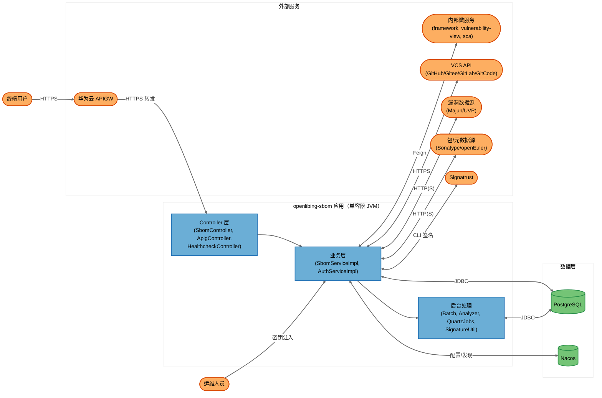
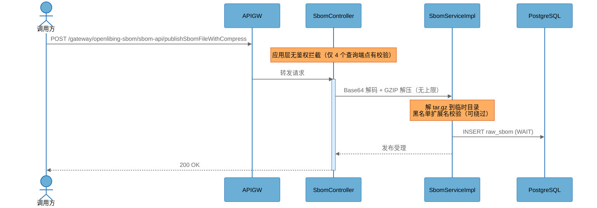
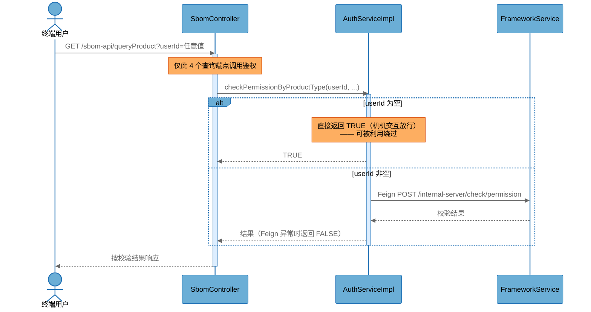
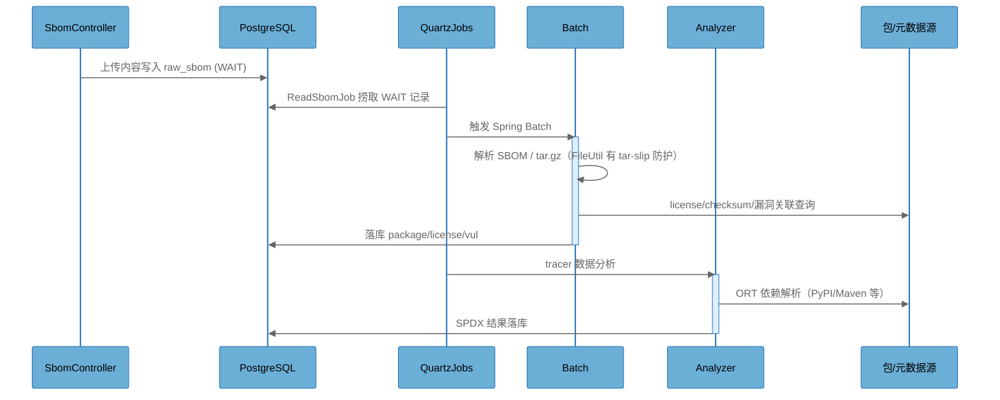
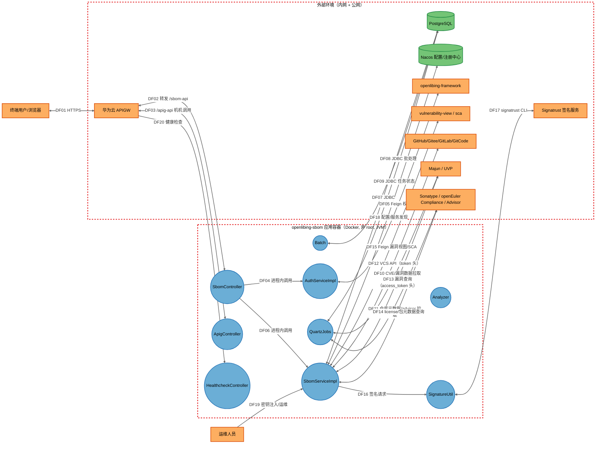
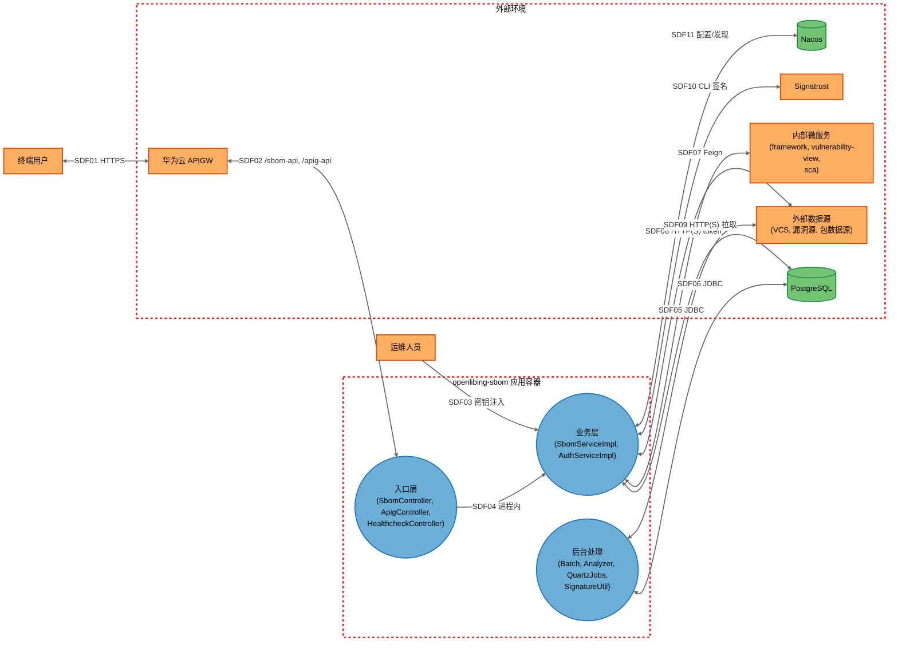

# openlibing-sbom STRIDE-A 威胁建模报告

> **说明（关于威胁数量）：** 本报告共识别 20 个组件、2 个信任边界、20 条数据流、53 项具体威胁（其中 9 项已有控制缓解、1 项平台托管、43 项 Open）。威胁仅在组件存在真实攻击面时枚举；对不适用的 STRIDE 类别以 `N/A` 显式说明并给出理由，未强行凑数。

---

## Report Files（报告文件）

| 文件                              | 说明                                                                                           |
| --------------------------------- | ---------------------------------------------------------------------------------------------- |
| `openlibing-sbom-威胁建模报告.md` | 本文档 — 按用户要求，将架构概览、威胁模型、STRIDE-A 分析、安全发现、评估摘要整合为单一中文文档 |
| `threat-inventory.json`           | 结构化威胁清单（组件/边界/数据流/威胁/发现），用于后续增量分析比对                             |
| `1.1-threatmodel.mmd`             | 详细数据流图（DFD）Mermaid 源文件                                                              |
| `1.2-threatmodel-summary.mmd`     | 概要数据流图 Mermaid 源文件                                                                    |

---

## Executive Summary（执行摘要）

openlibing-sbom 是一个基于 Spring Boot 的 SBOM（软件物料清单）管理服务，提供制品 SBOM 的发布、解析、漏洞/license 关联查询与导出能力，部署于华为云（Docker 容器 + 华为云 APIGW + Nacos + PostgreSQL）。

本次分析的最重要结论：

1. **应用层鉴权几乎完全缺失（严重）**。`/sbom-api` 下约 43 个端点中仅 4 个查询端点调用了权限校验；发布、新增产品、导出、刷新等写操作端点在应用层零鉴权。`/apig-api` 机机接口完全依赖网关隔离。此外授权判定依赖可伪造的 `userId` 请求参数，且**漏传 `userId` 即被视为机机调用直接放行**，仅有的 4 个受保护端点也可被绕过。
2. **未认证 DoS 面现实存在（高）**。`spring.codec.max-in-memory-size=1024MB` + 发布端点接收无上限 Base64+GZIP 数据 + 解压炸弹 + 无速率限制，少量并发请求即可造成 OOM。
3. **数据完整性防线薄弱（高/中）**。上传仅按扩展名校验、归档扩展名黑名单可绕过；外部数据解析存在 SnakeYAML 不安全加载与 XML_MAPPER 无 XXE 防护两处反序列化风险。
4. **凭据治理整体规范（亮点）**。仓库未发现提交的真实密钥；token 经环境变量/docker secret 文件注入；容器以非 root 用户运行、启用 fastjson safeMode 与 RASP、tar 解压有 slip 防护——这些是本项目的安全基础设施。

**量化概览：** 20 组件 | 53 项威胁 | 14 项发现（严重 2 / 高 6 / 中 4 / 低 2）| Tier 1（无前置条件可直接利用）5 项。

---

## 0.1 Architecture Overview（架构概览）

### System Purpose（系统目标）

openlibing-sbom 为开源软件供应链提供 SBOM 全生命周期管理：接收制品发布请求（含 SBOM 文件、tracer 数据），解析为 SPDX/CycloneDX 格式，关联漏洞（Majun、UVP）、License 与上游社区信息，并向 openlibing 前端及内部微服务（vulnerability-view、sca）提供查询 API。用户为 openlibing 平台的终端用户与内部机机调用方。

### Key Components（关键组件）

| Component             | Type                | Description                                                                                                    |
| --------------------- | ------------------- | -------------------------------------------------------------------------------------------------------------- |
| SbomController        | Process             | `/sbom-api` REST 入口，约 43 个端点（发布/查询/导出/刷新），锚点 `sbom-web/.../controller/SbomController.java` |
| ApigController        | Process             | `/apig-api` 华为云 APIGW 机机接口，与 SbomController 方法对应，锚点 `ApigController.java`                      |
| HealthcheckController | Process             | `/health-check` 健康检查端点，返回 "ok"                                                                        |
| AuthServiceImpl       | Process             | 授权服务：经 Feign 委托 openlibing-framework 校验产品权限，`userId` 为空直接放行                               |
| SbomServiceImpl       | Process             | SBOM 核心业务：发布校验、解析落库、查询、导出、签名                                                            |
| Batch                 | Process             | Spring Batch 任务：解析 raw_sbom、提取 license/checksum/漏洞信息（目录 `batch/`）                              |
| Analyzer              | Process             | 调用 OSS Review Toolkit 分析上传的 definition file/tracer 数据（目录 `analyzer/`）                             |
| QuartzJobs            | Process             | 定时任务：ReadSbomJob、FetchMajunCveJob、FetchOpenEulerRepoMetaJob（目录 `quartz/`）                           |
| SignatureUtil         | Process             | 经 ProcessBuilder 调用 signatrust CLI 对制品签名                                                               |
| PostgreSQL            | Data Store          | SBOM/产品/用户/漏洞关联数据存储                                                                                |
| Nacos                 | External Service    | 华为云 CSE 托管的配置与注册中心（`openlibing-prod` 命名空间）                                                  |
| FrameworkService      | External Service    | openlibing-framework：远程权限校验（`/internal-server/check/permission`）                                      |
| InternalMicroservices | External Service    | openlibing-vulnerability-view 与 openlibing-sca（Feign 内网调用）                                              |
| VcsProviders          | External Service    | GitHub/Gitee/GitLab/GitCode 仓库元数据 API（客户端类 GithubApi、GiteeApi、GitlabApi、GitCodeApi）              |
| VulDataSources        | External Service    | Majun 漏洞平台（access_token 头）与 UVP 漏洞源                                                                 |
| PackageDataSources    | External Service    | Sonatype（Maven Central）、openEuler Compliance、openEuler Advisor、仓库元数据源                               |
| Signatrust            | External Service    | 签名服务（私钥托管在服务端）                                                                                   |
| ApiGateway            | External Interactor | 华为云 APIGW：公网入口，路由 `/gateway/openlibing-sbom/*`                                                      |
| EndUser               | External Interactor | 终端用户（浏览器，经网关访问）                                                                                 |
| Operator              | External Interactor | 运维人员（密钥注入、部署、监控）                                                                               |

### Component Diagram（组件图）

### Top Scenarios（关键场景）

#### Scenario 1: 未认证 SBOM 发布（写路径，当前无应用层鉴权）

外部调用方经 APIGW 将制品发布请求（JSON + Base64+GZIP 压缩数据）POST 到 `/sbom-api/publishSbomFileWithCompress`，服务解压校验后写入 `raw_sbom`，由定时任务驱动批处理解析。**该端点应用层无鉴权。**

#### Scenario 2: 产品权限校验（仅有的鉴权链路）

4 个受保护查询端点调用 `AuthServiceImpl`，经 Feign 委托 openlibing-framework 校验。`userId` 取自请求参数（可伪造），为空直接放行。

#### Scenario 3: 上传内容的异步解析与分析

上传的 SBOM 文件存入 `raw_sbom` 后，Quartz 任务捞起 WAIT 记录驱动 Spring Batch 解析；tracer 数据由 Analyzer 调用 ORT 分析（会访问 PyPI 等外部包源）。

#### Scenario 4: 制品导出与签名（无序列图）

用户请求导出 SBOM 时，`SbomServiceImpl` 组装 SPDX/CycloneDX 文档，`SignatureUtil` 经 ProcessBuilder 调用 signatrust CLI（固定参数、5 秒超时、临时文件 normalize 校验 + monitor.sh chmod 600 加固）完成签名。

#### Scenario 5: 外部数据同步（无序列图）

`FetchMajunCveJob`、`FetchOpenEulerRepoMetaJob` 定时从 Majun/UVP/openEuler 拉取漏洞与仓库元数据：repo 元数据 zip 内 XML 由 `XML_MAPPER` 解析（**无 XXE 防护**），advisor 数据经 SnakeYAML 解析（**unsafe load**）。

### Technology Stack（技术栈）

| Layer          | Technologies                                                                                                                     |
| -------------- | -------------------------------------------------------------------------------------------------------------------------------- |
| Languages      | Java (Spring Boot 3 / Jakarta EE)                                                                                                |
| Frameworks     | Spring Boot、Spring Cloud（Nacos、OpenFeign、Ribbon）、Spring Batch、Quartz、OSS Review Toolkit (ORT)、Swagger/springdoc         |
| Data Stores    | PostgreSQL、内存 Caffeine 缓存                                                                                                   |
| Infrastructure | Docker（openEuler 22.03 基础镜像）、华为云 CSE（Nacos）、华为云 APIGW、HTTPS/TLS 1.2+                                            |
| Security       | Signatrust 签名、RASP javaagent、fastjson safeMode、docker secret 文件注入（`*_FILE`）、monitor.sh 文件权限加固、LogApi 审计切面 |

### Deployment Model（部署模型）

单 Docker 容器运行 Spring Boot 单体 JVM（内含 Controller、Service、Batch、Quartz、Analyzer 全部组件），容器内监听 `0.0.0.0:13331`（TLS，PKCS12 证书），经华为云 APIGW 以 `https://www.openlibing.com/gateway/openlibing-sbom/` 对外提供公网服务。PostgreSQL 与 Nacos（华为云 CSE）位于内网，凭据经环境变量/docker secret 文件注入。容器以非 root 用户 `openlibing` 运行，内置 monitor.sh（每 300 秒加固文件权限）与 RASP。

**Deployment Classification:** `NETWORK_SERVICE`（公网 API，经云网关暴露，T1 允许）

### Component Exposure Table（组件暴露表）

| Component             | Listens On                   | Auth Required        | Reachability            | Min Prerequisite              | Derived Tier |
| --------------------- | ---------------------------- | -------------------- | ----------------------- | ----------------------------- | ------------ |
| SbomController        | 0.0.0.0:13331 (TLS)          | 仅 4/43 端点有校验   | External（经网关）      | None                          | T1           |
| ApigController        | 0.0.0.0:13331 (TLS)          | No（依赖网关）       | External（经网关）      | None                          | T1           |
| HealthcheckController | 0.0.0.0:13331 (TLS)          | No                   | External（经网关）      | None                          | T1           |
| AuthServiceImpl       | N/A — 经 /sbom-api 链路可达  | 链路依赖             | External（链路）        | None                          | T1           |
| SbomServiceImpl       | N/A — 经 /sbom-api 链路可达  | 链路依赖             | External（链路）        | None                          | T1           |
| Batch                 | N/A — 由上传/发布链路触发    | No                   | External（链路）        | None                          | T1           |
| Analyzer              | N/A — 由上传链路触发         | No                   | External（链路）        | None                          | T1           |
| QuartzJobs            | N/A — 定时自启，处理外部数据 | N/A                  | No Listener（出站拉取） | PackageDataSources Compromise | T3           |
| SignatureUtil         | N/A — 进程内调用             | N/A                  | No Listener             | Host/OS Access                | T3           |
| PostgreSQL            | 5432（内网）                 | Yes                  | Internal Only           | Internal Network              | T2           |
| Nacos                 | 8848（云 CSE）               | 未知（需核实）       | Internal Only           | Internal Network              | T2           |
| FrameworkService      | 内网微服务                   | 未知                 | Internal Only           | Internal Network              | T2           |
| InternalMicroservices | 内网微服务                   | 未知                 | Internal Only           | Internal Network              | T2           |
| VcsProviders          | 外部 SaaS API                | Token（出站）        | External（出站）        | VcsProviders Compromise       | T3           |
| VulDataSources        | 外部 API                     | Majun token / UVP 无 | External（出站）        | VulDataSources Compromise     | T3           |
| PackageDataSources    | 外部 API                     | No                   | External（出站）        | PackageDataSources Compromise | T3           |
| Signatrust            | 内网签名服务                 | Key name             | Internal Only           | Signatrust Compromise         | T3           |
| ApiGateway            | 公网 443                     | 网关侧鉴权（需核实） | External                | None（绕过需核实）            | T1           |
| EndUser               | N/A                          | N/A                  | N/A                     | N/A（威胁源）                 | N/A          |
| Operator              | N/A                          | N/A                  | N/A                     | N/A（威胁源）                 | N/A          |

### Security Infrastructure Inventory（安全基础设施清单）

| Component                         | Security Role | Configuration                                                                  | Notes                                            |
| --------------------------------- | ------------- | ------------------------------------------------------------------------------ | ------------------------------------------------ |
| APIGW（华为云）                   | 边界访问控制  | `/gateway/openlibing-sbom/*` 路由                                              | 应用完全依赖其隔离；网关侧是否强制登录需核实     |
| AuthServiceImpl + FrameworkClient | 远程授权      | Feign 调 framework `/internal-server/check/permission`，Feign 异常 fail-closed | 仅覆盖 4 个查询端点                              |
| Signatrust                        | 制品签名      | PGP 私钥托管服务端，客户端仅传 key name                                        | 设计合理                                         |
| docker-entrypoint.sh              | 凭据注入      | 从 `*_FILE` secret 文件读取 DB/VCS token                                       | 仓库无硬编码凭据                                 |
| monitor.sh                        | 文件权限加固  | 每 300 秒 chmod 600/500                                                        | 纵深防御                                         |
| Dockerfile                        | 最小权限      | `USER openlibing`（非 root、nologin）                                          | 基础镜像 openEuler 22.03                         |
| RASP javaagent                    | 运行时自防护  | JVM 启动参数注入                                                               | —                                                |
| fastjson safeMode                 | 反序列化加固  | start-openlibing-sbom.sh 开启                                                  | 覆盖 fastjson，不覆盖 SnakeYAML/Jackson          |
| FileUtil tar-slip 防护            | 解压路径校验  | `normalize().startsWith(targetDir)`                                            | 已缓解 tar slip                                  |
| Mapper.initSbomMapper XXE 防护    | XML 安全解析  | 关闭 DTD/外部实体                                                              | 仅该 mapper 有防护，`XML_MAPPER` 无              |
| LogApi 审计切面                   | 操作审计      | 发布/查询等操作打点                                                            | 集中存储与防篡改需核实                           |
| TLS 配置                          | 传输加密      | TLSv1.2/1.3、ECDHE-AES-GCM、PKCS12                                             | `server.ssl.ketStoreType` 拼写错误（见 FIND-13） |

### Repository Structure（仓库结构）

| Directory      | Purpose                                                              |
| -------------- | -------------------------------------------------------------------- |
| sbom-web/      | Spring Boot 主应用（Controller、Service 实现、配置）                 |
| interface/     | 服务接口定义（api 包）                                               |
| service 层实现 | sbom-web 内 service/sbom、service/auth 等                            |
| batch/         | Spring Batch 批处理任务                                              |
| analyzer/      | ORT 分析器封装                                                       |
| quartz/        | 定时任务（ReadSbomJob、FetchMajunCveJob、FetchOpenEulerRepoMetaJob） |
| clients/       | 外部服务客户端（VCS、漏洞、license、Sonatype、Feign）                |
| dao/           | Spring Data JPA 仓储（75 处 nativeQuery 均为参数化绑定）             |
| model/         | 实体与 POJO                                                          |
| utils/         | 工具类（YamlUtil、Mapper、FileUtil、SignatureUtil、WebUtil 等）      |
| cache/         | Caffeine 缓存封装                                                    |
| doc/           | 架构与 API 文档                                                      |
| scripts/       | UT 覆盖率脚本；根目录含 Dockerfile、entrypoint、monitor.sh           |

---

## 1 Threat Model（威胁模型）

### Element Table（元素表）

| Element               | Type                | Description                 | Trust Boundary |
| --------------------- | ------------------- | --------------------------- | -------------- |
| SbomController        | Process             | `/sbom-api` REST 入口       | Application    |
| ApigController        | Process             | `/apig-api` 机机 REST 入口  | Application    |
| HealthcheckController | Process             | `/health-check` 健康检查    | Application    |
| AuthServiceImpl       | Process             | 远程授权委托                | Application    |
| SbomServiceImpl       | Process             | SBOM 核心业务               | Application    |
| Batch                 | Process             | Spring Batch 批处理         | Application    |
| Analyzer              | Process             | ORT 分析                    | Application    |
| QuartzJobs            | Process             | 定时任务（含外部数据拉取）  | Application    |
| SignatureUtil         | Process             | signatrust CLI 封装         | Application    |
| PostgreSQL            | Data Store          | 业务数据库                  | External       |
| Nacos                 | External Service    | 配置/注册中心               | External       |
| FrameworkService      | External Service    | openlibing-framework        | External       |
| InternalMicroservices | External Service    | vulnerability-view / sca    | External       |
| VcsProviders          | External Service    | GitHub/Gitee/GitLab/GitCode | External       |
| VulDataSources        | External Service    | Majun / UVP                 | External       |
| PackageDataSources    | External Service    | Sonatype / openEuler        | External       |
| Signatrust            | External Service    | 签名服务                    | External       |
| ApiGateway            | External Interactor | 华为云 APIGW                | External       |
| EndUser               | External Interactor | 终端用户（威胁源）          | External       |
| Operator              | External Interactor | 运维人员（威胁源）          | External       |

### Trust Boundaries（信任边界）

| Boundary    | Contains                                          | Crossing Flows         |
| ----------- | ------------------------------------------------- | ---------------------- |
| Application | 上述 9 个 Process（同一 Docker 容器内的同一 JVM） | DF01–DF20 中跨边界部分 |
| External    | PostgreSQL、Nacos、全部外部服务与网关、外部角色   | —                      |

### Detailed DFD（详细数据流图）

### Data Flows（数据流清单）

| Flow ID | 源 <--> 目标                               | 协议/内容                                                             | 跨信任边界      |
| ------- | ------------------------------------------ | --------------------------------------------------------------------- | --------------- |
| DF01    | EndUser <--> ApiGateway                    | HTTPS（用户请求/响应）                                                | 是              |
| DF02    | ApiGateway <--> SbomController             | HTTPS 转发 /sbom-api（含上传文件、Base64+GZIP 发布数据、userId 参数） | 是              |
| DF03    | ApiGateway <--> ApigController             | HTTPS /apig-api 机机调用                                              | 是              |
| DF20    | ApiGateway --> HealthcheckController       | GET /health-check                                                     | 是              |
| DF04    | SbomController --> AuthServiceImpl         | 进程内方法调用（userId、产品类型）                                    | 否              |
| DF05    | AuthServiceImpl <--> FrameworkService      | Feign HTTPS /internal-server/check/permission                         | 是              |
| DF06    | SbomController --> SbomServiceImpl         | 进程内方法调用                                                        | 否              |
| DF07    | SbomServiceImpl <--> PostgreSQL            | JDBC（SBOM/产品/用户数据）                                            | 是              |
| DF08    | Batch <--> PostgreSQL                      | JDBC（raw_sbom 解析落库）                                             | 否（应用内→DB） |
| DF09    | QuartzJobs <--> PostgreSQL                 | JDBC（任务驱动状态机）                                                | 否（应用内→DB） |
| DF10    | QuartzJobs <--> VulDataSources             | HTTP CVE/漏洞数据拉取                                                 | 是              |
| DF11    | QuartzJobs <--> PackageDataSources         | HTTP 仓库元数据 zip / advisor 数据                                    | 是              |
| DF12    | SbomServiceImpl <--> VcsProviders          | HTTPS 仓库元数据 API（token 头）                                      | 是              |
| DF13    | SbomServiceImpl <--> VulDataSources        | HTTP 漏洞查询（access_token 头）                                      | 是              |
| DF14    | SbomServiceImpl <--> PackageDataSources    | HTTP license/包元数据                                                 | 是              |
| DF15    | SbomServiceImpl <--> InternalMicroservices | Feign 内网调用                                                        | 是              |
| DF16    | SbomServiceImpl --> SignatureUtil          | 进程内签名请求                                                        | 否              |
| DF17    | SignatureUtil <--> Signatrust              | CLI 进程调用签名服务                                                  | 是              |
| DF18    | SbomServiceImpl <--> Nacos                 | 配置拉取/服务发现                                                     | 是              |
| DF19    | Operator --> SbomServiceImpl               | 环境变量/secret 文件密钥注入                                          | 是              |

### Summary View（概要数据流图）

详细 DFD 含 20 个元素（>15），按要求生成概要视图：

| Summary Element                              | Contains                                              | Summary Flows                         | Maps to Detailed Flows           |
| -------------------------------------------- | ----------------------------------------------------- | ------------------------------------- | -------------------------------- |
| Ingress                                      | SbomController, ApigController, HealthcheckController | SDF02                                 | DF02, DF03, DF20                 |
| Biz                                          | SbomServiceImpl, AuthServiceImpl                      | SDF03–SDF05, SDF07–SDF08, SDF10–SDF11 | DF04–DF07, DF12–DF16, DF18, DF19 |
| Async                                        | Batch, Analyzer, QuartzJobs, SignatureUtil            | SDF06, SDF09                          | DF08–DF11, DF16–DF17             |
| Infra                                        | FrameworkService, InternalMicroservices               | SDF07                                 | DF05, DF15                       |
| ExtData                                      | VcsProviders, VulDataSources, PackageDataSources      | SDF08, SDF09                          | DF10–DF14                        |
| ApiGateway / PostgreSQL / Nacos / Signatrust | 同名组件                                              | —                                     | DF01, DF07–DF09, DF17–DF18       |

---

## 2 STRIDE-A Analysis（STRIDE-A 威胁分析）

### Exploitability Tiers（可利用性层级）

| Tier   | 标签     | 前置条件               | 判定规则                                   |
| ------ | -------- | ---------------------- | ------------------------------------------ |
| Tier 1 | 直接暴露 | `None`                 | 未认证外部攻击者无需任何先验访问即可利用   |
| Tier 2 | 条件风险 | 单一前置条件           | 需要认证用户 / 内网位置 / 本地进程访问之一 |
| Tier 3 | 纵深防御 | 多重前置或基础设施访问 | 需要 Host/OS 访问、管理凭据、{组件}失陷等  |

### Summary（威胁汇总表）

| #   | Component             | S   | T   | R   | I   | D   | E   | A   | Derived Tier |
| --- | --------------------- | --- | --- | --- | --- | --- | --- | --- | ------------ |
| T01 | SbomController        | 1   | 2   | 1   | 2   | 1   | 1   | 1   | T1           |
| T02 | ApigController        | 1   | 1   | 0   | 0   | 0   | 1   | 0   | T1           |
| T03 | HealthcheckController | 0   | 0   | 0   | 0   | 0   | 0   | 0   | T1           |
| T04 | AuthServiceImpl       | 1   | 1   | 0   | 0   | 0   | 1   | 0   | T1           |
| T05 | SbomServiceImpl       | 0   | 1   | 1   | 1   | 1   | 0   | 1   | T1           |
| T06 | Batch                 | 0   | 1   | 0   | 0   | 1   | 0   | 1   | T1           |
| T07 | Analyzer              | 0   | 1   | 0   | 0   | 1   | 0   | 1   | T1           |
| T08 | QuartzJobs            | 0   | 2   | 0   | 1   | 0   | 0   | 0   | T3           |
| T09 | SignatureUtil         | 0   | 1   | 0   | 0   | 0   | 1   | 0   | T3           |
| T10 | PostgreSQL            | 1   | 1   | 0   | 1   | 0   | 0   | 0   | T2           |
| T11 | Nacos                 | 1   | 1   | 0   | 1   | 0   | 0   | 0   | T2           |
| T12 | FrameworkService      | 1   | 1   | 0   | 0   | 0   | 0   | 0   | T2           |
| T13 | InternalMicroservices | 1   | 1   | 0   | 0   | 0   | 0   | 0   | T2           |
| T14 | VcsProviders          | 0   | 1   | 0   | 1   | 0   | 0   | 0   | T3           |
| T15 | VulDataSources        | 0   | 1   | 0   | 1   | 0   | 0   | 0   | T3           |
| T16 | PackageDataSources    | 0   | 2   | 0   | 1   | 0   | 0   | 1   | T3           |
| T17 | Signatrust            | 1   | 1   | 0   | 0   | 0   | 0   | 0   | T3           |
| T18 | ApiGateway            | 1   | 1   | 0   | 0   | 0   | 0   | 0   | T1           |

合计 **53** 项具体威胁（不含 N/A 行；含 9 项已有控制缓解、1 项平台托管，其余 43 项 Open 威胁——其中 T10.T/T10.I 待人工评审——全部映射至发现 FIND-01～FIND-13）。

### T01 — SbomController（/sbom-api REST 入口）

**Status 图例：** Open=需修复 | Mitigated=已有控制 | Platform=平台托管

| ID     | 类别                   | 威胁                                                                                                             | 前置条件 | Tier | 状态      | 证据                                                                                                  | 缓解建议                                                   |
| ------ | ---------------------- | ---------------------------------------------------------------------------------------------------------------- | -------- | ---- | --------- | ----------------------------------------------------------------------------------------------------- | ---------------------------------------------------------- |
| T01.E  | Elevation of Privilege | 约 39/43 端点（publishSbomFile、addProduct、exportSbom、refresh、sync 等）无任何应用层鉴权，未认证者可执行写操作 | None     | T1   | Open      | SbomController.java：仅 4 个查询端点调用 AuthServiceImpl；全仓库无 Filter/Interceptor/Spring Security | 为全部端点接入统一鉴权（拦截器或网关强制登录），见 FIND-01 |
| T01.S  | Spoofing               | `userId` 取自可伪造的请求参数，冒充他人身份通过权限校验                                                          | None     | T1   | Open      | AuthServiceImpl.checkPermissionByProductType 以入参 userId 委托远端鉴权                               | 从可信会话/token 派生用户身份，见 FIND-02                  |
| T01.T  | Tampering              | 上传 SBOM 内容仅按扩展名校验，可投毒 SBOM 数据污染下游分析结果                                                   | None     | T1   | Open      | uploadSbomFile 仅扩展名判格式；PublishSbomRequestValidator 黑名单可绕过                               | 内容校验+来源认证+发布签名，见 FIND-04                     |
| T01.T2 | Tampering              | `server.ssl.ketStoreType` 属性拼写错误（应为 keyStoreType），keystore 类型配置静默失效，TLS 配置可能与预期不符   | None     | T1   | Open      | application.properties L26 `server.ssl.ketStoreType=PKCS12`                                           | 修正属性名并验证 TLS 生效配置，见 FIND-13                  |
| T01.R  | Repudiation            | 发布/修改操作若审计日志不完整可抵赖                                                                              | None     | T1   | Mitigated | LogApi 审计切面 + ManageLogHelper 覆盖主要操作                                                        | 需核实日志集中存储与防篡改（见"待核实项"）                 |
| T01.I  | Information Disclosure | Swagger/OpenAPI 文档经网关公网可达，暴露全部 API 结构                                                            | None     | T1   | Open      | application-prod.properties L33-37 swagger 路径指向 /gateway/ 公网前缀                                | 生产禁用或加鉴权，见 FIND-05                               |
| T01.I2 | Information Disclosure | CORS 白名单硬编码 localhost 且仅在下载分支设置，配置不当可致恶意站点读取响应                                     | None     | T1   | Open      | SbomController 下载错误分支设置 Access-Control-Allow-Origin: http://localhost                         | 按环境显式配置 CORS 白名单，见 FIND-08                     |
| T01.D  | Denial of Service      | 1024MB codec 缓冲 + 无上限 Base64/GZIP 解压 + 无速率限制 → 少量请求即可 OOM                                      | None     | T1   | Open      | application.properties L15 max-in-memory-size=1024MB；publish 端点走 @RequestBody 不受 multipart 限制 | 降低缓冲上限+解压比限制+网关限流，见 FIND-03               |
| T01.A  | Abuse                  | 批量自动注册产品/发布垃圾 SBOM 占用存储与批处理资源                                                              | None     | T1   | Open      | addProduct/publish 无鉴权且无防刷                                                                     | 同 FIND-01/FIND-03                                         |

### T02 — ApigController（/apig-api 机机入口）

| ID    | 类别                   | 威胁                                                       | 前置条件         | Tier | 状态 | 证据                                                              | 缓解建议                                           |
| ----- | ---------------------- | ---------------------------------------------------------- | ---------------- | ---- | ---- | ----------------------------------------------------------------- | -------------------------------------------------- |
| T02.E | Elevation of Privilege | 全部机机端点无服务级鉴权，完全依赖网关隔离                 | None             | T1   | Open | ApigController 注释"与 SbomController 方法一致"，代码内无身份验证 | 网关侧强制认证 + 服务内最小校验，见 FIND-01        |
| T02.S | Spoofing               | 绕过网关直连容器端口 13331（若安全组未限制）冒充机机调用方 | Internal Network | T2   | Open | 服务监听 0.0.0.0:13331；安全组配置不在仓库内                      | 网络隔离（仅允许网关网段）+ 应用层校验，见 FIND-01 |
| T02.T | Tampering              | 机机调用无重放保护/请求签名（网关侧机制未知）              | None             | T1   | Open | 代码内无签名/时间戳校验逻辑                                       | 网关启用签名防重放，见 FIND-01                     |

### T03 — HealthcheckController（/health-check）

| ID  | 类别      | 威胁                                                       | 前置条件 | Tier | 状态 | 证据                                  | 缓解建议 |
| --- | --------- | ---------------------------------------------------------- | -------- | ---- | ---- | ------------------------------------- | -------- |
| N/A | S/T/R/E/A | 仅返回固定字符串 "ok"，不暴露版本/内部信息，无状态变更     | —        | —    | N/A  | HealthcheckController 返回值恒为 "ok" | —        |
| N/A | I/D       | 无敏感信息泄露；被刷风险由 LB/网关层承受，属常规探活暴露面 | —        | —    | N/A  | 同上                                  | —        |

### T04 — AuthServiceImpl（远程授权委托）

| ID    | 类别                   | 威胁                                                                         | 前置条件 | Tier | 状态      | 证据                                      | 缓解建议                                   |
| ----- | ---------------------- | ---------------------------------------------------------------------------- | -------- | ---- | --------- | ----------------------------------------- | ------------------------------------------ |
| T04.S | Spoofing               | 空 `userId` 被视为"机机交互"直接放行，未认证者漏传参数即可绕过仅有的权限校验 | None     | T1   | Open      | AuthServiceImpl：userId 为空直接返回 TRUE | 拒绝空 userId 或改用服务间凭证，见 FIND-02 |
| T04.T | Tampering              | Feign 调用 framework 失败时返回 FALSE（fail-closed），不会被降级绕过         | None     | T1   | Mitigated | AuthServiceImpl 异常分支返回 FALSE        | 保持该行为；建议增加告警                   |
| T04.E | Elevation of Privilege | 鉴权仅覆盖 4 个查询端点，属架构级覆盖缺口，写路径完全旁路                    | None     | T1   | Open      | 同 T01.E 证据                             | 全端点统一鉴权，见 FIND-01                 |

### T05 — SbomServiceImpl（SBOM 核心业务）

| ID    | 类别                   | 威胁                                                            | 前置条件 | Tier | 状态      | 证据                             | 缓解建议                          |
| ----- | ---------------------- | --------------------------------------------------------------- | -------- | ---- | --------- | -------------------------------- | --------------------------------- |
| T05.T | Tampering              | 发布的 SBOM 数据无来源认证/签名，任何未认证者可写入并关联到产品 | None     | T1   | Open      | publishSbom 链路无调用方身份校验 | 发布方认证 + 内容签名，见 FIND-04 |
| T05.R | Repudiation            | 主要查询/发布操作有 LogApi 打点                                 | None     | T1   | Mitigated | SbomController 多处 @LogApi 注解 | 核实日志防篡改（见"待核实项"）    |
| T05.I | Information Disclosure | 未认证枚举全部产品/包/漏洞/license 数据                         | None     | T1   | Open      | 查询端点中 39 个无鉴权           | 鉴权覆盖，见 FIND-01              |
| T05.D | Denial of Service      | 大结果集导出（MAX_SIZE=10000）与导出文件组装占用内存            | None     | T1   | Open      | exportSbom 全量组装响应          | 流式导出+限流，见 FIND-03         |
| T05.A | Abuse                  | 利用查询接口低成本爬取全量 SBOM 情报（产品依赖构成）            | None     | T1   | Open      | 无速率限制、无鉴权               | 限流+鉴权，见 FIND-01/FIND-03     |

### T06 — Batch（Spring Batch 批处理）

| ID    | 类别              | 威胁                                                                         | 前置条件 | Tier | 状态 | 证据                                                   | 缓解建议                            |
| ----- | ----------------- | ---------------------------------------------------------------------------- | -------- | ---- | ---- | ------------------------------------------------------ | ----------------------------------- |
| T06.T | Tampering         | 批处理无条件解析用户上传的 raw_sbom 内容，恶意构造的 SBOM/tar 数据被直接落库 | None     | T1   | Open | ReadSbomJob 捞取 WAIT 记录驱动解析，无内容级校验       | 发布来源认证+内容校验，见 FIND-04   |
| T06.D | Denial of Service | 超大归档/深度嵌套结构消耗解析线程与内存                                      | None     | T1   | Open | 解压后无总量/深度限制（tar slip 已防护，但资源无限制） | 解压资源上限，见 FIND-03            |
| T06.A | Abuse             | 投毒数据经批处理自动"转正"进入正式 SBOM 库影响供应链决策                     | None     | T1   | Open | 解析成功即落库为正式数据                               | 人工审核阈值+来源白名单，见 FIND-04 |

### T07 — Analyzer（ORT 分析）

| ID    | 类别              | 威胁                                                                   | 前置条件 | Tier | 状态 | 证据                                    | 缓解建议                              |
| ----- | ----------------- | ---------------------------------------------------------------------- | -------- | ---- | ---- | --------------------------------------- | ------------------------------------- |
| T07.T | Tampering         | 恶意 definition file/tracer 数据经 ORT 解析，包名/依赖声明可被任意伪造 | None     | T1   | Open | AbstractBaseAnalyzer 解压后直接交给 ORT | 输入 schema 校验+来源认证，见 FIND-04 |
| T07.D | Denial of Service | 复杂规格触发 ORT 长时间分析占用计算资源                                | None     | T1   | Open | 分析任务无超时/资源上限证据             | 任务超时与队列限额，见 FIND-03        |
| T07.A | Abuse             | 构造包名诱导 ORT 访问外部包源（PyPI/Maven），探测内网出口行为/放大请求 | None     | T1   | Open | ORT 按包名解析外部依赖源                | 包源白名单+出网代理管控，见 FIND-04   |

### T08 — QuartzJobs（定时任务：外部数据拉取）

| ID     | 类别                   | 威胁                                                      | 前置条件                      | Tier | 状态 | 证据                                                           | 缓解建议                      |
| ------ | ---------------------- | --------------------------------------------------------- | ----------------------------- | ---- | ---- | -------------------------------------------------------------- | ----------------------------- |
| T08.T1 | Tampering              | Majun/UVP CVE 数据投毒：伪造漏洞关联影响平台漏洞视图      | VulDataSources Compromise     | T3   | Open | FetchMajunCveJob 直接信任外部 CVE 数据                         | 数据签名/交叉校验，见 FIND-11 |
| T08.T2 | Tampering              | openEuler 仓库元数据/advisor 投毒：进入 XML/YAML 解析路径 | PackageDataSources Compromise | T3   | Open | FetchOpenEulerRepoMetaJob 拉取后由 XML_MAPPER/SnakeYAML 解析   | 见 FIND-09/FIND-10            |
| T08.I  | Information Disclosure | 仓库元数据 zip 内 XML 解析存在 XXE，可读取容器内文件/SSRF | PackageDataSources Compromise | T3   | Open | Mapper.XML_MAPPER 未禁用外部实体，RepoMetaParserImpl L265 使用 | 见 FIND-10                    |

### T09 — SignatureUtil（signatrust 签名封装）

| ID    | 类别                   | 威胁                                                                                            | 前置条件       | Tier | 状态      | 证据                                                         | 缓解建议                   |
| ----- | ---------------------- | ----------------------------------------------------------------------------------------------- | -------------- | ---- | --------- | ------------------------------------------------------------ | -------------------------- |
| T09.E | Elevation of Privilege | 命令注入/参数注入：signatrust 客户端参数全部来自环境变量且固定，路径有 normalize 校验，5 秒超时 | Host/OS Access | T3   | Mitigated | SignatureUtil L88-104 ProcessBuilder 固定参数                | 保持参数不可被外部输入影响 |
| T09.T | Tampering              | 待签名临时文件被同主机进程篡改                                                                  | Host/OS Access | T3   | Mitigated | 临时文件 normalize 校验 + monitor.sh 每 300 秒 chmod 600/500 | 保持现有加固               |

### T10 — PostgreSQL（业务数据库）

| ID    | 类别                   | 威胁                                                               | 前置条件         | Tier | 状态      | 证据                                                                                | 缓解建议                                       |
| ----- | ---------------------- | ------------------------------------------------------------------ | ---------------- | ---- | --------- | ----------------------------------------------------------------------------------- | ---------------------------------------------- |
| T10.S | Spoofing               | 内网攻击者使用泄露/默认凭据连接数据库                              | Internal Network | T2   | Mitigated | 凭据经环境变量/docker secret 文件注入（docker-entrypoint.sh L5-28），仓库无默认口令 | 保持注入方式；启用账号最小权限                 |
| T10.T | Tampering              | 数据库连接未强制 TLS，内网链路可能明文传输                         | Internal Network | T2   | Open      | application.properties 无 ssl 相关 JDBC 参数（实际连接串在 Nacos，仓库不可见）      | 核实 JDBC 是否启用 sslmode；见"待核实项" NV-03 |
| T10.I | Information Disclosure | 敏感数据（用户、SBOM、漏洞关联）静态明文存储，无加密证据           | Internal Network | T2   | Open      | 仓库内无静态加密配置证据                                                            | 核实云盘加密/字段加密策略；见"待核实项" NV-03  |
| N/A   | R/D/E                  | 数据库由平台运维管理，审计与备份属基础设施职责；应用侧仅参数化访问 | —                | —    | N/A       | 75 处 nativeQuery 均为命名参数绑定                                                  | —                                              |

### T11 — Nacos（配置/注册中心，华为云 CSE）

| ID    | 类别                   | 威胁                                                  | 前置条件         | Tier | 状态 | 证据                                                            | 缓解建议                              |
| ----- | ---------------------- | ----------------------------------------------------- | ---------------- | ---- | ---- | --------------------------------------------------------------- | ------------------------------------- |
| T11.S | Spoofing               | 内网攻击者向 Nacos 注册伪造实例劫持 Feign 流量        | Internal Network | T2   | Open | 应用经 `discovery.secure=true` 连接，但引擎侧鉴权配置不在仓库内 | 核实并启用 Nacos 引擎鉴权，见 FIND-07 |
| T11.T | Tampering              | 篡改 Nacos 配置（数据库连接串、token 等）注入恶意配置 | Internal Network | T2   | Open | 配置中心承载敏感配置（namespace `openlibing-prod`）             | 见 FIND-07                            |
| T11.I | Information Disclosure | 读取 Nacos 配置获取数据库凭据与 API token             | Internal Network | T2   | Open | server-addr 与 namespace ID 已提交入仓库                        | 见 FIND-07                            |

### T12 — FrameworkService（openlibing-framework，鉴权依赖）

| ID    | 类别      | 威胁                                                  | 前置条件         | Tier | 状态 | 证据                                            | 缓解建议                     |
| ----- | --------- | ----------------------------------------------------- | ---------------- | ---- | ---- | ----------------------------------------------- | ---------------------------- |
| T12.S | Spoofing  | 伪造 framework 服务实例响应"有权限"，绕过产品权限校验 | Internal Network | T2   | Open | FrameworkClient 经 Nacos 发现调用，无服务间认证 | 服务间 mTLS/凭证，见 FIND-06 |
| T12.T | Tampering | 篡改鉴权响应（中间人）放行越权请求                    | Internal Network | T2   | Open | Feign 内网明文调用证据缺失（TLS 未知）          | 见 FIND-06                   |

### T13 — InternalMicroservices（vulnerability-view / sca）

| ID    | 类别      | 威胁                                        | 前置条件         | Tier | 状态 | 证据                                 | 缓解建议   |
| ----- | --------- | ------------------------------------------- | ---------------- | ---- | ---- | ------------------------------------ | ---------- |
| T13.S | Spoofing  | 伪造 vul-view/sca 实例返回伪造漏洞/SCA 数据 | Internal Network | T2   | Open | VulViewClient/ScaClient 无服务间认证 | 见 FIND-06 |
| T13.T | Tampering | 内网中间人篡改漏洞视图数据                  | Internal Network | T2   | Open | 同上                                 | 见 FIND-06 |

### T14 — VcsProviders（GitHub/Gitee/GitLab/GitCode）

| ID    | 类别                   | 威胁                                                       | 前置条件                | Tier | 状态      | 证据                                                               | 缓解建议                        |
| ----- | ---------------------- | ---------------------------------------------------------- | ----------------------- | ---- | --------- | ------------------------------------------------------------------ | ------------------------------- |
| T14.T | Tampering              | 仓库元数据响应投毒                                         | VcsProviders Compromise | T3   | Mitigated | 全部 VCS 客户端走 HTTPS，JVM 默认证书链校验，无 TrustAll 代码      | 保持 TLS 校验                   |
| T14.I | Information Disclosure | API token 经环境变量注入但长期静态、无轮换，泄露后长期有效 | Host/OS Access          | T3   | Open      | vcs.properties `${GITHUB_API_TOKEN}` 等占位符 + docker secret 注入 | 令牌轮换+最小 scope，见 FIND-12 |

### T15 — VulDataSources（Majun / UVP）

| ID    | 类别                   | 威胁                                                                                      | 前置条件                  | Tier | 状态 | 证据                                   | 缓解建议   |
| ----- | ---------------------- | ----------------------------------------------------------------------------------------- | ------------------------- | ---- | ---- | -------------------------------------- | ---------- |
| T15.T | Tampering              | CVE/漏洞数据投毒，伪造漏洞信息误导供应链风险决策                                          | VulDataSources Compromise | T3   | Open | 拉取的 CVE 数据无签名/交叉校验直接落库 | 见 FIND-11 |
| T15.I | Information Disclosure | 漏洞查询内容发往测试环境 uvp.test.osinfra.cn（所有 profile 继承），数据流向与生产预期不符 | VulDataSources Compromise | T3   | Open | uvp.properties L1 硬编码测试地址       | 见 FIND-14 |

### T16 — PackageDataSources（Sonatype / openEuler Compliance / Advisor）

| ID     | 类别                   | 威胁                                                                        | 前置条件                      | Tier | 状态 | 证据                                                                     | 缓解建议                         |
| ------ | ---------------------- | --------------------------------------------------------------------------- | ----------------------------- | ---- | ---- | ------------------------------------------------------------------------ | -------------------------------- |
| T16.T1 | Tampering              | 恶意 YAML 经 SnakeYAML 默认构造器反序列化，可触发任意对象实例化（潜在 RCE） | PackageDataSources Compromise | T3   | Open | YamlUtil L59 `new Yaml().load(io)`；parseFromStr 输入含外部 advisor 内容 | 使用 SafeConstructor，见 FIND-09 |
| T16.T2 | Tampering              | 仓库元数据 zip 内 XML 由无 XXE 防护的 XML_MAPPER 解析                       | PackageDataSources Compromise | T3   | Open | Mapper L47-48 XML_MAPPER 未禁 DTD/外部实体；RepoMetaParserImpl L265 调用 | 见 FIND-10                       |
| T16.I  | Information Disclosure | XXE 可读取容器内文件（配置、密钥）或发起 SSRF                               | PackageDataSources Compromise | T3   | Open | 同 T16.T2                                                                | 见 FIND-10                       |
| T16.A  | Abuse                  | License/compliance 数据被篡改后影响合规判定（误判许可证法律风险）           | PackageDataSources Compromise | T3   | Open | LicenseClientImpl 数据直接落库无校验                                     | 见 FIND-11                       |

### T17 — Signatrust（签名服务）

| ID    | 类别      | 威胁                                   | 前置条件              | Tier | 状态      | 证据                                                          | 缓解建议           |
| ----- | --------- | -------------------------------------- | --------------------- | ---- | --------- | ------------------------------------------------------------- | ------------------ |
| T17.S | Spoofing  | 冒用签名 key 名称请求签名              | Signatrust Compromise | T3   | Mitigated | 私钥托管 signatrust 服务端，客户端仅传 key name + config 路径 | 保持服务端密钥托管 |
| T17.T | Tampering | 签名客户端配置文件被替换指向恶意服务端 | Signatrust Compromise | T3   | Mitigated | config 路径来自运维受控环境变量，路径有 normalize 校验        | 保持运维侧配置管控 |

### T18 — ApiGateway（华为云 APIGW）

| ID    | 类别      | 威胁                                              | 前置条件              | Tier | 状态     | 证据                                   | 缓解建议                              |
| ----- | --------- | ------------------------------------------------- | --------------------- | ---- | -------- | -------------------------------------- | ------------------------------------- |
| T18.S | Spoofing  | 网关未强制登录时，未认证流量直达 /sbom-api 写端点 | None                  | T1   | Open     | 网关鉴权策略不在仓库内；应用层亦无兜底 | 网关强制认证 + 应用层兜底，见 FIND-01 |
| T18.T | Tampering | 路由/转发规则被篡改                               | ApiGateway Compromise | T3   | Platform | 华为云托管服务，配置由云平台 IAM 保护  | 依赖云平台管控                        |

---

## 3 Findings（安全发现）

> 发现按 **可利用性层级（Tier 1 → 2 → 3）** 排序，同层级内按严重度（Critical → High → Moderate → Low）及 CVSS 分值排序。每项发现均含 CVSS 4.0 向量与分值、CWE、OWASP Top 10:2025 映射、修复成本（Low/Medium/High）。

## Action Summary（行动摘要）

### Quick Wins

| 发现    | 问题                  | 修复成本 | 说明                                             |
| ------- | --------------------- | -------- | ------------------------------------------------ |
| FIND-02 | 空 userId 绕过授权    | Low      | 单文件修复：拒绝空 userId                        |
| FIND-03 | 1024MB codec 缓冲     | Low      | 配置项调整：降低 max-in-memory-size 并限制解压比 |
| FIND-05 | Swagger 公开暴露      | Low      | 生产 profile 关闭 springdoc                      |
| FIND-13 | keystore 类型拼写错误 | Low      | 单行配置修正                                     |
| FIND-08 | CORS 硬编码           | Low      | 按环境配置白名单                                 |

优先级最高的结构性工作为 **FIND-01（统一鉴权）** 与 **FIND-04（发布来源认证与内容校验）**，二者需要跨服务协作（framework 服务与会话体系），修复成本 High/Medium。

### Tier 1 — Direct Exposure（无前置条件，未认证外部攻击者可直接利用）

### FIND-01: /sbom-api 与 /apig-api 大量端点缺失应用层鉴权

| 属性                       | 值                                                                                                                                                                                                                                                                                                                              |
| -------------------------- | ------------------------------------------------------------------------------------------------------------------------------------------------------------------------------------------------------------------------------------------------------------------------------------------------------------------------------- |
| 组件                       | SbomController、ApigController、ApiGateway                                                                                                                                                                                                                                                                                      |
| 严重度                     | Critical                                                                                                                                                                                                                                                                                                                        |
| CVSS 4.0                   | 9.3 — `CVSS:4.0/AV:N/AC:L/AT:N/PR:N/UI:N/VC:H/VI:H/VA:H/SC:L/SI:L/SA:L`                                                                                                                                                                                                                                                         |
| CWE                        | [CWE-306](https://cwe.mitre.org/data/definitions/306.html): Missing Authentication for Critical Function                                                                                                                                                                                                                        |
| OWASP                      | A01:2025 – Broken Access Control                                                                                                                                                                                                                                                                                                |
| Exploitability Tier        | Tier 1                                                                                                                                                                                                                                                                                                                          |
| Exploitation Prerequisites | None                                                                                                                                                                                                                                                                                                                            |
| Remediation Effort         | High                                                                                                                                                                                                                                                                                                                            |
| Related Threats            | [T01.E](#t01--sbomcontrollersbom-api-rest-入口)、[T02.E](#t02--apigcontrollerapig-api-机机入口)、[T02.S](#t02--apigcontrollerapig-api-机机入口)、[T02.T](#t02--apigcontrollerapig-api-机机入口)、[T04.E](#t04--authserviceimpl远程授权委托)、[T05.I](#t05--sbomserviceimplsbom-核心业务)、[T18.S](#t18--apigateway华为云-apigw) |

#### Description

`/sbom-api` 下约 43 个端点中仅 4 个查询端点调用 `AuthServiceImpl` 做权限校验，其余写/查端点（publishSbomFile、publishSbomFileWithCompress、addProduct、exportSbom、refresh、sync、reportDashboard 等）在应用层完全无鉴权。`/apig-api` 机机接口同样无服务级身份验证。全仓库不存在 Servlet Filter、HandlerInterceptor、Spring Security 或任何入站 token 校验代码。APIGW 侧是否强制登录不在仓库内可证实（见"待核实项"），应用层缺少兜底控制意味着一旦网关策略出现缺口或服务端口被直连，攻击者可未认证发布制品、篡改产品数据、导出全部 SBOM 情报。

#### Evidence

- [SbomController.java](file:///d:/CODE/openlibing/openlibing-sbom/sbom-web/src/main/java/org/opensourceway/sbom/controller/SbomController.java)：仅 queryProductListMultiFilter、queryProductFilterFields、queryProductConfig、queryProduct 4 个方法调用 AuthServiceImpl。
- 全仓库搜索无 `SecurityFilterChain`/`HandlerInterceptor`/`WebMvcConfigurer`/spring-security 依赖。
- [ApigController.java](file:///d:/CODE/openlibing/openlibing-sbom/sbom-web/src/main/java/org/opensourceway/sbom/controller/ApigController.java)：注释明确依赖网关，代码内无身份验证。
- server 监听 0.0.0.0:13331（application.properties L24）。

#### Remediation

1. 为全部 `/sbom-api` 与 `/apig-api` 端点接入统一鉴权（HandlerInterceptor 或 Spring Security），从可信会话/token 派生身份而非信任请求参数。
2. 在 APIGW 侧对机机接口启用凭证/签名校验，对前端接口强制登录。
3. 网络层仅允许网关网段访问容器端口 13331（缓解直连旁路）。

#### Verification

1. 未携带任何凭证的请求访问 publishSbomFile/addProduct/exportSbom 应返回 401/403；
2. 携带他人 userId 的请求应被拒绝；
3. 从非网关网段直连 13331 端口应不可达。

### FIND-02: userId 参数可伪造且空值绕过授权

| 属性                       | 值                                                                                                  |
| -------------------------- | --------------------------------------------------------------------------------------------------- |
| 组件                       | AuthServiceImpl、SbomController                                                                     |
| 严重度                     | Critical                                                                                            |
| CVSS 4.0                   | 9.3 — `CVSS:4.0/AV:N/AC:L/AT:N/PR:N/UI:N/VC:H/VI:H/VA:H/SC:L/SI:L/SA:L`                             |
| CWE                        | [CWE-285](https://cwe.mitre.org/data/definitions/285.html): Improper Authorization（水平/垂直越权） |
| OWASP                      | A01:2025 – Broken Access Control                                                                    |
| Exploitability Tier        | Tier 1                                                                                              |
| Exploitation Prerequisites | None                                                                                                |
| Remediation Effort         | Low                                                                                                 |
| Related Threats            | [T01.S](#t01--sbomcontrollersbom-api-rest-入口)、[T04.S](#t04--authserviceimpl远程授权委托)         |

#### Description

`AuthServiceImpl.checkPermissionByProductType` 以调用方传入的 `userId` 参数委托 framework 远程鉴权：该值取自请求参数而非可信会话，可任意伪造冒充他人；且 `userId` 为空时直接返回 TRUE（注释称"机机交互放行"），未认证者只需不传 userId 即可绕过仅有的 4 个受保护端点。

#### Evidence

- [AuthServiceImpl.java](file:///d:/CODE/openlibing/openlibing-sbom/sbom-web/src/main/java/org/opensourceway/sbom/service/auth/impl/AuthServiceImpl.java)：`userId` 为空直接返回 TRUE；非空时经 FrameworkClient 以该值远程校验。

#### Remediation

1. 用户身份从网关注入的可验证请求头（签名/JWT）或服务端会话获取，禁止信任业务参数；
2. 空 userId 不再放行——机机调用应使用独立的服务间凭证通道（如 /apig-api 专用鉴权）；
3. framework 侧对 userId 与调用方绑定关系做一致性校验。

#### Verification

1. 不带 userId 请求受保护端点返回 401；
2. 伪造他人 userId 返回 403；
3. 仅本人可访问有权限的产品数据。

### FIND-03: 无速率限制与超配内存缓冲导致的未认证 DoS

| 属性                       | 值                                                                                                                                                                                                                                                                   |
| -------------------------- | -------------------------------------------------------------------------------------------------------------------------------------------------------------------------------------------------------------------------------------------------------------------- |
| 组件                       | SbomController、SbomServiceImpl、Batch、Analyzer                                                                                                                                                                                                                     |
| 严重度                     | High                                                                                                                                                                                                                                                                 |
| CVSS 4.0                   | 8.7 — `CVSS:4.0/AV:N/AC:L/AT:N/PR:N/UI:N/VC:N/VI:N/VA:H/SC:N/SI:N/SA:N`                                                                                                                                                                                              |
| CWE                        | [CWE-400](https://cwe.mitre.org/data/definitions/400.html): Uncontrolled Resource Consumption；[CWE-409](https://cwe.mitre.org/data/definitions/409.html): Improper Handling of Highly Compressed Data                                                               |
| OWASP                      | A02:2025 – Security Misconfiguration                                                                                                                                                                                                                                 |
| Exploitability Tier        | Tier 1                                                                                                                                                                                                                                                               |
| Exploitation Prerequisites | None                                                                                                                                                                                                                                                                 |
| Remediation Effort         | Low（配置部分）/ Medium（解压上限与限流）                                                                                                                                                                                                                            |
| Related Threats            | [T01.D](#t01--sbomcontrollersbom-api-rest-入口)、[T01.A](#t01--sbomcontrollersbom-api-rest-入口)、[T05.D](#t05--sbomserviceimplsbom-核心业务)、[T05.A](#t05--sbomserviceimplsbom-核心业务)、[T06.D](#t06--batchspring-batch-批处理)、[T07.D](#t07--analyzerort-分析) |

#### Description

`spring.codec.max-in-memory-size=1024MB` 允许单请求占用 1GB 堆内存；发布端点 `publishSbomFileWithCompress` 接收 Base64+GZIP 数据且解压无上限（压缩炸弹），同时该路径为 @RequestBody JSON，不受 multipart 40MB/100MB 限制；API 无速率限制。少量并发恶意请求即可造成 OOM/服务不可用，且影响与批处理、ORT 分析共用同一 JVM。

#### Evidence

- [application.properties](file:///d:/CODE/openlibing/openlibing-sbom/sbom-web/src/main/resources/application.properties) L15：`spring.codec.max-in-memory-size=1024MB`；L17-19 multipart 限制仅约束上传端点。
- [SbomController.java](file:///d:/CODE/openlibing/openlibing-sbom/sbom-web/src/main/java/org/opensourceway/sbom/controller/SbomController.java) publishSbomFileWithCompress（L181-208）：Base64 解码 + GZIP 解压无比例/总量限制。
- 发布/查询端点无鉴权、无限流组件（结合 FIND-01 放大）。

#### Remediation

1. 将 `max-in-memory-size` 降至业务实际需要的合理值（如 16-64MB）；
2. GZIP 解压增加输出总量与压缩比上限（如 >100 倍即拒绝）；
3. 网关/应用层对发布与查询端点增加限流与配额；
4. JSON `maxStringLength`（50MB）一并收敛。

#### Verification

以高压缩比小文件请求发布端点应被 4xx 拒绝；压测下并发大请求不致 OOM（有资源上限与限流生效）。

### FIND-04: 上传校验不足与 SBOM 数据投毒（黑名单扩展名可绕过）

| 属性                       | 值                                                                                                                                                                                                                                               |
| -------------------------- | ------------------------------------------------------------------------------------------------------------------------------------------------------------------------------------------------------------------------------------------------ |
| 组件                       | SbomController、SbomServiceImpl、Batch、Analyzer                                                                                                                                                                                                 |
| 严重度                     | High                                                                                                                                                                                                                                             |
| CVSS 4.0                   | 7.7 — `CVSS:4.0/AV:N/AC:L/AT:N/PR:N/UI:N/VC:N/VI:H/VA:L/SC:N/SI:H/SA:L`                                                                                                                                                                          |
| CWE                        | [CWE-434](https://cwe.mitre.org/data/definitions/434.html): Unrestricted Upload of File with Dangerous Type                                                                                                                                      |
| OWASP                      | A08:2025 – Software/Data Integrity Failures                                                                                                                                                                                                      |
| Exploitability Tier        | Tier 1                                                                                                                                                                                                                                           |
| Exploitation Prerequisites | None                                                                                                                                                                                                                                             |
| Remediation Effort         | Medium                                                                                                                                                                                                                                           |
| Related Threats            | [T01.T](#t01--sbomcontrollersbom-api-rest-入口)、[T05.T](#t05--sbomserviceimplsbom-核心业务)、[T06.T](#t06--batchspring-batch-批处理)、[T06.A](#t06--batchspring-batch-批处理)、[T07.T](#t07--analyzerort-分析)、[T07.A](#t07--analyzerort-分析) |

#### Description

上传文件仅按扩展名判格式、无内容级校验；归档校验采用扩展名**黑名单**（可构造绕过）且仅对 DEFINITION_FILE/TRACER 类型生效；内容直接进入解析/ORT 分析链路并落库为正式 SBOM 数据。SBOM 是供应链安全决策的信任基础，投毒数据将放大为错误的漏洞/license 结论。上传后临时目录不清理（磁盘耗尽）。tar slip 已由 FileUtil 防护（正面控制）。

#### Evidence

- [SbomMapperUtil.java](file:///d:/CODE/openlibing/openlibing-sbom/utils/src/main/java/org/opensourceway/sbom/utils/SbomMapperUtil.java) `fileToExt`：扩展名判定。
- [PublishSbomRequestValidator.java](file:///d:/CODE/openlibing/openlibing-sbom/utils/src/main/java/org/opensourceway/sbom/utils/PublishSbomRequestValidator.java)：黑名单扩展名校验 + createTmpDir 临时目录未清理。
- [FileUtil.java](file:///d:/CODE/openlibing/openlibing-sbom/utils/src/main/java/org/opensourceway/sbom/utils/FileUtil.java) L72-74：tar-slip 防护已存在。

#### Remediation

1. 发布来源强制认证（依赖 FIND-01）并对制品/发布方做签名校验；
2. 黑名单改白名单 + 内容 magic number/JSON/YAML schema 校验；
3. 归档解压增加文件数/总量/嵌套深度上限，临时目录用后即清；
4. 对自动"转正"的解析结果增加来源白名单或抽样人工审核。

#### Verification

投毒样本（伪造依赖、绕过扩展名的归档）应被拒绝或进入隔离状态而非正式库；临时目录无残留。

### FIND-05: Swagger/OpenAPI 文档公网暴露

| 属性                       | 值                                                                                                                     |
| -------------------------- | ---------------------------------------------------------------------------------------------------------------------- |
| 组件                       | SbomController（springdoc）                                                                                            |
| 严重度                     | Moderate                                                                                                               |
| CVSS 4.0                   | 5.3 — `CVSS:4.0/AV:N/AC:L/AT:N/PR:N/UI:N/VC:L/VI:N/VA:N/SC:N/SI:N/SA:N`                                                |
| CWE                        | [CWE-200](https://cwe.mitre.org/data/definitions/200.html): Exposure of Sensitive Information to an Unauthorized Actor |
| OWASP                      | A01:2025 – Broken Access Control                                                                                       |
| Exploitability Tier        | Tier 1                                                                                                                 |
| Exploitation Prerequisites | None                                                                                                                   |
| Remediation Effort         | Low                                                                                                                    |
| Related Threats            | [T01.I](#t01--sbomcontrollersbom-api-rest-入口)                                                                        |

#### Description

生产配置将 springdoc UI/API 文档路径置于 `/gateway/openlibing-sbom/manage/v3/...` 公网前缀下，攻击者可枚举全部 API 结构、参数与模型，降低攻击成本并暴露内部管理端点（/manage 前缀）。

#### Evidence

- [application-prod.properties](file:///d:/CODE/openlibing/openlibing-sbom/sbom-web/src/main/resources/application-prod.properties) L33-37：`springdoc.swagger-ui.path=/manage/v3/swagger-ui.html`、`api-docs.path=/manage/v3/api-docs`、oauth2RedirectUrl 指向公网域名。

#### Remediation

生产 profile 设置 `springdoc.api-docs.enabled=false` 与 `springdoc.swagger-ui.enabled=false`，或对 /manage/** 路径在网关层强制认证/IP 白名单。

#### Verification

公网访问 swagger-ui 与 api-docs 应返回 401/404。

### Tier 2 — Conditional Risk（需单一前置条件）

### FIND-06: 内部 Feign 微服务调用无服务间认证

| 属性                       | 值                                                                                                                                                                                                                                                 |
| -------------------------- | -------------------------------------------------------------------------------------------------------------------------------------------------------------------------------------------------------------------------------------------------- |
| 组件                       | FrameworkService、InternalMicroservices（经 AuthServiceImpl、VulViewClient、ScaClient）                                                                                                                                                            |
| 严重度                     | High                                                                                                                                                                                                                                               |
| CVSS 4.0                   | 8.2 — `CVSS:4.0/AV:A/AC:L/AT:N/PR:N/UI:N/VC:H/VI:H/VA:H/SC:H/SI:H/SA:H`                                                                                                                                                                            |
| CWE                        | [CWE-306](https://cwe.mitre.org/data/definitions/306.html): Missing Authentication for Critical Function                                                                                                                                           |
| OWASP                      | A01:2025 – Broken Access Control                                                                                                                                                                                                                   |
| Exploitability Tier        | Tier 2                                                                                                                                                                                                                                             |
| Exploitation Prerequisites | Internal Network                                                                                                                                                                                                                                   |
| Remediation Effort         | High                                                                                                                                                                                                                                               |
| Related Threats            | [T12.S](#t12--frameworkserviceopenlibing-framework鉴权依赖)、[T12.T](#t12--frameworkserviceopenlibing-framework鉴权依赖)、[T13.S](#t13--internalmicroservicesvulnerability-view--sca)、[T13.T](#t13--internalmicroservicesvulnerability-view--sca) |

#### Description

与 openlibing-framework（**承载鉴权决策**）、vulnerability-view、sca 的 Feign 调用无服务间认证（无 mTLS/凭证头）。内网攻击者可伪造服务实例（Nacos 注册）劫持鉴权响应直接绕过产品权限校验，或篡改漏洞/SCA 数据。鉴权链路是整个系统唯一的安全决策点，其完整性依赖网络隔离这一单层控制。

#### Evidence

- [FrameworkClient.java](file:///d:/CODE/openlibing/openlibing-sbom/clients/src/main/java/org/opensourceway/sbom/clients/feign/FrameworkClient.java) → `/internal-server/check/permission`，无认证头/凭证配置。
- feign.vul-view.name / feign.sca.name 经 Nacos 发现，仓库内无 mTLS/凭证配置。

#### Remediation

服务间引入 mTLS（如 CSE 服务网格/证书）或每服务独立凭证头；对鉴权响应增加签名；Nacos 启用实例白名单。

#### Verification

伪造实例注册无法被调用方选中；无凭证的内部调用被拒绝。

### FIND-07: Nacos 配置/注册中心暴露面（地址公开入仓，引擎鉴权未知）

| 属性                       | 值                                                                                                                                 |
| -------------------------- | ---------------------------------------------------------------------------------------------------------------------------------- |
| 组件                       | Nacos                                                                                                                              |
| 严重度                     | High                                                                                                                               |
| CVSS 4.0                   | 7.0 — `CVSS:4.0/AV:A/AC:L/AT:P/PR:N/UI:N/VC:H/VI:H/VA:L/SC:H/SI:H/SA:L`                                                            |
| CWE                        | [CWE-1188](https://cwe.mitre.org/data/definitions/1188.html): Insecure Default Initialization of Resource                          |
| OWASP                      | A02:2025 – Security Misconfiguration                                                                                               |
| Exploitability Tier        | Tier 2                                                                                                                             |
| Exploitation Prerequisites | Internal Network                                                                                                                   |
| Remediation Effort         | Medium                                                                                                                             |
| Related Threats            | [T11.S](#t11--nacos配置注册中心华为云-cse)、[T11.T](#t11--nacos配置注册中心华为云-cse)、[T11.I](#t11--nacos配置注册中心华为云-cse) |

#### Description

CSE Nacos 服务器地址与 namespace ID（`openlibing-prod`）提交入仓库；应用侧 `discovery.secure=true`，但引擎侧是否启用鉴权/AK-SK 无法从仓库证实。若引擎未开鉴权，内网攻击者可读取配置（含数据库凭据、API token）、篡改配置、注册恶意实例劫持 Feign 流量。

#### Evidence

- [application-prod.properties](file:///d:/CODE/openlibing/openlibing-sbom/sbom-web/src/main/resources/application-prod.properties) L22-32：server-addr、namespace、group 明文；`spring.config.import=optional:nacos:...`。

#### Remediation

核实并启用 CSE Nacos 引擎鉴权（AK/SK 或 RBAC），凭据经 secret 注入；限制引擎访问网段；轮换 namespace 内敏感配置的访问凭据。

#### Verification

无凭证访问 Nacos 控制台/开放 API 应被拒绝。

### FIND-08: CORS 白名单硬编码 localhost

| 属性                       | 值                                                                                                                |
| -------------------------- | ----------------------------------------------------------------------------------------------------------------- |
| 组件                       | SbomController                                                                                                    |
| 严重度                     | Moderate                                                                                                          |
| CVSS 4.0                   | 4.8 — `CVSS:4.0/AV:N/AC:H/AT:N/PR:N/UI:A/VC:L/VI:N/VA:N/SC:N/SI:N/SA:N`                                           |
| CWE                        | [CWE-942](https://cwe.mitre.org/data/definitions/942.html): Permissive Cross-domain Policy with Untrusted Domains |
| OWASP                      | A02:2025 – Security Misconfiguration                                                                              |
| Exploitability Tier        | Tier 2                                                                                                            |
| Exploitation Prerequisites | Authenticated User                                                                                                |
| Remediation Effort         | Low                                                                                                               |
| Related Threats            | [T01.I2](#t01--sbomcontrollersbom-api-rest-入口)                                                                  |

#### Description

CORS 头仅在下载错误分支设置且 Origin 白名单硬编码 `http://localhost`，与生产域名不符；全局 CORS 策略缺失，跨域行为不可预期，可能诱导已登录用户浏览器跨站读取响应。

#### Evidence

- [SbomController.java](file:///d:/CODE/openlibing/openlibing-sbom/sbom-web/src/main/java/org/opensourceway/sbom/controller/SbomController.java) 下载分支：`Access-Control-Allow-Origin: http://localhost`。

#### Remediation

按环境显式配置全局 CORS 白名单（仅生产/测试前端域名），统一经配置中心管理。

#### Verification

来自非白名单域的跨域请求响应中无 `Access-Control-Allow-Origin`。

### Tier 3 — Defense-in-Depth（多重前置条件/基础设施访问）

### FIND-09: SnakeYAML 不安全反序列化（外部 advisor 数据）

| 属性                       | 值                                                                                                                        |
| -------------------------- | ------------------------------------------------------------------------------------------------------------------------- |
| 组件                       | PackageDataSources（经 YamlUtil、QuartzJobs）                                                                             |
| 严重度                     | High                                                                                                                      |
| CVSS 4.0                   | 8.3 — `CVSS:4.0/AV:N/AC:L/AT:P/PR:N/UI:N/VC:H/VI:H/VA:H/SC:H/SI:H/SA:H`                                                   |
| CWE                        | [CWE-502](https://cwe.mitre.org/data/definitions/502.html): Deserialization of Untrusted Data                             |
| OWASP                      | A08:2025 – Software/Data Integrity Failures                                                                               |
| Exploitability Tier        | Tier 3                                                                                                                    |
| Exploitation Prerequisites | PackageDataSources Compromise                                                                                             |
| Remediation Effort         | Low                                                                                                                       |
| Related Threats            | [T16.T1](#t16--packagedatasourcessonatype--openeuler-compliance--advisor)、[T08.T2](#t08--quartzjobs定时任务外部数据拉取) |

#### Description

`YamlUtil` L59 使用 `new Yaml().load(io)`（默认构造器，允许任意类型标签实例化）。当前输入源包括 openEuler advisor 外部内容——若上游数据源被投毒或中间人替换，可触发任意对象实例化（历史 gadget 存在时为 RCE）。当前调用面有限（非直接用户输入），故列为 T3，但修复成本极低。

#### Evidence

- [YamlUtil.java](file:///d:/CODE/openlibing/openlibing-sbom/utils/src/main/java/org/opensourceway/sbom/utils/YamlUtil.java) L59；L47 `parseFromStr` 限定目标类型（相对安全），L59 无限制。

#### Remediation

统一改用 `new Yaml(new SafeConstructor(...))` 或 `loadAs(..., 明确类型)`；禁用全局标签；升级 SnakeYAML 至 2.x。

#### Verification

包含 `!!javax.script.ScriptEngineManager` 等标签的 YAML 输入被拒绝。

### FIND-10: XML_MAPPER 未禁用外部实体（XXE）

| 属性                       | 值                                                                                                                                                                                                 |
| -------------------------- | -------------------------------------------------------------------------------------------------------------------------------------------------------------------------------------------------- |
| 组件                       | PackageDataSources（经 Mapper、RepoMetaParserImpl、QuartzJobs）                                                                                                                                    |
| 严重度                     | High                                                                                                                                                                                               |
| CVSS 4.0                   | 7.5 — `CVSS:4.0/AV:N/AC:L/AT:P/PR:N/UI:N/VC:H/VI:H/VA:N/SC:H/SI:N/SA:N`                                                                                                                            |
| CWE                        | [CWE-611](https://cwe.mitre.org/data/definitions/611.html): Improper Restriction of XML External Entity Reference                                                                                  |
| OWASP                      | A05:2025 – Injection                                                                                                                                                                               |
| Exploitability Tier        | Tier 3                                                                                                                                                                                             |
| Exploitation Prerequisites | PackageDataSources Compromise                                                                                                                                                                      |
| Remediation Effort         | Low                                                                                                                                                                                                |
| Related Threats            | [T16.T2](#t16--packagedatasourcessonatype--openeuler-compliance--advisor)、[T16.I](#t16--packagedatasourcessonatype--openeuler-compliance--advisor)、[T08.I](#t08--quartzjobs定时任务外部数据拉取) |

#### Description

`Mapper.XML_MAPPER` 未关闭 DTD/外部实体（与已加固的 `initSbomMapper` 不一致），被 `RepoMetaParserImpl` 用于解析 openEuler 仓库元数据 zip 内的 XML。数据源投毒时可读取容器内文件（环境变量注入的密钥所在路径）、发起 SSRF。

#### Evidence

- [Mapper.java](file:///d:/CODE/openlibing/openlibing-sbom/utils/src/main/java/org/opensourceway/sbom/utils/Mapper.java) L47-48（XML_MAPPER 无防护）vs L62-65（initSbomMapper 已防护）。
- [RepoMetaParserImpl.java](file:///d:/CODE/openlibing/openlibing-sbom/clients/src/main/java/org/opensourceway/sbom/clients/repo/RepoMetaParserImpl.java) L265。

#### Remediation

为 XML_MAPPER 应用与 initSbomMapper 相同的 XXE 防护（禁 DTD、禁外部实体），或复用统一安全工厂方法。

#### Verification

包含外部实体声明的 XML 解析抛出异常且无出网请求。

### FIND-11: 外部漏洞/许可数据无完整性校验（投毒直达决策）

| 属性                       | 值                                                                                                                                                                                                                                                         |
| -------------------------- | ---------------------------------------------------------------------------------------------------------------------------------------------------------------------------------------------------------------------------------------------------------- |
| 组件                       | VulDataSources、PackageDataSources（经 QuartzJobs、LicenseClientImpl）                                                                                                                                                                                     |
| 严重度                     | Moderate                                                                                                                                                                                                                                                   |
| CVSS 4.0                   | 6.5 — `CVSS:4.0/AV:N/AC:L/AT:P/PR:N/UI:N/VC:L/VI:H/VA:N/SC:L/SI:H/SA:L`                                                                                                                                                                                    |
| CWE                        | [CWE-345](https://cwe.mitre.org/data/definitions/345.html): Insufficient Verification of Data Authenticity                                                                                                                                                 |
| OWASP                      | A08:2025 – Software/Data Integrity Failures                                                                                                                                                                                                                |
| Exploitability Tier        | Tier 3                                                                                                                                                                                                                                                     |
| Exploitation Prerequisites | VulDataSources Compromise 或 PackageDataSources Compromise                                                                                                                                                                                                 |
| Remediation Effort         | Medium                                                                                                                                                                                                                                                     |
| Related Threats            | [T08.T1](#t08--quartzjobs定时任务外部数据拉取)、[T08.T2](#t08--quartzjobs定时任务外部数据拉取)、[T15.T](#t15--vuldatasourcesmajun--uvp)、[T15.I](#t15--vuldatasourcesmajun--uvp)、[T16.A](#t16--packagedatasourcessonatype--openeuler-compliance--advisor) |

#### Description

Majun/UVP 的 CVE 数据、openEuler license/compliance 数据拉取后无签名校验、无交叉验证、无合理性检查，直接落库参与漏洞关联与合规判定。上游投毒或传输篡改将直接伪造平台的漏洞与合规结论（对使用方是供应链信任问题）。

#### Evidence

- [MajunVulClientImpl.java](file:///d:/CODE/openlibing/openlibing-sbom/clients/src/main/java/org/opensourceway/sbom/clients/vul/MajunVulClientImpl.java)、[LicenseClientImpl.java](file:///d:/CODE/openlibing/openlibing-sbom/clients/src/main/java/org/opensourceway/sbom/clients/license/LicenseClientImpl.java)：响应直接反序列化入库，无完整性校验。

#### Remediation

对上游数据启用 HTTPS 响应校验+来源签名（如可行）、关键字段合理性校验（CVSS 范围/时间戳）、与第二数据源交叉验证、变更审计。

#### Verification

注入异常 CVSS 值/未知 CVE 的模拟响应被合理性检查拒绝并告警。

### FIND-12: 出站 API 令牌静态长期有效

| 属性                       | 值                                                                                                                    |
| -------------------------- | --------------------------------------------------------------------------------------------------------------------- |
| 组件                       | VcsProviders（GithubApi/GiteeApi/GitlabApi/GitCodeApi）、MajunVulClientImpl                                           |
| 严重度                     | Moderate                                                                                                              |
| CVSS 4.0                   | 4.0 — `CVSS:4.0/AV:L/AC:H/AT:N/PR:H/UI:N/VC:H/VI:L/VA:N/SC:N/SI:N/SA:N`                                               |
| CWE                        | [CWE-798](https://cwe.mitre.org/data/definitions/798.html): Use of Hard-coded Credentials（静态凭据生命周期管理缺失） |
| OWASP                      | A02:2025 – Security Misconfiguration                                                                                  |
| Exploitability Tier        | Tier 3                                                                                                                |
| Exploitation Prerequisites | Host/OS Access                                                                                                        |
| Remediation Effort         | Medium                                                                                                                |
| Related Threats            | [T14.I](#t14--vcsprovidersgithubgiteegitlabgitcode)                                                                   |

#### Description

GitHub/Gitee/GitLab/GitCode/Majun 令牌经环境变量注入（注入方式合规），但为长期静态凭据、无轮换机制、scope 未知；Majun 以自定义 `access_token` 头传输。一旦主机/日志泄露，令牌长期有效。

#### Evidence

- [vcs.properties](file:///d:/CODE/openlibing/openlibing-sbom/clients/src/main/resources/vcs.properties)：`${GITHUB_API_TOKEN}` 等占位符；docker-entrypoint.sh 从 `*_FILE` 读取。
- [MajunVulClientImpl.java](file:///d:/CODE/openlibing/openlibing-sbom/clients/src/main/java/org/opensourceway/sbom/clients/vul/MajunVulClientImpl.java) L40。

#### Remediation

建立令牌轮换周期与最小 scope；令牌使用情况审计；确认无令牌输出到日志。

#### Verification

轮换后旧令牌失效；日志中无 token 明文。

### FIND-13: `server.ssl.ketStoreType` 属性拼写错误

| 属性                       | 值                                                                                                        |
| -------------------------- | --------------------------------------------------------------------------------------------------------- |
| 组件                       | SbomController（服务端 TLS 配置）                                                                         |
| 严重度                     | Low                                                                                                       |
| CVSS 4.0                   | 3.7 — `CVSS:4.0/AV:A/AC:H/AT:P/PR:L/UI:N/VC:L/VI:L/VA:N/SC:N/SI:N/SA:N`                                   |
| CWE                        | [CWE-1188](https://cwe.mitre.org/data/definitions/1188.html): Insecure Default Initialization of Resource |
| OWASP                      | A02:2025 – Security Misconfiguration                                                                      |
| Exploitability Tier        | Tier 3                                                                                                    |
| Exploitation Prerequisites | Internal Network                                                                                          |
| Remediation Effort         | Low                                                                                                       |
| Related Threats            | [T01.T2](#t01--sbomcontrollersbom-api-rest-入口)                                                          |

#### Description

application.properties L26 `server.ssl.ketStoreType=PKCS12` 拼写错误（应为 keyStoreType），该属性静默失效，keystore 类型回退默认值；实际生产或依赖 Nacos 覆盖或碰巧兼容，存在 TLS 配置与预期不一致的风险（同文件还有 L31 `tomcat.ssl.verify-client` 等非标准属性名，一并核查）。

#### Evidence

- [application.properties](file:///d:/CODE/openlibing/openlibing-sbom/sbom-web/src/main/resources/application.properties) L26。

#### Remediation

修正为 `server.ssl.key-store-type=PKCS12`，启动日志验证生效的 SSL 配置。

#### Verification

启动日志/`openssl s_client` 确认证书链与协议符合配置预期。

### FIND-14: 测试弱口令与测试环境地址提交入仓

| 属性                       | 值                                                                                        |
| -------------------------- | ----------------------------------------------------------------------------------------- |
| 组件                       | PackageDataSources/VulDataSources（测试与配置）                                           |
| 严重度                     | Low                                                                                       |
| CVSS 4.0                   | 3.1 — `CVSS:4.0/AV:L/AC:H/AT:N/PR:L/UI:N/VC:L/VI:N/VA:N/SC:L/SI:N/SA:N`                   |
| CWE                        | [CWE-798](https://cwe.mitre.org/data/definitions/798.html): Use of Hard-coded Credentials |
| OWASP                      | A02:2025 – Security Misconfiguration                                                      |
| Exploitability Tier        | Tier 3                                                                                    |
| Exploitation Prerequisites | Host/OS Access                                                                            |
| Remediation Effort         | Low                                                                                       |
| Related Threats            | [T15.I](#t15--vuldatasourcesmajun--uvp)                                                   |

#### Description

测试资源包含本地库弱口令 `postgres/123456`（test/resources，不入生产）；uvp.properties 硬编码测试环境地址 `uvp.test.osinfra.cn` 且被所有 profile 继承，存在生产误连测试环境、数据流向不符预期的风险。

#### Evidence

- [application.properties（test）](file:///d:/CODE/openlibing/openlibing-sbom/sbom-web/src/test/resources/application.properties) L2-3；[uvp.properties](file:///d:/CODE/openlibing/openlibing-sbom/clients/src/main/resources/uvp.properties) L1。

#### Remediation

uvp 地址按 profile 拆分（仅测试 profile 使用 test 地址）；测试口令改为占位符注入。

#### Verification

生产 profile 启动时解析的 UVP 地址为生产地址。

### Threat Coverage Verification（威胁覆盖验证）

> 图例：✅ Covered=已映射至发现 | 🔄 Mitigated by Platform/Control=已有控制缓解 | ⚠️ Open（待人工评审）=待核实后修复 | Platform 占比 1/53 ≈ 2%（≤20% 上限）；无 `Accepted Risk` 项。

| 威胁                | 状态                     | 对应发现/控制                                       |
| ------------------- | ------------------------ | --------------------------------------------------- |
| T01.E、T01.A        | ✅ Covered               | FIND-01                                             |
| T01.S               | ✅ Covered               | FIND-02                                             |
| T01.T               | ✅ Covered               | FIND-04                                             |
| T01.T2              | ✅ Covered               | FIND-13                                             |
| T01.R               | 🔄 Mitigated by Control  | LogApi 审计切面（日志防篡改待核实）                 |
| T01.I               | ✅ Covered               | FIND-05                                             |
| T01.I2              | ✅ Covered               | FIND-08                                             |
| T01.D               | ✅ Covered               | FIND-03                                             |
| T02.E、T02.S、T02.T | ✅ Covered               | FIND-01                                             |
| T03（全部类别）     | N/A                      | 仅返回 "ok"，无攻击面                               |
| T04.S               | ✅ Covered               | FIND-02                                             |
| T04.T               | 🔄 Mitigated by Control  | Feign 异常 fail-closed                              |
| T04.E               | ✅ Covered               | FIND-01                                             |
| T05.T               | ✅ Covered               | FIND-04                                             |
| T05.R               | 🔄 Mitigated by Control  | LogApi 审计切面                                     |
| T05.I               | ✅ Covered               | FIND-01                                             |
| T05.D、T05.A        | ✅ Covered               | FIND-03                                             |
| T06.T、T06.A        | ✅ Covered               | FIND-04                                             |
| T06.D               | ✅ Covered               | FIND-03                                             |
| T07.T、T07.A        | ✅ Covered               | FIND-04                                             |
| T07.D               | ✅ Covered               | FIND-03                                             |
| T08.T1              | ✅ Covered               | FIND-11                                             |
| T08.T2              | ✅ Covered               | FIND-09 / FIND-10                                   |
| T08.I               | ✅ Covered               | FIND-10                                             |
| T09.E、T09.T        | 🔄 Mitigated by Control  | 固定参数+路径校验+chmod 加固                        |
| T10.S               | 🔄 Mitigated by Control  | 凭据 secret 注入                                    |
| T10.T               | ⚠️ Open（待评审）        | JDBC TLS 配置在 Nacos，仓库不可见（待核实项 NV-03） |
| T10.I               | ⚠️ Open（待评审）        | 静态加密策略待核实（待核实项 NV-03）                |
| T11.S、T11.T、T11.I | ✅ Covered               | FIND-07                                             |
| T12.S、T12.T        | ✅ Covered               | FIND-06                                             |
| T13.S、T13.T        | ✅ Covered               | FIND-06                                             |
| T14.T               | 🔄 Mitigated by Control  | HTTPS + JVM 默认证书校验                            |
| T14.I               | ✅ Covered               | FIND-12                                             |
| T15.T               | ✅ Covered               | FIND-11                                             |
| T15.I               | ✅ Covered               | FIND-14                                             |
| T16.T1              | ✅ Covered               | FIND-09                                             |
| T16.T2、T16.I       | ✅ Covered               | FIND-10                                             |
| T16.A               | ✅ Covered               | FIND-11                                             |
| T17.S、T17.T        | 🔄 Mitigated by Control  | 服务端密钥托管+运维受控配置                         |
| T18.S               | ✅ Covered               | FIND-01                                             |
| T18.T               | 🔄 Mitigated by Platform | 华为云托管，云平台 IAM 保护                         |

### Technology-Specific Checklist Sweep（技术专项核查）

| 技术               | 核查项             | 结论                                                                                  |
| ------------------ | ------------------ | ------------------------------------------------------------------------------------- |
| PostgreSQL         | 注入/认证/SSL      | 注入已防护（参数化，N/A）；认证依赖注入凭据（Mitigated）；SSL 待核实（T10.T）         |
| Spring Boot/Tomcat | TLS 配置、错误处理 | ketStoreType 拼写错误（FIND-13）；无 verbose error 证据                               |
| SnakeYAML          | unsafe load        | FIND-09                                                                               |
| Jackson/XML        | XXE、反序列化      | initSbomMapper 已防护；XML_MAPPER 缺防护（FIND-10）；fastjson safeMode 已开启（控制） |
| Docker             | root 运行、seccomp | 非 root `USER openlibing`（控制）；secret 文件注入（控制）                            |
| REST API           | 鉴权/限流/文档暴露 | FIND-01/FIND-03/FIND-05                                                               |
| Nacos              | 引擎鉴权           | FIND-07                                                                               |
| CI/CD              | 凭据处理           | GitHub Actions 均用 `${{ secrets.* }}`，无泄漏（控制）                                |
| ProcessBuilder     | 命令注入           | 固定参数+超时（Mitigated，T09.E）                                                     |
| Feign              | 服务间认证         | FIND-06                                                                               |

---

## 0-assessment（评估摘要）

## Analysis Context & Assumptions（分析上下文与假设）

- 本分析为**单次全量分析**（非增量）。按用户要求，全部结果整合于本文档；`threat-inventory.json` 保留供后续增量比对。
- 部署分类 `NETWORK_SERVICE` 基于代码证据：服务监听 0.0.0.0:13331 且配置指向公网网关域名。
- 组件按部署拓扑归组：VcsProviders（4 个 VCS 客户端类）、VulDataSources（Majun+UVP）、PackageDataSources（Sonatype+openEuler 系列）按同角色出站数据源归组，锚定客户端类与配置键。
- CVSS 4.0 分值基于向量按标准度量衡评估，供排序参考。
- Platform 占比 2%（≤20% 上限）；T10.T/T10.I 两项为 Open（待人工评审，见 NV-03）。

### Needs Verification（待核实项）

| 编号  | 事项                                                        | 影响                                                    |
| ----- | ----------------------------------------------------------- | ------------------------------------------------------- |
| NV-01 | APIGW 是否对 /sbom-api 强制登录、对 /apig-api 强制凭证/签名 | 影响 FIND-01 实际可达性，但不改变应用层缺兜底控制的结论 |
| NV-02 | CSE Nacos 引擎是否启用鉴权（AK/SK/RBAC）                    | FIND-07 严重度确认                                      |
| NV-03 | PostgreSQL JDBC 连接是否启用 TLS、静态加密策略              | T10.T/T10.I（Open，待评审）                             |
| NV-04 | LogApi 审计日志是否集中存储、防篡改、覆盖发布/上传全路径    | T01.R/T05.R 缓解有效性                                  |
| NV-05 | ORT 出网是否经受控代理/白名单                               | T07.A 滥用面收敛                                        |
| NV-06 | 容器安全组是否仅放行网关网段访问 13331                      | T02.S 直连旁路                                          |

### Finding Overrides（发现覆核）

| 发现   | 覆核结论                               |
| ------ | -------------------------------------- |
| （无） | 所有初始判定经代码证据复核后均维持原级 |

## References Consulted（参考标准）

### Security Standards

| 标准                  | 用途           | 链接                                                                                  |
| --------------------- | -------------- | ------------------------------------------------------------------------------------- |
| OWASP Top 10:2025     | 发现类别映射   | https://owasp.org/Top10/2025/                                                         |
| CVSS v4.0             | 严重度评分     | https://www.first.org/cvss/v4.0/specification-document                                |
| CWE                   | 弱点编号       | https://cwe.mitre.org/                                                                |
| Microsoft SDL Bug Bar | 严重度分级参考 | https://www.microsoft.com/en-us/msrc/sdlbugbar                                        |
| STRIDE                | 威胁建模方法   | https://learn.microsoft.com/en-us/azure/security/develop/threat-modeling-tool-threats |

### Component Documentation

| 组件/技术                  | 用途          | 链接                                             |
| -------------------------- | ------------- | ------------------------------------------------ |
| Spring Boot                | 主框架        | https://spring.io/projects/spring-boot           |
| Spring Cloud Alibaba Nacos | 配置/注册中心 | https://sca.aliyun.com/                          |
| SnakeYAML                  | YAML 解析安全 | https://bitbucket.org/asomov/snakeyaml/wiki/Home |
| springdoc-openapi          | API 文档      | https://springdoc.org/                           |
| OSS Review Toolkit         | 依赖分析      | https://oss-review-toolkit.org/                  |
| Signatrust                 | 签名服务      | https://github.com/rustsign/signatrust           |

## Report Metadata（报告元数据）

| 字段                            | 值                                                             |
| ------------------------------- | -------------------------------------------------------------- |
| Model                           | `GLM-5.3-Flash (Trae Agent)`                                   |
| Analysis Started                | `2026-10-09 18:03:46 +08:00`                                   |
| Analysis Completed              | `2026-10-09 18:19:37 +08:00`                                   |
| Duration                        | `约 16 分钟`                                                   |
| Repository                      | `git@gitcode.com:openlibing/openlibing-sbom.git`               |
| Branch / Commit                 | `master / 28a521e9`（HEAD 提交时间 2026-10-09 16:39:21 +0800） |
| Host                            | `DESKTOP-HUE2QLH`                                              |
| 组件/边界/数据流                | `20 / 2 / 20`                                                  |
| 威胁（Open/Mitigated/Platform） | `53（43 / 9 / 1）`                                             |
| 发现（严重/高/中/低）           | `14（2 / 6 / 4 / 2）`                                          |

## Classification Reference（分级参考）

| 层级   | 前置条件                                                                                 | 说明                         |
| ------ | ---------------------------------------------------------------------------------------- | ---------------------------- |
| Tier 1 | None                                                                                     | 未认证外部攻击者无需先验访问 |
| Tier 2 | Authenticated User / Privileged User / Internal Network / Local Process Access           | 需单一访问条件               |
| Tier 3 | Host/OS Access / Admin Credentials / {Component} Compromise / Physical Access / 多重条件 | 纵深防御场景                 |

| 严重度   | CVSS 4.0 区间 |
| -------- | ------------- |
| Critical | 9.0–10.0      |
| High     | 7.0–8.9       |
| Moderate | 4.0–6.9       |
| Low      | 0.1–3.9       |
