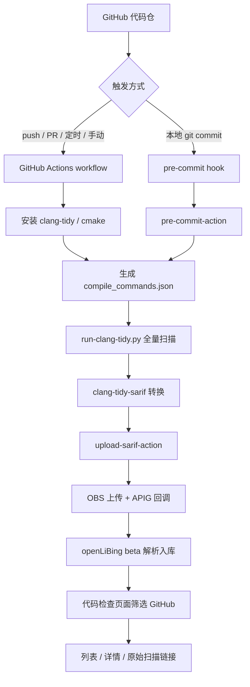

# 静态代码分析 GitHub 接入方案与文档 · clang-tidy · 需求设计

## 1. 需求背景与目标态

openLiBing 的代码检查链路当前主要面向 GitCode Actions：各静态分析工具产出 SARIF，经 `upload-sarif-action` 上传 OBS 并回调 openLiBing，最终在「开发管理 - 代码检查」页面展示。

本 US 面向 C/C++ 仓库，是「静态代码分析 GitHub 接入」FE 的首个落地工具，目标是在 GitHub Actions 上打通 clang-tidy 全量检查，并沉淀可复用的 GitHub 接入范式。

**目标态**：

1. 在 GitHub 平台 `openlibing-test` 组织下准备可运行的 clang-tidy 流水线，覆盖 workflow 全量扫描与 pre-commit 集成两种入口；
2. 扫描结果能够生成合法 SARIF，上传 OBS 并回调 openLiBing beta 环境；
3. 「代码检查」页面筛选 GitHub 平台后能看到问题列表与详情，仓库、分支、规则、文件行号、检测工具、原始扫描链接、流水线字段均正常；
4. 满足以上条件即可转入测试流程；
5. 同步更新 GitCode `docs` 仓的用户文档（在 full-analysis 方案内补充 GitHub 接入章节）。

前端目标态原型见 [prototype.html](./prototype.html)，覆盖平台筛选新增 GitHub、数据来源新增 GitHub Action、列表与详情字段、原始扫描链接跳转 GitHub Actions 运行页。

## 2. 设计关键点

### 2.1 双入口，一套规则

| 入口              | 使用场景                         | 复用点                                  |
| ----------------- | -------------------------------- | --------------------------------------- |
| pre-commit 集成   | 本地提交前拦截、PR 门禁          | `.clang-tidy`、wrapper 脚本、SARIF 转换 |
| workflow 单独运行 | push / 定时 / 手动全量扫描与归档 | 同一份 wrapper 与 SARIF 转换            |

两种入口共享 `.clang-tidy` 规则配置和 `scripts/run-clang-tidy.py`，GitHub 与 GitCode 也共享同一套业务脚本，避免规则与实现分叉。

### 2.2 统一 SARIF 链路

clang-tidy 输出文本诊断，经 `clang-tidy-sarif` 转换为 SARIF v2.1.0；随后由 `upload-sarif-action` 统一完成路径归一化、代码片段补齐、OBS 上传与 openLiBing 回调。两个平台只在「如何触发、如何认证」上不同，SARIF 之后的链路完全复用。

### 2.3 GitHub 平台适配

| 适配点     | 做法                                                                                                          |
| ---------- | ------------------------------------------------------------------------------------------------------------- |
| 工作流     | `.github/workflows/`，使用 `actions/checkout`、`actions/setup-python`                                         |
| 触发方式   | 手动、push、PR、5 位 POSIX 定时                                                                               |
| 上下文     | 插件内识别 `GITHUB_ACTIONS`，读取 `GITHUB_*` 变量                                                             |
| 上传认证   | AK/SK 静态凭证（`OBS_AK` / `OBS_SK`），华为云无需信任 GitHub OIDC issuer                                      |
| 流水线字段 | `pipelineId=GITHUB_JOB`、`pipelineRunId=GITHUB_RUN_ID`、`pipelineName=GITHUB_WORKFLOW`、`commitId=GITHUB_SHA` |
| 外部依赖   | `clang-tidy-sarif` 二进制随仓预置，CI 运行时不访问外网                                                        |

### 2.4 产品侧最小适配

| 适配项             | 现状                                    | 目标态                          |
| ------------------ | --------------------------------------- | ------------------------------- |
| 来源枚举           | 仅 `HUAWEI_PIPELINE` / `GITCODE_ACTION` | 新增 `GITHUB_ACTION`            |
| 前端来源选项与标签 | 仅华为云流水线 / GitCode Action         | 新增 GitHub Action              |
| 前端平台图标       | 仅 GitCode / Gitee                      | 新增 GitHub 图标                |
| 上传插件来源值     | 固定 `GITCODE_ACTION`                   | GitHub 环境上报 `GITHUB_ACTION` |
| 仓库解析与查询     | 已支持 GitHub 仓库坐标                  | 无需改动                        |
| 仓库跳转链接       | 已支持 GitHub base URL                  | 无需改动                        |

> 发布顺序：先上线后端枚举与前端展示，再让插件上报 `GITHUB_ACTION`，避免非法来源被拒绝。

### 2.5 文档交付

| 仓库              | 内容                                                                                                |
| ----------------- | --------------------------------------------------------------------------------------------------- |
| `openlibing-docs` | 本设计文档与需求原型（归档）                                                                        |
| `docs`            | 用户文档：在 `static-code-analysis/solutions/full-analysis/` 内补充 GitHub 接入说明，不新增并列目录 |

## 3. 业务流程

**关键流程说明**：

1. GitHub 仓库触发 workflow 或本地 pre-commit；
2. 生成 `compile_commands.json` 后执行全量 clang-tidy；
3. 文本诊断转换为 SARIF；
4. 上传 OBS 并回调 beta；
5. openLiBing 解析入库；
6. 前端按 GitHub 平台筛选查看结果。

## 4. 测试成果

### 4.1 验证仓库

链路验证使用同源代码在 GitHub 个人测试账号执行，目标态迁移到 `openlibing-test` 组织后复用同一套代码与工作流。

| 仓库                | 用途                         | 验证地址                                                      |
| ------------------- | ---------------------------- | ------------------------------------------------------------- |
| clang-tidy 测试仓   | C/C++ 示例与两套 workflow    | <https://github.com/yzh-java-coder/clang-tidy-full-scan-demo> |
| pre-commit-action   | pre-commit 执行与 SARIF 收集 | <https://github.com/yzh-java-coder/pre-commit-action>         |
| upload-sarif-action | SARIF 归一化、OBS 上传、回调 | <https://github.com/yzh-java-coder/upload-sarif-action>       |

### 4.2 验证运行

| 场景                       | 运行记录                                                                               | 结果    |
| -------------------------- | -------------------------------------------------------------------------------------- | ------- |
| workflow 全量扫描          | <https://github.com/yzh-java-coder/clang-tidy-full-scan-demo/actions/runs/41596713245> | success |
| pre-commit 集成            | <https://github.com/yzh-java-coder/clang-tidy-full-scan-demo/actions/runs/41596713223> | success |
| 页面展示验证（扫描）       | <https://github.com/yzh-java-coder/clang-tidy-full-scan-demo/actions/runs/41594396815> | success |
| 页面展示验证（pre-commit） | <https://github.com/yzh-java-coder/clang-tidy-full-scan-demo/actions/runs/41594396843> | success |

### 4.3 验证结论

| 验证项           | 结果                                                          |
| ---------------- | ------------------------------------------------------------- |
| GitHub workflow  | 手动 / push / PR / 定时触发均可用                             |
| clang-tidy 扫描  | 12 个源文件全量扫描通过                                       |
| SARIF 生成       | 单次扫描生成 140 条结果                                       |
| OBS 上传         | 成功，对象位于 `clang-tidy-results/` 前缀下                   |
| openLiBing 回调  | 返回 `{"code":200,"msg":"success"}`                           |
| beta 解析入库    | 测试库按指纹归一后入库 128 条问题                             |
| 前端展示         | 筛选 GitHub 平台后列表与详情正常                              |
| 来源与流水线字段 | 来源当前为 `GITCODE_ACTION`；流水线字段已按 GitHub 上下文映射 |

### 4.4 目标态迁移项

1. 在 `openlibing-test` 组织下创建 `clang-tidy-full-scan-demo`、`pre-commit-action`、`upload-sarif-action` 三个仓库；
2. 为测试仓配置 `OBS_AK` / `OBS_SK` Secrets，`env_type` 指向 `beta`；
3. 跑通两条 workflow，确认回调成功、beta 可解析入库；
4. 前端筛选 GitHub 平台，逐项核对列表、详情、原始扫描链接与流水线字段。

## 5. 验收标准

- GitHub Actions 能在 `openlibing-test` 目标仓库跑通 clang-tidy 全量扫描；
- 扫描结果能生成合法 SARIF 并成功上传 OBS；
- 回调 openLiBing beta 成功，结果可解析入库；
- 前端选择 GitHub 平台后能看到问题列表与详情；
- 平台图标、来源标记、原始扫描链接、流水线字段、文件行号等功能正常；
- pre-commit 集成可在本地或流水线复用同一份规则配置；
- `docs` 仓已补充 GitHub 接入的用户文档。

满足以上条件后，本 US 转入测试流程。

## 6. 交付物与范围边界

**交付物**：

- GitHub 侧 `pre-commit-action`、`upload-sarif-action` 与 clang-tidy 示例 workflow；
- clang-tidy GitHub 接入用户文档（`docs` 仓 full-analysis 方案内）；
- 本设计文档与需求原型（`openlibing-docs` 归档）。

**非目标**：

- 不覆盖 clang-tidy 之外的工具，其他工具按各自 US 扩展；
- 不改造 openLiBing 现有 SARIF 解析与问题去重模型；
- 不引入 GitHub App、GitHub Token 生命周期管理等额外能力；
- 不做存量 `GITCODE_ACTION` 数据迁移，历史数据保持原样。
