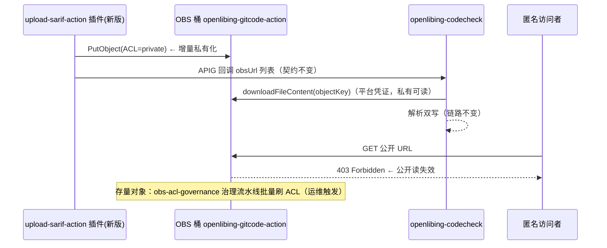

# SARIF 安全扫描上报对象私有化改造 — 详细设计

| 项          | 内容                                                                                                                                 |
| ----------- | ------------------------------------------------------------------------------------------------------------------------------------ |
| 需求名称    | upload-sarif-action 插件上传对象私有化                                                                                               |
| FE 需求名称 | 待定（创建 Issue 时补充，全链路命名以此为准）                                                                                        |
| 改动范围    | upload-sarif-action 插件（发新版）+ openlibing-codecheck 后端（Sarif 解析凭证化）+ 存量治理（复用 cicd 治理流水线）                  |
| 复用/依赖   | codecheck 既有平台凭证下载能力（`ObsBucketService#downloadFileContent`）；cicd 仓 obs-acl-governance 治理流水线                      |
| 设计日期    | 2026-11-05                                                                                                                           |
| 关联背景    | [UT 覆盖率上报对象私有化](../../../openlibing-coderepo/task_design/ut-upload-object-private/design.md)（同桶先例，治理流水线已落地） |

---

## 1. 方案设计

### 1.1 需求回顾

| 需求点                                                | 设计落点                                                                                                 |
| ----------------------------------------------------- | -------------------------------------------------------------------------------------------------------- |
| upload-sarif-action 上传的 SARIF 对象由公开读改为私有 | 插件 `ACL` 硬编码 `public-read` 改为 `private`（本就无配置项，改模块常量即可，无公开读复活口子）         |
| 后端解析链路兼容私有对象                              | **codecheck `SarifParseServiceImpl` 匿名 GET 改为平台凭证下载**（私有化的前置条件，见 2.2）              |
| 存量公开读对象清零                                    | 复用 cicd 仓已上线的 obs-acl-governance 治理流水线（bucket/prefix/mode/marker 全参数化，无需新增流水线） |
| 上报内容、回调契约不变，现有流水线无感知              | 仅改 ACL 参数与后端下载方式，回调报文（obsUrl 列表 / APIG 签名）零变更                                   |
| OIDC 认证模式不变                                     | 插件上传链路保持 OIDC 联邦认证（`@openlibing/huaweicloud-oidc-client`），不动凭证体系                    |

### 1.2 现状与风险

现状：插件把安全扫描 SARIF 结果上传到统一桶 `openlibing-gitcode-action`、前缀 `{tool}-results/{yyyyMMdd}.{HH}/{runId}/`（`buildToolPrefix` 按工具名归一化，如 `bandit-results/`、`spotbugs-results/`，兜底 `code-arts-check-results/`），对象 ACL **硬编码 public-read**（index.js L964）；后端 `SarifParseServiceImpl#downloadAndParse` 以 `URI.create(obsUrl).toURL().openStream()` **匿名 HTTP GET** 下载解析。

风险（敏感度高于 UT 覆盖率场景）：

1. **仓库安全弱点地图公开**：SARIF 含漏洞规则 ID、漏洞文件路径与行号、代码片段、修复建议——公开 URL 一旦外泄，攻击者可直接按图索骥定位可利用缺陷，等于把内网代码的安全底牌公开；
2. **URL 永久有效**：OBS 公开对象无过期机制，历史链接可无限期访问转发；
3. **口径不一致**：同桶 `code-metrics-action/`、`ut-coverage-action/` 前缀已完成（或进行中）私有化，SARIF 各 `*-results/` 前缀是公开读残留（治理流水线整桶摸底已证实大量 `bandit-results/` 对象公开读）。

### 1.3 方案总览

一句话：**后端先凭证化 + 插件再私有 + 存量流水线清零**——codecheck 后端解析改走平台 OBS 凭证（兼容公开读对象，先行发布）；插件新版本上传时 ACL 固定 private（增量止血）；存量公开对象由 cicd 治理流水线按前缀/整桶批量刷 ACL 为私有；回调契约零变更。

### 1.4 关键决策点（评审确认项）

| #   | 决策                                                                                         | 备选                                    | 推荐理由                                                                                                               |
| --- | -------------------------------------------------------------------------------------------- | --------------------------------------- | ---------------------------------------------------------------------------------------------------------------------- |
| D1  | 插件 ACL **固定 private**（改硬编码常量，无配置项）                                          | 增加 obs_acl 配置项                     | 与 UT 插件私有化口径一致；安全硬约束不开放配置；本就无配置项，改造成本更低                                             |
| D2  | 后端解析改走**平台凭证下载**（复用 codecheck 既有 `ObsBucketService#downloadFileContent`）   | 维持匿名 GET（仅靠对象公开读）          | 匿名 GET 是私有化的唯一障碍；平台凭证读取对公开/私有对象均有效，先行发布不破坏存量解析，是插件发版的前置条件           |
| D3  | 存量治理**复用 obs-acl-governance 治理流水线**，整桶 COUNT_ONLY → COUNT_AND_REPAIR           | 为 sarif 单独建流水线；桶级公共访问阻断 | 治理流水线已参数化（可选桶/前缀/模式/断点）且经 UT 场景实战验证；整桶摸底（total=6470）已证实 sarif 各前缀公开对象存在 |
| D4  | 发布顺序：**先 codecheck 后端（凭证化）→ 双验证 → 插件发版（ACL=private）→ 存量治理 → 观测** | 插件先发版                              | 与 UT 场景顺序相反：后端当前是匿名读，插件若先发版，新私有对象后端解析立即 403 断链；后端凭证读先行对公开对象无影响    |

---

## 2. 实现逻辑设计

### 2.1 插件改造（upload-sarif-action）

改动极小：ACL 硬编码改模块常量，上传与回调契约零变更。

1. **ACL 常量**：新增模块常量 `const OBJECT_ACL = 'private'`（含"私有化口径不可配置"注释，与 upload-ut-action 同款），`putObject` 的 `ACL: 'public-read'`（L964）改为 `ACL: OBJECT_ACL`；L959 注释同步更新（"后端经平台凭证读取，私有化口径"）；
2. **不变的契约**：SARIF 文件内容、objectKey 命名（`{tool}-results/{timePath}/{name}`）、回调报文（obsUrl 列表 / category / source 等）、APIG V11 签名回调全部不变；
3. **存量流水线影响**：无任何 input 变化（本就无 obs_acl），用户升级插件版本零配置改动；
4. **版本**：action.yml 与 package.json `1.0.1 → 1.1.0`（行为变化：上传对象私有，语义化版本取 minor），`npm run build` 重新生成 dist 并随版本发布（Release 填发布明细）。

### 2.2 后端改造（openlibing-codecheck）

私有化的**前置条件**：`SarifParseServiceImpl#downloadAndParse` 当前 `URI.create(obsUrl).toURL().openStream()` 匿名 GET，对象私有化后立即 403。

1. **下载方式替换**：从 obsUrl 解析出 objectKey（剔除 `https://openlibing-gitcode-action.obs.{region}.myhuaweicloud.com/` 前缀，余下 `{tool}-results/.../{name}` 即 objectKey），改调 `ObsBucketService#downloadFileContent(objectKey)`（平台凭证，服务间授权，返回 `Path`）→ 后续 Jackson 解析逻辑不变；
2. **桶与前缀白名单**：确认 codecheck `ObsBucketServiceImpl` 的桶名/前缀校验范围覆盖 `openlibing-gitcode-action` 桶与 `*-results/` 动态前缀（工具名归一化动态生成），必要时扩展白名单匹配规则；
3. **多 URL 兼容**：回调 obsUrl 为 `List<String>`（多工具混合扫描），逐 URL 提取 objectKey 下载，`parseAllUrls` 的分组容错逻辑（单 URL 失败跳过）不变；
4. **兼容性**：平台凭证读取对公开读对象同样有效——后端先行发布后，存量公开对象与（发版后的）私有对象都能解析，无灰度断链窗口；
5. **测试**：`SarifParseServiceImplTest` 补充/改造——mock `ObsBucketService` 验证 objectKey 提取（含多 URL、非法 URL 容错）与下载解析链路；URL→objectKey 解析函数独立单测。

### 2.3 存量治理（复用 cicd 治理流水线）

cicd 仓 `.gitcode/workflows/obs-acl-governance.yml` + `scripts/obs-acl-governance/` 已上线（UT 场景实战验证：整桶摸底 pages=7 / total=6470，匿名组判定 `URI=Everyone` + READ/FULL_CONTROL，marker 断点续跑、限流、摘要留痕）。SARIF 存量治理直接复用：

1. **摸底**：手动触发，`mode=COUNT_ONLY`、整桶（prefix 留空）——输出各前缀公开读总数（含 `bandit-results/` 等安全扫描前缀），对齐审计；
2. **审计（前置必做）**：确认 SARIF 各 `*-results/` 前缀无匿名消费方（OBS 访问日志筛查匿名 GET）——安全扫描结果的潜在消费方需逐一确认（页面下钻 / 报表导出均应走后端平台凭证）；
3. **修复**：确认后切 `mode=COUNT_AND_REPAIR`（整桶），一次性覆盖 UT 与 SARIF 全部前缀的公开读残留；幂等可重跑，超长按 marker 分段；
4. **验证**：治理后重跑 COUNT_ONLY 应归零；抽样历史 sarif objectKey 匿名 GET → 403；历史扫描记录解析/下钻正常。

### 2.4 验证矩阵

| 认证模式 | 上传凭证来源         | 验证点                                                                                             |
| -------- | -------------------- | -------------------------------------------------------------------------------------------------- |
| OIDC     | 流水线 OIDC 临时凭证 | ① 上传成功；② 对象 ACL 为私有（匿名 GET 403）；③ codecheck 解析入库成功、静态告警页面详情/下钻正常 |

补充验证：多工具混合上传（bandit + spotbugs 双 sarif）解析分组正确；治理后历史扫描记录重新解析正常（平台凭证读历史私有对象）。

### 2.5 回滚预案

- 后端：回退发布版本（恢复匿名 GET，要求对象重新公开）；
- 插件：回退上一版本重新发版（增量恢复公开读）；
- 存量治理：批量改 ACL 可逆（恢复 public-read）；
- 观测指标：SARIF 解析成功率、下载失败日志——异常即时回滚治理项。

---

## 3. 类设计

### 3.1 插件（upload-sarif-action，2 文件 + 构建）

| #   | 文件                          | 位置           | 改动                                                                                                |
| --- | ----------------------------- | -------------- | --------------------------------------------------------------------------------------------------- |
| 1   | `index.js`                    | L47 / L959-965 | 新增模块常量 `OBJECT_ACL = 'private'`；`putObject` ACL 改用常量；头注释与上传注释更新（私有化口径） |
| 2   | `action.yml` / `package.json` | version        | `1.0.1` → `1.1.0`（两处同步）                                                                       |
| 3   | `dist/index.js`               | 构建产物       | `npm run build`（ncc + zip）重新生成并随版本发布                                                    |

### 3.2 后端（openlibing-codecheck，2-3 文件）

| #   | 文件                                                    | 改动                                                                                                                |
| --- | ------------------------------------------------------- | ------------------------------------------------------------------------------------------------------------------- |
| 1   | `SarifParseServiceImpl`（business/service/impl/alarm/） | 新增 obsUrl→objectKey 解析函数；`downloadAndParse` 改用 `ObsBucketService#downloadFileContent(objectKey)`；注释更新 |
| 2   | `ObsBucketServiceImpl`（如白名单不含动态前缀）          | 桶/前缀白名单扩展覆盖 `*-results/`（按实现现状定）                                                                  |
| 3   | `SarifParseServiceImplTest` + 新增解析函数单测          | mock `ObsBucketService`：objectKey 提取、多 URL、下载失败容错、解析入库链路                                         |

### 3.3 存量治理（openlibing-cicd：无代码改动）

复用既有 obs-acl-governance 治理流水线与脚本，仅运维触发操作（COUNT_ONLY 摸底 → 审计 → COUNT_AND_REPAIR）；服务端 Java 零改动。

---

## 4. 数据模型设计

无数据库变更。SARIF 解析入库表结构与 scanRun 记录不涉及。

---

## 5. 性能设计

| 关注点   | 设计                                                                                                 |
| -------- | ---------------------------------------------------------------------------------------------------- |
| 上报链路 | 上传路径仅 ACL 参数变化，无性能影响                                                                  |
| 后端解析 | 匿名 GET → 平台凭证下载：同为单次 HTTP(S) 读取，时延持平；平台凭证为服务内长生命周期，无额外换证开销 |
| 治理吞吐 | 治理流水线逐对象 2 次 ACL API + 限流，整桶 6470 对象实测约 2.5 分钟（COUNT_ONLY），符合预期          |

---

## 6. API 接口设计

无接口变更：回调报文（obsUrl 列表 / APIG 签名）、页面查询接口全部保持原契约；"现有流水线无感知"由本条保证。

---

## 7. 安全设计

| 维度     | 设计                                                                                                                                                         |
| -------- | ------------------------------------------------------------------------------------------------------------------------------------------------------------ |
| 收益     | 消除 SARIF 安全扫描结果的匿名读取面——仓库安全弱点地图不再公开可达；与同桶 code-metrics / ut-coverage 前缀私有化口径对齐                                      |
| 凭证管理 | 插件上传凭证不变（OIDC 临时凭证，小时级短效）；后端走平台 OBS 凭证（服务间授权），不新增凭证；治理凭证沿用 obs-acl-governance 最小权限（List/GetAcl/PutAcl） |
| 审计     | 治理前强制匿名消费审计（D3，两段式执行先行摸底）；SARIF 敏感度高于覆盖率报告，审计窗口建议覆盖更长历史（近 30 天起步）                                       |
| 观测     | 治理后观测 SARIF 解析成功率与下载失败日志，异常即时回滚治理项                                                                                                |

---

## 8. 实施步骤与验收标准

### 实施步骤（D4 顺序）

1. codecheck 后端改造 + 发布（Sarif 解析凭证化，兼容公开对象）；
2. OIDC 流水线双验证（公开对象下新后端解析正常）；
3. 插件改造 + 新版本发布（ACL 固定 private）；
4. 新版插件上报验证（对象私有 + 后端解析入库正常）；
5. 存量治理：治理流水线 COUNT_ONLY 摸底 → 匿名消费审计（D3）→ COUNT_AND_REPAIR 修复 → 重跑 COUNT_ONLY 验证归零；
6. 观测期（解析成功率 / 下载失败日志）。

### 验收标准

1. codecheck 后端：SARIF 解析全部走平台凭证下载，单测覆盖 objectKey 提取与下载链路；
2. 新版插件上传的对象：匿名 GET 返回 403，后端解析入库正常；
3. 多工具混合上传（双 sarif）分组解析正确；
4. 存量治理后：COUNT_ONLY 公开读计数归零，抽样历史 sarif 对象匿名 GET 403；
5. 历史扫描记录解析 / 静态告警页面下钻不受影响；
6. 观测期 SARIF 解析成功率无劣化。
