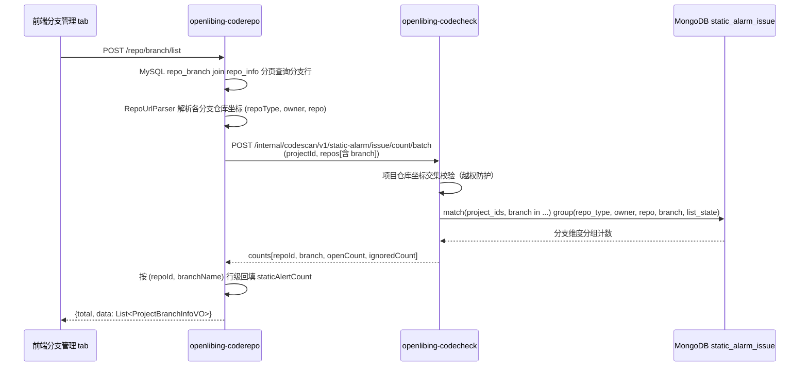

# 分支管理代码检查告警数展示——技术设计

# 1.方案设计

## 方案目标

代码仓管理页面的分支管理 tab 中，每个分支展示该分支的代码检查未处理告警数；用户点击指标可跳转代码检查告警详情页并自动带上分支过滤条件（跳转逻辑由前端实现）。

## 业务背景

用户在代码仓管理页面维护分支时，需要判断各分支的代码检查问题规模，以决定分支处理优先级。当前分支管理 tab 仅展示分支基本信息与代码度量，分支维度告警情况需要用户进入告警详情页逐仓逐分支人工查询。仓库管理 tab 已展示仓库维度的代码检查告警数（整仓所有分支未处理告警之和），分支维度缺乏同等能力。

## 涉及模块

- openlibing-coderepo：分支列表接口返回字段扩展与告警数批量回填。
- openlibing-codecheck：内部批量告警计数接口扩展分支维度。

## 整体处理方式

复用仓库管理 tab 告警数的既有取数链路（仓库坐标解析 + Feign 批量计数 + 空值降级），将内部批量计数接口 `POST /internal/codescan/v1/static-alarm/issue/count/batch` 扩展出分支维度：一次请求返回当前页全部仓库分支组合的未处理告警数，按行匹配回填到分支列表返回结果。

## 采用原因

- 告警数据在 codecheck MongoDB 主表按分支维度拆分记录，且已有分支状态索引，分支维度聚合为既有能力的自然扩展。
- 与仓库管理 tab 告警数共用同一取数链路与统计口径（未处理 = OPEN + PENDING_REVIEW），保证"同一仓库各分支告警数之和等于仓库管理 tab 展示的整仓告警数"。
- 不新增表、缓存、同步任务与对外接口，改动范围收敛在既有接口的字段与聚合维度扩展。
- 告警详情页过滤条件已由既有告警列表与计数接口支持（入参 `branches`），跳转能力无需后端新增接口。

# 2.实现逻辑设计

## 调用关系与数据流转

## 核心处理步骤

1. 分支列表主查询：`RepoServiceImpl#queryProjectBranch` 按既有逻辑完成 MySQL 分页查询、越权范围过滤与基础字段组装，新增字段不参与 SQL。
2. 坐标解析：对当前页每行按 `repoUrl` 经 `RepoUrlParser#parse` 解析仓库坐标；解析失败或非代码检查接入平台的行，告警数字段置空并跳过取数。
3. 批量计数：将去重后的仓库分支坐标组装为批量计数请求，经 Feign 调用 codecheck 内部接口；聚合在 codecheck 侧完成，底层匹配条件含 `branch` 过滤，分组维度含 `branch`。
4. 行级回填：按仓库标识与分支名匹配计数结果回填 `staticAlertCount`；无匹配结果的行保持空值。
5. 降级：Feign 调用异常或超时时不抛出错误，仅新增字段为空，前端展示占位符，分支列表主数据不受影响。

# 3.类设计

| 代码仓               | 类                              | 职责                            | 主要修改内容                                                                                                                          |
| -------------------- | ------------------------------- | ------------------------------- | ------------------------------------------------------------------------------------------------------------------------------------- |
| openlibing-coderepo  | `RepoServiceImpl`               | 分支列表、仓库列表业务实现      | `queryProjectBranch` 主流程接入告警数回填；新增分支维度批量取数与行级回填方法（复用 `fetchStaticAlertCountMap` 的降级与坐标解析模式） |
| openlibing-coderepo  | `RepoUrlParser`                 | 仓库 URL 解析为平台坐标         | 不修改，直接复用                                                                                                                      |
| openlibing-coderepo  | `OpenlibingCodeCheckClient`     | codecheck 内部接口 Feign 客户端 | 不修改，接口路径与签名不变，扩展字段随请求体传递                                                                                      |
| openlibing-codecheck | `StaticAlarmInternalController` | codecheck 内部批量计数入口      | 不修改，入参模型扩展字段                                                                                                              |
| openlibing-codecheck | `StaticAlarmServiceImpl`        | 批量计数业务实现                | `batchIssueCount` 计数结果回填键由仓库坐标扩展为仓库坐标加分支；分支为空的条目保持既有键语义                                          |
| openlibing-codecheck | `StaticAlarmOperation`          | MongoDB 聚合操作                | `countIssuesGroupByRepoAndListState` 分组维度追加 `branch`；匹配条件复用既有的分支过滤能力                                            |

# 4.数据模型设计

## 数据库表

不涉及。MySQL 侧无表结构变更；MongoDB 集合 `static_alarm_issue` 既有 `branch` 字段（不同分支为独立记录，已有分支状态索引），本次无字段新增。

## Request

`StaticAlarmCountBatchDTO`（openlibing-coderepo 与 openlibing-codecheck 双侧镜像，同步修改）：

| 字段   | 位置           | 类型   | 说明                                     |
| ------ | -------------- | ------ | ---------------------------------------- |
| branch | repos 列表项内 | String | 分支名；可空，为空时保持既有整仓统计语义 |

## Response

| 字段             | 位置                                                                         | 类型    | 说明                                          |
| ---------------- | ---------------------------------------------------------------------------- | ------- | --------------------------------------------- |
| staticAlertCount | `ProjectBranchInfoVO`（openlibing-coderepo，`/repo/branch/list` 行对象）     | Integer | 该分支未处理告警数；null 表示查询失败或不可用 |
| branch           | `StaticAlarmCountBatchVO` 计数项（openlibing-codecheck，批量计数接口响应项） | String  | 回显分支维度，供调用方行级匹配                |

# 5.性能设计

- 分支列表分页上限为 200 行，去重后的仓库分支组合不超过 200，单次批量计数请求一次完成，无 N+1 调用。
- codecheck 侧聚合查询的匹配条件命中 `project_ids` 与既有分支状态索引，分组规模与现有整仓批量计数接口同量级。
- 无新增缓存：当前为列表页随查随取场景，非高频访问，与仓库管理 tab 告警数保持同一实时取数架构，不引入缓存一致性问题。
- 降级路径保证接口满足 3 秒性能要求：取数异常不影响主查询，新增字段降级为空值。

# 6.API接口设计

## 分支列表接口（扩展返回字段）

- URL：`POST /repo/branch/list`
- Method：POST
- 请求参数：不变。
- 返回参数：行对象 `ProjectBranchInfoVO` 新增 `staticAlertCount`（Integer，可空），其余字段不变。
- 兼容性：纯新增返回字段，既有调用方无感知，向后兼容。

## 内部批量计数接口（扩展分支维度）

- URL：`POST /internal/codescan/v1/static-alarm/issue/count/batch`
- Method：POST
- 请求参数：repos 列表项新增 `branch`（String，可空）。
- 返回参数：计数项新增 `branch`（String）。
- 兼容性：`branch` 为空时保持既有整仓统计语义，既有调用方行为不变。

## 告警列表与计数接口（无变化）

- `POST /static-alarm/v1/list`、`POST /static-alarm/v1/issue/count`：既有入参已支持 `branches` 过滤，本次不修改；前端跳转告警详情页时在请求体中传入分支条件即可。

# 7.安全设计

## 鉴权

- 分支列表接口继承既有鉴权与数据范围控制：`resolveAccessibleRepoScope` 产出的仓库白名单注入 SQL 过滤，新增字段不改变范围计算。
- 内部批量计数接口继承既有越权防护：codecheck 侧按项目维度做仓库坐标交集校验；分支属于仓库内维度，不引入新的权限面，无需新增权限项。

## 敏感信息

本次变更不涉及新增 token、密钥等敏感信息处理；日志不打印凭据类内容，计数结果为业务统计值，无敏感信息泄露风险。

## 硬编码

本次变更不新增硬编码；内部服务地址沿用既有 Feign 配置管理，无 appkey、token、cookie、secret、密钥类字面量写入代码。

## 审计日志

本次变更均为查询类能力扩展，不涉及新增、修改、删除类业务操作，无新增审计需求；既有接口访问日志与鉴权日志保持不变。

# 附录

## 概念说明

- 未处理告警数口径：`list_state` 属于 OPEN 与 PENDING_REVIEW 之和，与仓库管理 tab 告警数口径一致。
- 仓库坐标：仓库 URL 经解析得到的平台类型、属主、仓库名三元组，是跨系统对齐告警数据的主键语义；同一坐标加分支名唯一确定一组告警记录。
- 整仓与分支口径关系：同一仓库下所有分支告警数之和等于仓库管理 tab 展示的整仓告警数，可作为上线后数据一致性校验依据。

## 可选方案说明

- 分支列表按告警数排序、仅对已接入代码检查的分支取数：均为可选优化，当前需求未要求，不建议本期增加。
- 跳转告警详情页的定位参数形式（仓库 URL 或坐标三元组）由前端结合页面既有数据选定，后端两种信息均已返回，无需新增字段。
