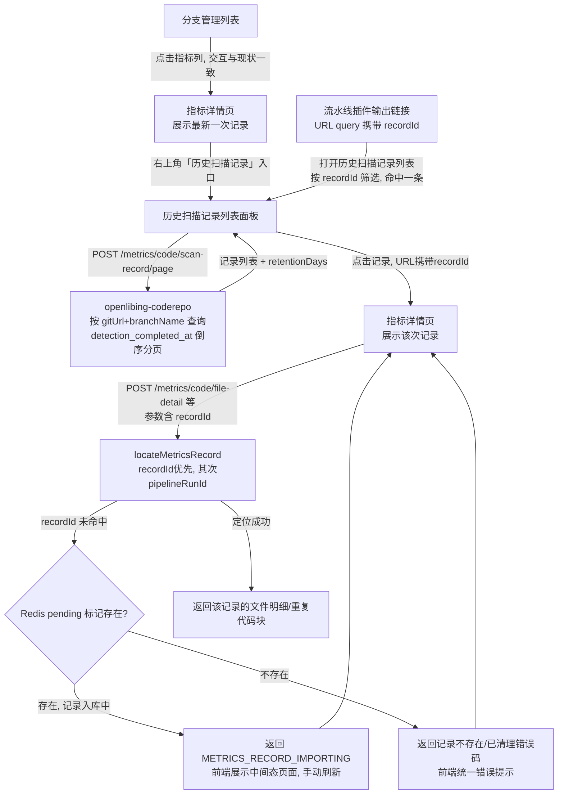
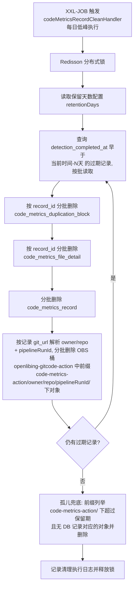

# 代码度量新增历史扫描记录页 设计文档

## 背景与目标

在分支管理场景中，用户通过代码度量指标（代码规模、平均代码行数、平均圈复杂度、总代码重复率）评估分支质量。当前系统仅展示分支最新一次扫描的结果，历史扫描数据虽已入库但无法查看；流水线插件输出的"扫描结果"链接固定落到最新数据，回看历史流水线时看到的指标与当时构建不一致。同时扫描记录持续累积且无清理机制，数据库与 OBS 存储不断增长，用户对数据可追溯范围没有预期。

本次改造目标：

1. 分支管理列表点击指标仍直达指标详情页（展示最新一次记录，交互与现状一致）；详情页右上角新增「历史扫描记录」入口，可查看该分支历史扫描记录并进入单条记录详情（含文件级明细与重复代码块）。
2. 详情页按记录 ID 唯一定位；上报接口在同步返回前**预生成 recordId**（重试时复用同一 ID），插件结果链接在原 query 参数基础上**追加 recordId**，落地打开历史扫描记录列表并按 recordId 筛选（仅命中一条），点击记录进入详情——历史流水线输出链接长期有效。
3. 扫描记录按配置的保留周期自动清理：**数据库记录与 OBS 上传文件同时删除**，清理任务在 openlibing-coderepo 后端实现（XXL-JOB），插件不参与；页面明确提示保留范围，已清理记录由后端校验拦截并返回明确错误。

涉及仓库：openlibing-coderepo（后端）、openlibing-web（前端）、code-metrics-action（插件，无代码改动）。

---

# 1.方案设计

## 方案目标

在不改变现有扫描入库链路（OBS 中转 + MQ 异步消费）的前提下，将已有的"按记录追加存储"能力透出为用户可用的历史记录查询能力，并补齐记录生命周期管理（数据库 + OBS 双清理）。

## 涉及模块

| 仓库                | 改动范围                                                                                                                                                                                                                                                   |
| ------------------- | ---------------------------------------------------------------------------------------------------------------------------------------------------------------------------------------------------------------------------------------------------------- |
| openlibing-coderepo | 新增历史扫描记录分页查询接口；三个详情接口增加按 recordId 定位；`/metrics/code/report` 同步段预生成/复用 recordId 并写入 MQ 消息，响应新增 recordId 字段，`detailLink` 在原 query 参数基础上追加 recordId；新增 XXL-JOB 定期清理任务（DB 三表 + OBS 对象） |
| openlibing-web      | 指标详情页右上角新增「历史扫描记录」入口；新增历史扫描记录列表面板；插件链接落地打开历史扫描记录列表并按 recordId 筛选（URL query 携带 recordId，命中一条）；详情页 URL 携带 recordId；保留范围提示、入库中间态页面与失效记录引导                          |
| code-metrics-action | 无代码改动。链接由服务端生成并透传输出；插件现有代码已尝试读取响应中的 `data.recordId`，服务端补充该字段后天然兼容                                                                                                                                         |

## 整体处理方式

**数据模型零变更**：现有 `code_metrics_record` 表已具备历史记录所需的全部要素——雪花算法主键 `id`（即记录 ID）、`git_url` + `branch_name` 归属、`pipeline_run_id`、`run_number`、`commit_id`、`pipeline_name`（来源）、`metrics_data_json`（总体指标）、`detection_completed_at`（扫描时间）、`status`。文件级明细表 `code_metrics_file_detail` 与重复代码块表 `code_metrics_duplication_block` 已通过 `record_id` 关联主表。因此本需求不新增表、不新增字段（OBS 对象按前缀规则推导，亦无需在记录表新增 obs_url 字段），只增加查询与清理能力。

**查询侧**：分支管理列表现有的 5 个指标列（代码规模、平均代码行数、平均圈复杂度、总代码重复率、总文件重复率）点击后**仍直达指标详情页并展示最新一次记录，交互与现状一致**。历史能力的入口放在详情页：右上角新增「历史扫描记录」按钮，点击进入该分支的历史扫描记录列表（新增分页查询接口，按 `git_url` + `branch_name` 过滤、`detection_completed_at` 倒序），再点击记录进入该次扫描的指标详情。**指标详情页的明细表格结构、排序、筛选、分页及行点击交互保持现状不变**（metricType 0~4 五种明细形态均保留，见第 6 节）。文件代码查看（总代码重复率类型下点击文件名打开代码视图）为现有能力，快照内容随扫描记录入库，按记录定位后历史记录同样可查看。详情复用现有三个详情接口，在原有 `pipelineRunId` 定位参数基础上增加 `recordId` 参数，`recordId` 优先；recordId 模式下 `repoId`/`branchName` 可缺省，后端按记录归属反查仓库完成权限校验。`pipelineRunId` 适配暂时保留，用于看板组未切换链接格式前的兼容。

**链接侧**：`/metrics/code/report` 在同步返回前完成 recordId 预生成——按 `pipeline_run_id` 查询已有记录：命中则**复用其 id**（保证重试场景链接不变）；未命中则雪花算法**预生成新 id**。recordId 写入 MQ 消息体，消费者使用该 id 入库（不再自行生成）。响应 `detailLink` 在现有 query 参数基础上追加 recordId：`{openlibing.domain}/apps/repos?projectId={projectId}&platforms={platforms}&repoUrlLike={repoUrlLike}&branchNameLike={branchName}&recordId={recordId}`——与改造前链接同构（保留原筛选参数还原页面上下文，仅追加 recordId）。前端检测到 URL 携带 recordId 时打开**历史扫描记录列表并按 recordId 筛选（仅命中一条）**，点击记录行或指标数字进入该次记录的详情页。链接为固定模板、不带指标参数，一条链接即可覆盖全部 5 个指标。插件仓库无需发版。

**清理侧**：清理任务在 **openlibing-coderepo 后端**实现（不在插件实现），沿用仓库现有 XXL-JOB 定时任务模式（`@XxlJob` 注解 + Redisson 分布式锁，参照 `branchMetricsSyncHandler`）。按配置的保留天数删除过期 DB 记录及其关联明细，同时删除 OBS 桶 `openlibing-gitcode-action` 中 `code-metrics-action/{owner}/{repo}/{pipelineRunId}/` 前缀下的上报 JSON 对象（owner/repo 由记录的 `git_url` 解析、pipelineRunId 取自记录，按前缀推导无需新增字段）；另对前缀下无 DB 记录对应的孤儿对象（上报成功但入库失败的残留）做兜底清理。采用分批删除避免大事务。

采用该方案的原因：扫描数据早已按记录完整入库，历史查询是纯"透出"性质的能力，改造集中在查询接口与前端展示；recordId 预生成把链接的确定性收敛到上报接口的同步段，重试复用保证链接永不变质；清理复用已有定时任务基建与 OBS 服务，不引入新组件。

---

# 2.实现逻辑设计

## 历史记录查看与下钻流程



## recordId 预生成与重试复用

**`/report` 同步段**（响应返回前完成）：

1. `selectByPipelineRunId(pipelineRunId)` 查询已有记录；
2. 命中（重试/重报场景）→ `recordId = 已有记录 id`，复用；
3. 未命中（首次上报）→ `recordId = IdUtil.getSnowflake(1,1).nextId()`，预生成；
4. recordId 写入 MQ 消息体；`detailLink` 在原 query 参数基础上追加 recordId；响应同时返回 `recordId` 字段。

**消费者入库（含保底补导入路径的统一规则）**：

- 消息体 recordId 非空 → 直接使用该 id 插入主表与明细表；
- 为空（保底补导入路径 `importMetricsFromObsFile` 未经过 /report）→ 按 pipelineRunId 查已有记录复用其 id；仍无 → 现场生成；
- `deleteExistingRecord` 仍按 pipelineRunId 删旧，随后**以同一 recordId 重建**——重试后链接中的 recordId 始终指向最新一次入库的数据，链接永不变质。

**中间态处理（链接已生成、记录尚未入库）**：recordId 在 `/report` 同步段预生成，而数据由 MQ 消费者异步入库，两者之间存在"链接已下发、记录还不存在"的中间态窗口（首次上报的入库延迟、重试重报期间的"删旧未插新"）。处理方式：

1. **Redis pending 标记**：`/report` 同步段预生成 recordId 的同时写入标记 `code-metrics:pending:{recordId}`（TTL 10 分钟，覆盖 MQ 消费与重试窗口）；消费者入库成功后删除该标记；
2. **错误码区分**：详情接口按 recordId 未命中记录时检查 pending 标记——存在 → 返回 `METRICS_RECORD_IMPORTING`（入库中）；不存在 → 返回记录不存在/已清理错误码，两种情况用户感知明确区分；
3. **前端中间态页面**：收到 `METRICS_RECORD_IMPORTING` 时展示中间态页面（加载图标 + "本次扫描记录正在入库"说明 + 「立即刷新」按钮），不自动轮询、由用户手动刷新；记录不存在/已清理则复用统一错误提示，不设专门失效页面；
4. **退化兜底**：pending 标记为附加保障、非强一致依赖——Redis 不可用或标记提前过期时安全退化为"记录不存在"提示，不影响主链路。

## 前后端职责边界

**后端接口变化仅三处：**

1. 新增历史记录分页接口 `POST /metrics/code/scan-record/page`；
2. 三个详情接口（file-detail、file-content、duplication-block/detail）新增可选入参 `recordId`（recordId 模式下 `repoId`/`branchName` 可缺省），响应增加 `recordId` 字段（定位到的记录 ID，前端用于 URL 回填）；recordId 未命中时结合 Redis pending 标记（`code-metrics:pending:{recordId}`）区分返回：标记存在返回 `METRICS_RECORD_IMPORTING`（入库中），否则返回记录不存在/已清理错误码（见「中间态处理」），其余请求与响应结构不变；
3. 上报响应新增 `recordId` 字段，`detailLink` 在现有 query 参数基础上追加 recordId（响应结构仅增字段）。

**前端变化：**

1. 指标详情页右上角新增「历史扫描记录」入口，打开新增的历史扫描记录列表面板（调用新分页接口）；
2. 插件链接落地：URL query 携带 recordId 时打开历史扫描记录列表面板并按 recordId 过滤（仅命中一条），点击记录进入详情——插件链接的落地页；复用既有 `/apps/repos` 路由与页面，无新增路由；
3. **详情页新增指标切换页签（本次新增能力——现状 5 个指标详情页互相独立、进入后无法切换到其他指标）**：详情页顶部提供代码规模/平均代码行数/平均圈复杂度/总代码重复率/总文件重复率 5 个页签，同一记录下切换仅变更 metricType 重新调用现有 file-detail 接口（不新增接口、后端不感知）。配合链接落地到列表筛选，可在同一记录下连续查看全部 5 个指标，无需反复返回列表；详情页 URL 携带 recordId 与 metricType（从详情响应回填，metricType 标识当前展示页签，与现有详情页 URL 习惯一致）；
4. 新增「记录入库中」中间态页面：详情请求返回 `METRICS_RECORD_IMPORTING` 时展示（加载图标 + 说明 + 「立即刷新」按钮，手动刷新不自动轮询），插件链接在入库完成前点击不再误报为记录失效；
5. 顶部信息区调整与保留范围提示。

**分支管理列表（branches.vue）无改动**：指标列点击行为与现状一致（直达最新详情）。

## 插件结果链接生成

`CoderepoUploader.js` 上传全量 JSON 至 OBS（桶 `openlibing-gitcode-action`，对象 key 规则 `code-metrics-action/{owner}/{repo}/{pipelineRunId}/{ts}-metrics.json`）后调用 `/metrics/code/report`。本次改造后：

- 服务端在响应中返回预生成的 `recordId` 与 `detailLink`（query 格式，追加 recordId）；
- 插件读取响应中的 `detailLink` 透传写入流水线输出（`扫描结果url=...`），该链路无需修改；插件现有代码中已存在读取 `data.recordId` 的逻辑，此前恒为 null，服务端补充该字段后天然兼容。

## 扫描记录定期清理流程



**实现位置**：openlibing-coderepo 后端 XXL-JOB 定时任务（`CodeMetricsRecordCleanHandler`），**不在插件内实现**——插件是无状态流水线步骤，清理需要数据库与 OBS 双写一致性，属于服务端数据治理职责。

**双存储删除**：数据库删除三张表（主表 + 文件明细 + 重复代码块）；OBS 删除该记录对应的上报 JSON 对象，按 `code-metrics-action/{owner}/{repo}/{pipelineRunId}/` 前缀列举后批量删除（前缀由记录的 git_url 与 pipeline_run_id 推导，`code_metrics_record` 表无需新增 obs_url 字段）。

**删除顺序**：先删 DB、后删 OBS——DB 删除后页面即刻查询不到过期数据（页面明细数据在 DB，不依赖 OBS 对象）；OBS 残留对象不影响页面展示，由同任务后续批次或孤儿兜底回收，中途失败不产生脏数据。

清理以 `detection_completed_at` 为周期基准（与页面展示的扫描时间语义一致）。单批规模控制，循环执行直至无过期数据，避免单次任务产生大事务与长锁。

---

# 3.类设计

## openlibing-coderepo

| 类                                                                  | 职责             | 主要修改内容                                                                                                                                                                                                                                                                                                                                                                                                                                                                                                                                                 |
| ------------------------------------------------------------------- | ---------------- | ------------------------------------------------------------------------------------------------------------------------------------------------------------------------------------------------------------------------------------------------------------------------------------------------------------------------------------------------------------------------------------------------------------------------------------------------------------------------------------------------------------------------------------------------------------ |
| `CodeMetricsController`                                             | 代码度量接口入口 | 新增 `POST /metrics/code/scan-record/page` 历史记录分页接口；三个详情接口（`/metrics/code/file-detail`、`/metrics/code/file-content`、`/metrics/code/duplication-block/detail`）的 DTO 增加可选 `recordId` 参数                                                                                                                                                                                                                                                                                                                                              |
| `CodeMetricsService` / `CodeMetricsServiceImpl`                     | 业务逻辑         | 新增 `queryScanRecordPage`（分页查询 + 保留天数随响应返回）；`/report` 处理链新增 `preGenerateOrReuseRecordId`（按 pipelineRunId 复用已有记录 id，否则预生成，同时写 Redis pending 标记 `code-metrics:pending:{recordId}`）；`locateMetricsRecord` 增加 `recordId` 优先定位、归属校验，并支持按记录归属反查仓库完成权限校验（recordId 模式下 repoId/branchName 可缺省），recordId 未命中时结合 pending 标记区分返回 `METRICS_RECORD_IMPORTING` 与记录不存在/已清理错误码；`buildDetailLink` 在现有 query 参数基础上追加 recordId（链接落地历史记录列表筛选） |
| `CodeMetricsImportConsumer`                                         | MQ 消费者        | 入库使用 MQ 消息体中的 recordId（消息体为空时按 pipelineRunId 复用已有记录 id，仍无则现场生成）；`deleteExistingRecord` 删旧后以同一 recordId 重建；入库成功后删除 `code-metrics:pending:{recordId}` 标记                                                                                                                                                                                                                                                                                                                                                    |
| `CodeMetricsReportDTO`（MQ 消息体同构）                             | 上报入参         | 新增 `recordId` 字段（同步段预生成后随消息投递）                                                                                                                                                                                                                                                                                                                                                                                                                                                                                                             |
| `CodeMetricsReportVO`                                               | 上报响应         | 新增 `recordId` 字段；`detailLink` 值在原 query 参数基础上追加 recordId                                                                                                                                                                                                                                                                                                                                                                                                                                                                                      |
| `ScanRecordPageDTO`                                                 | 列表查询入参     | 新增。字段：`gitUrl`、`branchName`、`pageNum`、`pageSize`                                                                                                                                                                                                                                                                                                                                                                                                                                                                                                    |
| `ScanRecordPageVO` / `ScanRecordItemVO`                             | 列表响应         | 新增。含 `total`、`retentionDays`、记录项（`recordId`、扫描时间、`pipelineName`、`runNumber`、`pipelineRunId`、`commitId`、五项核心指标、`status`）                                                                                                                                                                                                                                                                                                                                                                                                          |
| `CodeMetricsRecordMapper`                                           | 记录表访问       | 新增 `selectPageByGitAndBranch`（倒序分页）、`selectExpiredRecordIds`（按时间批量取过期 id）、`deleteByIds`                                                                                                                                                                                                                                                                                                                                                                                                                                                  |
| `CodeMetricsFileDetailMapper` / `CodeMetricsDuplicationBlockMapper` | 明细表访问       | 新增按 `recordIds` 批量删除方法                                                                                                                                                                                                                                                                                                                                                                                                                                                                                                                              |
| `CodeMetricsRecordCleanHandler`                                     | 定时清理任务     | 新增。`@XxlJob("codeMetricsRecordCleanHandler")`，Redisson 分布式锁 + 分批删除 DB 三表 + 按前缀删除 OBS 对象 + 孤儿兜底，实现模式参照 `branchMetricsSyncHandler`                                                                                                                                                                                                                                                                                                                                                                                             |
| `ObsBucketService`                                                  | OBS 访问         | 新增 `listObjectsByPrefix`（按前缀列举对象）与 `deleteObjects`（批量删除），仅允许操作 `code-metrics-action/` 前缀（前缀白名单校验）                                                                                                                                                                                                                                                                                                                                                                                                                         |
| `CodeMetricsProperties`                                             | 配置载体         | 新增。`@ConfigurationProperties(prefix = "code-metrics")`，含 `retentionDays`（各环境 application yaml 配置）与 `pendingMarkTtlMinutes`（pending 标记 TTL，默认 10 分钟）                                                                                                                                                                                                                                                                                                                                                                                    |

## openlibing-web

| 组件/文件                              | 职责             | 主要修改内容                                                                                                                                                                                                                                                                                                                                                                                                                                                                                                                                                                                                                                                                                                     |
| -------------------------------------- | ---------------- | ---------------------------------------------------------------------------------------------------------------------------------------------------------------------------------------------------------------------------------------------------------------------------------------------------------------------------------------------------------------------------------------------------------------------------------------------------------------------------------------------------------------------------------------------------------------------------------------------------------------------------------------------------------------------------------------------------------------- |
| `dialog/MetricsDetailDialog.vue`       | 指标详情页       | 修改（仅以下六点，明细表格结构、排序、筛选、分页、行点击交互均不变）：① 右上角新增「历史扫描记录」入口按钮（本次核心交互改动）；② 新增指标切换页签（代码规模/平均代码行数/平均圈复杂度/总代码重复率/总文件重复率，本次新增——现状 5 个指标详情互相独立不可切换），同一记录下切换仅变更 metricType 重新调用 file-detail；③ 接收 `recordId`（URL query 或详情响应回填）并随详情类请求传递，URL 携带 recordId；④ 顶部信息区增加"提交"（记录的 commitId），"流水线"更名为"来源"，与"扫描时间"交换位置，调整后顺序为：代码仓、分支、提交、来源、扫描时间；⑤ 增加保留范围提示，记录已被清理时由后端返回错误码，前端复用统一错误提示，不设专门失效页面；⑥ 收到 `METRICS_RECORD_IMPORTING` 时展示「记录入库中」中间态页面 |
| `ScanRecordListPanel.vue`              | 历史扫描记录列表 | 新增。从详情页右上角入口进入；表格列：扫描时间、来源、提交、代码规模、平均代码行数、平均圈复杂度、总代码重复率、总文件重复率、状态；扫描时间倒序；顶部展示保留范围提示；指标数字与记录行均可点击进入对应记录详情；分页遵循 `el-pagination` 现有惯例                                                                                                                                                                                                                                                                                                                                                                                                                                                              |
| `Repos/index.vue`                      | 代码仓管理父页   | 修改。新增历史记录面板与详情面板的切换；URL query 携带 recordId 时（插件链接落地）打开历史记录面板并按 recordId 过滤（仅命中一条），初始化页面上下文                                                                                                                                                                                                                                                                                                                                                                                                                                                                                                                                                             |
| `router/routes/modules/menu.ts`        | 路由注册         | 无改动。链接回归 query 格式，复用既有 `/apps/repos` 路由                                                                                                                                                                                                                                                                                                                                                                                                                                                                                                                                                                                                                                                         |
| `api/Repos/api.ts`、`api/Repos/url.ts` | 接口封装         | 修改。新增 `scanRecordPage` 请求封装；详情类请求参数增加 `recordId`                                                                                                                                                                                                                                                                                                                                                                                                                                                                                                                                                                                                                                              |
| `Repos/branches.vue`                   | 分支管理列表     | 无改动。指标列点击行为与现状一致（直达最新详情）                                                                                                                                                                                                                                                                                                                                                                                                                                                                                                                                                                                                                                                                 |

## code-metrics-action

无代码改动。`CoderepoUploader.js` 透传服务端响应的 `detailLink`（及 `recordId`），链接模板变更由服务端闭环。

---

# 4.数据模型设计

**数据库表：不涉及。** 不新增表、不新增字段。`code_metrics_record` 现有字段完整覆盖历史记录展示所需数据；`code_metrics_file_detail`、`code_metrics_duplication_block` 通过既有 `record_id` 关联。OBS 对象按 `code-metrics-action/{owner}/{repo}/{pipelineRunId}/` 前缀规则推导，记录表无需新增 obs_url 字段。

**OBS 对象（存量资产管理）**：桶 `openlibing-gitcode-action`，前缀 `code-metrics-action/`；清理任务按前缀删除，孤儿对象兜底回收。

**配置项（新增）：**

| 配置                          | 说明                         | 示例 |
| ----------------------------- | ---------------------------- | ---- |
| `code-metrics.retention-days` | 扫描记录保留天数，按环境配置 | 90   |

**DTO / VO（新增/修改）：** 见类设计章节 `ScanRecordPageDTO`、`ScanRecordPageVO`；`CodeMetricsReportDTO`/`CodeMetricsReportVO` 新增 `recordId`；详情类接口响应新增 `recordId`。

**存量数据处理：** 现有历史记录在功能上线后即自然可见；上线时若存在超出保留周期的存量记录，由清理任务首次执行时统一回收（DB + OBS）。

---

# 5.性能设计

**列表查询：** 分页查询条件为 `git_url + branch_name + detection_completed_at 倒序`，现有 `selectLatestByGitAndBranch` 查询已依赖该组合访问路径，为 `code_metrics_record` 补充 `(git_url, branch_name, detection_completed_at)` 组合索引（如线上已存在则复用）。分页遵循仓库现有 SQL 下推 count + LIMIT/OFFSET 模式，页大小使用 `PaginationUtil` 上限约束。

**详情查询：** 复用现有三个详情接口，文件明细与重复代码块表已有 `record_id` 关联索引，`recordId` 定位为主键查询，无额外开销。recordId 模式下按记录反查仓库为单次索引查询。

**清理任务：** 过期记录按批（固定批次大小）读取 id 后分批删除，明细表按 `record_id` 走索引删除；OBS 按前缀列举 + 批量删除（单批对象数受 OBS API 限制约束，按 1000/批分页推进）；单批规模小、循环推进，避免长事务与主从延迟。任务安排在每日低峰执行。

**缓存：** 历史记录列表为低频回溯场景，无高频访问需求，无需新增缓存。

接口默认满足 3 秒性能要求。

---

# 6.API接口设计

## 新增：历史扫描记录分页查询

- **URL**：`POST /gateway/openlibing-coderepo/metrics/code/scan-record/page`
- **Method**：POST
- **请求参数**：

```json
{
  "gitUrl": "https://gitcode.com/xxx/yyy.git",
  "branchName": "master",
  "pageNum": 1,
  "pageSize": 10
}
```

- **返回参数**：

```json
{
  "code": "0",
  "data": {
    "total": 42,
    "retentionDays": 90,
    "records": [
      {
        "recordId": "1937265012345678901",
        "scanTime": "2026-11-08 14:32:10",
        "pipelineName": "code-metrics-pipeline",
        "runNumber": 128,
        "pipelineRunId": "88001",
        "commitId": "a1b2c3d4",
        "codeScale": 152340,
        "avgFunctionLoc": 18.6,
        "avgCyclomaticComplexity": 4.2,
        "totalCodeDuplicationRate": 7.35,
        "totalFileDuplicationRate": 4.18,
        "status": 0
      }
    ]
  }
}
```

`retentionDays` 随响应返回，前端用于展示"仅保留最新 N 天的扫描记录"提示，避免新增独立的配置查询接口。

## 修改：详情类接口增加记录 ID 定位

`/metrics/code/file-detail`、`/metrics/code/file-content`、`/metrics/code/duplication-block/detail` 三个接口的请求体增加可选参数 `recordId`，响应增加 `recordId` 字段（定位到的记录 ID，前端用于 URL 回填），其余响应结构不变：

| 参数                | 类型          | 必填                  | 说明                                                                                                                      |
| ------------------- | ------------- | --------------------- | ------------------------------------------------------------------------------------------------------------------------- |
| recordId            | String        | 否                    | 记录 ID，非空时优先按其定位；此时 `repoId`/`branchName` 可缺省，后端按记录的 `git_url`/`branch_name` 反查仓库完成权限校验 |
| pipelineRunId       | String        | 否                    | 保留原有适配，看板组切换链接格式前继续可用                                                                                |
| repoId / branchName | Long / String | recordId 模式下可缺省 | 现有参数，存量调用方不变                                                                                                  |

**recordId 未命中时的错误码区分**（中间态处理，机制见第 2 节）：

| 场景                               | 判定                                                          | 错误码                     | 前端表现                                                |
| ---------------------------------- | ------------------------------------------------------------- | -------------------------- | ------------------------------------------------------- |
| 链接已生成、记录尚未入库（中间态） | DB 未命中 + Redis 存在 `code-metrics:pending:{recordId}` 标记 | `METRICS_RECORD_IMPORTING` | 中间态页面：加载图标 + 「立即刷新」，手动刷新不自动轮询 |
| 记录不存在或已被清理               | DB 未命中 + 无 pending 标记                                   | 记录不存在/已清理错误码    | 复用统一错误提示，无专门失效页面                        |

以 `/metrics/code/file-detail` 为例，现有请求参数（`repoId`、`branchName`、`metricType`、`pipelineRunId`（可选）、`fileName`（筛选可选）、`sortByField`、`sort`、`pageNum`、`pageSize`）与响应结构（`fileDetails`、`total`、`runNumber`、`pipelineLink`、`pipelineName`、`checkTime`、`pipelineRunId` 等）均保持现状，仅新增 `recordId` 入参与出参；`fileDetails` 内的字段按 metricType 保持现有定义（如 metricType=3 时为 `filePath`、`totalLines`、`duplicationRate`、`duplicationLineCount`、`duplicationBlockCount`、`hasSnapshot`）。

**前端展示范围约束（本次不改）**：指标详情页按 metricType 0~4 的明细表格列保持现有定义——

| metricType | 指标         | 明细表格列（现状，保持不变）                                       | 行点击交互（现状，保持不变）           |
| ---------- | ------------ | ------------------------------------------------------------------ | -------------------------------------- |
| 0          | 代码规模     | 序号、文件名称、行数                                               | 无                                     |
| 1          | 平均代码行数 | 序号、文件名称、函数名、函数行数、开始行、结束行                   | 无                                     |
| 2          | 平均圈复杂度 | 序号、文件名称、平均圈复杂度                                       | 无                                     |
| 3          | 总代码重复率 | 序号、文件名称、重复代码行数、有效代码行数、重复率、重复代码块数量 | 文件名可点击，打开代码视图（现有能力） |
| 4          | 总文件重复率 | 重复文件序列号、文件名                                             | 无                                     |

说明：接口响应中的 `hasSnapshot` 字段前端现有逻辑未作为点击门槛，本次不改变该行为；代码视图数据（文件内容快照）随扫描记录入库，按 `recordId` 定位到历史记录后同样可查看，记录被清理后随记录一起不可访问。**该能力为现状已有，非本次新增。**

**兼容性**：`recordId` 为新增可选参数，存量调用方（看板、前端既有入口）不传时行为不变；`pipelineRunId` 适配暂时保留，待看板组适配新链接格式后另行下线。

## 修改：上报响应链接（recordId 预生成 + query 追加 recordId）

`POST /metrics/code/report` 响应新增 `recordId` 字段（同步段预生成/复用），`detailLink` 的 URL 模板在"query 参数落到分支管理列表"基础上**追加 recordId**，落地打开历史扫描记录列表并按 recordId 筛选（仅命中一条）：

```json
{
  "code": "0",
  "data": {
    "recordId": "1937265012345678901",
    "detailLink": "https://www.openlibing.com/apps/repos?projectId=493420&platforms=gitcode&repoUrlLike=yanzhaohong%2Fhs-fbb-diting&branchNameLike=master&recordId=1937265012345678901"
  }
}
```

链接示例（完整，域名取 `openlibing.domain` 生产配置 `https://www.openlibing.com`）：

```text
改造前：https://www.openlibing.com/apps/repos?projectId=493420&platforms=gitcode&repoUrlLike=yanzhaohong%2Fhs-fbb-diting&branchNameLike=master
        （落到分支管理列表页，需再手动点击指标，且永远只能看到最新一次数据）

改造后：https://www.openlibing.com/apps/repos?projectId=493420&platforms=gitcode&repoUrlLike=yanzhaohong%2Fhs-fbb-diting&branchNameLike=master&recordId=1937265012345678901
        （保留原筛选参数，仅追加 recordId；落地打开历史扫描记录列表并按 recordId 筛选，仅命中该次记录，点击记录行或指标数字进入对应详情）
```

**recordId 为什么可以放进链接**（此前异步方案不可行的两点均已被解决）：

1. **时序**：recordId 不再等 MQ 消费者生成，而是在 `/report` 同步段预生成（或复用已有记录的 id），响应返回时即确定；
2. **稳定性**：同一 pipelineRunId 重试/重报时，`/report` 复用已有记录的 id，消费者删旧重建使用同一 recordId——链接中的 recordId 始终指向最新入库的数据，不会因重跑失效。

**为什么保留原筛选参数**：Repos 页面初始化（列表筛选状态、面包屑上下文）依赖 projectId/platforms/repoUrlLike/branchNameLike；链接与改造前同构（仅追加 recordId），前端复用既有 `/apps/repos` 路由与页面、改动最小。**为什么落地到列表筛选而非直达详情**：插件链接是固定模板、不带指标参数，落地历史记录列表按 recordId 筛选（仅命中一条）后由用户点击进入详情，一条链接即可覆盖全部 5 个指标；配合详情页新增的指标切换页签，可在同一记录下连续查看各指标。

**中间态**：recordId 预生成与 MQ 异步入库之间存在"链接已生成、记录尚未入库"的窗口（含重试重报期间短暂的"删旧未插新"）。通过 Redis pending 标记 + `METRICS_RECORD_IMPORTING` 错误码与"记录不存在/已清理"明确区分（机制见第 2 节「中间态处理」），前端展示中间态页面引导用户稍后手动刷新，不阻塞、不轮询。

---

# 7.安全设计

## 鉴权

新增接口继承网关注入 `userId` 的既有鉴权链路，并在 Service 层沿用 `commonService.verifyPermissionsByProduct` 进行项目级越权校验。详情接口按 `recordId` 定位时：`repoId`/`branchName` 缺省的情况下，后端按记录的 `git_url`/`branch_name` 反查仓库与项目完成权限校验，同时校验记录归属与请求参数一致，防止通过伪造记录 ID 跨仓访问数据。

## 敏感信息

扫描指标数据、提交 ID、流水线名称均为非敏感信息。清理任务日志仅输出清理批次统计（如删除条数、OBS 对象数），不打印记录内容。无新增敏感信息存储与下载能力。

## 硬编码

保留天数通过 `code-metrics.retention-days` 配置管理，按环境在 application yaml 中配置，代码中不出现硬编码数值。

## OBS 删除安全

清理任务的 OBS 删除仅允许操作固定桶 `openlibing-gitcode-action` 内 `code-metrics-action/` 前缀下的对象，`ObsBucketService` 新增方法做前缀白名单校验，防止误删其他业务对象；对象前缀由记录的 `git_url` 与 `pipeline_run_id` 推导，不接受外部传入任意前缀。

## 审计日志

数据删除由系统定时任务自动执行，非用户操作：任务每次执行的开始时间、保留天数、各表删除批次数与总条数、OBS 删除对象数记录在应用日志中，保证清理行为可追溯。用户侧无新增、修改、删除操作。
