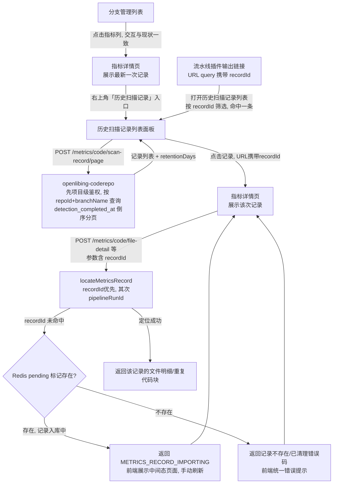

# 代码度量新增历史扫描记录页 设计文档

## 背景与目标

在分支管理场景中，用户通过代码度量指标（代码规模、平均代码行数、平均圈复杂度、总代码重复率）评估分支质量。当前系统仅展示分支最新一次扫描的结果，历史扫描数据虽已入库但无法查看；流水线插件输出的"扫描结果"链接固定落到最新数据，回看历史流水线时看到的指标与当时构建不一致。同时扫描记录持续累积且无清理机制，数据库与 OBS 存储不断增长，用户对数据可追溯范围没有预期。

本次改造目标：

1. 分支管理列表点击指标仍直达指标详情页（展示最新一次记录，交互与现状一致）；详情页右上角新增「历史扫描记录」入口，可查看该分支历史扫描记录并进入单条记录详情（含文件级明细与重复代码块）。
2. 详情页按记录 ID 唯一定位；上报接口在同步返回前**预生成 recordId**（重试时复用同一 ID），插件结果链接在原 query 参数基础上**追加 recordId**，落地打开历史扫描记录列表并按 recordId 筛选（仅命中一条），点击记录进入详情——历史流水线输出链接长期有效。
3. 扫描记录按配置的保留周期自动清理：**数据库记录与 OBS 上传文件同时删除**，清理任务在 openlibing-coderepo 后端实现（XXL-JOB），插件不参与；页面明确提示保留范围，已清理记录由后端校验拦截并返回明确错误。

涉及仓库：openlibing-coderepo（后端）、openlibing-web（前端）、code-metrics-action（插件，无代码改动）。

---

# 1.方案设计

## 方案目标

在不改变现有扫描入库链路（OBS 中转 + MQ 异步消费）的前提下，将已有的"按记录追加存储"能力透出为用户可用的历史记录查询能力，并补齐记录生命周期管理（数据库 + OBS 双清理）。

## 涉及模块

| 仓库                | 改动范围                                                                                                                                                                                                                                                   |
| ------------------- | ---------------------------------------------------------------------------------------------------------------------------------------------------------------------------------------------------------------------------------------------------------- |
| openlibing-coderepo | 新增历史扫描记录分页查询接口；三个详情接口增加按 recordId 定位；`/metrics/code/report` 同步段预生成/复用 recordId 并写入 MQ 消息，响应新增 recordId 字段，`detailLink` 在原 query 参数基础上追加 recordId；新增 XXL-JOB 定期清理任务（DB 三表 + OBS 对象） |
| openlibing-web      | 指标详情页右上角新增「历史扫描记录」入口；新增历史扫描记录列表面板；插件链接落地打开历史扫描记录列表并按 recordId 筛选（URL query 携带 recordId，命中一条）；详情页 URL 携带 recordId；保留范围提示、入库中间态页面与失效记录引导                          |
| code-metrics-action | 无代码改动。链接由服务端生成并透传输出；插件现有代码已尝试读取响应中的 `data.recordId`，服务端补充该字段后天然兼容                                                                                                                                         |

## 整体处理方式

**数据模型零变更**：现有 `code_metrics_record` 表已具备历史记录所需的全部要素——雪花算法主键 `id`（即记录 ID）、`git_url` + `branch_name` 归属、`pipeline_run_id`、`run_number`、`commit_id`、`pipeline_name`（来源）、`metrics_data_json`（总体指标）、`detection_completed_at`（扫描时间）、`status`。文件级明细表 `code_metrics_file_detail` 与重复代码块表 `code_metrics_duplication_block` 已通过 `record_id` 关联主表。因此本需求不新增表、不新增字段（OBS 对象按前缀规则推导，亦无需在记录表新增 obs_url 字段），只增加查询与清理能力。

**查询侧**：分支管理列表现有的 5 个指标列（代码规模、平均代码行数、平均圈复杂度、总代码重复率、总文件重复率）点击后**仍直达指标详情页并展示最新一次记录，交互与现状一致**。历史能力的入口放在详情页：右上角新增「历史扫描记录」按钮，点击进入该分支的历史扫描记录列表（新增分页查询接口，按 `repoId` + `branchName` 过滤——后端按 `repoId` 反查 `git_url` 后查询，`detection_completed_at` 倒序），再点击记录进入该次扫描的指标详情。**指标详情页的明细表格结构、排序、筛选、分页及行点击交互保持现状不变**（metricType 0~4 五种明细形态均保留，见第 6 节）。文件代码查看（总代码重复率类型下点击文件名打开代码视图）为现有能力，快照内容随扫描记录入库，按记录定位后历史记录同样可查看。详情复用现有三个详情接口，在原有 `pipelineRunId` 定位参数基础上增加 `recordId` 参数，`recordId` 优先；recordId 模式下 `repoId`/`branchName` 可缺省，后端按记录归属反查仓库完成权限校验。`pipelineRunId` 适配暂时保留，用于看板组未切换链接格式前的兼容。

**链接侧**：`/metrics/code/report` 在同步返回前完成 recordId 预生成——按 `git_url` + `branch_name` + `pipeline_run_id` 三条件查询已有记录（对齐 `code_metrics_record` 既有唯一键 `uk_git_branch_run`；`pipeline_run_id` 单独不保证全局唯一，不同仓/分支可能并存同一 run id）：命中且归属一致则**复用其 id**（保证重试场景链接不变）；未命中或命中但归属不一致（异常并存场景）则按未命中处理，雪花算法**预生成新 id**，杜绝链接指向他仓/他分支记录。recordId 写入 MQ 消息体，消费者使用该 id 入库（不再自行生成）。响应 `detailLink` 在现有 query 参数基础上追加 recordId：`{openlibing.domain}/apps/repos?projectId={projectId}&platforms={platforms}&repoUrlLike={repoUrlLike}&branchNameLike={branchName}&recordId={recordId}`——与改造前链接同构（保留原筛选参数还原页面上下文，仅追加 recordId）。前端检测到 URL 携带 recordId 时打开**历史扫描记录列表并按 recordId 筛选（仅命中一条）**，点击记录行或指标数字进入该次记录的详情页。链接为固定模板、不带指标参数，一条链接即可覆盖全部 5 个指标。插件仓库无需发版。

**清理侧**：清理任务在 **openlibing-coderepo 后端**实现（不在插件实现），沿用仓库现有 XXL-JOB 定时任务模式（`@XxlJob` 注解 + Redisson 分布式锁，参照 `branchMetricsSyncHandler`）。按配置的保留天数删除过期 DB 记录及其关联明细，但**每个（`git_url`、`branch_name`）分支始终保留最新一条记录**（周期基准取 `COALESCE(detection_completed_at, create_time)`），保证分支管理列表指标入口永远可下钻、不出现"列表可见、详情必失效"；过期判定对 `detection_completed_at` 为空的失败记录（上报失败也会落一条失败记录）退化为按 `create_time` 判定，避免失败记录因 `IS NULL` 不被 `detection_completed_at < cutoff` 命中而无限累积。DB 删除的同时，按 `obs.action.buckets` 配置的桶集合（当前为 `openlibing-gitcode-action` 与 `openlibing-github-action` 双桶，两桶对象 key 结构一致，GitCode/GitHub 来源分别落桶）逐桶删除 `code-metrics-action/{owner}/{repo}/{pipelineRunId}/` 前缀下的上报 JSON 对象（owner/repo 由记录的 `git_url` 解析、pipelineRunId 取自记录，按前缀推导无需新增字段）。**删除前共存校验**：OBS 前缀不含 branch，而记录唯一键含 `branch_name`——同一仓不同分支并存同一 `pipeline_run_id` 时（该并存场景真实存在，见链接侧），删除其中一条记录的前缀会连带销毁共存记录的上报对象、使其保底补导入（`importMetricsFromObsFile`）永久失效；因此每个前缀执行 OBS 删除前，必须先确认 DB 中该（`git_url`、`pipeline_run_id`）下已无未被本次清理的共存记录，存在共存则本批次仅删 DB、跳过该前缀的 OBS 删除，留待共存记录全部过期后由孤儿兜底统一回收。孤儿对象指按对象 key 解析出的（owner/repo 段、pipelineRunId）在 DB 中确认无对应记录的对象（上报成功但入库失败的残留）——仅清理单桶会导致另一平台来源对象永久残留。**首次上线两步走**：先以 dry-run 模式预跑（只统计命中 DB 条数与 OBS 对象数并输出日志、不执行删除），人工核对量级后再开启真实删除；同时设置单次删除条数上限与「命中量超过阈值则中止并告警」保护，避免保留天数配置错误（如误配为 1 天或漏配走默认值）或删除条件写错导致首次调度即不可逆删除全量存量历史数据且 OBS 对象无法恢复。采用分批删除避免大事务。

采用该方案的原因：扫描数据早已按记录完整入库，历史查询是纯"透出"性质的能力，改造集中在查询接口与前端展示；recordId 预生成把链接的确定性收敛到上报接口的同步段，重试复用保证链接永不变质；清理复用已有定时任务基建与 OBS 服务，不引入新组件。

---

# 2.实现逻辑设计

## 历史记录查看与下钻流程



## recordId 预生成与重试复用

**`/report` 同步段**（响应返回前完成）：

1. `selectByGitBranchAndRun(gitUrl, branchName, pipelineRunId)` 三条件查询已有记录（对齐唯一键 `uk_git_branch_run`；`pipeline_run_id` 单独不保证全局唯一——不同仓/分支可并存同一 run id，严禁单条件复用）；
2. 命中且归属一致（重试/重报场景）→ `recordId = 已有记录 id`，复用；
3. 未命中（首次上报），或命中但归属不一致（异常并存，防跨仓串链）→ 预生成新 id，**沿用项目既有主键生成策略（MyBatis-Plus `IdType.ASSIGN_ID` / `DefaultIdentifierGenerator`，workerId 由机器标识自动派生、集群内唯一）**。禁止硬编码 `IdUtil.getSnowflake(1,1)` 这类固定 workerId/datacenterId 示例——本服务多实例部署且 `/report` 为网关 HTTP 接口、多 Pod 并发承接上报，固定 (1,1) 会使不同实例在同一毫秒生成相同 19 位 ID，撞号后两条流水线记录争用同一主键，先入库成功、后入库者主键冲突 insert 失败，链路出现"链接已生成但记录永远入库失败"；
4. recordId 写入 MQ 消息体；`detailLink` 在原 query 参数基础上追加 recordId；响应同时返回 `recordId` 字段。

**消费者入库（含保底补导入路径的统一规则）**：

- 消息体 recordId 非空 → 直接使用该 id 插入主表与明细表；
- 为空（保底补导入路径 `importMetricsFromObsFile` 未经过 /report）→ 按 `git_url` + `branch_name` + `pipeline_run_id` 三条件查已有记录，归属一致才复用其 id（与同步段规则一致）；仍无 → 现场生成（主键生成策略与同步段一致，禁止硬编码 workerId/datacenterId）；
- `deleteExistingRecord` 按 `git_url` + `branch_name` + `pipeline_run_id` 三条件删旧（与既有唯一键一致），随后**以同一 recordId 重建**——重试后链接中的 recordId 始终指向最新一次入库的数据，链接永不变质。

**中间态处理（链接已生成、记录尚未入库）**：recordId 在 `/report` 同步段预生成，而数据由 MQ 消费者异步入库，两者之间存在"链接已下发、记录还不存在"的中间态窗口（首次上报的入库延迟、重试重报期间的"删旧未插新"）。处理方式：

1. **Redis pending 标记**：`/report` 同步段预生成 recordId 的同时写入标记 `code-metrics:pending:{recordId}`（TTL 10 分钟，覆盖 MQ 消费与重试窗口）；消费者入库成功后删除该标记；
2. **错误码区分**：详情接口按 recordId 未命中记录时检查 pending 标记——存在 → 返回 `METRICS_RECORD_IMPORTING`（入库中）；不存在 → 返回记录不存在/已清理错误码，两种情况用户感知明确区分；
3. **前端中间态页面**：收到 `METRICS_RECORD_IMPORTING` 时展示中间态页面（加载图标 + "本次扫描记录正在入库"说明 + 「立即刷新」按钮），不自动轮询、由用户手动刷新；记录不存在/已清理则复用统一错误提示，不设专门失效页面；
4. **退化兜底**：pending 标记为附加保障、非强一致依赖——Redis 不可用或标记提前过期时安全退化为"记录不存在"提示，不影响主链路。

## 前后端职责边界

**后端接口变化仅三处：**

1. 新增历史记录分页接口 `POST /metrics/code/scan-record/page`；
2. 三个详情接口（file-detail、file-content、duplication-block/detail）新增可选入参 `recordId`（recordId 模式下 `repoId`/`branchName` 可缺省），响应增加 `recordId` 字段（定位到的记录 ID，前端用于 URL 回填）；recordId 未命中时结合 Redis pending 标记（`code-metrics:pending:{recordId}`）区分返回：标记存在返回 `METRICS_RECORD_IMPORTING`（入库中），否则返回记录不存在/已清理错误码（见「中间态处理」），其余请求与响应结构不变；
3. 上报响应新增 `recordId` 字段，`detailLink` 在现有 query 参数基础上追加 recordId（响应结构仅增字段）。

**前端变化：**

1. 指标详情页右上角新增「历史扫描记录」入口，打开新增的历史扫描记录列表面板（调用新分页接口）；
2. 插件链接落地：URL query 携带 recordId 时打开历史扫描记录列表面板并按 recordId 过滤（仅命中一条），点击记录进入详情——插件链接的落地页；复用既有 `/apps/repos` 路由与页面，无新增路由；
3. **详情页新增指标切换页签（本次新增能力——现状 5 个指标详情页互相独立、进入后无法切换到其他指标）**：详情页顶部提供代码规模/平均代码行数/平均圈复杂度/总代码重复率/总文件重复率 5 个页签，同一记录下切换仅变更 metricType 重新调用现有 file-detail 接口（不新增接口、后端不感知）。配合链接落地到列表筛选，可在同一记录下连续查看全部 5 个指标，无需反复返回列表；详情页 URL 携带 recordId 与 metricType（从详情响应回填，metricType 标识当前展示页签，与现有详情页 URL 习惯一致）；
4. 新增「记录入库中」中间态页面：详情请求返回 `METRICS_RECORD_IMPORTING` 时展示（加载图标 + 说明 + 「立即刷新」按钮，手动刷新不自动轮询），插件链接在入库完成前点击不再误报为记录失效；
5. 顶部信息区调整与保留范围提示。

**分支管理列表（branches.vue）无改动**：指标列点击行为与现状一致（直达最新详情）。

## 插件结果链接生成

`CoderepoUploader.js` 上传全量 JSON 至 OBS（桶由**插件工作流配置**选择——`CoderepoUploader` 的 `obsBucket` 入参，GitCode/GitHub 工作流分别配置 `openlibing-gitcode-action` / `openlibing-github-action`，默认 `openlibing-gitcode-action`；服务端不参与选桶，仅在下载时以 `obs.action.buckets` 白名单校验桶名。正因记录表不存桶名，清理任务按桶集合逐桶尝试删除，两桶对象 key 规则一致：`code-metrics-action/{owner}/{repo}/{pipelineRunId}/{ts}-metrics.json`）后调用 `/metrics/code/report`。本次改造后：

- 服务端在响应中返回预生成的 `recordId` 与 `detailLink`（query 格式，追加 recordId）；
- 插件读取响应中的 `detailLink` 透传写入流水线输出（`扫描结果url=...`），该链路无需修改；插件现有代码中已存在读取 `data.recordId` 的逻辑，此前恒为 null，服务端补充该字段后天然兼容。

## 扫描记录定期清理流程

```mermaid
flowchart TD
    A[XXL-JOB 触发<br/>codeMetricsRecordCleanHandler<br/>每日低峰执行] --> B[Redisson 分布式锁]
    B --> C[读取保留天数配置 retentionDays]
    C --> D[查询过期记录, 按批读取:<br/>idx_detection_completed 索引取 detection_completed_at 过期<br/>+ 失败记录单独按 create_time 过期(拆两条避免 OR 退化)<br/>排除每分支最新一条在内存过滤, 不进 SQL]
    D --> E[按 record_id 分批删除<br/>code_metrics_duplication_block]
    E --> F[按 record_id 分批删除<br/>code_metrics_file_detail]
    F --> G[分批删除 code_metrics_record]
    G --> H[按记录 git_url 解析 owner/repo<br/>+ pipelineRunId 推导前缀, 按桶集合逐桶<br/>(obs.action.buckets: gitcode+github)<br/>DB 确认该(git_url,pipeline_run_id)<br/>无共存记录后分批删除前缀<br/>code-metrics-action/owner/repo/pipelineRunId/ 下对象<br/>存在共存记录则本批仅删 DB、跳过 OBS]
    H --> I{仍有过期记录?}
    I -->|是| D
    I -->|否| J[孤儿兜底(独立低频 @XxlJob, 如每周):<br/>按桶集合逐桶前缀列举 code-metrics-action/<br/>下超过保留期的对象, 按 key 解析(owner/repo段+runId)<br/>三元组批量 IN 核对 DB(兼容 unknown 等 key 变体)<br/>后删除, 解析失败跳过并告警, 单次扫描设上限]
    J --> K[记录清理执行日志并释放锁<br/>首次上线先 dry-run 预跑核对量级<br/>单次删除超阈值中止并告警]
```

**实现位置**：openlibing-coderepo 后端 XXL-JOB 定时任务（`CodeMetricsRecordCleanHandler`），**不在插件内实现**——插件是无状态流水线步骤，清理需要数据库与 OBS 双写一致性，属于服务端数据治理职责。

**双存储删除**：数据库删除三张表（主表 + 文件明细 + 重复代码块）；OBS 删除该记录对应的上报 JSON 对象——按 `obs.action.buckets` 配置的桶集合逐桶（当前为 `openlibing-gitcode-action`、`openlibing-github-action`，两桶对象 key 结构一致）在 `code-metrics-action/{owner}/{repo}/{pipelineRunId}/` 前缀下列举后批量删除（前缀由记录的 git_url 与 pipeline_run_id 推导，`code_metrics_record` 表无需新增 obs_url 字段；记录表不存桶名，故逐桶尝试删除）。前缀删除前执行共存校验、owner/repo 解析以插件 `extractOwnerRepo` 为唯一参照实现（详见第 7 节 OBS 删除安全）。

**删除顺序**：先删 DB、后删 OBS——DB 删除后页面即刻查询不到过期数据（页面明细数据在 DB，不依赖 OBS 对象）；OBS 残留对象不影响页面展示，由同任务后续批次或孤儿兜底回收，中途失败不产生脏数据。

清理以 `detection_completed_at` 为周期基准（与页面展示的扫描时间语义一致）；`detection_completed_at` 为空的失败记录（上报失败落库，无扫描完成时间）按 `create_time` 判定过期，同样纳入清理，避免无限累积。过期候选始终排除每个（`git_url`、`branch_name`）最新一条记录（保留记录同样按上述基准取 `COALESCE(detection_completed_at, create_time)`）——排除逻辑在任务内存中过滤、不进 SQL 谓词（见第 5 节性能设计）。单批规模控制，循环执行直至无过期数据，避免单次任务产生大事务与长锁。

---

# 3.类设计

## openlibing-coderepo

| 类                                                                  | 职责             | 主要修改内容                                                                                                                                                                                                                                                                                                                                                                                                                                                                                                                                                                                                               |
| ------------------------------------------------------------------- | ---------------- | -------------------------------------------------------------------------------------------------------------------------------------------------------------------------------------------------------------------------------------------------------------------------------------------------------------------------------------------------------------------------------------------------------------------------------------------------------------------------------------------------------------------------------------------------------------------------------------------------------------------------- |
| `CodeMetricsController`                                             | 代码度量接口入口 | 新增 `POST /metrics/code/scan-record/page` 历史记录分页接口；三个详情接口（`/metrics/code/file-detail`、`/metrics/code/file-content`、`/metrics/code/duplication-block/detail`）的 DTO 增加可选 `recordId` 参数                                                                                                                                                                                                                                                                                                                                                                                                            |
| `CodeMetricsService` / `CodeMetricsServiceImpl`                     | 业务逻辑         | 新增 `queryScanRecordPage`（分页查询 + 保留天数随响应返回）；`/report` 处理链新增 `preGenerateOrReuseRecordId`（按 `git_url`+`branch_name`+`pipeline_run_id` 三条件、归属一致才复用已有记录 id，未命中或归属不一致则预生成，同时写 Redis pending 标记 `code-metrics:pending:{recordId}`）；`locateMetricsRecord` 增加 `recordId` 优先定位、归属校验，并支持按记录归属反查仓库完成权限校验（recordId 模式下 repoId/branchName 可缺省），recordId 未命中时结合 pending 标记区分返回 `METRICS_RECORD_IMPORTING` 与记录不存在/已清理错误码；`buildDetailLink` 在现有 query 参数基础上追加 recordId（链接落地历史记录列表筛选） |
| `CodeMetricsImportConsumer`                                         | MQ 消费者        | 入库使用 MQ 消息体中的 recordId（消息体为空时按 `git_url`+`branch_name`+`pipeline_run_id` 三条件、归属一致才复用已有记录 id，仍无则现场生成）；`deleteExistingRecord` 按三条件删旧后以同一 recordId 重建；入库成功后删除 `code-metrics:pending:{recordId}` 标记                                                                                                                                                                                                                                                                                                                                                            |
| `CodeMetricsReportDTO`（MQ 消息体同构）                             | 上报入参         | 新增 `recordId` 字段（同步段预生成后随消息投递）                                                                                                                                                                                                                                                                                                                                                                                                                                                                                                                                                                           |
| `CodeMetricsReportVO`                                               | 上报响应         | 新增 `recordId` 字段；`detailLink` 值在原 query 参数基础上追加 recordId                                                                                                                                                                                                                                                                                                                                                                                                                                                                                                                                                    |
| `ScanRecordPageDTO`                                                 | 列表查询入参     | 新增。字段：`repoId`、`branchName`、`pageNum`、`pageSize`。`repoId` 必传——同一 `git_url` 可归属多个项目，仅凭 `gitUrl` 无法唯一确定应校验的项目，`repoId` 与现有详情接口参数风格一致，作为鉴权与查询的唯一定位锚点                                                                                                                                                                                                                                                                                                                                                                                                         |
| `ScanRecordPageVO` / `ScanRecordItemVO`                             | 列表响应         | 新增。含 `total`、`retentionDays`、记录项（`recordId`、扫描时间、`pipelineName`、`runNumber`、`pipelineRunId`、`commitId`、五项核心指标、`status`）                                                                                                                                                                                                                                                                                                                                                                                                                                                                        |
| `CodeMetricsRecordMapper`                                           | 记录表访问       | 新增 `selectPageByRepoAndBranch`（按 repoId 反查 git_url 后倒序分页）、`selectExpiredByDetectTime`（走 `idx_detection_completed` 索引分批取过期候选）与 `selectExpiredFailureByCreateTime`（失败记录单独查询；拆两条避免 OR 跨列退化，最新一条排除由任务内存过滤）、`selectByGitBranchAndRun`（三条件查询，供 recordId 复用判定与删旧定位）、`selectCoLocatedIds`（按 git_url + pipeline_run_id 批量 IN 查共存记录，供 OBS 删除前共存校验）、`deleteByIds`                                                                                                                                                                 |
| `CodeMetricsFileDetailMapper` / `CodeMetricsDuplicationBlockMapper` | 明细表访问       | 新增按 `recordIds` 批量删除方法                                                                                                                                                                                                                                                                                                                                                                                                                                                                                                                                                                                            |
| `CodeMetricsRecordCleanHandler`                                     | 定时清理任务     | 新增。`@XxlJob("codeMetricsRecordCleanHandler")`，Redisson 分布式锁 + 分批删除 DB 三表 + 按（ownerRepo、runId）去重聚合后的前缀删除 OBS 对象（共存校验合并为批内一次 IN 查询），实现模式参照 `branchMetricsSyncHandler`                                                                                                                                                                                                                                                                                                                                                                                                    |
| `CodeMetricsOrphanCleanHandler`                                     | 孤儿兜底任务     | 新增。`@XxlJob("codeMetricsOrphanCleanHandler")` 独立低频调度（如每周）——全前缀列举随桶内对象总量线性放大、不并入每日任务；按 key 解析三元组批量 IN 核对 DB（兼容多级 group / `unknown` 等 key 历史变体），单次扫描设分页推进与总对象数上限，超限中止告警、下轮续扫                                                                                                                                                                                                                                                                                                                                                        |
| `ObsBucketService`                                                  | OBS 访问         | 新增 `listObjectsByPrefix`（按前缀列举对象）与 `deleteObjects`（批量删除），按 `obs.action.buckets` 配置的桶集合逐桶操作，仅允许操作桶集合内桶的 `code-metrics-action/` 前缀（桶 + 前缀双重白名单校验）；新增对象 key 解析工具（以插件 `extractOwnerRepo` 为参照实现，兼容多级 group / `unknown` 兜底等历史变体），供前缀共存校验与孤儿三元组判定复用                                                                                                                                                                                                                                                                      |
| `CodeMetricsProperties`                                             | 配置载体         | 新增。`@ConfigurationProperties(prefix = "code-metrics")`，含 `retentionDays`（各环境 application yaml 配置）与 `pendingMarkTtlMinutes`（pending 标记 TTL，默认 10 分钟）                                                                                                                                                                                                                                                                                                                                                                                                                                                  |

## openlibing-web

| 组件/文件                              | 职责             | 主要修改内容                                                                                                                                                                                                                                                                                                                                                                                                                                                                                                                                                                                                                                                                                                     |
| -------------------------------------- | ---------------- | ---------------------------------------------------------------------------------------------------------------------------------------------------------------------------------------------------------------------------------------------------------------------------------------------------------------------------------------------------------------------------------------------------------------------------------------------------------------------------------------------------------------------------------------------------------------------------------------------------------------------------------------------------------------------------------------------------------------- |
| `dialog/MetricsDetailDialog.vue`       | 指标详情页       | 修改（仅以下六点，明细表格结构、排序、筛选、分页、行点击交互均不变）：① 右上角新增「历史扫描记录」入口按钮（本次核心交互改动）；② 新增指标切换页签（代码规模/平均代码行数/平均圈复杂度/总代码重复率/总文件重复率，本次新增——现状 5 个指标详情互相独立不可切换），同一记录下切换仅变更 metricType 重新调用 file-detail；③ 接收 `recordId`（URL query 或详情响应回填）并随详情类请求传递，URL 携带 recordId；④ 顶部信息区增加"提交"（记录的 commitId），"流水线"更名为"来源"，与"扫描时间"交换位置，调整后顺序为：代码仓、分支、提交、来源、扫描时间；⑤ 增加保留范围提示，记录已被清理时由后端返回错误码，前端复用统一错误提示，不设专门失效页面；⑥ 收到 `METRICS_RECORD_IMPORTING` 时展示「记录入库中」中间态页面 |
| `ScanRecordListPanel.vue`              | 历史扫描记录列表 | 新增。从详情页右上角入口进入；表格列：扫描时间、来源、提交、代码规模、平均代码行数、平均圈复杂度、总代码重复率、总文件重复率、状态；扫描时间倒序；顶部展示保留范围提示；指标数字与记录行均可点击进入对应记录详情；分页遵循 `el-pagination` 现有惯例                                                                                                                                                                                                                                                                                                                                                                                                                                                              |
| `Repos/index.vue`                      | 代码仓管理父页   | 修改。新增历史记录面板与详情面板的切换；URL query 携带 recordId 时（插件链接落地）打开历史记录面板并按 recordId 过滤（仅命中一条），初始化页面上下文                                                                                                                                                                                                                                                                                                                                                                                                                                                                                                                                                             |
| `router/routes/modules/menu.ts`        | 路由注册         | 无改动。链接回归 query 格式，复用既有 `/apps/repos` 路由                                                                                                                                                                                                                                                                                                                                                                                                                                                                                                                                                                                                                                                         |
| `api/Repos/api.ts`、`api/Repos/url.ts` | 接口封装         | 修改。新增 `scanRecordPage` 请求封装；详情类请求参数增加 `recordId`                                                                                                                                                                                                                                                                                                                                                                                                                                                                                                                                                                                                                                              |
| `Repos/branches.vue`                   | 分支管理列表     | 无改动。指标列点击行为与现状一致（直达最新详情）                                                                                                                                                                                                                                                                                                                                                                                                                                                                                                                                                                                                                                                                 |

## code-metrics-action

无代码改动。`CoderepoUploader.js` 透传服务端响应的 `detailLink`（及 `recordId`），链接模板变更由服务端闭环。

---

# 4.数据模型设计

**数据库表：不新增表、不新增字段，但新增 2 个索引（以 Liquibase changeset 随发布自动应用，DDL 见下方「索引变更（本次交付）」，属于本次交付的 DDL 变更）。**`code_metrics_record` 现有字段完整覆盖历史记录展示所需数据；`code_metrics_file_detail`、`code_metrics_duplication_block` 通过既有 `record_id` 关联。OBS 对象按 `code-metrics-action/{owner}/{repo}/{pipelineRunId}/` 前缀规则推导，记录表无需新增 obs_url 字段。

**OBS 对象（存量资产管理）**：桶集合 `obs.action.buckets`（当前为 `openlibing-gitcode-action` 与 `openlibing-github-action`，GitCode/GitHub 来源分别落桶，对象 key 结构一致），前缀 `code-metrics-action/`；清理任务按桶集合逐桶前缀删除，孤儿对象逐桶兜底回收。

**配置项（新增）：**

| 配置                          | 说明                         | 示例 |
| ----------------------------- | ---------------------------- | ---- |
| `code-metrics.retention-days` | 扫描记录保留天数，按环境配置 | 90   |

**DTO / VO（新增/修改）：** 见类设计章节 `ScanRecordPageDTO`、`ScanRecordPageVO`；`CodeMetricsReportDTO`/`CodeMetricsReportVO` 新增 `recordId`；详情类接口响应新增 `recordId`。

**存量数据处理：** 现有历史记录在功能上线后即自然可见；上线时若存在超出保留周期的存量记录，在发布步骤中先核对 `code-metrics.retention-days` 配置无误，再由清理任务以 dry-run 模式预跑（只统计命中量、不删除），人工核对量级后开启真实删除统一回收（DB + OBS 逐桶），每个分支最新一条记录始终保留。

**索引变更（本次交付，随 Liquibase 自动执行）：** 为 `code_metrics_record` 新增 2 个索引（既有唯一键 `uk_git_branch_run(git_url, branch_name, pipeline_run_id)` 无法覆盖新查询的访问路径）。**不采用手工 DDL**——openlibing-coderepo 使用 Liquibase 管理库表结构（master changelog：`src/main/resources/db/changelog/db.changelog.xml`），索引以 changeset 形式追加到该文件，随服务发布自动应用：

```xml
<changeSet id="20261118_add_code_metrics_indexes" author="ai-assisted">
    <preConditions onFail="MARK_RAN">
        <sqlCheck expectedResult="0">SELECT COUNT(*) FROM information_schema.statistics
            WHERE table_name = 'code_metrics_record' AND index_name = 'idx_git_branch_detect'</sqlCheck>
    </preConditions>
    <sql>
        -- ① 历史记录分页：git_url + branch_name 过滤 + detection_completed_at 倒序
        CREATE INDEX idx_git_branch_detect
            ON code_metrics_record (git_url, branch_name, detection_completed_at);
    </sql>
    <rollback>DROP INDEX idx_git_branch_detect ON code_metrics_record;</rollback>
</changeSet>
<changeSet id="20261118_add_code_metrics_detect_index" author="ai-assisted">
    <preConditions onFail="MARK_RAN">
        <sqlCheck expectedResult="0">SELECT COUNT(*) FROM information_schema.statistics
            WHERE table_name = 'code_metrics_record' AND index_name = 'idx_detection_completed'</sqlCheck>
    </preConditions>
    <sql>
        -- ② 清理任务过期扫描：按 detection_completed_at 前导列分批定位候选
        --    （清理查询不带 git_url/branch_name 前导条件，组合索引无法命中；
        --    过期谓词拆为两条查询避免 OR 跨列导致索引退化，见第 5 节性能设计）
        CREATE INDEX idx_detection_completed
            ON code_metrics_record (detection_completed_at);
    </sql>
    <rollback>DROP INDEX idx_detection_completed ON code_metrics_record;</rollback>
</changeSet>
```

changeset 风格（id 格式 `yyyyMMdd_描述`、原生 `<sql>` + `<rollback>`、`preConditions onFail="MARK_RAN"` 幂等防护）与仓内既有 changeset 一致；preConditions 同时承担"线上已存在等价索引则跳过"的复用语义（与第 5 节性能设计口径一致）。大表建索引如担忧锁表，执行窗口随发布低峰进行（MySQL 8.0 `CREATE INDEX` 默认 online DDL，不阻塞读写）。

---

# 5.性能设计

**列表查询：** 分页查询条件为 `git_url + branch_name + detection_completed_at 倒序`，现有 `selectLatestByGitAndBranch` 查询已依赖该组合访问路径，为 `code_metrics_record` 补充 `(git_url, branch_name, detection_completed_at)` 组合索引（如线上已存在则复用）。分页遵循仓库现有 SQL 下推 count + LIMIT/OFFSET 模式，页大小使用 `PaginationUtil` 上限约束。

**详情查询：** 复用现有三个详情接口，文件明细与重复代码块表已有 `record_id` 关联索引，`recordId` 定位为主键查询，无额外开销。recordId 模式下按记录反查仓库为单次索引查询。

**清理任务（DB 侧）：** 过期扫描**不使用 OR 跨列谓词**（`detection_completed_at < cutoff OR create_time < cutoff` 会使优化器退化为全表扫描，且新组合索引以 `git_url`/`branch_name` 为前导列无法命中）——拆为两条查询：① 按 `idx_detection_completed` 索引分批取 `detection_completed_at < cutoff` 的候选；② 失败记录（`detection_completed_at IS NULL`）单独按 `create_time < cutoff` 查询（该类记录占比极小，可接受次优路径）。「排除每个（`git_url`、`branch_name`）最新一条」**不进 SQL 谓词**（`NOT IN (SELECT MAX(id) ... GROUP BY git_url, branch_name)` 会对全表反复聚合）——候选按批读入内存后过滤（对照各分支当前最新记录 id，随批次缓存增量维护）。按批（固定批次大小）取 id 后分批删除，明细表按 `record_id` 走索引删除；单批规模小、循环推进，避免长事务与主从延迟。任务安排在每日低峰执行。

**清理任务（OBS 侧，聚合降调用）：** 按（ownerRepo、pipelineRunId）**对前缀去重聚合后**再逐桶列举删除——共存记录本就共享同一前缀，避免逐记录重复列举；单批对象数受 OBS API 限制约束（按 1000/批分页推进）；同批次记录的共存校验合并为一次 `IN` 查询，不逐记录单查。大规模首次清理时 OBS API 调用量降低一个量级。

**孤儿兜底（独立低频任务）：** 全前缀列举随桶内对象总量线性放大（OBS 列举按字典序分页、无法按时间裁剪，保留期内对象量可达百万级），**不并入每日清理任务**——拆为独立 `@XxlJob`（如每周执行一次），DB 核对按 distinct（ownerRepo、runId）对批量 `IN` 查询（非逐对象单查），单次扫描设分页推进上限与总对象数上限，超限中止并告警、下轮续扫。

**缓存：** 历史记录列表为低频回溯场景，无高频访问需求，无需新增缓存。

接口默认满足 3 秒性能要求。

---

# 6.API接口设计

## 新增：历史扫描记录分页查询

- **URL**：`POST /gateway/openlibing-coderepo/metrics/code/scan-record/page`
- **Method**：POST
- **请求参数**：

```json
{
  "repoId": 123,
  "branchName": "master",
  "pageNum": 1,
  "pageSize": 10
}
```

| 参数               | 类型    | 必填 | 说明                                                                                                                  |
| ------------------ | ------- | ---- | --------------------------------------------------------------------------------------------------------------------- |
| repoId             | Long    | 是   | 仓库 ID，鉴权与查询的唯一锚点（同一 git_url 可归属多个项目，禁止仅凭 gitUrl 定位）；后端按 repoId 反查 git_url 后查询 |
| branchName         | String  | 是   | 分支名                                                                                                                |
| pageNum / pageSize | Integer | 是   | 分页参数                                                                                                              |

- **返回参数**：

```json
{
  "code": "0",
  "data": {
    "total": 42,
    "retentionDays": 90,
    "records": [
      {
        "recordId": "1937265012345678901",
        "scanTime": "2026-11-08 14:32:10",
        "pipelineName": "code-metrics-pipeline",
        "runNumber": 128,
        "pipelineRunId": "88001",
        "commitId": "a1b2c3d4",
        "codeScale": 152340,
        "avgFunctionLoc": 18.6,
        "avgCyclomaticComplexity": 4.2,
        "totalCodeDuplicationRate": 7.35,
        "totalFileDuplicationRate": 4.18,
        "status": 0
      }
    ]
  }
}
```

`retentionDays` 随响应返回，前端用于展示"仅保留最新 N 天的扫描记录（每个分支始终保留最新一条）"提示，避免新增独立的配置查询接口。

**鉴权顺序（先校验后查询）**：① 网关注入 `userId`；② Service 层先按 `repoId` 反查仓库归属项目，调用 `commonService.verifyPermissionsByProduct` 完成项目级越权校验；③ 校验通过后才执行分页查询。接口不接收 `gitUrl` 入参——同一 `git_url` 可归属多个项目，仅凭 `gitUrl`+`branchName` 无法唯一确定应校验的项目，且会形成凭任意仓库地址跨项目遍历他人历史扫描记录（commitId、流水线名、五项指标）的越权读取路径。

## 修改：详情类接口增加记录 ID 定位

`/metrics/code/file-detail`、`/metrics/code/file-content`、`/metrics/code/duplication-block/detail` 三个接口的请求体增加可选参数 `recordId`，响应增加 `recordId` 字段（定位到的记录 ID，前端用于 URL 回填），其余响应结构不变：

| 参数                | 类型          | 必填                  | 说明                                                                                                                      |
| ------------------- | ------------- | --------------------- | ------------------------------------------------------------------------------------------------------------------------- |
| recordId            | String        | 否                    | 记录 ID，非空时优先按其定位；此时 `repoId`/`branchName` 可缺省，后端按记录的 `git_url`/`branch_name` 反查仓库完成权限校验 |
| pipelineRunId       | String        | 否                    | 保留原有适配，看板组切换链接格式前继续可用                                                                                |
| repoId / branchName | Long / String | recordId 模式下可缺省 | 现有参数，存量调用方不变                                                                                                  |

**recordId 未命中时的错误码区分**（中间态处理，机制见第 2 节）：

| 场景                               | 判定                                                          | 错误码                     | 前端表现                                                |
| ---------------------------------- | ------------------------------------------------------------- | -------------------------- | ------------------------------------------------------- |
| 链接已生成、记录尚未入库（中间态） | DB 未命中 + Redis 存在 `code-metrics:pending:{recordId}` 标记 | `METRICS_RECORD_IMPORTING` | 中间态页面：加载图标 + 「立即刷新」，手动刷新不自动轮询 |
| 记录不存在或已被清理               | DB 未命中 + 无 pending 标记                                   | 记录不存在/已清理错误码    | 复用统一错误提示，无专门失效页面                        |

以 `/metrics/code/file-detail` 为例，现有请求参数（`repoId`、`branchName`、`metricType`、`pipelineRunId`（可选）、`fileName`（筛选可选）、`sortByField`、`sort`、`pageNum`、`pageSize`）与响应结构（`fileDetails`、`total`、`runNumber`、`pipelineLink`、`pipelineName`、`checkTime`、`pipelineRunId` 等）均保持现状，仅新增 `recordId` 入参与出参；`fileDetails` 内的字段按 metricType 保持现有定义（如 metricType=3 时为 `filePath`、`totalLines`、`duplicationRate`、`duplicationLineCount`、`duplicationBlockCount`、`hasSnapshot`）。

**前端展示范围约束（本次不改）**：指标详情页按 metricType 0~4 的明细表格列保持现有定义——

| metricType | 指标         | 明细表格列（现状，保持不变）                                       | 行点击交互（现状，保持不变）           |
| ---------- | ------------ | ------------------------------------------------------------------ | -------------------------------------- |
| 0          | 代码规模     | 序号、文件名称、行数                                               | 无                                     |
| 1          | 平均代码行数 | 序号、文件名称、函数名、函数行数、开始行、结束行                   | 无                                     |
| 2          | 平均圈复杂度 | 序号、文件名称、平均圈复杂度                                       | 无                                     |
| 3          | 总代码重复率 | 序号、文件名称、重复代码行数、有效代码行数、重复率、重复代码块数量 | 文件名可点击，打开代码视图（现有能力） |
| 4          | 总文件重复率 | 重复文件序列号、文件名                                             | 无                                     |

说明：接口响应中的 `hasSnapshot` 字段前端现有逻辑未作为点击门槛，本次不改变该行为；代码视图数据（文件内容快照）随扫描记录入库，按 `recordId` 定位到历史记录后同样可查看，记录被清理后随记录一起不可访问。**该能力为现状已有，非本次新增。**

**兼容性**：`recordId` 为新增可选参数，存量调用方（看板、前端既有入口）不传时行为不变；`pipelineRunId` 适配暂时保留，待看板组适配新链接格式后另行下线。

## 修改：上报响应链接（recordId 预生成 + query 追加 recordId）

`POST /metrics/code/report` 响应新增 `recordId` 字段（同步段预生成/复用），`detailLink` 的 URL 模板在"query 参数落到分支管理列表"基础上**追加 recordId**，落地打开历史扫描记录列表并按 recordId 筛选（仅命中一条）：

```json
{
  "code": "0",
  "data": {
    "recordId": "1937265012345678901",
    "detailLink": "https://www.openlibing.com/apps/repos?projectId=493420&platforms=gitcode&repoUrlLike=yanzhaohong%2Fhs-fbb-diting&branchNameLike=master&recordId=1937265012345678901"
  }
}
```

链接示例（完整，域名取 `openlibing.domain` 生产配置 `https://www.openlibing.com`）：

```text
改造前：https://www.openlibing.com/apps/repos?projectId=493420&platforms=gitcode&repoUrlLike=yanzhaohong%2Fhs-fbb-diting&branchNameLike=master
        （落到分支管理列表页，需再手动点击指标，且永远只能看到最新一次数据）

改造后：https://www.openlibing.com/apps/repos?projectId=493420&platforms=gitcode&repoUrlLike=yanzhaohong%2Fhs-fbb-diting&branchNameLike=master&recordId=1937265012345678901
        （保留原筛选参数，仅追加 recordId；落地打开历史扫描记录列表并按 recordId 筛选，仅命中该次记录，点击记录行或指标数字进入对应详情）
```

**recordId 为什么可以放进链接**（此前异步方案不可行的两点均已被解决）：

1. **时序**：recordId 不再等 MQ 消费者生成，而是在 `/report` 同步段预生成（或复用已有记录的 id），响应返回时即确定；
2. **稳定性**：同一 `git_url`+`branch_name`+`pipeline_run_id`（对齐唯一键）重试/重报时，`/report` 复用已有记录的 id，消费者按三条件删旧重建使用同一 recordId——链接中的 recordId 始终指向最新入库的数据，不会因重跑失效。

**为什么保留原筛选参数**：Repos 页面初始化（列表筛选状态、面包屑上下文）依赖 projectId/platforms/repoUrlLike/branchNameLike；链接与改造前同构（仅追加 recordId），前端复用既有 `/apps/repos` 路由与页面、改动最小。**为什么落地到列表筛选而非直达详情**：插件链接是固定模板、不带指标参数，落地历史记录列表按 recordId 筛选（仅命中一条）后由用户点击进入详情，一条链接即可覆盖全部 5 个指标；配合详情页新增的指标切换页签，可在同一记录下连续查看各指标。

**中间态**：recordId 预生成与 MQ 异步入库之间存在"链接已生成、记录尚未入库"的窗口（含重试重报期间短暂的"删旧未插新"）。通过 Redis pending 标记 + `METRICS_RECORD_IMPORTING` 错误码与"记录不存在/已清理"明确区分（机制见第 2 节「中间态处理」），前端展示中间态页面引导用户稍后手动刷新，不阻塞、不轮询。

---

# 7.安全设计

## 鉴权

新增接口继承网关注入 `userId` 的既有鉴权链路，并在 Service 层沿用 `commonService.verifyPermissionsByProduct` 进行项目级越权校验。**分页接口（scan-record/page）鉴权顺序为"先校验后查询"**：以必传的 `repoId` 反查仓库归属项目 → `verifyPermissionsByProduct` 项目级校验 → 校验通过后才执行分页查询。接口不接收 `gitUrl` 入参：同一 `git_url` 可归属多个项目，仅凭 `gitUrl` 无法唯一确定应校验的项目（若按"查到的第一个项目"校验，会出现有权限被拒/无权限放行的判定抖动），且凭任意 `gitUrl`+`branchName` 可跨项目遍历他人仓库的历史扫描记录（越权读取 commitId、流水线名与五项指标）。详情接口按 `recordId` 定位时：`repoId`/`branchName` 缺省的情况下，后端按记录的 `git_url`/`branch_name` 反查仓库与项目完成权限校验，同时校验记录归属与请求参数一致，防止通过伪造记录 ID 跨仓访问数据。

## 敏感信息

扫描指标数据、提交 ID、流水线名称均为非敏感信息。清理任务日志仅输出清理批次统计（如删除条数、OBS 对象数），不打印记录内容。无新增敏感信息存储与下载能力。

## 硬编码

保留天数通过 `code-metrics.retention-days` 配置管理，按环境在 application yaml 中配置，代码中不出现硬编码数值。

## OBS 删除安全

清理任务的 OBS 删除仅允许操作 `obs.action.buckets` 配置集合内的桶（当前为 `openlibing-gitcode-action`、`openlibing-github-action`）中 `code-metrics-action/` 前缀下的对象，`ObsBucketService` 新增方法做"桶集合 + 前缀"双重白名单校验（复用既有 `METRICS_OBS_OBJECT_PREFIX` 常量，保持单一口径来源），防止误删其他桶或其他业务对象（同桶内还存在 `ut-coverage-action/` 等其他业务前缀，白名单保证枚举与删除根前缀固定为 `code-metrics-action/`、永不下探桶根）。在此之外还有四层约束：

1. **解析参照实现唯一（防口径漂移）**：owner/repo 解析算法以插件 `CoderepoUploader.extractOwnerRepo`（`buildObjectKey` 的实际数据源）为**唯一参照实现**移植——剥 `.git` 后缀与尾部斜杠、支持 `git@host:owner/repo` 与 `https://host/owner/repo` 两形态、**多级 group 整体作为 owner/repo 段**；**禁止**复用后端既有 `RepoUrlUtil.parseOwnerAndRepo` 等工具（其口径未与插件对齐验证，多级 group 场景可能解析出错位前缀）。注意 `.git` 后缀、大小写、多级 group、URL 编码差异。
2. **前缀删除前共存校验（防跨记录连带删除）**：OBS 前缀不含 branch 而记录唯一键含 `branch_name`，同一仓不同分支并存同一 `pipeline_run_id` 时，删除其一前缀会连带销毁共存记录的上报对象。每个前缀执行 OBS 删除前，先按（`git_url`、`pipeline_run_id`）确认 DB 中无未被本次清理的共存记录；存在共存则本批次仅删 DB、跳过该前缀的 OBS 删除（见第 1 节清理侧），留待共存记录全部过期后由孤儿兜底回收。
3. **对象 key 变体兼容（孤儿扫描，防误判漏判）**：解析存量对象 key 须兼容插件历史产出变体——多级 group key（前缀后 ≥3 段）按「末段为文件名、倒数第二段为 `pipelineRunId`、中间段整体为 owner/repo 段」解析；插件 gitUrl 解析失败时曾以 `'unknown'` 兜底产出**仅 3 段**（`code-metrics-action/unknown/{runId}/{file}`，无 owner/repo 分段）的 key，此类对象须按 `pipelineRunId` 对 DB 全局核对、确认无任何对应记录后方可删除；段数不足 3 或 `pipelineRunId` 段为空的 key 一律跳过并 warn 告警，不做删除。
4. **孤儿判定三元组 + fail-safe**：孤儿兜底判定要求「对象 key 解析出的 owner/repo 段（大小写精确匹配）+ `pipelineRunId`」**三元组**在 DB 中确认无对应记录（而非仅按前缀反推），并排除同前缀下仍有未过期共存记录的情形，防止口径漂移把仍有效记录的对象误判为孤儿删除（影响 `importMetricsFromObsFile` 保底补导入）。解析口径与推导规则失败时跳过该记录/对象并 warn 告警，**禁止回退为更短前缀**——白名单只保证"不越过 `code-metrics-action/`"，无法保证"不越过本仓"，回退短前缀会命中他仓对象。「过期记录数 > 0 但 OBS 删除对象数 = 0」时输出告警，防止解析口径不一致导致删除静默失效。对象前缀由记录的 `git_url` 与 `pipeline_run_id` 推导，不接受外部传入任意前缀。

## 审计日志

数据删除由系统定时任务自动执行，非用户操作：任务每次执行的开始时间、保留天数、各表删除批次数与总条数、OBS 删除对象数记录在应用日志中，保证清理行为可追溯。**事前保护**：首次上线以 dry-run 模式（只统计输出、不删除）预跑核对量级，单次删除量超阈值时中止任务并告警（见第 1 节清理侧）。用户侧无新增、修改、删除操作。
