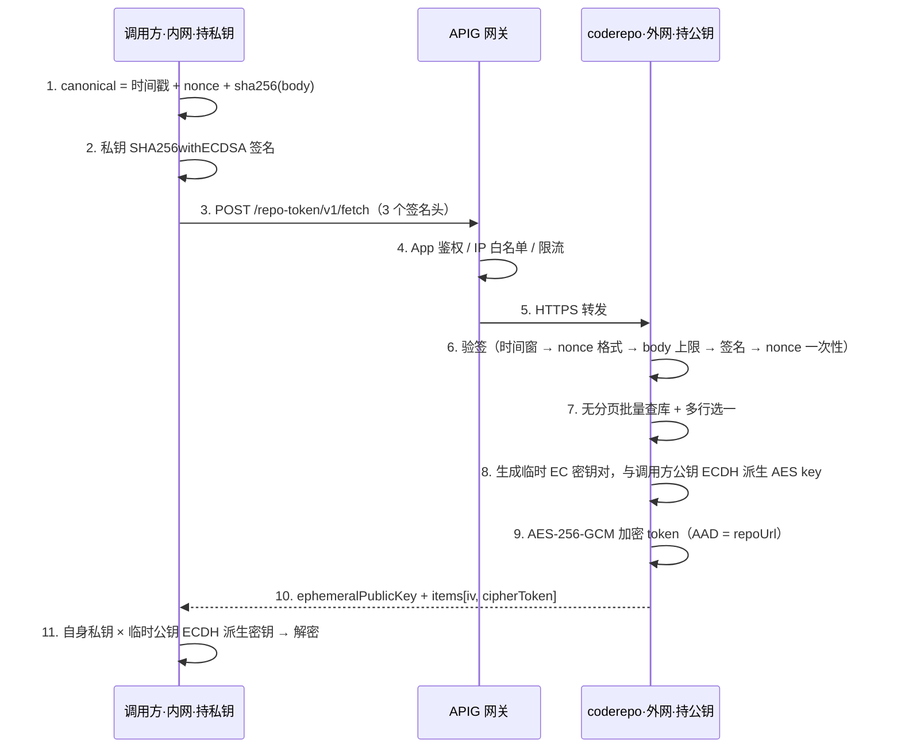

# Design：【黄蓝协同】openlibing代码仓Token鉴权信息自动获取（openlibing-coderepo 侧）

## 1. 方案设计

### 1.1 总体思路

链路 `内网调用方 → APIG → 外网 coderepo`，两端各持一对 EC P-256 密钥的一半能力：

- **请求方向**：调用方持私钥签名（身份认证 + 报文完整性），coderepo 持公钥验签；
- **响应方向**：coderepo 每次响应生成临时 EC 密钥对，用「临时私钥 × 调用方公钥」ECDH 派生一次性 AES-256 密钥，加密 token；调用方用「自身私钥 × 响应中的临时公钥」派生出同一密钥解密。

一句话：**请求用私钥签名证明身份，响应用临时密钥协商加密，token 明文全程不出 coderepo 内存。**

### 1.2 关键选型与取舍

| 决策                      | 选项                                                                                 | 理由                                                                                                                                                                        |
| ------------------------- | ------------------------------------------------------------------------------------ | --------------------------------------------------------------------------------------------------------------------------------------------------------------------------- |
| 密钥算法                  | **EC P-256**（而非 RSA-3072）                                                        | 同等 128-bit 安全强度，密钥短约 10 倍，可直接放入 Nacos 单行配置                                                                                                            |
| 请求签名                  | **SHA256withECDSA**，canonical = `timestamp + "\n" + nonce + "\n" + sha256hex(body)` | 绑定时间戳（防重放窗口）、nonce（一次性）、body（防篡改/拼接）                                                                                                              |
| 响应加密                  | **每次响应临时 EC 密钥对 + ECDH + SHA-256 KDF → AES-256-GCM**                        | 每次响应密钥不同，前向安全；GCM 自带完整性校验                                                                                                                              |
| 密钥包裹方案              | 放弃 RSA-OAEP `wrappedKey`，改用 `ephemeralPublicKey`                                | JDK SunEC 对 `ECDH.generateSecret("AES")` 支持受限（报 `Only supported for algorithm TlsPremasterSecret`），改为对共享密钥取 SHA-256 派生 AES key；同时不再需要包裹密钥字段 |
| AAD                       | **repoUrl**                                                                          | 防止密文在不同仓库条目间被调包（一个仓库的密文冒充另一仓库）                                                                                                                |
| nonce 校验顺序            | **晚于验签**（先验签、后 SETNX）                                                     | 未持私钥的请求不得消耗 Redis 缓存容量，避免缓存被刷爆的拒绝服务                                                                                                             |
| nonce 格式                | 强制 **32~128 位 hex**                                                               | 契约必须在服务端生效；下限保证熵、上限避免超长 key                                                                                                                          |
| 请求体大小                | 上限 **64 KB**，超限 413                                                             | 验签前需读全 body，必须防无界内存分配（无需私钥即可触达该分支）                                                                                                             |
| 公钥可变性                | 配置 + **指纹启动自检**                                                              | 公钥被悄悄替换会导致攻击者可伪造签名/解密响应；指纹不一致拒绝启动                                                                                                           |
| 网关旁路防护              | **只登记、不开发**                                                                   | App 授权 / IP 白名单 / 限流 / HTTPS 由 APIG 承担，服务侧不重复建设                                                                                                          |
| token 元信息缺失（Gitee） | 状态回传 `unsupported` 且**照常下发密文**                                            | 平台不提供元信息不等于令牌不可用；由调用方按状态自行降级                                                                                                                    |

### 1.3 时序



## 2. 实现逻辑设计

### 2.1 验签过滤器（`RepoTokenAuthFilter`）

仅对 `servletPath` 以 `/repo-token/internal/` 前缀的请求生效；匹配用**解码后路径**，避免 `%6C` 之类编码路径绕过（servletPath 为空时回退分支同样先做 URI 解码）。

校验顺序（先便宜后贵），失败统一 JSON 错误体：

| 顺序 | 校验                                                                                | 失败响应                                             |
| ---- | ----------------------------------------------------------------------------------- | ---------------------------------------------------- |
| 1    | `repo-token.enabled` 开关                                                           | 503 接口下线                                         |
| 2    | 三头齐全（`X-Auth-Timestamp` / `X-Auth-Nonce` / `X-Auth-Signature`）                | 401                                                  |
| 3    | 时间戳可解析且在 ±5 分钟内                                                          | 401                                                  |
| 4    | nonce 匹配 `^[0-9a-fA-F]{32,128}$`                                                  | 401                                                  |
| 5    | `Content-Length` ≤ 64 KB；实际读取用 `readNBytes(limit+1)` 有界截断（覆盖 chunked） | 413                                                  |
| 6    | SHA256withECDSA 验签（canonical 含 body 摘要）                                      | 401                                                  |
| 7    | nonce Redis `SETNX` 一次性（TTL 10 分钟）                                           | 401（重复/重放）                                     |
| —    | 放行                                                                                | 以 `BodyReplayRequest` 包装请求，保证下游仍可读 body |

要点：

- **body 可重读包装**：验签已消费输入流，`BodyReplayRequest` 每次 `getInputStream()` 基于原始字节新建独立流，并补齐 `getReader()`；
- **nonce 登记晚于验签**：避免未认证请求占用缓存；
- Redis 不可用/异常时 **fail-closed**（拒绝请求），不降级放行。

### 2.2 业务逻辑（`RepoTokenServiceImpl`）

1. 入参清洗：去空白、去重；空列表或超过 100 条直接参数错误；
2. **无分页批量查库**（`queryRepoInfoByUrls`，`repo_url IN (...)`）：`repo_info` 唯一索引是 `(repo_url, project_id)`，同一仓库被多项目引用会产生多行；带 LIMIT 会把后续 URL 挤出结果集并误报 `not_found`，故此处不使用分页；
3. **多行选一规则**（确定性）：`token_status=valid` 优先 → 再取 `repo_id` 最小（接口入参只有 repoUrl，无法区分项目）；
4. 每次响应生成一组临时 EC 密钥对 + ECDH 派生一次性 AES key（整个响应共用该 key，逐条独立 IV）；
5. 逐仓库组装结果：
   - 未命中 → `not_found`；
   - 状态为空 → `unknown`；
   - `expiration` 经 `TokenExpirationNormalizer` 归一化为 ISO-8601 UTC（不可解析 → `null`）；
   - 仅 `valid` / `unsupported` 走 `commonService.getAccessToken` 取明文并加密下发，取不到 → `unavailable`；
   - 其余状态仅返回元数据；
6. `ephemeralPublicKey` 仅在**确有密文下发**时才返回（全降级响应只有元数据）。

### 2.3 MQS 去明文 token

- `MqsReqMessageVO` 移除 `access_token` 字段，`PrSyncMessageContext` 移除 `accessToken`，`MqsMessageSenderImpl` 不再填充；
- `PrSyncEventHandler` / `PrSyncPushEventHandler` 不再为消息获取 token；推送同步也**不再以"仓库令牌可用"作为发送前置条件**——令牌失效不应导致事件被整段丢弃，由黄区消费端按需自取；
- token 仍用于标签操作等本地平台调用，但**不再进入消息体**。

## 3. 类设计

| 类                                                 | 职责                                                                                                               |
| -------------------------------------------------- | ------------------------------------------------------------------------------------------------------------------ |
| `RepoTokenController`                              | `POST /repo-token/internal/fetch` 入口，仅做参数校验与委派                                                         |
| `RepoTokenService` / `RepoTokenServiceImpl`        | 批量查询、多行选一、逐条降级、ECDH + AES-GCM 加密、响应组装                                                        |
| `RepoTokenFetchRequest` / `RepoTokenFetchResponse` | 请求/响应 DTO（含 `TokenItem` / `TokenMeta` 内部结构）                                                             |
| `RepoTokenProperties`                              | `repo-token.enabled/publicKey/fingerprint` 配置绑定；`@PostConstruct init()` 解析公钥 + 指纹自检（不一致拒绝启动） |
| `RepoTokenCrypto`                                  | canonical 构造、ECDSA 签名/验签、临时 EC 密钥对生成、ECDH + SHA-256 KDF、公钥编解码、AES-GCM 加解密                |
| `NonceCache` / `RedisNonceCache`                   | nonce 一次性登记（SETNX + TTL），异常 fail-closed                                                                  |
| `RepoTokenAuthFilter`                              | 验签过滤器（含 `BodyReplayRequest` / `ByteArrayServletInputStream` 请求体可重读实现）                              |
| `RepoTokenFilterConfig`                            | 过滤器注册（`HIGHEST_PRECEDENCE+100`）与依赖装配（强制 Redis nonce 缓存）                                          |
| `TokenExpirationNormalizer`                        | 三平台过期时间归一化为 ISO-8601 UTC                                                                                |
| `RepoInfoMapper#queryRepoInfoByUrls`               | 无分页按 URL 集合查询（复用既有 where 片段，`has_repo != '0'`）                                                    |

## 4. 数据模型设计

### 4.1 读取的库表（`repo_info`，只读）

| 字段                                  | 用途                                         |
| ------------------------------------- | -------------------------------------------- |
| `repo_id` / `repo_url` / `project_id` | 定位仓库；多行选一的确定性排序依据           |
| `access_token`                        | 加密后下发（密文才是对外产物）               |
| `token_status`                        | 响应 `tokenMeta.status` 与是否下发密文的依据 |
| `token_expiration` / `token_scopes`   | 归一化后作为元信息返回                       |

唯一索引 `uk_repo_project(repo_url(200), project_id)` ⇒ 同一 `repo_url` 可对应多行（多项目引用）。

### 4.2 Redis

| 键                         | 值  | TTL     | 说明                                |
| -------------------------- | --- | ------- | ----------------------------------- |
| `repo-token:nonce:{nonce}` | `1` | 10 分钟 | `SETNX` 成功即首次出现；失败 ⇒ 重放 |

### 4.3 响应结构（对外契约）

```json
{
  "code": 200,
  "msg": "success",
  "data": {
    "ephemeralPublicKey": "MFkwEwYHKoZIzj0CAQYIKoZIzj0DAQcDQgAE...",
    "items": [
      {
        "repoUrl": "https://gitcode.com/org/repo.git",
        "tokenMeta": {
          "status": "valid",
          "expiration": "2027-06-27T16:00:00Z",
          "scopes": "repo"
        },
        "iv": "Base64(12 字节)",
        "cipherToken": "Base64(密文)"
      }
    ]
  }
}
```

## 5. 性能设计

- 批量上限 100 条 URL；**一条** `IN` 查询完成（不做逐条查询），无分页、无 N+1；
- 每次请求只生成 **1 组**临时 EC 密钥对与 1 次 ECDH（而非逐条），逐条仅做 AES-GCM 加密；
- Redis 仅 1 次 `SETNX`（每请求 1 个 nonce）；
- 请求体上限 64 KB，避免大 body 带来的内存与验签 CPU（sha256 + ECDSA）压力；
- 网关侧限流（如 10 QPS）由 APIG 承担，服务端无额外排队逻辑。

## 6. API 接口设计

**POST** `/repo-token/internal/fetch`（APIG 对外建议 `/repo-token/v1/fetch`）

请求头（APIG 需原样透传）：

| 头                 | 必填 | 格式          | 说明                            |
| ------------------ | ---- | ------------- | ------------------------------- |
| `X-Auth-Timestamp` | 是   | 毫秒时间戳    | 与服务器偏差须在 ±5 分钟内      |
| `X-Auth-Nonce`     | 是   | 32~128 位 hex | 服务端强校验；10 分钟内不可重复 |
| `X-Auth-Signature` | 是   | Base64        | `SHA256withECDSA`，见签名串     |

```
canonical = timestamp + "\n" + nonce + "\n" + sha256hex(body)
signature = SHA256withECDSA(callerPrivateKey, canonical) → Base64
```

请求体：`{"repoUrls": ["https://gitcode.com/org/repo.git", ...]}`（非空、≤100 条、自动去重去空白、精确匹配不归一化 `.git` 后缀、body ≤64 KB）。

响应状态语义：

| status        | 含义                                             | 是否含密文 |
| ------------- | ------------------------------------------------ | ---------- |
| `valid`       | 令牌有效                                         | 是         |
| `unsupported` | 平台不提供令牌元信息（如 Gitee），令牌按配置下发 | 是         |
| `invalid`     | 平台确认失效/过期                                | 否         |
| `unavailable` | 库中有记录但取不到可用令牌                       | 否         |
| `unknown`     | 元信息未刷新（状态为空）                         | 否         |
| `not_found`   | 库中无该仓库                                     | 否         |

错误响应：

| HTTP | 触发条件                                            |
| ---- | --------------------------------------------------- |
| 401  | 缺头 / 时间戳超窗 / nonce 格式不符或重复 / 签名不符 |
| 413  | 请求体超过 64 KB                                    |
| 503  | `repo-token.enabled=false`（接口整体下线）          |
| 429  | 网关流控                                            |

调用方解密步骤：`ephemeralPublicKey`（Base64 X.509 DER）→ 与自身私钥 ECDH → SHA-256 派生 AES key → 逐条 `AES/GCM/NoPadding`，IV = Base64(`iv`)，AAD = 该条 `repoUrl` 的 UTF-8 字节。

## 7. 安全设计

| 威胁               | 对策                                                                                    |
| ------------------ | --------------------------------------------------------------------------------------- |
| 伪造调用（无密钥） | SHA256withECDSA 验签，canonical 绑定 body 摘要；非对称密钥仅调用方持有私钥              |
| 重放               | 时间戳 ±5 分钟窗口 + nonce Redis 一次性（10 分钟）                                      |
| 篡改 / 拼接        | canonical 含 `sha256hex(body)`；验签覆盖 body 字节                                      |
| 链路窃听 token     | 响应密文下发：每次响应临时 EC 密钥对 + ECDH + AES-256-GCM；token 明文不落日志、不进 MQS |
| 密文调包（跨仓库） | GCM AAD = `repoUrl`，错配即解密失败                                                     |
| 公钥被替换         | 启动指纹自检：`sha256:` + 公钥 DER 前 16 字节 SHA-256，不一致拒绝启动                   |
| 缓存刷爆 DoS       | nonce 登记晚于验签；Redis 异常 fail-closed                                              |
| 大 body 内存压力   | 64 KB 上限 + 有界读取（`readNBytes(limit+1)`），验签前拦截                              |
| 路径编码绕过       | 过滤器按解码后 `servletPath` 匹配；回退分支同样解码                                     |
| 网关层旁路         | APIG 侧 App 授权 / IP 白名单 / 限流 / HTTPS（登记，不在服务内实现）                     |

**密钥分置**：调用方私钥仅存内网（不落仓库、不进日志）；coderepo 仅持公钥（泄露无风险）+ 指纹。生产环境需调用方重新生成密钥对，并经独立通道核对指纹后上线。
