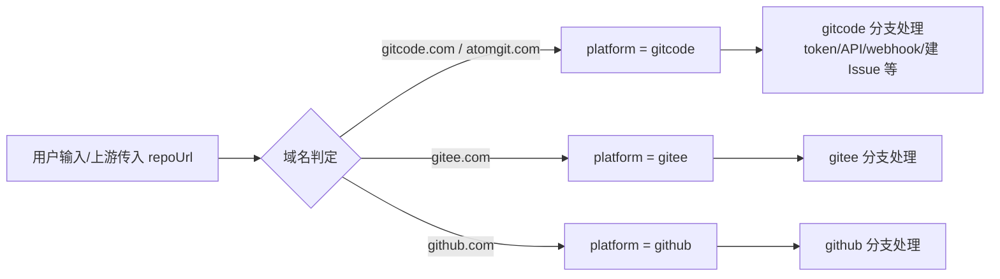

# 设计文档：代码仓支持 gitcode.com / atomgit.com 双域名（三大仓简化版）

## 1.方案设计

**业务背景**：用户在页面配置代码仓时，可选平台类型为 gitcode / gitee / github。GitCode 代码仓新增域名 `atomgit.com`，与 `gitcode.com` 同属 gitcode 平台。当前系统中所有"URL → 平台"判定只识别 `gitcode.com`，atomgit 仓会被拒绝、误判为 gitee 或静默失效。

**方案目标**：用户输入的代码仓 URL 包含 `gitcode.com` 或 `atomgit.com` 时，均解析为 gitcode 平台类型；既有 gitcode.com / gitee / github 行为不变。

**涉及模块**：openlibing-coderepo、openlibing-codecheck、openlibing-cicd 三个仓。

**整体处理方式**：

1. 平台标识值不变（仍为字符串 `"gitcode"`），不新增平台常量、不改数据库值域。
2. 所有 `contains("gitcode.com")` 式的平台判定点，扩展为同时接受 `atomgit.com`；URL 正则、`@Pattern` 等结构性校验同步放开。
3. 依赖配置 `code.platform.address` 做"单域名前缀 indexOf 定位"解析 owner/repo 的逻辑，改为域名无关的结构化解析，消除 atomgit URL 下解析错乱的风险。
4. codecheck 仓以已有的 `CodePlatformUtil.normalizeGitCodeDomain`（atomgit.com → gitcode.com 归一化）为收敛点，推广到配置驱动的平台识别入口。

**采用原因**：atomgit 与 gitcode 共用平台账号与开放 API 体系（GitCode 流水线 runner 已使用 `ATOMGIT_*` 环境变量前缀），按"域名归入平台"扩展最小且与存量 `RepoUrlParser`（已含 atomgit→gitcode）的实现方向一致。

## 2.实现逻辑设计

核心链路为"入口 URL → 平台判定 → 平台分支处理"三层：

关键处理步骤：

1. **平台判定层**（三仓共约 20 处散落判定点）：由纯 `gitcode.com` 匹配扩展为 `gitcode.com || atomgit.com`；cicd 仓建议在 `RepoType` 收敛统一的 `platformFromUrl` 工具方法。
2. **owner/repo 解析层**：coderepo 与 codecheck 仓各有一处按配置前缀 `indexOf` 定位的解析，atomgit URL 下 `indexOf` 返回 -1 导致错位；改为取"协议之后第一个 `/` 与最后一个 `/` 之间的段"，与域名无关。
3. **结构性校验层**：cicd 仓 `PipelineRelationDTO` 的 `@Pattern`、`GitCodeIssueClient` 的 owner/repo 提取正则、`CrossRegionServiceImpl` 的 PR URL 正则，显式加入 `atomgit\.com`。

## 3.类设计

不新增类（cicd 仓可选在既有 `RepoType` 中新增一个静态工具方法）。修改类清单：

**openlibing-coderepo（4 处代码 + 配置）**

| 类                                  | 修改内容                                                                                                                          |
| ----------------------------------- | --------------------------------------------------------------------------------------------------------------------------------- |
| `SigInfoClient`                     | `parsePlatformFromUrl` 增加 `atomgit.com → PLATFORM_GITCODE` 分支                                                                 |
| `OrgLocationUtil`                   | `expectedHost` 改为 host 匹配判断，gitcode 平台接受 gitcode.com / atomgit.com 双域名                                              |
| `CommonServiceImpl`                 | `getProjectAndRepoNameFromUrl` 改域名无关解析                                                                                     |
| `RepoServiceImpl`                   | 同名 `getProjectAndRepoNameFromUrl` 同步修改；`checkRepoAddress` 对 gitcode 平台显式放行双域名；`buildRepoUrl` 拼接域名规则需决策 |
| （配置中心）`code.platform.address` | gitcode 值追加 `https://atomgit.com`                                                                                              |
| 测试                                | `OrgLocationUtilTest` 等补 atomgit 用例                                                                                           |

**openlibing-codecheck（4 处代码）**

| 类                          | 修改内容                                                                                         |
| --------------------------- | ------------------------------------------------------------------------------------------------ |
| `CodePlatformUtil`          | `getCodePlatform` 匹配前先 `normalizeGitCodeDomain` 归一化，消除 atomgit 静默误判为 gitee 的根因 |
| `ProblemshieldDelegateImpl` | `resolveHostingPlatform` 显式追加 atomgit.com 分支（通知分发随归一化自动修复）                   |
| `CheckboardDelegateImpl`    | `getCodeHostingPlatform` 追加 atomgit.com 分支，恢复看板缺陷 userUrl 补全                        |
| `CommonHelper`              | `getProjectAndRepoNameFromUrl` 改域名无关解析（与 coderepo 方案对齐）                            |
| 测试                        | `CodePlatformUtilTest` 等补 atomgit 用例（当前 4 处修改点均无 atomgit 单测）                     |

**openlibing-cicd（10 处代码）**

| 类                                | 修改内容                                                                                    |
| --------------------------------- | ------------------------------------------------------------------------------------------- |
| `PipelineRelationDTO`             | `@Pattern` 正则放开 atomgit.com                                                             |
| `GitCodeIssueClient`              | `GITCODE_PATTERN` 正则加入 atomgit.com                                                      |
| `PipelineEventTriggerServiceImpl` | `groupReposByPlatform` gitcode 分支追加 atomgit.com（否则 atomgit 仓被跳过）                |
| `PipelineServiceImpl`             | L756 repoType 入库、L4225 PR 前缀、L1271/L2136 webhook 回调选择（域名分段推断改白名单映射） |
| `XxlJobHandler`                   | L557/L1012 repoType 判定                                                                    |
| `IssueClientFactory`              | `contains("gitcode")` 改域名白名单（atomgit 不含 `gitcode` 子串，现状返回 empty）           |
| `RepoServiceImpl`（cicd）         | `getEventTriggerTemplate` 追加 atomgit 分支                                                 |
| `PipelineFailEmailConsumer`       | `deriveRepoTypeFromUrl` 增加 atomgit → gitcode                                              |
| `CrossRegionServiceImpl`          | `parseUrl` PR URL 正则加入 atomgit.com                                                      |
| `WebhookRefreshService`           | 域名兜底推断改统一映射；`buildRepoUrl` 组织扫描前缀需决策                                   |

## 4.数据模型设计

不涉及。三仓 `platform` / `repoType` 字段值域不变（`"gitcode"`），无表结构变更、无数据迁移。

## 5.性能设计

不涉及。所有修改点均为字符串包含判断或正则匹配的分支扩展，无新增 I/O、缓存或异步需求，满足 3 秒性能要求。

## 6.API接口设计

不涉及。无新增/变更对外接口；`PipelineRelationDTO` 入参校验放开属于向后兼容（合法入参集合扩大）。

## 7.安全设计

**鉴权**：继承已有鉴权逻辑，无新增权限项。atomgit 仓复用 gitcode 平台的 token 校验与 webhook 鉴权链路。

**敏感信息**：不涉及新增 token、密钥处理；日志中不打印 token。

**硬编码**：本次修改不新增任何硬编码域名常量之外的凭证类信息。既有硬编码 `api.gitcode.com`（三仓共约 12 处）本次原则不改，前提见附录待确认项 1。

**审计日志**：不涉及增删改审计能力变化。

## 附录：三大仓注意点与不确定项

**注意点**：

1. **两处"隐形陷阱"**：codecheck/coderepo 的 `getProjectAndRepoNameFromUrl` 在 atomgit URL 下不抛异常、**静默解析错值**；cicd 的 `IssueClientFactory` 匹配的是子串 `gitcode`，`atomgit.com` 天然不命中——单测用 gitcode.com fixture 测不出这两类问题，必须补 atomgit 用例。
2. **配置与代码双保险**：`code.platform.address` 为配置中心外部注入（仓内 yaml 无定义），coderepo `checkRepoAddress` 建议代码侧显式放行双域名，避免强依赖配置变更窗口。
3. **上线依赖顺序**：atomgit 仓需先经 coderepo 仓修复正常登记（platform=gitcode），codecheck/cicd 的下游链路才能闭环；建议 coderepo 先行。
4. **归一化口径统一**：codecheck 已有 `normalizeGitCodeDomain`（纯子串替换），新增使用点时注意与"域名白名单"两种手法的边界保持一致，避免部分链路归一化、部分链路显式分支造成行为不一致。

**不确定项（需业务/平台侧确认后定性）**：

1. **atomgit 仓开放 API 是否与 `api.gitcode.com` 同构同端点**？若共用，三仓共约 12 处硬编码 API 域名与 `gitcode.api.address` 配置全部不改；若独立域名，需按仓库 host 动态路由 API 地址，属架构级改动，是本方案最大前置条件。
2. **atomgit 用户/账号体系是否统一在 gitcode.com**？影响 codecheck `buildUserUrl` / `buildReviewerUserUrl` 硬编码拼 `https://gitcode.com/<login>` 是否需要按来源域名拼接（倾向不改）。
3. **atomgit 组织主页 URL 路径结构**是否与 gitcode 一致（影响 coderepo `OrgLocationUtil#extractLoginFromSegments` 是否扩展），以及 coderepo `buildRepoUrl` 多域名下拼接选哪个域名。
4. **cicd `WebhookRefreshService#buildRepoUrl` 的组织扫描**是否需要纳入 atomgit 组织（涉及 `gitcode.prefix` 配置与假地址风险）。
5. **上游 webhook 对 atomgit 仓的 platform 传参**是否为 `"gitcode"`（影响 codecheck `SuppressionScanServiceImpl` 路由，服务端不解析 URL 域名）。
6. **配置中心 `code.platform.address` 当前实际值**与各消费方的解析语义（单值 indexOf 还是 contains），追加 atomgit 前需逐一核对。
