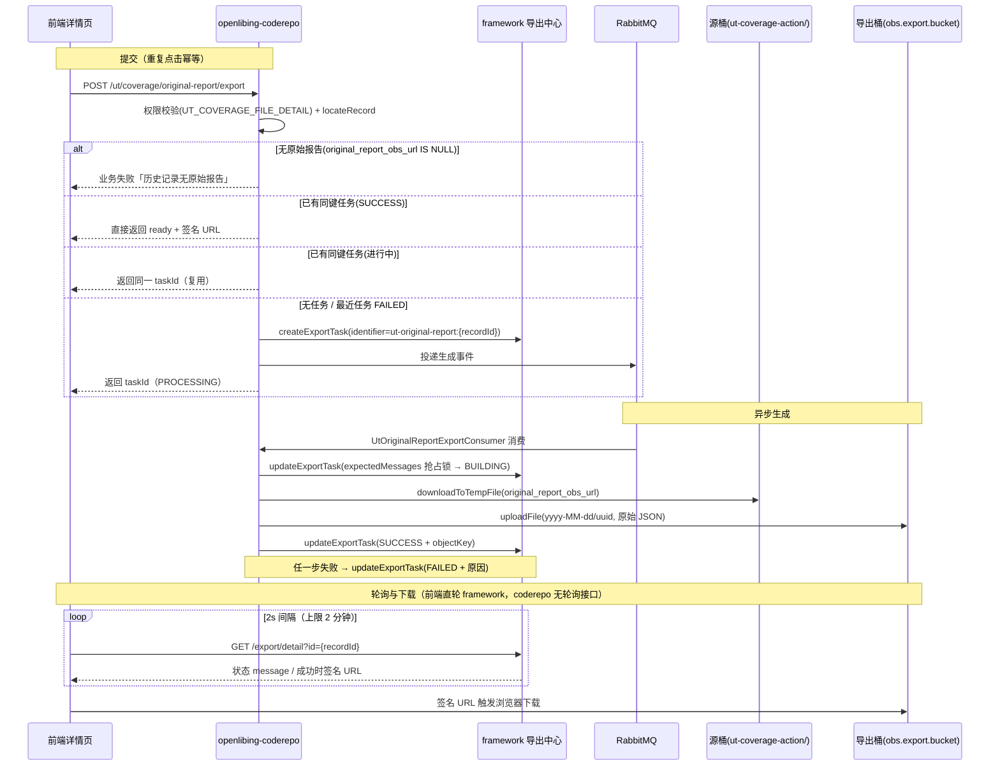

# UT 覆盖率原始报告下载 — 详细设计

| 项          | 内容                                                                                              |
| ----------- | ------------------------------------------------------------------------------------------------- |
| 需求名称    | UT 覆盖率原始报告下载                                                                             |
| FE 需求名称 | 待定（创建 Issue 时补充，全链路命名以此为准）                                                     |
| 改动范围    | openlibing-coderepo（后端）、openlibing-web（前端）                                               |
| 复用能力    | framework 导出中心（平台现有异步下载能力）、coderepo 既有 OBS 工具与权限体系                      |
| 设计日期    | 2026-11-02                                                                                        |
| 关联背景    | [UT 覆盖率指标数据链路](../../../architecture_desgin/openlibing-coderepo/UT覆盖率指标数据链路.md) |

---

## 1. 方案设计

### 1.1 需求回顾

| 需求点                                 | 设计落点                                                                                                                                                                      |
| -------------------------------------- | ----------------------------------------------------------------------------------------------------------------------------------------------------------------------------- |
| 平台保存每次上报的原始报告位置         | `code_ut_record` 新增 `original_report_obs_url` 列，上报入库时随双写落库                                                                                                      |
| 历史记录不回溯，明确提示无原始报告     | 列为空 = 无原始报告；详情 VO 透出 `originalReportAvailable=false`，接口返回明确业务失败文案                                                                                   |
| 详情页新增"下载原始报告"按钮，异步生成 | 1 个提交端点（幂等）触发导出任务；提交即返回，状态呈现复用框架全局「导出任务」浮层（已集成）                                                                                  |
| 完成后自动开始下载，失败给出明确原因   | 框架浮层自动呈现进度并触发下载（条目"已自动下载"，支持"重新下载"）；FAILED 透出截断后的失败原因                                                                               |
| 重复点击复用同一任务，不重复生成       | `identifier = ut-original-report:{recordId}:{userId}` 幂等键（用户维度隔离）；未完成任务复用、已完成任务复用返回原 ID，最近一条 FAILED 或非终态停滞超 10 分钟（判活）允许重建 |
| 下载与查看明细同一套权限               | 新增提交接口复用 `UT_COVERAGE_FILE_DETAIL` 权限点，不新增权限项                                                                                                               |
| 复用平台现有异步下载能力               | framework 导出中心 `/export/internal-server/create\|update\|query` + 导出桶（`obs.export.bucket`）+ 签名 URL                                                                  |

### 1.2 现状与痛点

现状（详见背景文档）：插件上报的原始报告 JSON 存放在 OBS 桶 `openlibing-gitcode-action/ut-coverage-action/` 下，`/ut/coverage/report` 仅把 `obsUrl` 用作一次性入参（下载解析后即丢弃），**未持久化**；`/ut/coverage/file-detail` 只能看到解析入库后的文件级明细。痛点：

1. 明细页仅展示 `filePath/lineCoverage/lineCovered/lineTotal` 四列，解析入库丢掉的字段（如 method/class 级数据，若插件版本包含）无法回看；
2. 问题排查（如"明细与总量对不上"）需要原始 JSON 比对，目前只能找运维捞 OBS；
3. 离线分析、审计无原始数据入口。

### 1.3 方案总览

一句话：**上报时多落一列原始报告位置；下载时把"原始报告从源桶转存到导出桶"做成一次幂等的导出任务，任务登记与状态托管全部复用 framework 导出中心，前端轮询拿到签名 URL 触发下载。**



> 参考实现：`openlibing-codecheck` 的 `StaticAlarmServiceImpl#exportStaticAlarmList` / `#processExport`（`/static-alarm/v1/list/export`）——提交建任务 + MQ 事件、消费者 CAS 状态机（INITIALIZED → BUILDING → UPLOADING → SUCCESS + objectKey）、前端直轮 framework `/export/detail?id=` 拿签名 URL 下载。本方案沿用同一模式。

### 1.4 关键决策点（评审确认项）

> **评审结论（2026-11-02）：D1–D5 全部采纳，按本方案执行。**

| #   | 决策                                                                                 | 备选                        | 推荐理由                                                                                                                                  |
| --- | ------------------------------------------------------------------------------------ | --------------------------- | ----------------------------------------------------------------------------------------------------------------------------------------- |
| D1  | 原始报告**转存导出桶**，前端拿签名 URL 下载，而非 302 跳源桶                         | 直接给源桶签名 URL          | 源桶 `openlibing-gitcode-action` 是插件上报桶，前端无稳定访问保障；导出桶 + 签名 URL 是平台现有异步下载的标准出口，权限与生命周期管理统一 |
| D2  | 任务状态/登记**全部托管 framework 导出中心**，coderepo 不建任务表                    | coderepo 自建导出任务表     | 需求明确要求复用平台现有异步下载能力；导出中心已提供任务登记、状态条件更新（任务锁）、查询能力，且统一展示入口                            |
| D3  | 幂等键 `identifier = ut-original-report:{recordId}`，**FAILED 允许重建新任务**       | FAILED 后复用原任务重置状态 | 导出中心的 message 即状态载体，重置需条件更新链路长；按 identifier 查"最新一条"（id 最大）天然支持重建后复用                              |
| D4  | 原始文件**原样转存**，不重新打包/压缩                                                | zip 打包                    | 原始报告本身即 JSON 文本，保持 byte-for-byte 一致才符合"原始报告"语义，也便于 diff 审计                                                   |
| D5  | 生成执行侧走 **MQ 事件 + 消费者**（复用 `codeMetricsListenerContainerFactory` 模式） | 同步线程池                  | 与 coderepo 现有异步导入（`UtCoverageImportConsumer`）模式一致；天然限流、可重试、多实例削峰                                              |

---

## 2. 实现逻辑设计

### 2.1 上报侧改造（1 行落库）

`UtCoverageServiceImpl#persistUtCoverage` 事务内 `saveUtRecord` 组装实体时增加 `entity.setOriginalReportObsUrl(request.getObsUrl())`。失败记录 `saveFailureRecord` **不落** obsUrl（失败记录无成功产物，且 OBS 文件可能未上传完成，保留 NULL 语义）。

> 说明：`obsUrl` 在入库前已通过 `ObsBucketServiceImpl` 的桶名 + 前缀白名单校验，落库值可信；历史遗留数据该列为 NULL，即"无原始报告"。

### 2.2 提交导出任务（`POST /ut/coverage/original-report/export`）

```
入参: repoId + branchName + pipelineRunId（与 file-detail 定位参数一致）+ userId(网关注入)
处理:
  1. verifyPermissionsByProduct(userId, null, null, repoId, UT_COVERAGE_FILE_DETAIL)  ← 复用明细权限点
  2. repo_info 反查 gitUrl → normalizeGitUrl → locateRecord(gitUrls, branch, runId)   ← 复用现有定位逻辑
  3. record.originalReportObsUrl 为空 → DataResult 业务失败「该记录为功能上线前的历史上报，无原始报告可下载」
  4. identifier = "ut-original-report:" + record.getId() + ":" + userId   ← 用户维度隔离（framework 仅创建人可查看/下载，跨用户复用会被归属鉴权拦截）
     queryExportTask({identifier, type=UT_ORIGINAL_REPORT, limit=1})
     ├─ 命中且 message ∉ FAILED（进行中或已成功）→ 复用：返回已有 exportRecordId（不重复生成）；
     │   其中非终态且停滞超 10 分钟（updateTime 判活，消费者进程死亡无人收尾）→ 放行重建
     └─ 未命中 / 最近一条 FAILED / 非终态停滞超时 → createExportTask(userId, {type=UT_ORIGINAL_REPORT,
             fileName=<规范文件名>, identifier, data=<JSON: recordId/repoId/gitUrl/branchName/pipelineRunId/obsUrl>})
             → 投递 MQ 生成事件（发送失败兜底：回写 FAILED，见 2.3）
出参: exportRecordId（字符串，前端据此直轮 framework /export/detail）
```

规范文件名：`ut-original-report_{repoName}_{branchName}_{pipelineRunId|recordId}.json`；非法路径字符替换为 `_`，整体长度截断至 255。

### 2.3 异步生成（MQ 消费者 `UtOriginalReportExportConsumer`）

状态机与 codecheck `processExport` 完全一致，消息体仅含 `exportRecordId`（其余上下文从导出中心 `data` 字段恢复）。

监听配置：新队列 `ut_original_report_export_queue`（默认交换机 + routing key=队列名，持久化消息，容器工厂复用 `codeMetricsListenerContainerFactory`，并发 2-4）：

1. **MQ 发送失败兜底**（Producer 侧）：投递导出事件失败时立即 `updateExportTask({id, message=FAILED.desc + ":消息投递失败"})`，保证用户轮询能看到失败终态而非卡在 INITIALIZED（对齐 `StaticAlarmExportProducer` 惯例）。
2. **CAS 抢占**：`updateExportTask({id, message=BUILDING.desc, expectedMessages=[INITIALIZED.desc]})`，条件更新失败说明已被其他实例消费或已终态 → ACK 跳过。
3. **下载转存**：`obsBucketService.downloadToTempFile(data 中的 obsUrl)`（源桶白名单校验天然生效）→ CAS BUILDING → UPLOADING → `obsBucketService.uploadFile(objectKey, tempFile, fileName)`，objectKey = `yyyy-MM-dd/` + UUID。
4. **CAS 回写成功**：`updateExportTask({id, message=SUCCESS.desc, objectKey, expectedMessages=[UPLOADING.desc]})`。
5. **失败回写**：任一步失败按异常分类回写 `FAILED.desc + ":" + 截断原因(≤255)`；CAS / 回写失败场景先回查确认仍处前置中间态才条件回写 FAILED（命中终态说明写入实际生效，保持终态不动），消息不重投（重试由用户重新点击触发，天然限频）。
6. 消费消息体损坏（JSON 解析失败）：记 error 日志后 ACK 丢弃。

> 状态机：`INITIALIZED → BUILDING → UPLOADING → SUCCESS(+objectKey)`，任一环节可跳 `FAILED`；每步 CAS 均携带 expectedMessages，防止终态被覆盖。失败原因透出约束：framework `message` 上限 255 字符，回写前截断，前端展示原文。非终态任务停滞超过 10 分钟由提交侧按 updateTime 判活放行重建（消费者进程死亡无人收尾的自愈路径）。

### 2.4 状态呈现与下载（框架全局「导出任务」浮层统一承担，coderepo 不提供轮询接口）

提交拿到 `exportRecordId` 后，**状态呈现与下载全部复用框架页面已集成的全局「导出任务」浮层**（右下角悬浮卡片，static-alarm 导出同款体验）：

- 浮层内部对接 framework 导出详情接口（`GET /gateway/openlibing-framework/export/detail?id={exportRecordId}`），业务页面**零轮询代码**。
- 导出成功：浮层自动触发浏览器下载（条目显示「已自动下载」），并提供「重新下载」入口（重新签发 URL）。
- 导出失败：条目内展示 `message` 截断后的失败原因；「查看全部导出」入口由框架提供。
- coderepo **不新增** status 轮询端点，UT 详情页也不自建轮询 UI——避免重复建设与签名 URL 二次跳转。

UT 详情页自身交互保持极简：点击按钮 → 提交成功 toast「已提交导出任务，完成后将自动下载」→ 按钮复位（重复点击幂等复用）；后续状态用户在浮层中查看。

### 2.5 明细接口补充字段

`/ut/coverage/file-detail` 响应 `UtCoverageFileDetailVO` 新增 `originalReportAvailable`（`record.getOriginalReportObsUrl() != null`）。前端据此控制按钮可用态；为 false 时按钮置灰 + tooltip「功能上线前的历史记录无原始报告」。

### 2.6 边界与异常场景

| 场景                                  | 行为                                                                                                                                                             |
| ------------------------------------- | ---------------------------------------------------------------------------------------------------------------------------------------------------------------- |
| 历史记录（上线前）无原始报告          | 提交接口业务失败 + 明细 VO `originalReportAvailable=false`，按钮置灰                                                                                             |
| 源桶对象已被清理（OBS 生命周期策略）  | 生成阶段下载失败 → 任务 FAILED，原因「OBS 文件下载失败或不存在」                                                                                                 |
| 导出中心 create/update/query 调用失败 | 提交失败返回明确错误；生成侧 CAS/回写失败先回查确认仍处前置中间态才条件回写 FAILED（命中终态保持不动）；非终态停滞超 10 分钟由提交侧判活放行重建，无永久卡死窗口 |
| 多实例并发消费同一任务                | expectedMessages 条件更新抢占，未抢到直接 ACK                                                                                                                    |
| 原始文件超过源桶/下载大小上限         | `downloadToTempFile` 现有 500MB 上限兜底，超限任务 FAILED 并透出原因                                                                                             |
| 重复点击                              | 提交接口幂等：进行中/已完成均复用已有导出记录（返回原 exportRecordId），不重复生成                                                                               |
| 签名 URL 过期后再次下载               | 重新点击提交 → 命中已有记录返回原 exportRecordId → 前端直轮 framework detail 重新拿签名 URL（不重新生成文件）                                                    |

---

## 3. 类设计

openlibing-coderepo 新增/改动（沿用既有分层：Controller → Service → Consumer/Feign/Mapper）：

| 类                                                                                                | 类型 | 职责                                                                                                                                                 |
| ------------------------------------------------------------------------------------------------- | ---- | ---------------------------------------------------------------------------------------------------------------------------------------------------- |
| `UtOriginalReportController`（或挂入 `UtCoverageController`）                                     | 改动 | 新增 `/ut/coverage/original-report/export` 提交端点（**仅 1 个**，状态轮询由前端直轮 framework）                                                     |
| `UtOriginalReportExportService` + Impl                                                            | 新增 | 提交幂等编排：定位记录 → 无原始报告校验 → 复用判定（identifier 查询）→ createExportTask → 投递 MQ → 返回 exportRecordId                              |
| `UtOriginalReportExportProducer`                                                                  | 新增 | MQ 投递导出事件；**发送失败兜底回写 FAILED**（对齐 codecheck `StaticAlarmExportProducer` 惯例）                                                      |
| `UtOriginalReportExportConsumer`                                                                  | 新增 | MQ 消费：CAS 状态机（INITIALIZED→BUILDING→UPLOADING→SUCCESS+objectKey，对齐 codecheck `processExport`）→ 下载转存                                    |
| `FrameworkExportClient`                                                                           | 新增 | Feign：`/export/internal-server/create\|update\|query`；**contextId 必须唯一**（如 `openlibing-framework-export`），避免与同 name 客户端的 Bean 冲突 |
| `ObsFileCreateRequestDTO / ObsFileUpdateRequestDTO / ObsFileQueryRequestDTO / ObsFileResponseDTO` | 新增 | 与 framework 契约字段一致的独立定义（coderepo 不依赖 cicd / codecheck 包），路径 `business/dto/export/`                                              |
| `ExportStatus`                                                                                    | 新增 | 枚举 INITIALIZED/BUILDING/UPLOADING/SUCCESS/FAILED，message 与 framework 侧一致（message 即状态载体，对齐 `StaticAlarmExportStatusEnum`）            |
| `UtOriginalReportExportEventDTO`                                                                  | 新增 | MQ 消息体：`exportRecordId`（其余上下文从导出中心 `data` 字段恢复）                                                                                  |
| `UtCoverageFileDetailVO`                                                                          | 改动 | 新增 `originalReportAvailable` 字段                                                                                                                  |
| `UtCoverageServiceImpl`                                                                           | 改动 | `saveUtRecord` 落库 `originalReportObsUrl`；`getFileDetail` 填充新字段                                                                               |
| `CodeUtRecordEntity` / `CodeUtRecordMapper(.xml)`                                                 | 改动 | 实体与 SQL 补列                                                                                                                                      |
| `db.changelog.xml`                                                                                | 改动 | changeSet：`code_ut_record` 加列                                                                                                                     |

openlibing-web（前端）：UT 覆盖率详情页新增导出按钮与 loading 态（提交即返回、按钮复位；状态轮询、自动下载与失败提示全部由框架全局「导出任务」浮层承担，业务页面零轮询代码，见 2.4）。

---

## 4. 数据模型设计

`code_ut_record` 新增 1 列（Liquibase changeSet，遵循既有 preConditions MARK_RAN 风格）：

```sql
ALTER TABLE code_ut_record
    ADD COLUMN original_report_obs_url VARCHAR(1024) DEFAULT NULL
    COMMENT '插件上报的原始报告 OBS 下载链接（ut-coverage-action/ 前缀）；NULL=功能上线前历史记录或失败记录，无原始报告';
```

| 设计点                        | 说明                                                                                                                              |
| ----------------------------- | --------------------------------------------------------------------------------------------------------------------------------- |
| 为什么只存 URL 不存 objectKey | URL 为固定格式（`https://{bucket}.obs.{region}.myhuaweicloud.com/{objectKey}`），objectKey 可解析派生，避免冗余双写不一致         |
| 为什么不迁移历史              | 需求明确不回溯；NULL 即"无原始报告"的业务语义                                                                                     |
| framework 导出中心侧          | 任务记录（`type=UT_ORIGINAL_REPORT`、identifier、message 状态、objectKey 产物）由 framework 现有表托管，coderepo **不新建任务表** |
| 导出桶产物                    | objectKey = `yyyy-MM-dd/{uuid}`，文件名通过 OBS `downloadFileName` 元数据携带；生命周期沿用导出桶现有 OBS 策略                    |

---

## 5. 性能设计

| 关注点        | 设计                                                                                                                                                |
| ------------- | --------------------------------------------------------------------------------------------------------------------------------------------------- |
| 同步接口耗时  | 提交接口仅涉及本地 MySQL 定位 + framework 2-3 次 Feign（query/create），无 OBS 大对象 IO；定位复用现有 `locateRecord`（命中 `idx_git_branch` 索引） |
| 原始文件大小  | 源文件为插件上报 JSON（与现有导入同源），`downloadToTempFile` 现有 500MB 上限与流式下载已兜底；转存为流式复制语义，不整体载入内存                   |
| 并发与限流    | 消费者并发 2-4 + prefetch=1，与 UT 导入共享 `codeMetricsListenerContainerFactory` 隔离线池；同任务多实例由条件更新锁互斥                            |
| 重复生成防护  | identifier 幂等：进行中/已完成均复用已有导出记录；仅 FAILED 重建，频次受用户点击约束                                                                |
| MQ 队列隔离   | 新建独立队列，不与 UT 导入/度量导入队列混用，互不影响削峰                                                                                           |
| 签名 URL 时效 | 由 framework `/export/detail` 统一签发（平台既有时效策略）；过期重新点击提交即可重新获取，不触发重新生成                                            |

---

## 6. API 接口设计

### 6.1 提交导出任务（幂等）

```http
POST /gateway/openlibing-coderepo/ut/coverage/original-report/export
Content-Type: application/json
```

```json
// 请求（userId 网关注入）
{ "repoId": 100, "branchName": "master", "pipelineRunId": "run-123" }
```

```json
// 响应：成功返回导出中心记录 ID（新建或复用，字段含义与 codecheck /list/export 一致）
{ "code": "0", "msg": "success", "data": "445805" }
// 无原始报告（历史记录）
{ "code": "500", "msg": "该记录为功能上线前的历史上报，无原始报告可下载" }
```

校验：`repoId/branchName` 必填，`pipelineRunId` 缺省时定位最新成功记录（与 file-detail 一致）。返回值语义：前端不区分新建/复用，统一以该 ID 直轮 framework 详情接口。

### 6.2 轮询下载状态（前端直轮 framework，coderepo 不新建接口）

```http
GET /gateway/openlibing-framework/export/detail?id={exportRecordId}
```

平台既有接口（static-alarm 导出同款）：返回导出记录详情，`message` 字段承载状态（`导出任务已创建 / 导出文件生成中 / 正在上传文件 / 导出成功 / 导出失败：xxx`）；`message=导出成功` 时 framework 返回签名下载 URL，前端直接触发下载。

### 6.3 明细接口字段补充

`/ut/coverage/file-detail` 响应新增：`"originalReportAvailable": true|false`。

### 6.4 前端交互约定（openlibing-web）

1. 详情页渲染时按 `originalReportAvailable` 控制"下载原始报告"按钮：置灰 + tooltip「功能上线前的历史记录无原始报告」。按钮**位置与样式**：页头信息条（代码仓 / 分支 / 流水线）同一行右侧，次要按钮样式（白底描边 + 下载图标），对应"这条上报记录"整体；高保真效果图见评审 HTML §6.5。
2. 点击 → 调 6.1 拿 `exportRecordId`（无原始报告等业务失败直接展示失败文案）→ 按钮短暂 loading 后即复位，不做提交成功提示、不做失败 message（生成进度与失败原因均由框架「导出任务」浮层呈现）。
3. 状态呈现与自动下载由**框架全局「导出任务」浮层**统一承担（生成中 → 成功自动下载/支持"重新下载" → 失败展示原因，入口「查看全部导出」），UT 详情页不自建轮询 UI。
4. 幂等：同 recordId 重复提交复用已有导出记录，浮层/导出列表不出现重复任务。

---

## 7. 安全设计

| 维度         | 设计                                                                                                                                                   |
| ------------ | ------------------------------------------------------------------------------------------------------------------------------------------------------ |
| 权限         | 新增提交接口复用 `verifyPermissionsByProduct(userId, null, null, repoId, UrlConstant.UT_COVERAGE_FILE_DETAIL)`，与查看明细同一权限项，**不新增权限点** |
| 横向越权     | repoId 来自请求且必经权限校验；状态轮询直连 framework `/export/detail`，其访问控制沿用该接口既有鉴权（与 static-alarm 导出一致，非本次改动范围）       |
| OBS 源站安全 | 生成侧复用 `downloadToTempFile` 既有桶名 + `ut-coverage-action/` 前缀白名单；落库的 `original_report_obs_url` 仅在白名单校验通过后才写入               |
| 下载链路     | 前端仅接触 framework 签发的导出桶短时效签名 URL，不接触源桶与 OBS 凭证；文件名经服务端规范化（替换路径分隔符等非法字符），防下载文件名注入             |
| 注入防护     | branchName/pipelineRunId 参与文件名拼接前做白名单清洗；日志打印统一走 `LogSanitizer.sanitize`                                                          |
| 失败信息     | `message` 入库前按 255 截断，异常细节不透出 OBS 内部凭证/endpoint                                                                                      |

---

## 8. 改造清单与验收标准（附录）

### 改造清单

| 仓                  | 改动                                                                                                                                                                                                                                                                                                                                |
| ------------------- | ----------------------------------------------------------------------------------------------------------------------------------------------------------------------------------------------------------------------------------------------------------------------------------------------------------------------------------- |
| openlibing-coderepo | db.changelog 加列；上报落库 1 行；`UtOriginalReportExportService` + `ExportProducer` + MQ 消费者 + Feign 客户端（唯一 contextId）+ 4 个 DTO + `ExportStatus` 枚举；Controller 1 个提交端点（轮询复用 framework `/export/detail`）；file-detail VO 加字段；单测（幂等复用三分支、CAS 状态机、MQ 发送失败兜底、无原始报告、失败回写） |
| openlibing-web      | 详情页导出按钮（提交 + 按钮复位）；状态轮询 / 自动下载 / 失败提示由框架全局「导出任务」浮层承担，页面零轮询代码                                                                                                                                                                                                                     |

### 验收标准

1. 新上报一条 UT 覆盖率 → `code_ut_record.original_report_obs_url` 非空且等于插件传的 obsUrl。
2. 历史记录（列为 NULL）：按钮置灰带提示；接口提交返回「无原始报告」明确文案。
3. 点击下载：任务创建 → 框架「导出任务」浮层呈现进度 → 成功自动下载（条目"已自动下载"，"重新下载"可用），文件内容与源桶对象 byte-for-byte 一致。
4. 连续快速点击 N 次：导出中心同 identifier 仅 1 条进行中任务（或多条历史但仅最新生效），无重复转存执行。
5. 人工将源对象删除后再点击：任务 FAILED（`message=导出失败：xxx`）且前端展示失败原因。
6. 无明细查看权限的用户调提交接口：被拒绝（权限点与明细一致）。
