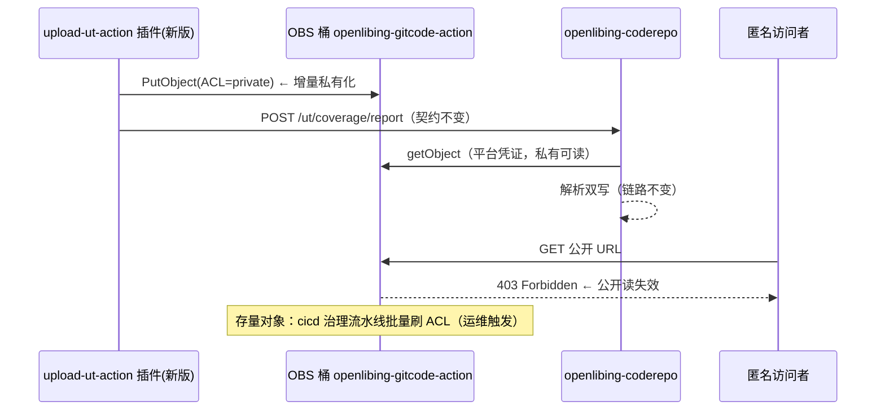

# UT 覆盖率上报对象私有化改造 — 详细设计

| 项          | 内容                                                                                                                  |
| ----------- | --------------------------------------------------------------------------------------------------------------------- |
| 需求名称    | UT 覆盖率上报插件上传对象私有化                                                                                       |
| FE 需求名称 | 待定（创建 Issue 时补充，全链路命名以此为准）                                                                         |
| 改动范围    | upload-ut-action 插件（发新版）+ openlibing-cicd 治理流水线（运维触发存量治理）；**openlibing-coderepo 后端无需改动** |
| 复用/依赖   | coderepo 既有平台凭证读取能力（`ObsBucketServiceImpl#downloadToTempFile`）                                            |
| 设计日期    | 2026-11-03                                                                                                            |
| 关联背景    | [UT 覆盖率指标数据链路](../../../architecture_desgin/openlibing-coderepo/UT覆盖率指标数据链路.md)                     |

---

## 1. 方案设计

### 1.1 需求回顾

| 需求点                                                       | 设计落点                                                                                                                                           |
| ------------------------------------------------------------ | -------------------------------------------------------------------------------------------------------------------------------------------------- |
| 插件上传对象改为私有，不再公开可读                           | **移除 `obs_acl` 配置项**，代码固定 ACL = private（安全硬约束不开放配置，杜绝公开读复活口子）                                                      |
| 上报内容、回调地址、文件命名规则不变，现有流水线无感知       | 仅改 ACL 参数，上报契约（JSON 内容 / `/report` 接口 / objectKey 规则）零变更                                                                       |
| 验证 OIDC（插件上传侧）与 AK/SK（治理脚本 / 平台侧）认证链路 | 发布前跑 OIDC 模式流水线完成验证矩阵；AK/SK 仅限治理脚本 / 平台侧消费（见 2.2）                                                                    |
| 存量治理：批量刷 ACL 为私有                                  | **已敲定**：openlibing-cicd 仓搭 GitCode Action 治理流水线 + 脚本批量刷新，流水线入参支持 AK/SK、刷新模式（只统计 / 统计并刷新）、可选桶（见 2.3） |
| openlibing-coderepo 后端无需改动                             | 后端读取走平台 OBS 凭证，不依赖公开读（见 2.4）                                                                                                    |

### 1.2 现状与风险

现状：插件把覆盖率标准 JSON 上传到统一桶 `openlibing-gitcode-action`、前缀 `ut-coverage-action/{日期}/{uuid}.json`，对象为**公开可读**——任何人拿到 URL 即可匿名 GET。

风险：

1. **内部信息暴露**：覆盖率报告包含仓库文件清单、路径结构与逐文件覆盖率，公开 URL 一旦外泄即泄露仓库内部结构；
2. **URL 长期有效**：OBS 公开对象无过期机制，历史链接可无限期访问；
3. **口径不一致**：同桶的 `code-metrics-action/`（代码度量插件）已是私有化口径，UT 插件是唯一公开读前缀。

### 1.3 方案总览

一句话：**增量止血 + 存量清零**——插件新版本上传时显式设置对象 ACL=private（增量全部私有），存量公开对象由 **cicd 仓的 GitCode Action 治理流水线批量刷 ACL 为私有**（入参支持 AK/SK、刷新模式、可选桶）；coderepo 后端用平台凭证读取私有对象，零改动。



### 1.4 关键决策点（评审确认项）

| #   | 决策                                                                                                                               | 备选                                                    | 推荐理由                                                                                                                       |
| --- | ---------------------------------------------------------------------------------------------------------------------------------- | ------------------------------------------------------- | ------------------------------------------------------------------------------------------------------------------------------ |
| D1  | 存量治理**已敲定**：cicd 仓 GitCode Action 治理流水线批量刷 ACL 为私有（脚本枚举 + 判定 + SetAcl，入参 AK/SK / 刷新模式 / 可选桶） | 桶级公共访问阻断（Public Access Block，运维控制台操作） | 流水线方案前缀级精确修复、留审计数字、可重跑、由团队自主触发不依赖运维窗口；桶级阻断留作兜底手段（如批量修复遗漏时的应急封口） |
| D2  | **移除 `obs_acl` 配置项**，插件代码固定 ACL=private（不开放配置）                                                                  | 保留配置项仅切换默认值；调整桶默认 ACL（运维改桶配置）  | 安全硬约束不应留给用户开口子（`public-read` 可被配回）；插件自闭环随版本生效，桶默认策略由 D1 兜底                             |
| D3  | 治理执行前**强制审计 OBS 访问日志**：确认 `ut-coverage-action/` 前缀（及 D1 选桶级时的全桶）无匿名 GET 消费方                      | 直接执行                                                | 私有化后匿名 GET 一律 403，若存在未知消费方（如外部脚本直连 URL）会静默中断，必须先审计后执行                                  |
| D4  | 发布顺序：**先发插件（增量止血）→ 双认证验证 → 审计 → 存量治理 → 观测**                                                            | 先治理存量再发插件                                      | 先止住新增暴露面，存量暴露窗口随治理收口；顺序颠倒会让新公开对象在治理后继续产生                                               |

---

## 2. 实现逻辑设计

### 2.1 插件改造（upload-ut-action）

**私有化是安全硬约束，不开放配置**：ACL 参数化能力虽已具备（`obs_acl` 输入 + 白名单 + 透传 + 单测，Ref issue #1），但保留配置项意味着 `public-read` 仍可被配回——本次**直接移除 `obs_acl` 输入与相关代码，ACL 固定 private**。

1. **不变的契约**：标准 JSON 内容、`/ut/coverage/report` 回调地址与报文、objectKey 命名规则（`ut-coverage-action/{repoName}/{日期}.{小时}/{runId}/ut-coverage.json`）全部不变。
2. **存量流水线影响**：显式配置了 `obs_acl: public-read` 的流水线升级插件后配置失效、一律私有（安全约束优先于个别配置，发布说明中明确声明）；未配置的流水线数据链路无感知。

### 2.2 双认证模式验证矩阵

发布前完成验证（插件上传侧仅 OIDC 链路；AK/SK 仅限治理脚本 / 平台侧消费，插件无静态凭证分支）：

| 认证模式 | 上传凭证来源                                                    | 验证点                                                                                                  |
| -------- | --------------------------------------------------------------- | ------------------------------------------------------------------------------------------------------- |
| OIDC     | 流水线 OIDC 临时凭证                                            | ① 上传成功；② 对象 ACL 为私有（匿名 GET 403）；③ coderepo 解析入库成功、明细页正常                      |
| AK/SK    | 治理脚本 / 平台侧 IAM 静态 AK/SK（插件上传侧无此链路，仅 OIDC） | 治理脚本按最小权限 IAM 策略（List / GetObjectAcl / PutObjectAcl）完成统计与修复；平台侧服务凭证读取正常 |

补充验证：私有对象下 `/ut/coverage/file-detail` 下钻、（若已上线）原始报告下载均正常——它们都经 coderepo 平台凭证读取，理论不受影响，实测收口。

### 2.3 存量治理：GitCode Action 流水线（统计 + 修复能力工程化）

存量治理不依赖运维手工脚本，也不在 cicd 服务端新增 Java 代码——落地为 **openlibing-cicd 仓的一条 GitCode Action 流水线**（`.gitcode/workflows/obs-acl-governance.yml`，手动触发），流水线拉起治理脚本完成「统计公开读数量」与「一键修复为私有」。

**执行流（单次遍历同时完成统计与修复）**：

```
运维手动触发流水线（workflow_dispatch），inputs:
  bucket=openlibing-gitcode-action（可选桶，下拉/手输）
  region=cn-southwest-2（桶所属区域，OBS 端点 obs.{region}.myhuaweicloud.com；华北桶为 cn-east-3）
  prefix=ut-coverage-action/（桶内前缀，可留空=整个桶）
  mode=COUNT_ONLY（只统计不刷新）| COUNT_AND_REPAIR（统计并刷新）
  batchIntervalMs=200（限流，可选）
  凭证：AK/SK 以私密参数传入（平台脱敏，不落 yml/代码/日志明文）——非敏感入参（bucket/prefix/mode 等）走 inputs，凭证与普通入参分离
  1. 流水线 job 拉起治理脚本（Node + esdk-obs-nodejs，凭证从 env 读取）
  2. ListObjects 分页枚举（每批 1000，marker 翻页）遍历目标桶/前缀下全部对象
  3. 逐对象 GetObjectAcl → 判定 AllUsers + READ/FULL_CONTROL（即公开可读，FULL_CONTROL 包含 READ 权限）
       ├─ COUNT_ONLY：仅计数（摸底报告：总数 / 公开读数 / 私有数 / 失败数）
       └─ COUNT_AND_REPAIR：立即 SetObjectAcl(private)（幂等，失败只计数不中断）
  4. 限流：每批间隔 batchIntervalMs，避免触发 OBS 限频
  5. 输出治理摘要（流水线日志留痕）：pages / total / publicRead / repaired / failed / costMs / failedKeys
```

**设计要点**：

1. **两段式执行**：先 `COUNT_ONLY` 摸底拿到公开读数量（对齐 D3 审计精神——先看数字再动手），确认无匿名消费方后改 `COUNT_AND_REPAIR` 执行修复；修复幂等可重跑。
2. **治理逻辑形态**：Node 治理脚本放 cicd 仓 `scripts/obs-acl-governance/`（与插件同生态复用 `esdk-obs-nodejs`），workflow 仅做拉起与凭证注入——cicd 服务端 Java 零改动。
3. **精确修复而非全量覆盖**：逐对象 GetObjectAcl 判定后仅对公开读对象 SetAcl，统计数字与修复动作同源，可留下"治理前有多少公开读"的审计数字。
4. **凭证权限**：治理凭证需 `ListBucket` + `GetObjectAcl` + `PutObjectAcl` 三个权限；**不需要 GetObject**（治理只碰 ACL 元数据，不读对象内容）——与 §7 最小权限口径一致。凭证来源**已敲定为流水线私密参数传入静态 AK/SK**（需配套最小权限 IAM 策略）；workflow 声明 `id-token: write` 复用 OIDC 临时凭证可作为后续演进方向（短效免静态密钥，需委托策略扩展 ACL 权限）。
   - **私密参数传递方式（已敲定）**：AK/SK 通过流水线**私密参数**传入（平台自动脱敏，运行日志打码 `***`，不落 yml/代码/日志明文）→ workflow step `env` 注入 `OBS_ACCESS_KEY_ID: ${{ secrets.OBS_GOVERNANCE_AK }}` → 脚本从环境变量读取构造 ObsClient。**已查证 GitCode 官方文档（syntax-reference/variables）**：私密参数（secrets）在平台设置页配置（组织级 / 项目级，项目级覆盖组织级）、日志自动脱敏 `***`；`workflow_dispatch` 手动触发支持 `inputs`（`string / boolean / choice / number` 类型——`bucket` 手输、`mode` 可用 `choice` 下拉防呆）；引用语法 `${{ secrets.X }}` / `${{ inputs.X }}`。**入参分离原则**：桶、前缀、模式等非敏感参数走 inputs（可回显、可复用），AK/SK 只走私密参数通道（不进 inputs——inputs 值界面可见不加密）。
5. **范围可配置**：inputs 的 `bucket` 支持选择桶（不传默认主桶 `openlibing-gitcode-action`），`prefix` 默认 `ut-coverage-action/`（可留空=整个桶）；桶级阻断（D1 备选兜底）仍是运维控制台操作，本流水线做桶/前缀级统计与修复。

6. **审计（前置必做，与治理流水线互补）**：COUNT_ONLY 给出存量数字，OBS 访问日志审计回答"有没有匿名消费方"——两者都清零/确认后才执行 COUNT_AND_REPAIR。
7. **验证**：治理后抽样历史 objectKey 匿名 GET → 403；coderepo 历史记录下钻 / 原始报告下载正常（平台凭证读取不受影响）。

### 2.4 coderepo 后端零改动的依据

`ObsBucketServiceImpl#downloadToTempFile` 通过服务端 OBS 客户端 `getObject(bucketName, objectKey)` 读取对象——使用平台 OBS 凭证（服务间授权），**不依赖对象公开可读**；桶名 + 前缀白名单校验逻辑不变。因此对象私有化对该读取路径透明。

### 2.5 回滚预案

- 插件：回退上一版本重新发版（增量恢复公开读）；
- 存量治理：批量改 ACL 可逆（恢复 public-read）；桶级阻断解除即可恢复。

---

## 3. 类设计

**关键事实**：插件已具备 ACL 参数化能力（`obs_acl` 输入 + 白名单 + 透传 + 单测，Ref issue #1），但私有化是安全硬约束——**移除配置项、代码固定 private**，杜绝公开读被配回的口子。改动共 6 个文件：

| #   | 文件（upload-ut-action） | 位置                             | 改动                                                                                                                             |
| --- | ------------------------ | -------------------------------- | -------------------------------------------------------------------------------------------------------------------------------- |
| 1   | `action.yml`             | inputs / version                 | **删除 `obs_acl` input 定义**；version `1.0.1` → `1.0.2`（与 package.json 同步）                                                 |
| 2   | `index.js`               | L136-142                         | **删除 `obs_acl` 解析、白名单校验与透传代码**；调用 `uploadAndNotify` 不再传 obsAcl                                              |
| 3   | `src/obs/ObsUploader.js` | `uploadJson` / `uploadAndNotify` | 签名去掉 acl / obsAcl 参数，`putObject` 固定 `ACL: 'private'`（模块常量）；顶部注释与 ACL 日志文案更新（"私有化口径，不可配置"） |
| 4   | `test/obs-acl.test.js`   | 全文件                           | 删除 ACL 配置类用例（白名单 / 缺省 / 透传），改为「putObject ACL 恒为 private」防回归断言（防止公开读复活）                      |
| 5   | `package.json`           | `version`                        | `1.0.1` → `1.0.2`                                                                                                                |
| 6   | `dist/index.js`          | 构建产物                         | `npm run build`（ncc build + zip）重新生成并随版本发布                                                                           |

**认证模式说明（重要澄清）**：插件上传 OBS **仅有 OIDC 联邦认证一条链路**——流水线声明 `id-token: write` → SDK 申请 OIDC ID Token → 华为云 STS `AssumeAgencyWithOIDC` 换 1 小时临时 AK/SK/SecurityToken → putObject；SDK（`@openlibing/huaweicloud-oidc-client`）本身是**免 AK/SK 设计**，不存在静态凭证分支。因此需求中「验证 AK/SK 认证模式」需评审澄清具体所指：若指插件上传侧，需新增静态凭证分支（读环境变量构造 ObsClient，改动小）；若指治理脚本 / 平台服务侧的 AK/SK 消费，则与插件无关、属 IAM 授权配置。临时凭证的权限边界由 OIDC 委托（agency）策略决定——§7 的「仅 PutObject」最小权限即配在该委托上。

**存量治理流水线（openlibing-cicd 侧）**：

| 位置                                        | 类型 | 职责                                                                                                                                                       |
| ------------------------------------------- | ---- | ---------------------------------------------------------------------------------------------------------------------------------------------------------- |
| `.gitcode/workflows/obs-acl-governance.yml` | 新增 | 治理流水线：手动触发（workflow_dispatch），inputs 声明 bucket / region / prefix / mode / batchIntervalMs，AK/SK 以私密参数传入；拉起治理脚本并注入凭证     |
| `scripts/obs-acl-governance/index.js`       | 新增 | Node 治理脚本（复用 `esdk-obs-nodejs`）：ListObjects 分页枚举 → GetObjectAcl 判定 AllUsers+READ/FULL_CONTROL → SetObjectAcl(private)，限流、进度与摘要输出 |
| 治理脚本单测                                | 新增 | 凭证 mock：判定逻辑（AllUsers+READ/FULL_CONTROL）、mode 分支、分页遍历                                                                                     |

openlibing-cicd 服务端 Java / openlibing-coderepo：**无代码改动**；仅按需在观测期关注 `downloadToTempFile` 失败日志（私有化误伤的信号）。

---

## 4. 数据模型设计

无数据库变更。`code_ut_record` / `repo_branch` 等表结构与数据不涉及。

---

## 5. 性能设计

| 关注点        | 设计                                                                                                                                        |
| ------------- | ------------------------------------------------------------------------------------------------------------------------------------------- |
| 上报链路      | 上传路径仅增加一个 ACL 参数，无性能影响；读取路径（平台凭证 getObject）与公开读性能一致                                                     |
| 治理任务吞吐  | 逐对象 2 次 ACL API（Get [+ Put]）：按 1 万对象、限流 200ms 估算，总耗时约 30-60 分钟（OBS API 通常几十 ms/次 + 批间 sleep）                |
| workflow 时长 | 整桶 6470 对象实测约 2.5 分钟（COUNT_ONLY），远低于 job 时长上限；超大桶（数十万对象）治理耗时线性增长，届时可按前缀分桶/分批触发流水线覆盖 |
| 治理限流      | 批间间隔 inputs 可调（默认 200ms），避免触发 OBS 限频；失败对象只计数不中断，摘要中体现                                                     |
| 重复执行      | 流水线可重复触发，SetAcl 幂等；COUNT_ONLY 无副作用，可随时重跑摸底                                                                          |

---

## 6. API 接口设计

无接口变更：`/ut/coverage/report` 请求/响应、`/ut/coverage/file-detail`、内部 Feign 全部保持原契约；"现有流水线无感知"即由本条保证。

---

## 7. 安全设计

| 维度     | 设计                                                                                                                                                                                                                                                                                                         |
| -------- | ------------------------------------------------------------------------------------------------------------------------------------------------------------------------------------------------------------------------------------------------------------------------------------------------------------ |
| 收益     | 消除 UT 覆盖率报告的匿名读取面，与 code-metrics-action 私有化口径对齐                                                                                                                                                                                                                                        |
| 凭证管理 | 插件上传凭证不变（OIDC 临时凭证 / AK/SK 既有配置），不新增凭证。**最小权限硬要求**：AK/SK 模式的 IAM 策略收敛为「仅对 `ut-coverage-action/` 前缀 PutObject」——上传不需要读权限，收敛后即使 AK/SK 泄露也无法下载任何对象（读能力只存在于 coderepo 服务端凭证）；OIDC 临时凭证短效（小时级），泄露窗口天然有限 |
| 治理安全 | 治理流水线两段式执行（COUNT_ONLY 摸底先行）；治理凭证仅授 List/GetAcl/PutAcl（不给 GetObject，不读对象内容），AK/SK 经流水线私密参数传入（已敲定，平台自动脱敏）；执行留痕（流水线日志摘要）、失败不中断可重跑、抽样验证                                                                                     |
| 观测     | 治理后观测 coderepo `downloadToTempFile` 失败日志与 UT 上报解析成功率，异常即时回滚治理项                                                                                                                                                                                                                    |

---

## 8. 实施步骤与验收标准

### 实施步骤（D4 顺序）

1. 插件改造 + 新版本发布；
2. cicd 治理流水线开发（workflow yml + Node 治理脚本 + 单测）；
3. OIDC / AK-SK 两条流水线验证矩阵（2.2）；
4. 存量治理执行：治理流水线 `COUNT_ONLY` 摸底拿到公开读数字 → 访问日志审计确认无匿名消费方（D3）→ `COUNT_AND_REPAIR` 修复 → 治理后验证（抽样 403 / 下钻正常）；
5. 观测期（解析成功率 / 读取失败日志）。

### 验收标准

1. 新版本插件上传的对象：匿名 GET 返回 403，平台凭证读取正常；
2. OIDC 模式流水线完成上报并解析入库成功；AK/SK 链路仅限治理脚本 / 平台侧（插件上传侧无静态凭证分支）；
3. 治理任务 COUNT_ONLY 输出公开读对象统计摘要（总数 / 公开读数 / 私有数 / 失败数）；
4. COUNT_AND_REPAIR 执行后：公开读计数归零（重跑 COUNT_ONLY 验证），抽样历史对象匿名 GET 403；
5. 历史记录下钻、（已上线的）原始报告下载功能不受影响；
6. 观测期 UT 上报解析成功率无劣化。
