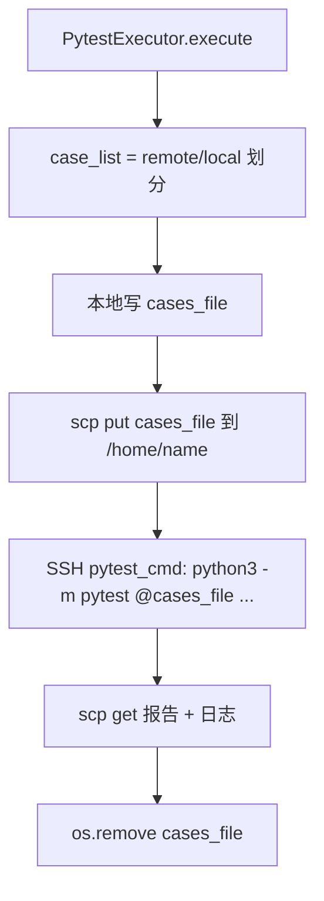
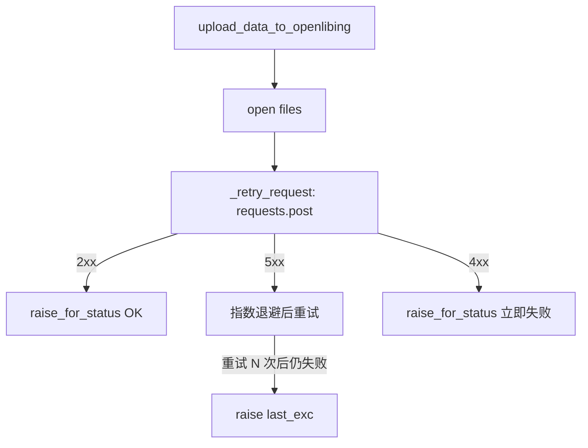

# scheduler-reliability-202610 — 技术设计

## 方案概述

三个子需求各自独立，但都集中在 `pytest-executor` 的可靠性与抗误操作能力。整体方案沿用现有架构与命名风格，最小化外部接口变化：

- 子需求 1：替换 `pytest_executor.py` 中 testkit 安装链路，参数改名断老调用点。
- 子需求 2：复用 `api_handler._retry_request` 重试机制加固 openlibing 报告上传。
- 子需求 3：引入 pytest 7.0+ `@file` 语法，三种执行模式统一在落盘 cases_file 后执行。

## 架构决策

### 1. whl 兜底参数改名（兼容而非暴力拒绝）

**决策**：将 `argparse` 中 `--pytest_testkit_path` 改名为 `--pytest_testkit_whl_path`，但**保留老参数作为兼容**。两个参数都用 `argparse.SUPPRESS` 隐藏帮助文档，避免在 `--help` 中暴露"whl 安装"这个面向内部 testkit 开发测试的入口；老参数传值时仅 `logger.warning` 提示并静默忽略（不阻断调度，仍走 pip install）。

**原因**：用户希望"老脚本没同步修改时不要阻塞调度，而是安静地切到 pip install pytest-testkit"；同时 `pytest_testkit_whl_path` 是面向 testkit 包开发/测试场景的内部参数，正式使用一律走 pypi 拉取，不应在 `--help` 中作为正式选项出现。

**老参数的唯一语义**（功能描述与 AC-1 必须一致）：

| 参数                          | 行为                                                                 |
| ----------------------------- | -------------------------------------------------------------------- |
| `--pytest_testkit_whl_path`   | 按 whl 安装（内部开发/测试场景）                                     |
| `--pytest_testkit_path`（旧） | **仅打 deprecation 警告，强制走 pip install**，不按 whl 安装、不报错 |

老参数**不做 argparse 报错**——报错会阻断存量调度脚本，与"不要阻塞调度"的决策冲突。代价是旧调用方显式锁定的 whl 版本会被降级为镜像源中的版本，因此版本复现需以目标机实际安装版本为准（见「实现要点」的记录要求）。

**实现要点**：

- `Config` 内部仍保留 `pytest_testkit_path` 字段（避免连片重命名），由 `main.py` 把新参数值写进去；
- 老参数传值时仅打 `logger.warning(...)` 提醒, 不再驱动 whl 安装，强制走 pip；
- `requirements.txt` 已含 `pytest-testkit`，`pyproject.toml` 的 `dependencies` 同步补齐。

### 2. testkit 默认走 pip，来源复用现有 mirror

**决策**：default 走 `pip install --upgrade pytest-testkit`，pip 源 / 超时 / 重试沿用 `Config.python_mirror_repo` / `pip_timeout_seconds` / `pip_retries`。

**原因**：避免在 `pytest_executor.py` 内部重新定义 pip 源；与 `requirements.txt` 安装链路统一。

**版本策略**：采用**浮动升级**而非固定版本约束。理由：testkit 与 executor 同仓同节奏发布，固定版本会在 testkit 发版后导致目标机装到旧版、采集行为与本地不一致；浮动升级保证目标机始终拿到最新兼容版本。

代价与缓解：

- 目标机安装版本随镜像源变化 → **问题复现前先记录 `pip show pytest-testkit` 的实际版本**；
- 镜像源复用 `Config.python_mirror_repo`（公司内网源），不使用公网 PyPI，避免同名包被替换。

**代码骨架**：

```python
if self.pytest_testkit_whl_path:
    # whl 兜底：直接 install 本地 whl
    install_cmd = f"python3 -m pip install --force-reinstall --no-cache-dir {whl} {pip_args} -q"
else:
    # 默认：远程 pip 装最新（浮动升级）
    install_cmd = f"python3 -m pip install --upgrade --no-cache-dir pytest-testkit {pip_args} -q"
```

### 3. 重试参数与 K8s API 完全对齐（仅 openlibing 上传）

**决策**：复用 `api_handler._RETRY_MAX_ATTEMPTS=3` / `_RETRY_INITIAL_BACKOFF=1.0` / `_RETRY_BACKOFF_FACTOR=2.0` / `_RETRY_RETRYABLE_STATUS={500,502,503,504}`，不上 Config。作用范围限定为 openlibing 报告上传。

**原因**：用户明确要求与 K8s API 保持一致；行为统一便于全链路统一观测。对象存储上传链路并发度高，重试会拉长整次上传耗时，本期不纳入。

**实施**：

- `ApiHandler.upload_data_to_openlibing`：把 `requests.post(...)` 拆成"open files" + "lambda 调用 _retry_request"，文件句柄在 retry 之间保持打开（`requests` 内部 `read()` 后游标到底，retry 需 `f.seek(0)` 重置或每次重新打开）。

**幂等性决策**：openlibing 上传是写操作（报告与元数据落库），对非幂等 POST 做自动重试时存在「请求已被服务端处理但响应丢失」的典型场景（连接被中断、网关 502/504、服务端提交成功后才 5xx），此时客户端判定失败并重试，服务端会收到同一份报告的第二、第三次写入。

- 本期**不引入幂等键**：上传接口当前不提供服务端去重能力，新增幂等键需服务端配套改造，超出本期范围。
- 补偿方式：重复写入落在同一 `pipelineId` / `pipelineRunId` / `jobId` 维度，由服务端按任务维度覆盖、或由下游统计侧按任务去重消化；日志中标注 `retry N/M` 便于排查重复记录。
- **残留风险**：若服务端未按任务维度去重，重试可能产生重复的 report / 元数据记录，导致下游统计与用例通过率被重复计算。已登记在风险表，需在后续迭代评估服务端幂等键方案。

### 4. 用例名文件化

**决策**：所有 pytest 执行模式统一 `python -m pytest @<cases_file> <other args>`，cases_file 每行一个 nodeid。

**原因**：

- `pytest @file` 语法在 pytest 7.0+ 原生支持，仓库 `requires-python = ">=3.10"`、`pytest>=7.0` 已声明；
- 直接避免 cmdline 出现具体用例名，运维 `pkill -f <case_name>` 不再命中 pytest 调度进程。

**实现要点**：

- 新增 helper `_write_cases_file(case_ids, target_path) -> Path`：
  - 每行一个 case_id；
  - 校验非空、`strip()` 去除空白、过滤空行；
  - 写出后 `chmod 0o600` 防止并发读取。
- runner 模式：cases_file 落在 `home_path`（`/home/<name>/.cases_<suffix>.txt`），cwd 切到 `home_path` 后 `pytest @<file>`。
- remote 模式：cases_file 落在 `self.test_dir`，`subprocess.Popen(cwd=self.test_dir, cmd=[sys.executable, "-m", "pytest", "@<file>", ...])`。
- local 模式：本地写 `cases_file` → scp 上传到 `/home/<name>/.cases_<suffix>.txt` → 远端 pytest cmdline 引用。

**命名约束**：`<suffix>` 取自 `generate_random_string()`（大小写字母 + 数字，长度 8），**不来自用例名、task_id 等外部可控字段**。

- **路径安全**：随机串不含路径分隔符与 `..`，写入路径不会逃逸出 `self.test_dir` / `/home/<name>`；
- **并发唯一**：同一目标机上并发执行两个任务时随机串不同，文件名不冲突，后执行者不会覆盖前者的 cases 文件（否则 pytest 会按错误的用例集合执行，静默少跑 / 错跑用例）。

**清理**：执行完（无论成功失败）`os.remove(cases_file)`，避免 `/home` 长期堆积。清理需覆盖 pytest 非 0 返回、SSH 中断、异常退出等分支——这些路径与需求背景中的"临时文件泄漏"属同类问题，缺一个分支就会在目标机 `/home/<name>` 持续残留 cases 文件。

### 5. 失败语义保持

- `upload_data_to_openlibing` retry 全部失败仍 `raise`（保持原 `run_scheduler.run()` 错误处理路径）。
- pytest exit code != 0 仍视为用例失败，行为不变。

## 涉及文件

| 文件                                                       | 操作 | 说明                                                          |
| ---------------------------------------------------------- | ---- | ------------------------------------------------------------- |
| `pytest-executor/main.py`                                  | 修改 | argparse 参数改名                                             |
| `pytest-executor/src/scheduler/scheduler_config.py`        | 修改 | 字段名沿用 `pytest_testkit_path`（deprecated），加注释        |
| `pytest-executor/src/executor/pytest_executor.py`          | 修改 | testkit 安装逻辑 + 三处 cases_file 落地 + `pytest @file` 替换 |
| `pytest-executor/src/api/api_handler.py`                   | 修改 | `upload_data_to_openlibing` 接入 `_retry_request`             |
| `pytest-executor/src/scheduler/env_manager.py`             | 修改 | 合入未提交的小改动（日志位置）                                |
| `pytest-executor/pyproject.toml`                           | 修改 | `dependencies` 补 `pytest-testkit`                            |
| `pytest-executor/tests/test_api_handler_retry.py`          | 新增 | openlibing 上传重试单测                                       |
| `pytest-executor/tests/test_pytest_executor_cases_file.py` | 新增 | cases_file 落盘内容、特殊字符处理、cmdline 构造               |

## 核心流程

### 用例名文件化（local 模式为例）



### 上传重试（openlibing 上传为例）



## 风险 & 缓解

| 风险                                               | 影响 | 缓解措施                                                                                                                                                                                                                  |
| -------------------------------------------------- | ---- | ------------------------------------------------------------------------------------------------------------------------------------------------------------------------------------------------------------------------- |
| retry 期间 openlibing 上传重复写                   | 中   | 重复写入落在同一 pipelineId/pipelineRunId/jobId 维度，由服务端按任务维度覆盖或下游按任务去重消化；日志清晰标注"retry N/M"。**残留风险**：服务端若未按任务维度去重，重复写入会重复计算下游统计，需后续迭代评估服务端幂等键 |
| 远端 `pytest @file` 不可用（pytest < 7）           | 高   | 启动时 `pytest --version` 自检，失败则报错                                                                                                                                                                                |
| `pip install pytest-testkit` 网络不可达            | 中   | whl 兜底（`--pytest_testkit_whl_path`）                                                                                                                                                                                   |
| testkit 版本浮动，目标机版本不可复现               | 中   | 镜像源复用公司内网 `python_mirror_repo`；问题复现前先记录 `pip show pytest-testkit` 的实际版本                                                                                                                            |
| cases_file 在 `/home` 残留                         | 低   | 收尾 `os.remove`；异常路径用 try/finally 兜底；清理覆盖 pytest 非 0 返回 / SSH 中断 / 异常退出分支                                                                                                                        |
| cases_file 名冲突或路径逃逸                        | 中   | `<suffix>` 取自 `generate_random_string()`（字母数字随机串），不含外部可控字段与路径分隔符，天然避免路径逃逸与并发覆盖                                                                                                    |
| 老脚本传 `--pytest_testkit_path` 被降级为 pip 安装 | 中   | 老参数仅打 deprecation 警告不报错，不阻断调度；显式锁定的 whl 版本会降级为镜像源版本，需按实际安装版本复现                                                                                                                |
| 终态（404/409）时主流程不感知                      | 中   | 停线程 + ERROR 日志，调用方（`SchedulerRunner`）后续在 future 收集阶段检查心跳 client 是否仍有对应记录                                                                                                                    |
| 心跳线程与主流程 race                              | 低   | 用 `threading.Event` 同步 + daemon=True 主流程退出时线程自动结束                                                                                                                                                          |
| `ttl_seconds` 配成 0/1/2 时 `interval=0` 忙循环    | 中   | `interval <= 0` 一律 WARNING 并 `start()` 直接 return；同时对 `ttl_seconds` 做下限校验（不小于 3）                                                                                                                        |
| 调试模式 `health_ttl=-1` 透传到 K8s 申请 payload   | 高   | 申请 payload 过滤哨兵值（发默认值 600 或不发送），避免环境被立即判死回收或因参数校验失败导致申请失败                                                                                                                      |
| 调试模式忘关导致环境长期占用                       | 高   | `--debug_keep_env` 在 `argparse` 中标记 `SUPPRESS`，不在 `--help` 暴露；调度机启动脚本方需手动添加；**另在启动处与每次跳过释放处打 WARNING 日志**，便于巡检发现被遗忘的开关                                               |

## 跨仓影响

无跨仓影响。本次仅在 `openlibing-pytest-executor/pytest-executor/` 内部修改；父 issue #65 中其他子项不在本次范围。

---

## 子需求 4 设计补充

### `_validate_execution_results` xml 缺失兜底

**问题**：原代码 `if local_results_xml and local_results_xml not in xml_files:` 在 `local_results_xml = None` 时短路跳过整段校验。

**决策**：在循环内根据 `case_list` 的 `remote_run` 标记判断"该 env 是否预期有 local/remote case"，预期有但 xml 字段为 None → 直接 return False。

**代码骨架**（[run_scheduler.py:188-217](file:///c:/work/code/openlibing/openlibing-pytest-executor/pytest-executor/src/run_scheduler.py#L188-L217)）：

```python
for env_case_info in env_block_list:
    case_list = env_case_info.get("case_list", []) or []
    has_local_cases = any(not case.get("remote_run") for case in case_list)
    has_remote_cases = any(case.get("remote_run") for case in case_list)

    local_results_xml = env_case_info.get("local_results_xml")
    remote_results_xml = env_case_info.get("remote_results_xml")

    if has_local_cases and not local_results_xml:
        return False  # local 失败被吞
    if local_results_xml and local_results_xml not in xml_files:
        return False
    if has_remote_cases and not remote_results_xml:
        return False
    if remote_results_xml and remote_results_xml not in xml_files:
        return False
```

**遗留**：silent degradation 的另一个源头（`_execute_remote_cases` 内部 `_prepare_test_environment` 返回值被丢弃）不在本次修复范围，另起 issue 跟踪。

---

## 子需求 5 设计补充

### 心跳保活架构

**决策**：在 `api_handler.py` 新增 `send_heartbeat_k8s(env_id) -> (status, body)` 静态方法（一次性发送，不重试当前次，行为与 K8s API 不同——按心跳协议"按原间隔等下次自然 tick"），和 `LeaseHeartbeatClient` 类（管理 daemon 线程 + 状态码分发）。

**线程模型**：

- `threading.Thread(daemon=True, name="hb-{env_id}")`
- 主循环 `while not self._stop_event.is_set(): self._send_one_with_log(); self._stop_event.wait(self.interval)`
- `interval = ttl_seconds // 3`，ttl=600 → 200s
- **`interval <= 0` 一律打 WARNING 并 `start()` 直接 return**：这覆盖了调试模式 `ttl_seconds=-1`（`interval=-1`），也覆盖 `ttl_seconds` 配成 0 / 1 / 2 的边界（`interval` 分别算出 0 / 0 / 0）。若只在 `interval < 0` 时拦截，`ttl=1` 或 `ttl=2` 会算出 `interval=0`，主循环的 `Event.wait(0)` 立即返回，线程变成**无间隔忙循环**，持续打心跳请求直到任务结束。
- 对 `ttl_seconds` 同时做下限校验（正常模式下不允许小于 3），避免配置笔误退化成忙循环。

**状态码处理**：

| 状态            | 行为                                                       |
| --------------- | ---------------------------------------------------------- |
| 200             | DEBUG 日志含 `last_heartbeat_at`，**不维护**任何客户端状态 |
| 404/409/400     | ERROR 日志 + `self.stop(reason="http_xxx")`                |
| 5xx / status=-1 | WARNING 日志，**不重试当前次**，下次自然 tick              |

**env_id 唯一标识**：K8s 流程下资源标识统一用 env_id，客户端不维护额外字段。心跳接口路径 `/api/v1/envs/{env_id}/heartbeat`，请求体只带必要字段。

**调试模式集成**：

- `Config.lease_health_ttl_seconds = -1` → `LeaseHeartbeatClient.start()` 不创建线程
- `Config.debug_keep_env = True` → `EnvironmentManager.release_env` / `release_all` 内部跳过
- 主流程 `_allocate_environments_and_execute` finally 块调 `stop()` 幂等
- **哨兵值不得原样透传**：`lease_health_ttl_seconds = -1` 仅用于本地抑制心跳线程。K8s 申请 payload 中的 `health_ttl` 需过滤该哨兵值（发送默认值 600 或不发送该字段）——原样透传 `-1` 会让调度服务按「TTL 已过期」立即判死回收刚申请的调试环境，或因参数校验失败返回 4xx 导致申请直接失败，两种结果都会让 `--debug_keep_env` 失效。
- **调试模式必须打 WARNING 日志**：仅靠 `argparse.SUPPRESS` 隐藏开关不够——参数不出现在 `--help` 中，但仍可能被写进调度机启动脚本。`debug_keep_env` 打开时需在调度启动处与每次跳过释放处打 WARNING，便于巡检发现被遗忘的开关（否则环境会长期占用且无明显痕迹）。

**与 K8s API retry 策略的本质区别**：

- K8s API（`apply_env_k8s` / `check_env_status_k8s` / `release_env_k8s`）：**5xx 立即指数退避 1→2→4s 重试 3 次**，因为单次调用是同步阻塞的
- 心跳：5xx **不重试当前次**，等下次自然 tick（200s 后）—— 因为调度端有超时容错，单次抖动不影响判死

### 心跳日志规范

| 事件           | 级别     | 内容                                                                                                              |
| -------------- | -------- | ----------------------------------------------------------------------------------------------------------------- |
| 线程启动       | INFO     | `Heartbeat started for env_id=..., interval=...s`                                                                 |
| **每轮发送**   | **INFO** | `Heartbeat sending for env_id=...`（运维 grep 用）                                                                |
| 200 成功       | DEBUG    | `Heartbeat OK for env_id=..., last_heartbeat_at=...`                                                              |
| 404/409/400    | ERROR    | `Heartbeat xxx for env_id=...: lease terminal. Stopping heartbeat thread.`                                        |
| 5xx / 网络异常 | WARNING  | `Heartbeat failed (transient, will retry on next tick): env_id=..., status=...`                                   |
| 线程停止       | INFO     | `Heartbeat stopped for env_id=..., reason=...`（reason: normal / http_404 / http_409 / http_400 / task_finished） |
